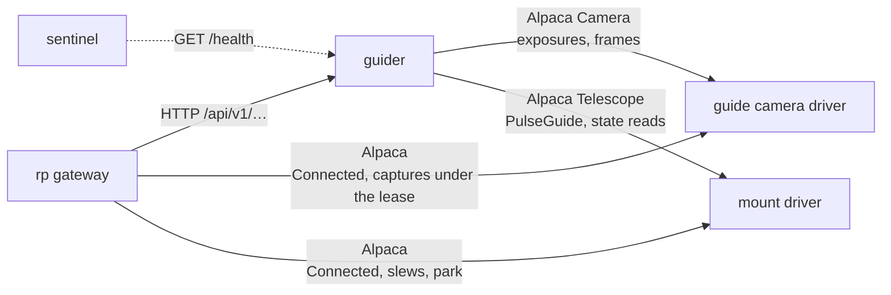

# guider — Service Design

## Overview

`guider` is an **rp-managed service** that keeps a mount on its target
while an exposure runs. It takes frames from one ASCOM Alpaca Camera,
measures how far a set of guide stars has moved, and corrects the mount
with `PulseGuide` on one ASCOM Alpaca Telescope. `rp` commands it over
an HTTP API.

**The service is designed and not yet built.** This document is the
design the implementation is written against.
[ADR-024](../decisions/024-native-guider-as-a-standalone-alpaca-client-service.md)
records why rusty-photon guides with a guider of its own and why that
guider is a standalone service.
[`docs/plans/native-guider.md`](../plans/native-guider.md) holds the
evidence and orders the work in stages G0 to G7. Until stage G6 moves
`rp` to the contract below, the rigs guide through
[`phd2-guider`](phd2-guider.md) and `rp` speaks that service's contract.

Four properties shape the design:

- **It is an Alpaca client application, not an Alpaca device.** The
  standard has no guider device type. The guider's own server serves
  the HTTP API of this document, a setup page and `/health`.
- **It is headless and wraps no other program.** It needs no desktop
  session, no display and no vendor SDK. The guide camera stays on its
  rusty-photon driver and in `rp`'s roster.
- **It holds the guide loop itself.** A guiding run lives in the
  service's memory, so a restart of the service ends the run and the
  service starts idle. On disk it keeps the calibration and the guide
  logs, nothing else.
- **Its authority over the devices is fixed.** It sends `PulseGuide`
  and no other command to the mount, it exposes only while no client
  holds the [camera lease](#the-camera-lease), and it never changes
  `Connected` on either device.

**Cross-platform support:** Linux x64, Linux aarch64 (Pi 5), macOS
Apple Silicon and Windows x64, as a service with nobody logged on.

## Architecture



`rp` and the guider are both clients of the guide camera and of the
mount. The division is fixed: `rp` connects and disconnects the
devices, slews and parks the mount, and exposes on the guide camera
only while it holds the guider's camera lease. The guider exposes on
the camera while nobody holds the lease, and sends guide pulses.

### Pieces

| Piece | Kind | Holds |
|---|---|---|
| `rp-guiding` | Library crate | The guiding core: star selection, measurement, calibration, control, dither, settle, statistics and the state machine. Frames and timestamps in, pulse requests and statistics out. No I/O; time and randomness are passed in, so a whole night runs under test in simulated time |
| `rp-image-analysis` | Library crate | The image kernels `rp` and the guider share: background, star detection, centroid, half-flux diameter, signal-to-noise ratio |
| `rp-guider` | Library crate | The HTTP contract of this document: request and response types, the error codes, and the client `rp` uses |
| `guider` | Service, port 11129 | The Alpaca clients, the loop that drives the core, the HTTP API, the setup page, the calibration store and the guide log |
| `guide-simulator` | Test-infrastructure crate | A mount model and a star renderer behind an Alpaca Camera and an Alpaca Telescope: drift, periodic error, backlash, pulse granularity and seeing, with the stars moving as the pulses say |

### Alpaca members used

| Device | Members | Access |
|---|---|---|
| Camera | `Connected` | Read |
| Camera | `CameraXSize`, `CameraYSize`, `PixelSizeX`, `SensorType`, `MaxADU`, `MaxBinX`, `CanAbortExposure` | Read once per connection, and again after a failed frame |
| Camera | `BinX`, `BinY`, `StartX`, `StartY`, `NumX`, `NumY`, `Gain`, `Offset` | Written when the guider starts to expose, and again after a failed frame |
| Camera | `StartExposure`, `ImageReady`, `ImageArray` (as ImageBytes), `AbortExposure` | The frame cycle |
| Telescope | `Connected` | Read |
| Telescope | `CanPulseGuide` | Read once per connection |
| Telescope | `Tracking`, `Slewing`, `AtPark`, `SideOfPier` | Read before every pulse |
| Telescope | `Declination`, `GuideRateRightAscension`, `GuideRateDeclination` | Read when a run starts |
| Telescope | `RightAscension`, `Altitude`, `Azimuth`, `SiderealTime` | Read when a run starts, for the guide log only |
| Telescope | `PulseGuide`, `IsPulseGuiding` | The only command, and its completion |

The guider is a client of no SafetyMonitor. Safety is `rp`'s
([rp.md § Safety](rp.md#safety)): `rp` stops guiding and parks the
mount, and the guider's own [mount check](#the-mount-checks-and-pulses)
stops a run when the mount parks or slews, whoever asked for it.

## Alignment with the tenets

- **Project tenet 1 — make the best use of night time.** A stored
  calibration is used again on later nights, so a rig that calibrates
  within 60° of the celestial equator calibrates once for each pier
  side. A run that loses its stars keeps looking for them and takes up
  guiding when they return. The closed-loop simulator and a replay of
  recorded frames run before the first night on sky, so that nights
  confirm behaviour and do not debug it.
- **Project tenet 2 — robustness.** The configuration is validated when
  it is loaded. The guider runs in a process of its own and keeps
  guiding while `rp` restarts. When it cannot guide safely it stops and
  says why with a named reason; it never guesses.
- **Project tenet 3 — no actuation on connect.** The service is idle
  after every start. Nothing but a client's request makes it expose,
  calibrate or send a pulse: see [Starting idle](#starting-idle).
- **`rp` tenet 4 — remote interfaces only.** The guider speaks Alpaca
  to its devices and HTTP to `rp`. It links no vendor SDK and drives no
  ST4 port.
- **`rp` tenet 5 — minimal footprint.** The guider holds one frame and
  a window of 50 measurements in memory. It runs on a Raspberry Pi 5
  beside the drivers and `rp`.

The project tenets are in
[workspace.md § Project Tenets](../workspace.md#project-tenets), `rp`'s
in [rp.md § Tenets](rp.md#tenets).

## Behavioral Contracts

### States

The guider is always in one of six states. `GET /api/v1/guiding/stats`
reports the state.

| State | Exposures | Pulses | Meaning |
|---|---|---|---|
| `idle` | No | No | Nothing runs. The state after every start |
| `looping` | Yes | No | Frames are taken and measured, for a person who frames or focuses and for the per-frame metrics |
| `calibrating` | Yes | Calibration steps | The guider learns what a pulse in each direction does to the stars |
| `guiding` | Yes | Corrections | The guide loop is closed |
| `paused` | Yes, or no with `full` | No | A client paused the corrections |
| `star_lost` | Yes | No | Too few of the guide stars are usable. The guider keeps looking |

`calibrating`, `guiding`, `paused` and `star_lost` are the **run
states**. A **run** begins when a `calibrate` or `guiding/start`
request is accepted and ends when the state returns to `idle` or
`looping`.

| From | Trigger | To |
|---|---|---|
| `idle` | `loop` | `looping` |
| `idle`, `looping` | `calibrate` | `calibrating`, then the state it came from |
| `idle`, `looping` | `guiding/start` | `calibrating` when no stored calibration can be used, then `guiding` |
| `guiding` | A star-lost frame | `star_lost` |
| `star_lost` | A frame with the stars back | `guiding` |
| `guiding`, `star_lost` | `guiding/pause` | `paused` |
| `paused` | `guiding/resume` | `guiding` |
| `guiding`, `paused`, `star_lost` | `guiding/start` | `guiding` ([`guiding/start`](#post-apiv1guidingstart) says what it keeps) |
| Any but `idle` | `guiding/stop` | `idle` |
| A run state, `looping` | [A stop of the guider's own](#stopping-on-its-own) | `idle` |

Settling is not a state. While a `guiding/start` or a `dither` waits
for the stars to settle, the state is `guiding` and `stats` reports
`settling: true`.

### Starting idle

- **The state after every start is `idle`.** The guider takes no frame
  and sends no pulse because it started or restarted. It does not take
  up a run that was in progress when the process ended.
- **Finding a device again starts nothing.** When the camera or the
  mount answers again, or reports `Connected` again, the guider reads
  the device's static properties and stays in its state. The one
  exception is a stop: a run does not go on with
  [a camera that came back changed](#the-camera-loop).
- **Saving the configuration starts nothing.** A save on the setup page
  is written to the file and takes effect at the next start.
- **A service with no devices configured runs.** The default
  configuration names no camera, no mount and no focal length. The
  service starts with it, `/health` answers `503` and says what is
  missing, and every request that would expose or move is refused with
  `not_configured`. The [setup page](#setup-page) is where an operator
  fills them in.

### Devices and connections

The guider is a client of the Camera and the Telescope named in
`devices`. It reaches them as `rp` reaches its devices: `ca_cert` is
the root it trusts for an `https://` address, and a device's `auth`
block sends HTTP Basic Auth credentials.

**The guider never writes `Connected`.** `rp` owns device connections.
A device that is not connected is reported and never connected by the
guider. Used without `rp`, the rig's operator connects the devices
with any Alpaca client.

**The device poll.** In every state the guider reads `Connected` on
both devices every `devices.poll_interval`. On the first read that
finds a device connected, and again whenever a device comes back, it
reads that device's static properties: the camera's sensor size, pixel
size, sensor type, `MaxADU`, `MaxBinX` and `CanAbortExposure`, and the
mount's `CanPulseGuide`. The poll only reads. `GET /api/v1/devices` and
`/health` answer from its results.

**At a request.** `loop`, `calibrate` and `guiding/start` read
`Connected` afresh before anything else. A device that does not answer
refuses the request with `device_unreachable`; one that answers and is
not connected refuses it with `device_not_connected`. When the poll has
not yet read a connected device's static properties, the request reads
them before it goes on, so no request runs on a property that is
missing.

**A call that gets no answer.** Every call to a device has a deadline:
a call with no answer after 10 s has failed, as one that returns an
error has. A `PulseGuide` call may last as long as its pulse, and
`mount.pulse_timeout` bounds it. The fetch of a frame is bounded by
`camera.frame_timeout` and not by the 10 s. Ten seconds is a starting
value of this design.

**While `rp` is away.** The guider does not depend on `rp` being
reachable. A run continues through a restart of `rp`.

### The camera loop

In every state but `idle` (and a full pause) the guider takes one frame
after another. One cycle is:

1. **Expose.** `StartExposure` for `camera.exposure`, then `ImageReady`
   is polled until it is true, then the frame is fetched as ImageBytes.
2. **Measure.** The core measures the guide stars and, in a run state,
   decides the pulses.
3. **Check the mount and pulse**, in a run state only: see
   [The mount: checks and pulses](#the-mount-checks-and-pulses). The
   RA pulse is sent first and awaited, then the Dec pulse.
4. The next exposure starts when the pulses have ended. A pulse never
   overlaps an exposure.

**Frame settings.** Each time the guider leaves `idle` it writes the
binning, the region (the full frame at that binning) and, when
`camera.gain` or `camera.offset` is set, the gain and the offset. A
`null` gain or offset leaves the camera's value as the last client left
it. The settings are written again after every frame failure. Another
client may change them only under the [lease](#the-camera-lease), and
the lease is granted only in `idle`, so settings written on leaving
`idle` hold for as long as the guider exposes.

**Frame failures.** A frame fails when a camera call fails, when the
frame has not arrived `camera.frame_timeout` after its exposure should
have ended, or when its dimensions are not the ones the guider asked
for. A failed frame is discarded and no pulse follows it. After
`camera.max_frame_failures` consecutive failures the guider stops with
the reason `camera_error`.

**A camera that comes back changed.** A run's calibration, pixel scale
and star positions belong to the sensor it started on. A camera that
comes back during a run with a sensor size, pixel size or sensor type
other than the run started with stops the run with `camera_error`. The
guider learns of it from the camera's static properties. It reads them
when the [device poll](#devices-and-connections) finds the camera
again, and after every frame failure, before it writes the frame
settings again; a read that fails there fails the next frame.

**Stopping the loop.** When the loop ends for any reason the guider
aborts its own exposure if the camera reports `CanAbortExposure`, and
waits for it to end otherwise. It never aborts an exposure it did not
start: while the lease is held it has none.

**One frame in memory.** The guider keeps the latest measured frame,
for `GET /api/v1/frame/latest`, and writes no frame to disk.

### Sensor handling

The guider measures a single-channel frame. What it does with the
camera's frame depends on `SensorType`:

| `SensorType` | Reading | Effective binning |
|---|---|---|
| `Monochrome` | The frame as read, with `camera.binning` as hardware binning on both axes | `camera.binning` |
| `RGGB` | Read unbinned; each 2×2 cell is summed into one pixel in software | 2 |
| Any other | Refused with `camera_unsupported` | — |

- Any 2×2 cell of a Bayer mosaic holds one red, two green and one blue
  pixel wherever the cell starts, so the summed frame is a luminance
  frame and the Bayer offsets do not matter.
- An `RGGB` camera requires `camera.binning` to be 1; a `Monochrome`
  camera requires `camera.binning` to be at most `MaxBinX`. Both are
  checked when a request starts the loop, since the sensor type is the
  camera's to report, and a breach is refused with `camera_unsupported`.
- **Pixels** in this document, in the configuration and on the wire are
  pixels of the measured frame, after binning or summing; a camera's
  `width` and `height` are its `CameraXSize` and `CameraYSize`, in the
  camera's pixels.
- **Saturation.** A star with a pixel at full scale is not chosen as a
  guide star. Full scale is the saturation level of the camera's frame,
  by the rule `rp` measures with
  ([rp.md § MVP: `measure_basic` Contract](rp.md#mvp-measure_basic-contract)):
  the frame's own clip when it shows one, `MaxADU` otherwise, and the
  lower of the two when both are known. `MaxADU` alone is not enough:
  `qhy-camera` reports the top of its 16-bit container, and its frames
  clip below it. A star that clips on four pixels of the camera's frame
  or fewer, in a frame where nothing else reaches the clip, is not seen
  as saturated when `MaxADU` lies above the clip. A pixel of a summed
  frame is at full scale when any of the four camera pixels summed into
  it is at or above that level, which the guider judges on the camera's
  frame before it sums: a star whose green pixels clip is saturated
  although its sums stay below four times the level.

### The camera lease

An Alpaca camera has one exposure in flight and one image for all its
clients, and the standard has no session that would tell them apart.
`rp` needs the guide camera for itself at times: a focus sweep of the
guiding train, a plate solve through it. The guider serves a lease so
that the two never expose at once.

- **A client acquires the lease with a token it chooses**: 32 lowercase
  hexadecimal digits, new for every lease. Because the client names the
  token, an acquire it repeats after a lost answer is the same lease
  and not a second one.
- **The lease is granted only in `idle`**, with no mutating request in
  flight or queued. Otherwise the answer is `not_idle`. An acquire is
  answered at once against the state as it is; it never waits.
- **One lease at a time.** While one token holds the lease, an acquire
  with another token is refused with `camera_leased`.
- **A lease lasts for its `ttl`** and is renewed by its holder. When it
  expires it ends without notice, so a holder that died does not keep
  the guider from exposing for longer than that. No request ends a
  lease without its token, so the lease of a holder that died or
  restarted ends only when its `ttl` runs out. A holder asks for a
  short `ttl`, 60 s by default, and renews it.
- **While a lease is held**, `loop`, `calibrate` and `guiding/start`
  are refused with `camera_leased`, and the guider sends the camera
  nothing but the reads of the device poll.
- **The lease lives in memory.** After a restart of the guider nobody
  holds it. A holder whose renewal is answered with `lease_not_found`
  has lost it and acquires again before its next exposure.
- **`guiding/stop` does not touch the lease.**
- **The lease binds its two parties.** It keeps `rp` and the guider
  apart. A third Alpaca client that commands the camera is outside it.

The endpoints are under
[`/api/v1/camera/lease`](#post-apiv1cameralease).

### The mount: checks and pulses

**The only command the guider sends the mount is `PulseGuide`.** It
never slews, parks, unparks, sets tracking or writes a guide rate.

**The mount check.** Before every pulse, and once in every cycle of a
run state that sends none, the guider reads `Tracking`, `Slewing`,
`AtPark` and `SideOfPier`. The run continues only while the mount is
tracking, not slewing, not parked and on the pier side the run started
on. Otherwise the run stops, with the reason `mount_not_tracking`,
`mount_slewing`, `mount_parked` or `pier_side_changed`. The guider does
not wait for the mount to come back and does not resume: a mount that
slewed has moved the stars, and starting again is its client's
decision.

- The check runs in `paused` and `star_lost` too. A slew is the usual
  reason for losing the stars, and it must end the run all the same.
  In a full pause, with no frames, the check runs once per
  `camera.exposure`.
- A mount that reports no pier side, or reports it unknown, gives the
  run the side `unknown`, and the pier side is not checked. A meridian
  flip of such a mount is one of the things the guider cannot see
  ([Calibration](#calibration)): the client that flips it clears the
  calibration store before the next run.
- The check is the guider's because a driver's is not enough: the Star
  Adventurer GTi driver accepts a pulse while tracking is off
  ([star-adventurer-gti.md § PulseGuide lifecycle](star-adventurer-gti.md#pulseguide-lifecycle)).
- The check does not run in `looping`: no pulse is sent there.

**At a request.** `calibrate` and `guiding/start` run the same check
before they start, and read `CanPulseGuide`. A mount that fails either
refuses the request with `mount_not_ready`, and the message names what
failed.

**A pulse.** The guider calls `PulseGuide` with a direction and a
duration. The pulse has ended when the call has returned, the duration
has passed and `IsPulseGuiding` reads false. A pulse still in progress
`mount.pulse_timeout` after its duration stops the run with
`pulse_timeout`.

**Bounds.**

- No pulse is longer than `mount.max_pulse`.
- A correction that works out shorter than `mount.min_pulse` is not
  sent. A mount whose driver delivers short pulses coarsely sets this
  at or above its granularity. The GTi's RA granularity is in its
  [§ PulseGuide lifecycle](star-adventurer-gti.md#pulseguide-lifecycle):
  a West pulse shorter than its trim delivers the edge steps alone. Its
  Dec granularity is not measured, and the plan's stage G5 settles
  `mount.min_pulse` on sky.
- No pulse is sent in `looping`, `paused` or `star_lost`, or after a
  frame that failed.

**A mount that does not answer.** A cycle in which a mount read or a
`PulseGuide` call fails sends no further pulse. A mount read that gets
no answer fails at the [deadline of a call](#devices-and-connections).
After `mount.max_failures` consecutive such cycles the run stops with
`mount_unreachable`.

### Star selection and measurement

**Selection.** The guider detects the stars of one frame and keeps up
to `stars.max` of them as its guide stars, ranked by signal-to-noise
ratio. A detection is passed over when it is saturated, when it is
closer to the frame's edge than `calibration.distance_px` plus
`stars.search_region_px`, when it is too sharp to be a star (a hot
pixel), or when another star is so close that the two would be
confused. A frame that yields no guide star refuses `calibrate`,
`guiding/start` and `star/reselect` with `no_stars`. `loop` is not
refused: it answers with a `star_count` of 0, and the guider selects
again on each frame of `looping` until one has stars.

Selection happens on the first frame of `looping` and on each later one
until a frame has stars, when a run begins from `idle` or `looping`,
and on `star/reselect`. The guider never selects stars again on its own
in the middle of a run.

**Measurement.** In each later frame every guide star is looked for
within `stars.search_region_px` of its position in the last frame in
which it was usable. A star is **usable** in a frame when its
signal-to-noise ratio is at least `stars.min_snr`, it is not too sharp
to be a star, and its flux is within `stars.mass_change` of its
reference, the median of its flux over its last ten usable frames, or
over all of them while it has fewer. The frame a star was selected in
is its first usable frame. The frame's offset is the median, on each
sensor axis, of the usable stars' offsets from their reference
positions.

**A change of brightness that lasts.** A frame that fails the flux test
adds nothing to the reference, so a change larger than
`stars.mass_change` that lasts, as when haze clears or thin cloud
settles in, fails the test in every frame that follows. A star that
fails only the flux test in ten frames in a row therefore starts its
reference again from those ten: they take the place of its last ten
usable frames, so the frames from before the change no longer count,
and each usable frame after them takes its place among the ten. The
sharpness test keeps a hot pixel from becoming the reference while the
star is behind cloud, and ten frames in a row keep out noise that
reaches `stars.min_snr` in a frame now and then. Ten is a starting
value of this design, for the frames the reference is taken over and
for the frames in a row alike.

**A star-lost frame** is one with fewer than `stars.min` usable stars.
It gives no offset and is followed by no pulse. In `guiding` it moves
the state to `star_lost`; the first later frame with enough usable
stars moves it back. The guider waits for the stars for as long as the
run lasts, and it looks for each one only around the position it was
last usable at. With no correction sent, the field drifts, and stars
that drifted further than `stars.search_region_px`, behind a long cloud
or in a long full pause, are not found again: the run then stays in
`star_lost`. A client that has waited long enough stops the run or asks
for a new selection, with [`star/reselect`](#post-apiv1starreselect) or
`guiding/start`. A new selection locks on the stars where they are now,
so the field is off by the drift, and putting it back is the client's
work.

**Metrics.** Every measured frame, in every exposing state, appends an
entry to a window of the last 50 frames: the frame number, the median
half-flux diameter, signal-to-noise ratio and flux of its usable stars,
their count, and whether it was a star-lost frame.
`GET /api/v1/guiding/metrics` returns the window.

No dark frame and no defect map is applied.

### Calibration

A calibration measures, for the pier side the mount is on, the
direction and the speed with which a West pulse and a North pulse move
the stars on the sensor.

**When it runs.** On `calibrate`, and inside `guiding/start` when no
stored calibration can be used for the current pier side or the request
says `recalibrate: true`. Never otherwise: a calibration moves the
mount.

**The legs.** Each step is one pulse, then one frame.

1. **West**, until the stars have moved `calibration.distance_px`. This
   gives the RA axis: its angle on the sensor and its rate.
2. **East**, the same number of steps, to bring the stars back.
3. **North**, until the stars have moved `calibration.backlash_clear_px`,
   to take up the Dec backlash.
4. **North**, until the stars have moved `calibration.distance_px`. This
   gives the Dec axis.
5. **South**, the same number of steps. The pulse time that passes
   before the stars start back is recorded as the Dec backlash, for the
   operator; the controller does not use it.

With `control.dec.mode` set to `"off"`, legs 3 to 5 are skipped and the
calibration has no Dec axis.

**A frame with no offset.** After a star-lost or a failed frame the leg
sends no pulse and takes frames until one measures the stars. A leg's
steps are its pulses, so such a frame is no step and does not count
towards `calibration.max_steps`. The state stays `calibrating`, and
`calibration.timeout` bounds the wait.

**The step.** The guider sizes the step so that a leg takes about
`calibration.steps` steps. It works the step out from the guide rate
the mount reports, the declination and the pixel scale, and uses
`calibration.fallback_step` for a mount that reports no guide rate. The
step is held within `mount.min_pulse` and `mount.max_pulse`. A leg that
has not covered its distance after `calibration.max_steps` steps fails
the calibration, and so does a calibration longer than
`calibration.timeout`.

**Cross-checks.** Two checks run on the result. Each has a threshold
that adds a warning to the record and a wider one that fails the
calibration. A check that needs both axes is left out of a calibration
with no Dec axis: the angle between them, and the ratio of the two
rates for a mount that reports no guide rate.

| Check | Warns above | Fails above |
|---|---|---|
| The angle between the two axes, as its distance from 90° | 12.5° | 30° |
| A measured rate against the rate expected from the mount's guide rate and the pixel scale, as a fraction of the expected rate. For a mount that reports no guide rate: the ratio of the two measured rates against the cosine of the declination | 0.20 | 0.50 |

**Declination.** The guider calibrates wherever the mount points and
records the declination. Close to the pole a West pulse barely moves
the stars, and the West leg fails at `calibration.max_steps`. A record
made more than 60° from the celestial equator serves its own run and is
not stored; the slot keeps the record it held. A record holds the RA
rate divided by the cosine of its declination, and a run multiplies it
by the cosine of its own, so in the run that made the record the two
cancel. In every other run an error in the declination the mount
reported for the record stays in the rate: an error of one degree
changes the rate by 3 % at 60° and by 10 % at 80°. A `calibrate` beyond
60° answers with its record and stores nothing. While a slot holds no
record a run can use, every `guiding/start` from `idle` or `looping`
beyond 60° on that pier side calibrates first. An operator who wants a
calibration made near the celestial equator points there and calls
`calibrate`; the stored record then serves every later target on that
pier side. The 60° and the 89° of the store are the limits PHD2 uses
for scaling a calibration to another declination
([`scope.cpp`](https://github.com/OpenPHDGuiding/phd2/blob/264a64d21710967bd37fcfab3004747cf1cae0a0/src/scope.cpp#L67-L68),
[`mount.cpp`](https://github.com/OpenPHDGuiding/phd2/blob/264a64d21710967bd37fcfab3004747cf1cae0a0/src/mount.cpp#L1383-L1398)),
taken as starting values of this design.

**The store.** A calibration that passes within 60° of the celestial
equator is written to `calibration.json` in the
[state directory](#state-directory), in the slot of its pier side:
`east`, `west` or `unknown`. A failed calibration, and one made further
from the equator, stores nothing and leaves the slot as it was. A
record that cannot be written does not fail the calibration: the
failure is logged, the record serves its own run, a `calibrate`
answers with it, and the slot keeps what it held.

- A record holds the RA rate as it would be at the equator: the
  measured rate divided by the cosine of the declination it was
  measured at. A run multiplies it by the cosine of its own
  declination. A run takes its declination as at most 89° from the
  equator when it scales the RA rate, and the record's declination is
  held the same way when the record is made, so the run that made a
  record guides on the rate it measured. Closer to the pole the cosine
  goes to zero, and neither the record's rate nor a pulse worked out
  from the scaled rate has a bound.
- A slot is never worked out from the other side's record.
- **A stored record is used** when the pier side is its slot's, the
  camera's pixel size, sensor size, effective binning, the configured
  focal length and the mount's two guide rates are the ones it was made
  with, and it has a Dec axis unless `control.dec.mode` is `"off"`.
  Anything else starts a calibration. A mount that reports no guide
  rate is compared on the other values.
- **What the guider cannot see**, it does not invalidate. A camera
  turned in its holder, a rotator that moved, or a meridian flip of a
  mount that reports no pier side changes the angles without changing
  any of those values. The client that knows clears the store
  (`calibration/clear`) before the next run. A start with
  `recalibrate: true` is no substitute. A camera or a rotator that
  turned makes the records of both pier sides wrong, and the start
  replaces only the record of the side it runs on. A calibration made
  more than 60° from the celestial equator replaces no record, and the
  wrong one stays in its slot.
- A `calibration.json` the guider cannot read is set aside under
  another name when the service starts, and the store starts empty.

### Control

In `guiding`, each frame's offset is turned into at most one pulse on
each axis.

**The error.** The guider projects the frame's offset onto the
calibrated RA and Dec axes and subtracts the lock offset, which is zero
until a dither moves it. The result is the error on each axis, in
pixels.

**RA.** The error is blended with the previous correction and scaled:

```
correction = aggression × ((1 − hysteresis) × error + hysteresis × previous correction)
```

with `control.ra.hysteresis` and `control.ra.aggression`. The previous
correction is the one the last guide step worked out, in pixels and
before the pulse bounds. It is zero at a run's first step, at the first
step after a pause, a dither or a new selection, and after a step whose
error was below the minimum move.

**Dec.** The correction is `control.dec.aggression` times the error,
and Dec holds its direction: a correction against the direction of the
last one is sent only after the error has been on the other side of the
lock for `control.dec.reversal_frames` consecutive frames. Reversing
Dec takes up the backlash each time, so the controller reverses only
for an error that stays. `control.dec.mode` selects `"auto"` (both
directions), `"north"` or `"south"` (corrections in that direction
only) or `"off"` (no Dec corrections).

**The minimum move.** An axis whose error is smaller than
`control.min_move_px` gets no correction in that frame. With `null` the
guider uses `max(0.1515 + 0.1548 ÷ scale, 0.15)` pixels, where `scale`
is the pixel scale in arcseconds per pixel.

**From pixels to a pulse.** The duration is the correction divided by
the axis rate: the calibrated Dec rate, or the calibrated RA rate times
the cosine of the declination read when the run started, held to 89° as
[the store](#calibration) says. The direction is the one that reduces
the error. The duration is then held to the
[bounds](#the-mount-checks-and-pulses) of `mount.min_pulse` and
`mount.max_pulse`.

**Runaway.** On either axis, when `control.runaway.frames` consecutive
frames each sent a correction in the same direction, and the error at
the last of them is at least `control.runaway.min_error_px` and no
smaller than at the first, the run stops with the reason `runaway`. The
mount is not following the pulses, and more of them would not help.

### Dither, settle and abort

**The lock.** When guiding begins, the positions of the guide stars
become their reference positions: the run's **home**. The lock offset
is the point, relative to home and along the calibrated axes, that the
controller steers to.

**A dither** moves the lock offset. The new offset is drawn uniformly
from the square of half-width `amount` around home, leaving out every
point closer than half of `amount` to the current offset. So every
dither moves the stars by at least half the amount, and no sequence of
dithers takes them further than `amount` from home on either axis.
With `ra_only`, only the RA component is drawn and the Dec component
keeps its value. The same holds whenever `control.dec.mode` is not
`"auto"`: the controller cannot steer to a Dec point it may correct
towards in one direction only, or not at all. `dither` is valid only in
`guiding`.

**Settling.** `guiding/start` and `dither` answer when the guiding has
settled: the distance of the frame's offset from the lock has stayed
below the settle tolerance for the settle `time` without a break. A
frame above the tolerance or a star-lost frame starts the time again.
With `control.dec.mode` `"off"` the distance is the RA error alone: the
guider does not hold Dec.

- A request that has not settled `timeout` after guiding began, or
  after the dither moved the lock, is answered with `settle_timeout`.
  Guiding continues: the error says the stars did not settle in time,
  not that guiding stopped.
- A run that stops by itself while a request waits to settle answers
  the request with `guide_failed`, with the stop reason in `details`;
  one that `guiding/stop` ends answers it with `stopped`.

**Aborting a dither.** `dither/abort` sets the lock offset to where the
stars are in the latest frame, so that the controller stops steering to
the abandoned point, and answers the waiting `dither` with
`dither_aborted`. Guiding continues.

### Stopping on its own

The guider stops a run, or the loop, by itself for the reasons below.
It then aborts its own exposure, sends no further pulse and goes to
`idle`.

| Reason | Trigger |
|---|---|
| `mount_not_tracking` | The mount check found `Tracking` false |
| `mount_slewing` | The mount check found `Slewing` true |
| `mount_parked` | The mount check found `AtPark` true |
| `pier_side_changed` | The mount check found another pier side than the run's |
| `mount_unreachable` | `mount.max_failures` consecutive cycles with a failed mount read or pulse call |
| `pulse_timeout` | A pulse still in progress `mount.pulse_timeout` after its duration |
| `camera_error` | `camera.max_frame_failures` consecutive failed frames, or a camera that came back with another sensor size, pixel size or sensor type than the run started with |
| `runaway` | Corrections in one direction that the error does not follow |
| `calibration_failed` | A calibration failed inside a run that was already guiding |

A stop on `guiding/stop` has the reason `requested`.

The guider pushes no event. A client learns of a stop in three ways:
a request that was waiting is answered with `guide_failed` and the
reason, or with `stopped` when the stop was a `guiding/stop`; `stats`
reports the state and, as `last_stop`, the reason and time of the
latest stop; and the running totals count it as an interruption.

### Units

The pixel scale is known as soon as the camera's pixel size has been
read, before any calibration:

```
scale ["/pixel] = 206.265 × PixelSizeX [µm] × effective binning ÷ optics.focal_length_mm
```

- Responses carry arcseconds beside pixels, and `pixel_scale_arcsec`,
  which is `null` until the pixel size has been read.
- A dither names its size as exactly one of `amount_px` and
  `amount_arcsec`, and a settle tolerance as exactly one of `pixels`
  and `arcsec`. Naming both, or neither where one is required, is an
  `invalid_request`.
- The running totals are sums of squares in px², so that readings from
  both ends of an interval subtract exactly.
- Durations are humantime strings on the wire and in the configuration
  ([workspace.md § Duration Units](../workspace.md#duration-units)).

### HTTP API

All bodies are JSON. An empty body is read as `{}`. Every successful
answer to a mutating request carries `state`, the guider's state after
the request.

| Endpoint | Purpose | Waits for |
|---|---|---|
| `POST /api/v1/loop` | Start taking frames | The first measured frame |
| `POST /api/v1/calibrate` | Calibrate the current pier side | The calibration |
| `POST /api/v1/guiding/start` | Guide, calibrating first when needed | Settling |
| `POST /api/v1/guiding/stop` | Stop everything | The loop's end |
| `POST /api/v1/guiding/pause`, `…/resume` | Hold and release the corrections | — |
| `POST /api/v1/dither` | Move the lock | Settling |
| `POST /api/v1/dither/abort` | End a dither | — |
| `POST /api/v1/star/reselect` | Choose the guide stars anew | The next frame |
| `GET /api/v1/calibration` | The stored calibrations | — |
| `POST /api/v1/calibration/clear` | Empty the calibration store | — |
| `POST /api/v1/camera/lease`, `PUT`/`DELETE …/{token}` | The camera lease | — |
| `GET /api/v1/guiding/stats` | State, RMS, running totals | — |
| `GET /api/v1/guiding/metrics` | The per-frame window | — |
| `GET /api/v1/devices` | What the guider knows of its devices | — |
| `GET /api/v1/frame/latest` | The latest frame, as a picture | — |
| `GET /setup`, `POST /setup` | The setup page | — |
| `GET /health` | Liveness and readiness | — |

#### `POST /api/v1/loop`

Starts the camera loop without guiding.

```json
{ "state": "looping", "star_count": 5 }
```

- From `idle`: clears the metrics window, writes the frame settings,
  takes the first frame, selects guide stars on it and answers. A first
  frame with no star still answers `looping`, with `star_count` 0, and
  the guider selects again on each frame until one has stars.
- In `looping`: answers with the current values and changes nothing.
- In a run state: `not_idle`.

#### `POST /api/v1/calibrate`

Calibrates the pier side the mount is on, and stores the result when it
was made within 60° of the celestial equator
([Calibration](#calibration)). Takes no fields.

```json
{
  "state": "idle",
  "calibration": {
    "calibrated_at": "2026-11-12T03:14:15Z",
    "pier_side": "east",
    "declination_deg": 12.4,
    "pixel_scale_arcsec": 2.99,
    "focal_length_mm": 200.0,
    "camera": { "pixel_size_um": 1.45, "width": 3840, "height": 2192, "binning": 2 },
    "guide_rates": { "ra_deg_per_s": 0.002089, "dec_deg_per_s": 0.002089 },
    "ra": { "angle_deg": 87.3, "rate_px_per_s": 2.52, "steps": 12, "step": "850ms" },
    "dec": { "angle_deg": 177.1, "rate_px_per_s": 2.49, "steps": 12, "step": "850ms", "backlash": "310ms" },
    "orthogonality_error_deg": 0.2,
    "expected": { "ra_rate_px_per_s": 2.51, "dec_rate_px_per_s": 2.51 },
    "warnings": []
  }
}
```

- Valid in `idle` and `looping`; `not_idle` in a run state. The guider
  returns to the state the request found it in, whether the calibration
  passed or failed. A stop of the guider's own during the calibration
  is not a failed calibration: the guider goes to `idle` and the
  request answers `guide_failed`
  ([Stopping on its own](#stopping-on-its-own)).
- From `idle` it selects guide stars on its first frame.
- `camera` and `guide_rates` hold what a later run is compared with:
  the pixel size, the sensor's size and the effective binning, and the
  mount's `GuideRateRightAscension` and `GuideRateDeclination` in
  degrees per second. `angle_deg` is the direction on the sensor,
  counter-clockwise from the +x axis, in which a West pulse (`ra`) or a
  North pulse (`dec`) moves the stars. `ra.rate_px_per_s` is the rate
  at the equator. `declination_deg` is the declination the mount
  reported; beyond ±60 the record is [not stored](#calibration).
  `guide_rates` and `expected` are `null` for a mount that reports no
  guide rate, and `dec` and `orthogonality_error_deg` are `null` in a
  record made with `control.dec.mode` `"off"`.
- `warnings` lists the cross-checks that passed their warning
  threshold, each as `{ "check", "value", "threshold" }`.
- A calibration that fails answers `calibration_failed`; `details`
  names the leg or the cross-check.

#### `POST /api/v1/guiding/start`

```json
{
  "recalibrate": false,
  "settle": { "pixels": 1.5, "time": "10s", "timeout": "60s" }
}
```

All fields are optional. `settle` defaults to the configuration's
`settling` block, field by field, and takes `arcsec` in place of
`pixels`. The request waits until guiding has settled and answers:

```json
{
  "state": "guiding",
  "rms_ra_px": 0.21,
  "rms_dec_px": 0.18,
  "total_rms_px": 0.28,
  "rms_ra_arcsec": 0.63,
  "rms_dec_arcsec": 0.54,
  "total_rms_arcsec": 0.83,
  "sample_count": 12
}
```

The RMS fields are `null` while `sample_count` is 0. What the request
does depends on the state it finds:

| State | What `guiding/start` does |
|---|---|
| `idle`, `looping` | Selects guide stars on a fresh frame, calibrates when no stored record can be used, takes the lock, guides and settles |
| `guiding` | Keeps the guide stars and the lock, and runs the settle check again |
| `paused` | Resumes, then as in `guiding` |
| `star_lost` | Selects guide stars on a fresh frame and takes a new lock, then settles |

- `recalibrate: true` runs a calibration first in each of these states.
  A calibration is always followed by a new lock.
- A frame with no star answers `no_stars` and leaves the state, the
  guide stars and the lock as they were.
- A calibration that fails answers `calibration_failed`. The guider
  returns to `idle` or `looping` if the request found it there, and
  stops the run with the reason `calibration_failed` otherwise.
- Every accepted `guiding/start` clears the RMS window and the metrics
  window.
- A client's deadline for this request covers the first frame,
  `calibration.timeout` and the settle `timeout`.

#### `POST /api/v1/guiding/stop`

Stops the loop, a calibration or guiding, whichever runs. Takes no
fields.

```json
{ "state": "idle" }
```

- Accepted in every state and idempotent: in `idle` it answers at once.
- It does not queue behind other requests, and it answers every
  mutating request that is waiting or queued when it arrives with
  `stopped`. Nothing accepted before a stop runs after it.
- It answers when the guider's exposure has ended and no pulse is in
  flight. If that takes longer than `stop_timeout` the answer is
  `stop_timeout`; the guider sends no further pulse in any case.

#### `POST /api/v1/guiding/pause` and `POST /api/v1/guiding/resume`

```json
{ "full": false }
```

- `pause` stops the corrections. With `full: false` (the default) the
  guider keeps taking and measuring frames; with `full: true` it stops
  exposing too. Valid in `guiding` and `star_lost`. In `paused` it
  succeeds and applies its `full`. In any other state: `not_guiding`.
- `resume` takes no fields and is valid in `paused`; in `guiding` and
  `star_lost` it succeeds and changes nothing; otherwise `not_guiding`.
  It keeps the guide stars and the lock and does not wait for settling.
- Both answer with the state after the request: `pause` with
  `{ "state": "paused" }`, and `resume` with `{ "state": "guiding" }`,
  or with `{ "state": "star_lost" }` when it changed nothing in that
  state.

#### `POST /api/v1/dither`

```json
{
  "amount_px": 5.0,
  "ra_only": false,
  "settle": { "pixels": 1.5, "time": "10s", "timeout": "60s" }
}
```

Exactly one of `amount_px` and `amount_arcsec` is required. `settle` is
optional, as in `guiding/start`. The request waits until guiding has
settled at the new lock and answers with the shape of `guiding/start`.

- Valid only in `guiding`; `not_guiding` otherwise, `paused` and
  `star_lost` included.
- `ra_only` is taken as `true` while `control.dec.mode` is not `"auto"`
  ([Dither, settle and abort](#dither-settle-and-abort)).
- `settle_timeout`, `guide_failed`, `dither_aborted` and `stopped` are
  its errors once accepted.

#### `POST /api/v1/dither/abort`

Ends a dither that is waiting to settle. Takes no fields.

```json
{ "state": "guiding", "aborted": true }
```

- Accepted in every state and idempotent. With no dither in flight it
  changes nothing and answers `"aborted": false`.
- It does not queue behind other requests.

#### `POST /api/v1/star/reselect`

Selects the guide stars anew on the next frame. Takes no fields.

```json
{ "state": "guiding", "star_count": 5 }
```

- Valid while frames are taken; `not_exposing` in `idle` and in a full
  pause.
- In a run, the new stars' positions become the run's home and the lock
  offset returns to zero.
- A frame with no star answers `no_stars` and keeps the previous guide
  stars.

#### `GET /api/v1/calibration`

The calibration store: one record per pier side, in the shape
`calibrate` returns, or `null` for an empty slot.

```json
{ "east": { "calibrated_at": "2026-11-12T03:14:15Z", "…": "…" }, "west": null, "unknown": null }
```

#### `POST /api/v1/calibration/clear`

Empties every slot of the calibration store. Takes no fields.

```json
{ "state": "idle" }
```

Valid in `idle` and `looping`; `not_idle` in a run state. A client that
wants a run to drop the records of both pier sides stops it, clears and
starts again. A start with `recalibrate: true` replaces at most the
record of the run's own pier side: it leaves the other slot as it was,
and its own too when the calibration is made more than 60° from the
celestial equator ([Calibration](#calibration)).

#### `POST /api/v1/camera/lease`

Acquires the [camera lease](#the-camera-lease).

```json
{ "token": "5f2b8c1e9a4d47c3b0e6a1d2c3f4e5a6", "ttl": "60s" }
```

```json
{ "token": "5f2b8c1e9a4d47c3b0e6a1d2c3f4e5a6", "expires_in": "60s" }
```

- `ttl` is optional (default `"60s"`) and lies between `"10s"` and
  `"5m"`.
- An acquire with the token that holds the lease succeeds and sets the
  `ttl` anew.
- `not_idle` unless the state is `idle` and no mutating request is in
  flight or queued; `camera_leased` while another token holds the
  lease. It never waits.

#### `PUT /api/v1/camera/lease/{token}` and `DELETE /api/v1/camera/lease/{token}`

- `PUT` renews the lease for the `ttl` in its body, and answers in the
  shape of the acquire. A token that holds no lease, because it never
  did, the lease expired or the guider restarted, answers
  `lease_not_found`.
- `DELETE` releases the lease and answers `{ "released": true }`. A
  token that holds no lease answers `{ "released": false }`, also with
  `200`: releasing twice is not an error.

#### `GET /api/v1/guiding/stats`

```json
{
  "state": "guiding",
  "guiding": true,
  "settling": false,
  "pixel_scale_arcsec": 2.99,
  "rms_ra_px": 0.21,
  "rms_dec_px": 0.18,
  "total_rms_px": 0.28,
  "rms_ra_arcsec": 0.63,
  "rms_dec_arcsec": 0.54,
  "total_rms_arcsec": 0.83,
  "snr": 24.8,
  "star_mass": 5120.0,
  "star_count": 5,
  "sample_count": 50,
  "last_stop": null,
  "totals": {
    "epoch": "0b9f6a0e-3c1d-4f6e-9a57-5d1c2e8f7a10",
    "guide_steps": 1530,
    "ra_samples": 1530,
    "ra_sum_sq_px2": 67.5,
    "dec_samples": 1530,
    "dec_sum_sq_px2": 49.6,
    "star_lost": 2,
    "interruptions": 1
  }
}
```

- `guiding` is `true` only in the state `guiding`.
- `snr`, `star_mass` and `star_count` are the latest measured frame's,
  and `null` when no frame has been measured since the loop started.
- `last_stop` is `null` until something has stopped since the service
  started, and then
  `{ "reason": "mount_slewing", "at": "2026-11-12T03:20:01Z", "message": "…" }`
  for the latest stop, a requested one included.
- The RMS fields and the totals are defined under
  [Statistics](#statistics).

#### `GET /api/v1/guiding/metrics`

```json
{
  "state": "guiding",
  "guiding": true,
  "epoch": "0b9f6a0e-3c1d-4f6e-9a57-5d1c2e8f7a10",
  "frames": [
    { "frame": 41, "hfd": 2.31, "snr": 24.8, "star_mass": 5120.0, "star_count": 5, "star_lost": false },
    { "frame": 42, "hfd": null, "snr": null, "star_mass": null, "star_count": 0, "star_lost": true }
  ]
}
```

- The last 50 measured frames, oldest first, from every exposing state.
- `frame` counts the frames measured since the service started, and
  `epoch` names this run of the service: it is the `epoch` of the
  [running totals](#statistics). Under one `epoch` the count only
  grows, so a client reads the window again and again and keeps the
  entries above the highest number it has seen. Under a new `epoch` the
  count has started again, and the client forgets that number.
- `hfd` is the half-flux diameter in pixels.
- The window is cleared by every `loop` that starts the loop from
  `idle` and by every accepted `guiding/start`.

#### `GET /api/v1/devices`

```json
{
  "camera": {
    "reachable": true,
    "connected": true,
    "leased": false,
    "sensor_type": "rggb",
    "pixel_size_um": 1.45,
    "width": 3840,
    "height": 2192,
    "binning": 2,
    "can_abort_exposure": true
  },
  "mount": { "reachable": true, "connected": true, "can_pulse_guide": true },
  "rotator": null
}
```

- The answer comes from the device poll and is at most
  `devices.poll_interval` old, plus the
  [deadline of a call](#devices-and-connections) to a device that has
  stopped answering; `leased` is current.
- A device that is not configured is `null`. A property that has not
  been read yet is `null`. `binning` is the effective binning.
- `rotator` is always `null`: the guider is a client of no rotator.

#### `GET /api/v1/frame/latest`

The latest measured frame as a PNG, stretched to eight bits, with the
search region of each guide star drawn in. It is a diagnostic for a
person: which stars the guider chose, and what the frame looks like.
`no_frame` when no frame has been measured since the loop last started.

#### `GET /setup` / `POST /setup`

The setup page, HTML for a browser: see [Setup page](#setup-page).

#### `GET /health`

`200 {"status": "ok"}` while the configuration names both devices and
the focal length, and both devices answer and are connected.
`503 {"status": "unavailable", "message": "..."}` otherwise, where
`message` says what is missing: the configuration names no camera or no
focal length, the mount does not answer, the camera is not connected.
The answer comes from the configuration and the device poll, so a probe
costs no device call.

The `503` means **alive but degraded**. Devices that are switched off
or not connected are the normal daytime state and nothing a restart of
the guider cures. Sentinel's
[health supervision](sentinel.md#service-health-supervision) counts a
`503` as proof of life, restarts nothing, and shows the service amber
with `message` as it is.

### Statistics

**The RMS window** holds the last 50 guide steps and is cleared by
every accepted `guiding/start`. A **guide step** is a frame that gave
an offset, measured in the state `guiding` or moving `star_lost` back
to it, whether or not a pulse followed it. A star-lost frame is no
step. A step's samples are the errors on the RA and the Dec axis before
correction.

- `rms_ra_px` = √(mean(RA error²)), `rms_dec_px` = √(mean(Dec error²)),
  `total_rms_px` = √(`rms_ra_px`² + `rms_dec_px`²). The arcsecond
  fields are these times the pixel scale. With `control.dec.mode`
  `"off"` a step has no Dec sample, and the Dec and total fields are
  `null`.
- `sample_count` is the number of steps in the window. The RMS fields
  are `null` while it is 0.
- The window survives a stop and is lost when the service restarts.

**The running totals** answer for an interval of a client's own
choosing, which the window cannot: 50 steps at a 2 s cadence are 100 s,
and an exposure can outlast them. The totals only grow while the
service runs, and nothing resets them. A client reads them at both ends
of its interval and subtracts.

- `epoch` names this run of the service, a UUID drawn when it starts.
  Readings with different epochs cannot be subtracted.
- `guide_steps` counts the guide steps.
- `ra_samples` and `ra_sum_sq_px2` count the steps and sum the square
  of the RA error, in px²; `dec_samples` and `dec_sum_sq_px2` do the
  same for Dec. An interval's RMS on an axis is √(Δsum ÷ Δsamples).
  With `control.dec.mode` `"off"` there is no Dec axis and the Dec
  pair does not grow.
- `star_lost` counts the star-lost frames of runs.
- `interruptions` counts each time a run stops, is paused, calibrates
  again (`guiding/start` with `recalibrate: true` in a run state) or
  selects stars again (`star/reselect`, or `guiding/start` in
  `star_lost`). With `guiding` true at both readings and the count
  unchanged, the run was not stopped, paused or calibrated again in the
  interval, and it kept its stars. The frames in it that had no usable
  star are the change in `star_lost`, and no correction followed them.

Each axis's count and sum is a `SquareSums` from
[`rusty-photon-rolling-stats`](../crates/rusty-photon-rolling-stats.md).

### Concurrency

- **Mutating requests take turns.** `loop`, `calibrate`,
  `guiding/start`, `pause`, `resume`, `dither`, `calibration/clear` and
  `star/reselect` serialize behind a single-flight mutex. Overlapping
  requests queue; they are not refused. One guider has one mount, and
  two settle waits at once mean nothing.
- **`guiding/stop` and `dither/abort` never queue.** They act at once,
  whatever is waiting. `guiding/stop` answers every waiting and queued
  mutating request with `stopped`.
- **The lease endpoints never queue.** An acquire is answered against
  the state as it is.
- **Reads take no turn.** `stats`, `metrics`, `devices`, `calibration`,
  `frame/latest` and `health` answer while a mutating request waits.

### Error envelope

Errors have the shape the other rp-managed services use (`details` is
left out when there is nothing to attach):

```json
{ "error": "guide_failed", "message": "the run stopped: the mount is slewing", "details": { "stop_reason": "mount_slewing" } }
```

| Code | HTTP status | Trigger |
|------|-------------|---------|
| `invalid_request` | 400 | A body that does not match its schema, an unparseable duration, a non-positive or non-finite amount or tolerance, both or neither of a pixel and an arcsecond field, a malformed lease token, a `ttl` out of range. Refused before anything else happens |
| `lease_not_found` | 404 | `PUT` on a lease token that holds no lease |
| `no_frame` | 404 | `frame/latest` with no measured frame |
| `not_configured` | 409 | `loop`, `calibrate` or `guiding/start` while `devices.camera`, `devices.mount` or `optics.focal_length_mm` is not set |
| `not_guiding` | 409 | `dither` outside `guiding`; `pause` or `resume` outside a run that guides |
| `not_idle` | 409 | `loop`, `calibrate` or `calibration/clear` in a run state; a lease acquire outside `idle` or with a mutating request pending |
| `not_exposing` | 409 | `star/reselect` while no frames are taken |
| `camera_leased` | 409 | `loop`, `calibrate` or `guiding/start` while a lease is held; a lease acquire while another token holds it |
| `device_not_connected` | 409 | A device answers and reports `Connected` false when a request starts the loop or a run |
| `mount_not_ready` | 409 | At `calibrate` or `guiding/start`: `CanPulseGuide` false, or the mount not tracking, slewing or parked |
| `stopped` | 409 | A `guiding/stop` arrived while the request was waiting or queued |
| `dither_aborted` | 409 | A `dither/abort` arrived while the `dither` waited to settle |
| `camera_unsupported` | 422 | A sensor type the guider cannot measure, or a `camera.binning` the camera cannot do |
| `no_stars` | 422 | Star selection found no guide star |
| `calibration_failed` | 422 | A calibration leg ran out of steps or time, or a cross-check failed |
| `guide_failed` | 422 | The run or the loop stopped by itself while the request waited. `details.stop_reason` holds the reason |
| `device_unreachable` | 502 | A device does not answer when a request starts the loop or a run |
| `settle_timeout` | 504 | Guiding did not settle within the settle `timeout`. Guiding continues |
| `stop_timeout` | 504 | The loop did not end within `stop_timeout` |
| `internal` | 500 | An unexpected failure of the service |

### Guide log

The guider writes a guide log in the format PHD2 writes
(<https://github.com/OpenPHDGuiding/phd2/wiki/PHD2GuideLog>), so that
the log viewers people already use read a night of its guiding without
change.

- **Where.** In `guide-logs/` in the [state directory](#state-directory),
  a file for each night. A file is started by the first calibration or
  guiding run after each local noon, and by the first one after the
  service starts. It is named
  `PHD2_GuideLog_<YYYY-MM-DD>_<HHMMSS>.txt` by the local time of its
  creation. A calibration or a guiding run stays in the file it began
  in. A night with no calibration and no guiding run has no file.
- **What.** A section for each calibration, with its steps and its
  result, and a section for each guiding run: a header with the pixel
  scale, the exposure, the mount's guide rates, the pointing (right
  ascension, declination, hour angle, pier side, altitude, azimuth) and
  the control parameters; one row for each guide step, with the
  measured offset, the error on each axis, the pulses sent and the
  star's flux and signal-to-noise ratio; and a note for each dither,
  settle, pause, resume, star-lost frame and stop.
- **How it is kept true to the format.** Logs that PHD2 itself wrote
  are test fixtures, in `services/guider/tests/fixtures/guide-logs/`
  with a README that says what each one holds. The guider's writer is
  tested against what a parser built from them accepts, and a log of
  the guider's is opened in PHD2 Log Viewer
  (<https://github.com/agalasso/phdlogview>) before the first night on
  sky.
- **Retention.** Each time it starts a file, the service removes log
  files older than `guide_log.retention`.
- **A log that cannot be written never stops guiding.** The failure is
  logged, and the log is off until the next file is started.

### State directory

The guider keeps `calibration.json` and `guide-logs/` in `state_dir`
when it is set; otherwise in the platform state directory —
`/var/lib/rusty-photon/guider/` on Linux (the packaged unit's
`StateDirectory=`), `%PROGRAMDATA%\rusty-photon\guider\` on Windows,
`~/Library/Application Support/rusty-photon/guider/` on macOS —
resolved through
[`rusty-photon-config`](../crates/rusty-photon-config.md). The
directory is created at startup.

### Setup page

`guider` configures itself on one HTML page, `GET` and `POST` `/setup`
on the service listener, behind the same TLS and Basic Auth as the HTTP
API. The shared `rusty-photon-setup` crate draws and saves it
([rusty-photon-setup.md](../crates/rusty-photon-setup.md),
[ADR-023](../decisions/023-services-configure-themselves-on-their-own-setup-pages.md)).
The page is what an operator uses in place of an equipment wizard: the
address of the camera, the address of the mount and the focal length
are all a rig has to supply.

- **One page.** `server`, `devices`, `optics`, `camera`, `mount`,
  `stars`, `calibration`, `control`, `settling`, `stop_timeout`,
  `guide_log`, `ca_cert` and `state_dir` are sections of fields, and
  the Security section edits `server.auth`: a username and a password
  the service hashes. The list of devices is empty, since the guider's
  own server serves no Alpaca device. The file-only fields, named on
  the page and edited in the file, are `server.tls` and the two device
  `auth` blocks, which `doctor --fix` writes from the observatory
  credential ([doctor.md](doctor.md) § Client-target joins).
- **A save waits for the restart.** The service has no reload path (the
  `Restart` disposition): a save is persisted, and its answer names the
  fields that take effect at the next start and how to restart the
  service (`sudo systemctl restart rusty-photon-guider` on Linux,
  `Restart-Service rusty-photon-guider` on Windows, `brew services
  restart rusty-photon-guider` on macOS). The page says that a restart
  ends a guiding run. A save never restarts the service by itself and
  never reaches a device.
- **What a save is held to.** The rules of
  [Configuration validation at startup](#configuration-validation-at-startup).
  A value that would stop the next start is refused beside its field
  and not saved.
- **No file, no page.** A service that runs with no configuration file
  to save to answers `/setup` with `404` and says so.

The page shows no frame and no status. `GET /api/v1/frame/latest` and
`GET /api/v1/guiding/stats` are where those are.

### Configuration validation at startup

The service refuses to start, and exits non-zero before it binds, on:

- a file that is not valid JSON, or carries a field the configuration
  does not have (`deny_unknown_fields`);
- a device address that is not an `http://` or `https://` URL;
- `optics.focal_length_mm` that is set and not greater than 0;
- a duration that does not parse or is zero, except
  `settling.time`, which may be zero;
- `camera.binning` below 1; `camera.max_frame_failures` or
  `mount.max_failures` below 1;
- `mount.min_pulse` not shorter than `mount.max_pulse`;
- `stars.min` below 1 or above `stars.max`; `stars.min_snr`,
  `stars.search_region_px` not greater than 0; `stars.mass_change`
  outside (0, 1];
- `calibration.steps` below 4 or above `calibration.max_steps`;
  `calibration.distance_px` or `calibration.backlash_clear_px` not
  greater than 0;
- an aggression outside (0, 2]; `control.ra.hysteresis` outside
  [0, 1); `control.dec.mode` not one of its four values;
  `control.dec.reversal_frames` or `control.runaway.frames` below 1;
  `control.min_move_px` or `control.runaway.min_error_px` that is set
  and negative;
- `settling.pixels` not greater than 0;
- a `ca_cert` file that cannot be read or holds no certificate;
- a state directory that cannot be created or written.

Not checked at startup: the devices. A camera or a mount that does not
answer, is not connected or is of a kind the guider cannot use is
reported by `/health` and `GET /api/v1/devices` and refuses requests;
it does not stop the service.

### Startup and port discovery

`guider` binds `server.bind_address:server.port` and prints
`bound_addr=<host>:<port>` to stdout (the `bdd-infra::ServiceHandle`
discovery convention; `port: 0` auto-assigns).

## Configuration

`guider` reads `--config <path>` when it is given, and a missing file
there is an error. Otherwise it reads the platform default
(`~/.config/rusty-photon/guider.json` on Linux,
`%PROGRAMDATA%\rusty-photon\guider.json` on Windows), which
`rusty_photon_config::resolve_and_init` creates with the defaults on
the first start
([rusty-photon-config.md](../crates/rusty-photon-config.md)).

```json
{
  "server": { "port": 11129, "bind_address": "0.0.0.0", "tls": null, "auth": null },
  "ca_cert": null,
  "state_dir": null,
  "devices": {
    "camera": { "alpaca_url": "http://localhost:11121", "device_number": 0, "auth": null },
    "mount": { "alpaca_url": "http://localhost:11117", "device_number": 0, "auth": null },
    "poll_interval": "10s"
  },
  "optics": { "focal_length_mm": 200.0 },
  "camera": {
    "exposure": "2s",
    "binning": 1,
    "gain": null,
    "offset": null,
    "frame_timeout": "10s",
    "max_frame_failures": 3
  },
  "mount": {
    "min_pulse": "20ms",
    "max_pulse": "2500ms",
    "pulse_timeout": "2s",
    "max_failures": 3
  },
  "stars": {
    "max": 8,
    "min": 1,
    "search_region_px": 15,
    "min_snr": 3.0,
    "mass_change": 0.5
  },
  "calibration": {
    "distance_px": 25,
    "steps": 12,
    "max_steps": 60,
    "backlash_clear_px": 3,
    "fallback_step": "750ms",
    "timeout": "10m"
  },
  "control": {
    "ra": { "aggression": 0.7, "hysteresis": 0.1 },
    "dec": { "mode": "auto", "aggression": 1.0, "reversal_frames": 3 },
    "min_move_px": null,
    "runaway": { "frames": 15, "min_error_px": 3.0 }
  },
  "settling": { "pixels": 0.5, "time": "10s", "timeout": "60s" },
  "stop_timeout": "10s",
  "guide_log": { "enabled": true, "retention": "90d" }
}
```

The example shows a configured rig. In the default file
`devices.camera`, `devices.mount` and `optics.focal_length_mm` are
`null`.

| Field | Required | Default | Notes |
|---|---|---|---|
| `server` | No | port 11129, `0.0.0.0`, no TLS, no auth | The shared `ServerConfig` of `crates/rusty-photon-server-config` ([ADR-016](../decisions/016-service-config-ownership-and-doctor.md)) |
| `ca_cert` | No | `null` | A PEM file. When set it is the only root the device clients trust ([ADR-002](../decisions/002-tls-for-inter-service-communication.md)) |
| `state_dir` | No | `null` | Overrides the [state directory](#state-directory) |
| `devices.camera`, `devices.mount` | To guide | `null` | `alpaca_url`, `device_number` (default 0) and an optional `auth` (`{username, password}`) |
| `devices.poll_interval` | No | `"10s"` | How often `Connected` is read on both devices |
| `optics.focal_length_mm` | To guide | `null` | The guide scope's focal length; the same number as the `focal_length_mm` of `rp`'s guiding train |
| `camera.exposure` | No | `"2s"` | The exposure of every frame |
| `camera.binning` | No | `1` | Hardware binning of a `Monochrome` camera; must be 1 for an `RGGB` camera |
| `camera.gain`, `camera.offset` | No | `null` | Written to the camera when set; `null` leaves the camera's value alone |
| `camera.frame_timeout` | No | `"10s"` | How long after its exposure a frame may take to arrive |
| `camera.max_frame_failures` | No | `3` | Consecutive failed frames that stop the loop |
| `mount.min_pulse` | No | `"20ms"` | A shorter correction is not sent |
| `mount.max_pulse` | No | `"2500ms"` | No pulse is longer |
| `mount.pulse_timeout` | No | `"2s"` | How long after its duration a pulse may still be in progress |
| `mount.max_failures` | No | `3` | Consecutive cycles with a failed mount call that stop the run |
| `stars.max`, `stars.min` | No | `8`, `1` | The most guide stars kept, and the fewest usable ones a frame needs |
| `stars.search_region_px` | No | `15` | How far from the position it was last usable at a star is looked for |
| `stars.min_snr` | No | `3.0` | The lowest signal-to-noise ratio of a usable star |
| `stars.mass_change` | No | `0.5` | The largest change of a star's flux from its reference, as a fraction |
| `calibration.distance_px` | No | `25` | How far a leg moves the stars |
| `calibration.steps`, `calibration.max_steps` | No | `12`, `60` | The steps a leg aims for, and the steps after which it fails |
| `calibration.backlash_clear_px` | No | `3` | How far the stars move North before the Dec leg is measured |
| `calibration.fallback_step` | No | `"750ms"` | The step for a mount that reports no guide rate |
| `calibration.timeout` | No | `"10m"` | The longest a calibration may take |
| `control.ra.aggression`, `control.ra.hysteresis` | No | `0.7`, `0.1` | See [Control](#control) |
| `control.dec.mode` | No | `"auto"` | `"auto"`, `"north"`, `"south"` or `"off"` |
| `control.dec.aggression`, `control.dec.reversal_frames` | No | `1.0`, `3` | See [Control](#control) |
| `control.min_move_px` | No | `null` | `null` uses the formula in [Control](#control) |
| `control.runaway.frames`, `control.runaway.min_error_px` | No | `15`, `3.0` | See [Control](#control) |
| `settling` | No | `0.5` px, `"10s"`, `"60s"` | The settle defaults of `guiding/start` and `dither`: `pixels`, `time`, `timeout` |
| `stop_timeout` | No | `"10s"` | How long `guiding/stop` waits for the loop to end |
| `guide_log.enabled`, `guide_log.retention` | No | `true`, `"90d"` | See [Guide log](#guide-log) |

All duration fields use the humantime string format
([workspace.md § Duration Units](../workspace.md#duration-units)).

**Where the defaults come from.** The RA aggression and hysteresis, the
Dec aggression, the minimum-move formula, the longest pulse, the search
region, the signal-to-noise floor, the flux change, the calibration
distance and step count and the two warning thresholds are the values
the options study collected from guiders in field use, with its sources
([native-guider.md § Options](../plans/native-guider.md#options), parts
4 to 6). Every other number here is a starting value of this design:
the plan's stage G1 settles the camera timings, G3 the star and control
values on recorded frames, and G5 the rest on sky.

`guider doctor [--config <file>] [--json]` checks the configuration
without starting the service, as every service's doctor does
([doctor.md § Per-service doctors](doctor.md#per-service-doctors-and-aggregation-d5)).

## Supervision and recovery

The service follows the lifecycle every long-running rusty-photon
service has
([`rusty-photon-service-lifecycle`](../crates/rusty-photon-service-lifecycle.md),
[`docs/skills/service-lifecycle.md`](../skills/service-lifecycle.md)).
When it is told to stop — SIGTERM, Ctrl-C, a stop from the Windows
service manager — it stops the loop, sends no further pulse and aborts
its own exposure. A pulse in flight ends on the mount by itself.

### Failure domains

| Domain | Supervisor | Detection | Action |
|---|---|---|---|
| The `guider` process | The OS service manager; sentinel | The process exits; `/health` stops answering | Restart. The service starts idle; starting guiding again is its client's decision |
| The guide loop inside the service | The service | The loop's task ends without a stop | The process exits non-zero, and its supervisor restarts it |
| The camera driver, the mount driver | Their own supervisors | Failed frames, failed mount calls | The run stops with `camera_error` or `mount_unreachable`. The guider restarts no driver and reconnects no device |
| `rp` | The OS service manager; sentinel | — | None in the guider: a run continues, and the mount check ends it if the mount slews or parks |

**What a restart costs.** A restart of the guider ends a guiding run.
The calibration store and the guide logs survive it; the RMS window,
the metrics window, the running totals (under a new `epoch`) and the
camera lease do not. An exposure of `rp`'s that spans the restart
records that guiding did not run throughout.

**Sentinel.** Sentinel discovers the installed `rusty-photon-guider`
unit as a service that is not an Alpaca device, derives the
`GET /health` probe from the service's own configuration, and restarts
the service after consecutive failed probes
([sentinel.md § Service health supervision](sentinel.md#service-health-supervision)).
A `503` is not a failed probe.

### Joining the workspace

`guider` is one more first-party service, and it is entered wherever
the workspace lists its services by hand: the workspace `Cargo.toml`
and its Bazel targets, the service table of the root `README.md` and of
[workspace.md](../workspace.md), the packaging lists and port table of
`tools/rusty-photon-ci`, a `pkg/` directory with its unit, its package
scripts and its `doctor.toml`, the doctor catalog, sentinel's list of
services that are not Alpaca devices, and a fragment of the Windows
installer. Doctor's client-target joins cover the guider's two device
clients as they cover `rp`'s.

## Testing

- **The core in simulated time.** `rp-guiding` takes its time and its
  randomness as arguments, so unit tests step a run frame by frame, and
  closed-loop tests run it against `guide-simulator`'s mount model for
  simulated hours in seconds: drift, periodic error, backlash, a mount
  that delivers short pulses coarsely, seeing, clouds, a slew in the
  middle of a run.
- **Recorded frames.** Frames and guide logs recorded on the rigs are
  replayed through the measurement and the controller.
- **The service.** BDD scenarios start the `guider` binary against
  `guide-simulator`'s Alpaca devices and hold it to this document
  section by section: the states, starting idle, the lease, the mount
  check and each stop reason, the calibration and its store, each
  endpoint and each error code.
- **The guide log.** Fixture tests, as [Guide log](#guide-log) says.
- **Not ConformU.** The guider is no Alpaca device, so there is nothing
  for ConformU to check.

## MVP Scope

### In scope for v1

- The six states and the HTTP API of this document.
- One Alpaca Camera and one Alpaca Telescope; `Monochrome` and `RGGB`
  sensors; full frames.
- Several guide stars, measured each frame and combined.
- Step calibration with cross-checks, stored for each pier side and
  used again.
- Hysteresis on RA, direction-holding on Dec, a minimum move, a pulse
  floor and cap, the runaway stop.
- Dither with settling and abort.
- The mount check, the stop reasons and the camera lease.
- Arcseconds beside pixels.
- The guide log in PHD2's format.
- The setup page, `guider doctor`, packaging and sentinel supervision
  on Linux, macOS and Windows.

### Deferred

- **Subframes.** Every frame is the full frame. Stage G1 measures what
  that costs.
- **Dark frames and a defect map.**
- **Hardware-binned colour frames** and sensor types other than
  `Monochrome` and `RGGB`.
- **Pulses through the camera's ST4 port**, and pulses on both axes at
  once.
- **A rotator client**, and a calibration turned by the rotator's
  angle.
- **A calibration predicted** from a plate solution and the mount's
  guide rates, and a calibration worked out from the other pier side's.
- **Other controllers**: predictive periodic-error correction, and a
  backlash compensation that uses the measured Dec backlash.
- **Changing control values without a restart.** A save takes effect at
  the next start. Tuning on sky restarts the service between settings;
  a live path is built if stage G5 shows the need.
- **An event stream**, and a PHD2-compatible event server.
- **An assistant** that measures a mount and proposes settings.

## References

- [ADR-024](../decisions/024-native-guider-as-a-standalone-alpaca-client-service.md)
  — the decision this service implements.
- [`docs/plans/native-guider.md`](../plans/native-guider.md) — the
  options study and the staging.
- [`phd2-guider.md`](phd2-guider.md) — the service that guides the rigs
  until `rp` moves to this one.
- [rp.md § Component Categories](rp.md#component-categories),
  [§ Guider Service](rp.md#guider-service),
  [§ Mount Motion Gate](rp.md#mount-motion-gate),
  [§ Train Lease](rp.md#train-lease) — where `rp` places the guider and
  what it expects of one.
- [star-adventurer-gti.md § PulseGuide lifecycle](star-adventurer-gti.md#pulseguide-lifecycle)
  — what a guide pulse is on the pier1 mount.
- [sentinel.md § Service health supervision](sentinel.md#service-health-supervision).
- <https://github.com/OpenPHDGuiding/phd2/wiki/PHD2GuideLog> — the
  guide log format.
