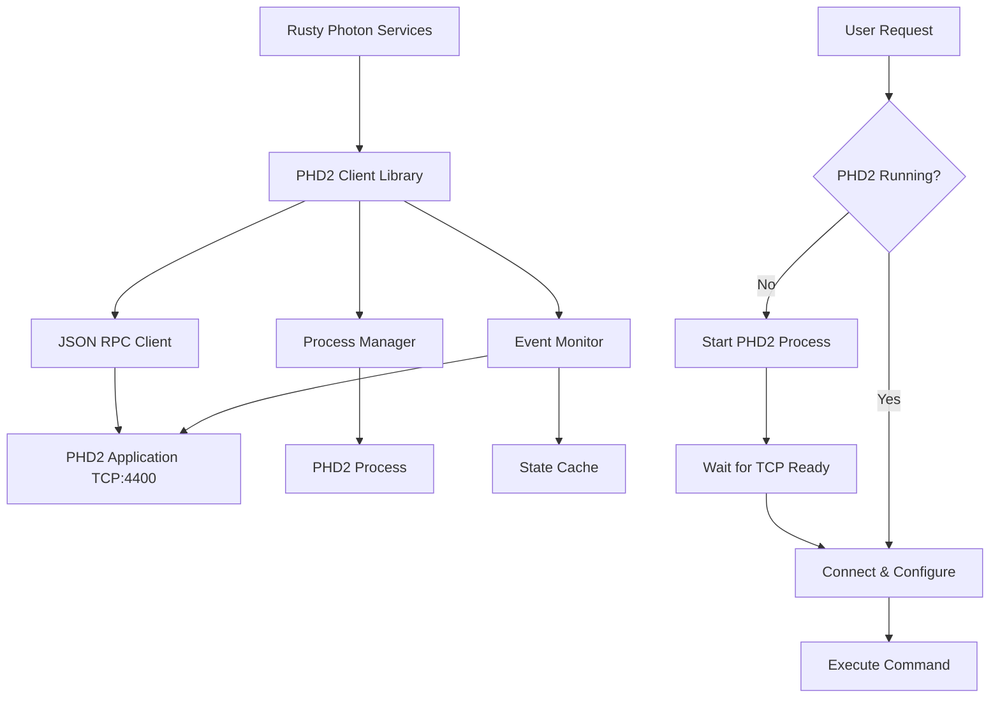

# PHD2 Guider Service Design

## Overview

The PHD2 guider service provides a Rust client library and service for interacting with Open PHD Guiding 2 (PHD2). It enables programmatic control of PHD2 including starting/stopping the application, managing equipment profiles, and controlling guiding operations.

The binary has two roles:

- **CLI** — one-shot subcommands (`status`, `guide`, `dither`, …) for
  operators and scripts.
- **rp-managed HTTP service** — `phd2-guider serve` runs the guider
  service that `rp` proxies its guider MCP tools
  (`start_guiding`, `stop_guiding`, `dither`, …) to. See
  [HTTP Service Mode](#http-service-mode-serve) below and
  `docs/services/rp.md` § "Guider Service".
- **Opt-in ASCOM Alpaca Camera** — with `camera.enabled`, `serve` also
  serves the guide camera as an Alpaca Camera on port 11128 (loopback
  only), its frames captured by PHD2. See
  [Camera facade](#camera-facade-camera).

`phd2-guider doctor [--config <file>] [--json]` diagnoses this service's
own config read-only without starting it — see
[doctor.md §Per-service doctors](doctor.md).

**Cross-Platform Support:** The service runs natively on Linux, macOS, and Windows, matching PHD2's platform support.

## Architecture Overview



## Module Structure

The library is organized into focused modules for maintainability:

```
services/phd2-guider/src/
├── lib.rs          # Crate root with re-exports
├── client.rs       # Phd2Client with all RPC methods
├── config.rs       # Config, Phd2Config, SettleParams, load_config
├── connection.rs   # Internal connection management and auto-reconnect
├── error.rs        # Phd2Error enum and Result type alias
├── events.rs       # AppState, GuideStepStats, Phd2Event
├── fits.rs         # FITS file utilities for saving images
├── io.rs           # I/O traits and implementations for testability
├── process.rs      # Phd2ProcessManager, get_default_phd2_path
├── rpc.rs          # RpcRequest, RpcResponse, RpcErrorObject
├── types.rs        # Rect, Profile, Equipment (shared types)
├── setup.rs        # the setup page (`/setup`) and the facade's redirect to it
└── service/        # HTTP service mode (`phd2-guider serve`)
    ├── mod.rs      # ServerBuilder, BoundServer
    ├── api.rs      # axum router, wire types, request handlers
    ├── error.rs    # ServiceError enum + structured error envelope
    ├── guider.rs   # GuiderOps: settle wait, stop poll, rolling RMS stats, the capture slot, the sweep lease
    ├── capture.rs  # the facade's capture: files, the restart marker, the wait for PHD2's event
    ├── lease.rs    # the sweep lease's Actions, tokens and the record of them
    └── camera.rs   # Phd2Camera: the ASCOM Alpaca Camera device
```

| Module | Description | Key Types |
|--------|-------------|-----------|
| `client` | PHD2 client with RPC methods | `Phd2Client` |
| `config` | Configuration | `Config`, `Phd2Config`, `SettleParams`, `ReconnectConfig` |
| `connection` | Connection management (internal) | `SharedConnectionState`, `ConnectionConfig` |
| `error` | Error handling | `Phd2Error`, `Result<T>` |
| `events` | PHD2 events and state | `Phd2Event`, `AppState`, `GuideStepStats` |
| `fits` | FITS file utilities | `decode_base64_u16`, `write_grayscale_u16_fits` |
| `io` | I/O traits for testability | `LineReader`, `MessageWriter`, `ConnectionFactory`, `ProcessSpawner`, `ProcessHandle` |
| `process` | Process management | `Phd2ProcessManager`, `get_default_phd2_path` |
| `rpc` | JSON RPC 2.0 protocol | `RpcRequest`, `RpcResponse`, `RpcErrorObject` |
| `types` | Common types | `Rect`, `Profile`, `Equipment`, `EquipmentDevice`, `CalibrationData`, `CalibrationTarget`, `GuideAxis`, `CoolerStatus`, `StarImage` |
| `service` | HTTP service mode and the camera facade | `ServerBuilder`, `BoundServer`, `GuiderOps`, `ServiceError`, `Phd2Camera` |
| `setup` | The setup page and the facade's redirect to it | `Phd2GuiderDriver`, `GuiderSetupLink` |

All commonly used types are re-exported at the crate root for convenience. The `connection` module is internal (`pub(crate)`) and handles TCP connection establishment, message reading, and auto-reconnection logic.

## I/O Trait Abstractions

The library uses trait abstractions for I/O operations, enabling comprehensive testing without requiring actual network or process operations. This allows tests to run under miri for memory safety verification.

### Traits

| Trait | Purpose | Default Implementation |
|-------|---------|----------------------|
| `LineReader` | Reading lines from a connection | `TcpLineReader` |
| `MessageWriter` | Writing messages to a connection | `TcpMessageWriter` |
| `ConnectionFactory` | Creating connections | `TcpConnectionFactory` |
| `ProcessSpawner` | Spawning processes | `TokioProcessSpawner` |
| `ProcessHandle` | Managing spawned processes | `TokioProcessHandle` |

### Test-Friendly Constructors

Both `Phd2Client` and `Phd2ProcessManager` provide constructors that accept custom implementations of these traits:

```rust
// Production use (default TCP/process implementations)
let client = Phd2Client::new(config);
let manager = Phd2ProcessManager::new(config);

// Testing with mock implementations
let client = Phd2Client::with_connection_factory(config, mock_factory);
let manager = Phd2ProcessManager::with_spawner(config, mock_spawner, mock_factory);
```

This design enables:
- Unit tests that run quickly without network I/O
- Tests that can run under miri for memory safety verification
- Deterministic test behavior without timing dependencies
- Testing error handling and edge cases that are hard to reproduce with real network connections

## PHD2 API Overview

PHD2 provides two network interfaces:

### 1. Socket Server Interface (Port 4300)
- Legacy single-byte command protocol
- Commands: pause, resume, dither, start guiding, stop, etc.
- **Not recommended for new implementations**

### 2. Event Monitoring / JSON RPC Interface (Port 4400) ⭐ **Recommended**
- Modern JSON RPC 2.0 protocol
- Full bidirectional communication
- Event notifications and method invocation
- Multiple simultaneous client connections supported

## Complete PHD2 JSON RPC API Reference

### Guiding Control

| Method | Parameters | Description | Status |
|--------|------------|-------------|--------|
| `guide` | `settle: {pixels, time, timeout}`, `recalibrate: bool`, `roi: [x,y,w,h]` | Start guiding with settling parameters; optional recalibration and region of interest | ✅ |
| `dither` | `amount: float`, `raOnly: bool`, `settle: object` | Shift lock position by specified pixels for dithering between exposures | ✅ |
| `loop` | none | Start capturing exposures, or if guiding, stop guiding but continue capturing | ✅ |
| `stop_capture` | none | Stop all capture and guiding operations | ✅ |

### Pause Control

| Method | Parameters | Description | Status |
|--------|------------|-------------|--------|
| `get_paused` | none | Check if guiding is currently paused | ✅ |
| `set_paused` | `paused: bool`, `full: string` | Pause or resume guiding; "full" pauses looping entirely | ✅ |

### Equipment Connection

| Method | Parameters | Description | Status |
|--------|------------|-------------|--------|
| `set_connected` | `connected: bool` | Connect or disconnect all equipment in current profile | ✅ |
| `get_connected` | none | Check if equipment is connected | ✅ |
| `get_current_equipment` | none | Retrieve list of selected devices in active profile | ✅ |

### Profile Management

| Method | Parameters | Description | Status |
|--------|------------|-------------|--------|
| `get_profile` | none | Return current profile ID and name | ✅ |
| `get_profiles` | none | List all available equipment profiles | ✅ |
| `set_profile` | `id: int` | Switch active profile; equipment must be disconnected first | ✅ |

### Calibration

| Method | Parameters | Description | Status |
|--------|------------|-------------|--------|
| `get_calibrated` | none | Check if mount is calibrated | ✅ |
| `get_calibration_data` | `which: string` | Obtain calibration parameters and angles ("Mount" or "AO") | ✅ |
| `clear_calibration` | `which: string` | Reset calibration data for "mount", "ao", or "both" | ✅ |
| `flip_calibration` | none | Invert existing calibration for meridian flip without recalibrating | ✅ |

### Camera Operations

| Method | Parameters | Description | Status |
|--------|------------|-------------|--------|
| `capture_single_frame` | `exposure: int`, `binning: int`, `gain: int`, `subframe: [x,y,w,h]`, `save: bool`, `path: string` | Acquire one frame, all parameters optional. With `save`, PHD2 saves the frame when it ends, at `path` (absolute, must not exist) or a name of its own, and sends `SingleFrameComplete` (PHD2 2.6.14+, see [Camera facade](#what-phd2-does-with-a-single-frame)) | ✅ |
| `set_exposure` | `exposure: int` | Set exposure duration in milliseconds | ✅ |
| `get_exposure` | none | Get current exposure time in milliseconds | ✅ |
| `get_exposure_durations` | none | List all valid exposure duration options | ✅ |
| `get_camera_frame_size` | none | Return camera image dimensions (width, height) | ✅ |
| `get_use_subframes` | none | Check if subframing is enabled | ✅ |

### Camera Cooling

| Method | Parameters | Description | Status |
|--------|------------|-------------|--------|
| `get_ccd_temperature` | none | Read current sensor temperature | ✅ |
| `get_cooler_status` | none | Get cooler temperature and power percentage | ✅ |
| `set_cooler_state` | `enabled: bool`, `temperature: float` | Enable/disable cooling and set target temperature | ✅ |

### Guide Star & Lock Position

| Method | Parameters | Description | Status |
|--------|------------|-------------|--------|
| `find_star` | `roi: [x,y,w,h]` | Auto-select a guide star, optionally within specified region | ✅ |
| `get_lock_position` | none | Get current lock position coordinates (x, y) | ✅ |
| `set_lock_position` | `x: float`, `y: float`, `exact: bool` | Set lock position; exact=false allows PHD2 to find nearby star | ✅ |
| `get_lock_shift_enabled` | none | Check if lock position shift is enabled | ❌ |
| `set_lock_shift_enabled` | `enabled: bool` | Enable or disable lock position shifting | ❌ |
| `get_lock_shift_params` | none | Get shift rate and axis configuration | ❌ |
| `set_lock_shift_params` | `rate: [ra,dec]`, `units: string`, `axes: string` | Configure shift parameters | ❌ |

### Guide Algorithm Parameters

| Method | Parameters | Description | Status |
|--------|------------|-------------|--------|
| `get_algo_param_names` | `axis: string` | List algorithm parameter names for "ra" or "dec" axis | ✅ |
| `get_algo_param` | `axis: string`, `name: string` | Read individual algorithm parameter value | ✅ |
| `set_algo_param` | `axis: string`, `name: string`, `value: float` | Modify individual algorithm parameter value | ✅ |

### Guide Output Control

| Method | Parameters | Description | Status |
|--------|------------|-------------|--------|
| `get_guide_output_enabled` | none | Check if guide corrections are being sent to mount | ❌ |
| `set_guide_output_enabled` | `enabled: bool` | Enable or disable sending guide corrections | ❌ |
| `guide_pulse` | `amount: int`, `direction: string`, `which: string` | Send manual pulse; direction: N/S/E/W, which: "mount" or "ao" | ❌ |
| `get_dec_guide_mode` | none | Get declination guide mode (Off/Auto/North/South) | ❌ |
| `set_dec_guide_mode` | `mode: string` | Set declination guide mode | ❌ |

### State & Status

| Method | Parameters | Description | Status |
|--------|------------|-------------|--------|
| `get_app_state` | none | Get current app state: Stopped, Selected, Calibrating, Guiding, LostLock, Paused, Looping | ✅ |
| `get_pixel_scale` | none | Get image scale in arc-seconds per pixel | ❌ |
| `get_search_region` | none | Get star search radius in pixels | ❌ |

### Image Operations

| Method | Parameters | Description | Status |
|--------|------------|-------------|--------|
| `get_star_image` | `size: int` | Get a cutout around the guide star: `{frame, width, height, star_pos, pixels}`, `pixels` base64-encoded 16-bit row-major | ✅ |
| `save_image` | none | Save the current frame to a new FITS file in PHD2's default image directory. Result: `{"filename": "<full path>"}`, a path on PHD2's host. Per PHD2, "the client should remove the file when done with it" | ✅ |

### Timing Configuration

| Method | Parameters | Description | Status |
|--------|------------|-------------|--------|
| `get_variable_delay_settings` | none | Get delay configuration between exposures | ❌ |
| `set_variable_delay_settings` | `enabled: bool`, `shortDelay: int`, `longDelay: int` | Configure exposure delays | ❌ |

### Application Control

| Method | Parameters | Description | Status |
|--------|------------|-------------|--------|
| `shutdown` | none | Close PHD2 application | ✅ |

## PHD2 Event Notifications

PHD2 sends asynchronous event notifications over the same TCP connection:

| Event | Description |
|-------|-------------|
| `Version` | Sent on connect; contains PHD2 version and protocol version |
| `AppState` | Application state changed (Stopped, Guiding, etc.) |
| `GuideStep` | Sent after each guide correction with detailed statistics |
| `GuidingDithered` | Dither operation completed |
| `SettleDone` | Settling after guide/dither completed |
| `StarSelected` | Guide star was selected |
| `StarLost` | Guide star was lost |
| `LockPositionSet` | Lock position was established |
| `LockPositionShiftLimitReached` | Lock shift hit its limit |
| `Calibrating` | Calibration in progress |
| `CalibrationComplete` | Calibration finished |
| `CalibrationFailed` | Calibration failed |
| `CalibrationDataFlipped` | Calibration was flipped |
| `LoopingExposures` | Looping exposures started |
| `LoopingExposuresStopped` | Looping stopped |
| `Paused` | Guiding was paused |
| `Resumed` | Guiding was resumed |
| `GuideParamChange` | Guide algorithm parameter changed |
| `ConfigurationChange` | Configuration was modified |
| `Alert` | Alert message for user |
| `SingleFrameComplete` | A `capture_single_frame` frame ended: `Success`, `Error` on failure, `Path` when saved (PHD2 2.6.14+) |

## Service API Design

The service exposes a high-level Rust API:

### Connection Management

```rust
/// Connect to a running PHD2 instance (uses host/port from config)
async fn connect(&self) -> Result<()>;

/// Disconnect from PHD2
async fn disconnect(&self) -> Result<()>;

/// Check if connected to PHD2
async fn is_connected(&self) -> bool;

/// Get the PHD2 version (available after connection)
async fn get_phd2_version(&self) -> Option<String>;
```

### Process Management

```rust
/// Start PHD2 application (uses executable_path from config or default)
async fn start_phd2(&self) -> Result<()>;

/// Stop PHD2 application gracefully
/// If client is provided, attempts graceful RPC shutdown first
async fn stop_phd2(&self, client: Option<&Phd2Client>) -> Result<()>;

/// Check if PHD2 process is running (by attempting TCP connect)
async fn is_phd2_running(&self) -> bool;

/// Check if we are managing a PHD2 process
async fn has_managed_process(&self) -> bool;
```

### Profile Management

```rust
/// Get list of available equipment profiles
async fn get_profiles(&self) -> Result<Vec<Profile>>;

/// Get current active profile
async fn get_current_profile(&self) -> Result<Profile>;

/// Set active profile (equipment must be disconnected)
async fn set_profile(&self, profile_id: i32) -> Result<()>;
```

### Equipment Control

```rust
/// Connect all equipment in current profile
async fn connect_equipment(&self) -> Result<()>;

/// Disconnect all equipment
async fn disconnect_equipment(&self) -> Result<()>;

/// Check if equipment is connected
async fn is_equipment_connected(&self) -> Result<bool>;

/// Get current equipment configuration
async fn get_current_equipment(&self) -> Result<Equipment>;
```

### Guiding Control

```rust
/// Start guiding with settling parameters
/// roi: Optional region of interest for star selection
async fn start_guiding(&self, settle: &SettleParams, recalibrate: bool, roi: Option<Rect>) -> Result<()>;

/// Stop guiding (continues looping)
async fn stop_guiding(&self) -> Result<()>;

/// Stop all capture and guiding
async fn stop_capture(&self) -> Result<()>;

/// Start looping exposures without guiding
async fn start_loop(&self) -> Result<()>;

/// Pause guiding
/// full: If true, pause looping entirely. If false, continue looping but don't send corrections.
async fn pause(&self, full: bool) -> Result<()>;

/// Resume guiding
async fn resume(&self) -> Result<()>;

/// Check if guiding is paused
async fn is_paused(&self) -> Result<bool>;

/// Get current application state
async fn get_app_state(&self) -> Result<AppState>;

/// Get cached application state (from events, no RPC call)
async fn get_cached_app_state(&self) -> Option<AppState>;

/// Dither the guide position
async fn dither(&self, amount: f64, ra_only: bool, settle: &SettleParams) -> Result<()>;
```

### Star Selection

```rust
/// Auto-select a guide star
async fn find_star(&self, roi: Option<Rect>) -> Result<()>;

/// Get current lock position
async fn get_lock_position(&self) -> Result<(f64, f64)>;

/// Set lock position
/// exact: If true, use exact position. If false, PHD2 will search for a nearby star.
async fn set_lock_position(&self, x: f64, y: f64, exact: bool) -> Result<()>;
```

### Calibration

```rust
/// Check if calibrated
async fn is_calibrated(&self) -> Result<bool>;

/// Get calibration data
/// which: Mount or AO (Both is not valid for get, defaults to Mount)
async fn get_calibration_data(&self, which: CalibrationTarget) -> Result<CalibrationData>;

/// Clear calibration
/// which: Mount, AO, or Both
async fn clear_calibration(&self, which: CalibrationTarget) -> Result<()>;

/// Flip calibration for meridian flip
async fn flip_calibration(&self) -> Result<()>;
```

### Camera Exposure

```rust
/// Get the current exposure duration in milliseconds
async fn get_exposure(&self) -> Result<u32>;

/// Set the exposure duration in milliseconds
async fn set_exposure(&self, exposure_ms: u32) -> Result<()>;

/// Get the list of valid exposure durations in milliseconds
async fn get_exposure_durations(&self) -> Result<Vec<u32>>;

/// Get the camera frame size (width, height) in pixels
async fn get_camera_frame_size(&self) -> Result<(u32, u32)>;

/// Check if subframe mode is enabled
async fn get_use_subframes(&self) -> Result<bool>;

/// Capture a single frame
async fn capture_single_frame(&self, exposure_ms: Option<u32>, subframe: Option<Rect>) -> Result<()>;

/// Capture a single full frame and have PHD2 save it at `path`
/// (absolute, must not exist) when it ends (PHD2 2.6.14+). PHD2 then
/// sends `Phd2Event::SingleFrameComplete` naming `path`.
async fn capture_single_frame_to(&self, exposure_ms: u32, path: &str) -> Result<()>;
```

### Camera Cooling

```rust
/// Get the current CCD sensor temperature in degrees Celsius
async fn get_ccd_temperature(&self) -> Result<f64>;

/// Get the cooler status including temperature and power
async fn get_cooler_status(&self) -> Result<CoolerStatus>;

/// Set the cooler state
/// temperature: Required when enabling the cooler
async fn set_cooler_state(&self, enabled: bool, temperature: Option<f64>) -> Result<()>;
```

### Guide Algorithm Parameters

```rust
/// Get the list of algorithm parameter names for the specified axis
async fn get_algo_param_names(&self, axis: GuideAxis) -> Result<Vec<String>>;

/// Get the value of a guide algorithm parameter
async fn get_algo_param(&self, axis: GuideAxis, name: &str) -> Result<f64>;

/// Set the value of a guide algorithm parameter
async fn set_algo_param(&self, axis: GuideAxis, name: &str, value: f64) -> Result<()>;
```

### Image Operations

```rust
/// Get the current guide star image
/// size: Size of the image in pixels (width and height will be 2*size+1)
async fn get_star_image(&self, size: u32) -> Result<StarImage>;

/// Save the current camera frame to a new FITS file
/// Returns the full path PHD2 replies with ({"filename": ...}), a path
/// on PHD2's host. The caller owns the file and must remove it.
async fn save_image(&self) -> Result<String>;
```

`save_image` accepts only PHD2's documented reply, an object with a
non-empty string `filename`. A bare string, a missing `filename`, or a
non-string or empty one is a `Phd2Error::InvalidState` whose message
carries the reply as received; the client never substitutes a default
path, since the caller goes on to read, and then delete, the file it
names. PHD2's own failures (`no image available`, `error saving
image`) arrive as `Phd2Error::RpcError`. The client does not remove the
file: whoever consumes the frame does.

### FITS Utilities

```rust
/// Decode base64-encoded image data to u16 pixel values
fn decode_base64_u16(base64_data: &str) -> Result<Vec<u16>>;

/// Write a 16-bit grayscale image to a FITS file. Native u16 via
/// BITPIX=16 + BZERO=32768 (per ADR-001 Amendment A; previously the
/// `fitrs`-based path widened to BITPIX=32 because it could not write
/// unsigned values). Atomic and durable: stages, fsyncs, renames,
/// fsyncs the parent dir.
/// `width`/`height` are `usize` because they describe `pixels`; the
/// writer narrows them to `NAXIS1`/`NAXIS2` header cards itself.
async fn write_grayscale_u16_fits(
    path: impl AsRef<Path>,
    pixels: &[u16],
    width: usize,
    height: usize,
    headers: Option<&[(&str, &str)]>,
) -> Result<()>;
```

**Example usage:**
```rust
use phd2_guider::{Phd2Client, decode_base64_u16, write_grayscale_u16_fits};

let image = client.get_star_image(15).await?;
let pixels = decode_base64_u16(&image.pixels)?;
write_grayscale_u16_fits(
    "guide_star.fits",
    &pixels,
    image.width,
    image.height,
    Some(&[("FRAME", &image.frame.to_string()), ("ORIGIN", "PHD2")]),
).await?;
```

### Application Control

```rust
/// Shutdown PHD2 application
async fn shutdown_phd2(&self) -> Result<()>;
```

### Event Subscription

```rust
/// Subscribe to PHD2 events
fn subscribe(&self) -> broadcast::Receiver<Phd2Event>;
```

### Auto-Reconnect Control

```rust
/// Check if auto-reconnect is enabled
fn is_auto_reconnect_enabled(&self) -> bool;

/// Enable or disable auto-reconnect
fn set_auto_reconnect_enabled(&self, enabled: bool);

/// Check if currently reconnecting
async fn is_reconnecting(&self) -> bool;

/// Stop ongoing reconnection attempts
async fn stop_reconnection(&self);
```

## Configuration

```json
{
  "server": {
    "port": 11130,
    "bind_address": "0.0.0.0",
    "tls": null,
    "auth": null
  },
  "stop_timeout": "10s",
  "phd2": {
    "host": "localhost",
    "port": 4400,
    "executable_path": null,
    "connection_timeout": "10s",
    "command_timeout": "30s",
    "auto_start": false,
    "auto_connect_equipment": false,
    "reconnect": {
      "enabled": true,
      "interval": "5s",
      "max_retries": null
    }
  },
  "settling": {
    "pixels": 0.5,
    "time": "10s",
    "timeout": "60s"
  },
  "camera": {
    "enabled": false
  }
}
```

All duration fields use the humantime string format (`"5s"`, `"500ms"`,
`"1m30s"`). See `docs/workspace.md` § "Duration Units" for the
convention.

Configuration sections:

- **server** (only read by `phd2-guider serve`, ignored by the CLI
  subcommands): the shared `ServerConfig` from
  `crates/rusty-photon-server-config` (see ADR-016):
  - `port`: HTTP port (default: `11130`; `0` auto-assigns — used by
    tests)
  - `bind_address`: listen interface (default: `0.0.0.0`, all
    interfaces)
  - `tls` / `auth`: optional HTTPS and HTTP Basic Auth blocks. Absent
    (`null`) means plain, unauthenticated HTTP.
- **stop_timeout** (top level; `serve` mode only): how long
  `POST /api/v1/guiding/stop` waits for PHD2 to reach `Stopped`
  (default: `"10s"`)
- **phd2**: PHD2 connection and process settings
  - `host`: PHD2 host address (default: localhost)
  - `port`: JSON RPC port (default: 4400)
  - `executable_path`: Path to PHD2 executable (null for system default)
  - `connection_timeout`: TCP connection timeout (default: `"10s"`)
  - `command_timeout`: RPC command timeout (default: `"30s"`)
  - `auto_start`: Automatically start PHD2 if not running (declared
    for future use — no code path honors it yet, `serve` included;
    see § HTTP Service Mode)
  - `auto_connect_equipment`: Automatically connect equipment after PHD2 starts
  - `reconnect`: Auto-reconnect settings
    - `enabled`: Enable automatic reconnection (default: true)
    - `interval`: Delay between reconnection attempts (default: `"5s"`)
    - `max_retries`: Maximum reconnection attempts, null for unlimited (default: null)
- **settling**: Default settling parameters for guiding operations.
  Note: PHD2's own JSON-RPC `guide`/`dither` payloads require integer
  seconds for `time` and `timeout`, so this struct is the operator
  config representation. When `client.rs` constructs the wire payload,
  it rounds these durations up to whole seconds (ceil rounding) before
  sending them to PHD2. For example, `"500ms"` is sent as `1` second,
  and `"1.2s"` is sent as `2` seconds.
- **camera** (`serve` mode only): the opt-in ASCOM Alpaca Camera facade,
  off by default. Its fields and rules are in
  [Camera facade § Configuration](#configuration-1).

### Config-path resolution and first-start creation

Config comes from `--config <path>` if given (a missing explicit file is a
hard error). Without it, `serve` resolves the platform default
(`~/.config/rusty-photon/phd2-guider.json` on Linux,
`%PROGRAMDATA%\rusty-photon\phd2-guider.json` on Windows) and — when neither
`--host` nor `--port` is passed, i.e. the packaged path where systemd invokes
the bare binary — bootstraps it via `rusty_photon_config::resolve_and_init`,
**materializing the default config there on first start**. `serve` with
explicit `--host`/`--port` flags and no existing default file runs on
in-memory defaults with the flags applied, writing nothing; the CLI
subcommands (`status`, `monitor`, …) never touch the default path at all —
they always use in-memory defaults plus the flags.

## PHD2 Process Management

### Starting PHD2

**Platform-specific executable locations:**
- **Linux**: `phd2` (in PATH) or `/usr/bin/phd2`
- **macOS**: `/Applications/PHD2.app/Contents/MacOS/PHD2`
- **Windows**: `C:\Program Files (x86)\PHDGuiding2\phd2.exe`

**Startup sequence:**
1. Check if PHD2 is already running (attempt TCP connect)
2. If not running, spawn PHD2 process
3. Wait for TCP port 4400 to become available (with timeout)
4. Connect and receive initial Version event
5. Optionally set profile and connect equipment

### Stopping PHD2

**Clean shutdown sequence:**
1. Stop any active guiding (`stop_capture`)
2. Disconnect equipment (`set_connected(false)`)
3. Send `shutdown` RPC command
4. Wait for process to exit (with timeout)
5. Force kill if graceful shutdown fails

## Auto-Reconnect

The client automatically attempts to reconnect when the connection to PHD2 is lost (e.g., PHD2 crashes or is restarted). This behavior is enabled by default but can be configured or controlled at runtime.

### Connection Events

The following events are broadcast when connection state changes:

| Event | Description |
|-------|-------------|
| `ConnectionLost` | Connection was lost (includes reason) |
| `Reconnecting` | Attempting to reconnect (includes attempt number) |
| `Reconnected` | Successfully reconnected |
| `ReconnectFailed` | Reconnection failed (max retries or cancelled) |

### Reconnection Behavior

1. When the TCP connection is lost, `ConnectionLost` event is broadcast, and
   the cached PHD2 version and app state are cleared — `get_phd2_version()`
   and `get_cached_app_state()` return `None` until the new session's
   `Version`/`AppState` events arrive, so callers can't mistake stale data
   from the ended session for the reconnected one
2. If auto-reconnect is enabled, reconnection attempts begin immediately
3. Each attempt broadcasts a `Reconnecting` event
4. Between attempts, waits for the configured interval
5. On success, `Reconnected` event is broadcast and normal operation resumes
6. On failure (max retries or disabled), `ReconnectFailed` event is broadcast

### Runtime Control

Auto-reconnect can be controlled at runtime:
- `set_auto_reconnect_enabled(false)` - Disables auto-reconnect; stops any ongoing reconnection
- `stop_reconnection()` - Stops current reconnection attempt without disabling future reconnects
- `disconnect()` - Cleanly disconnects and stops any reconnection attempts

## HTTP Service Mode (`serve`)

`phd2-guider serve` — also the default when the binary runs with no
subcommand, which is how the packaged systemd unit invokes it — runs
the **rp-managed guider service** described in `docs/services/rp.md`
§ "Guider Service": a narrow HTTP API in front of the PHD2 JSON-RPC
client, so `rp` speaks only HTTP and never PHD2's wire protocol. The shape deliberately mirrors
[`docs/services/plate-solver.md`](plate-solver.md) — the other
rp-managed service — including the structured error envelope, the
`/health` probe, the `bound_addr=` stdout line for test harnesses, and
the OS-process-supervisor recovery posture.

Default port: **11130** (matches the `guider.url` placeholder in
`rp.md` § "Configuration").

### What serve mode does and does not do

- It **connects to an already-running PHD2** (`phd2.host`/`phd2.port`)
  using the client's auto-reconnect. A failed connect at startup is
  **not fatal**: the service binds and serves anyway, reports `503` on
  `/health`, fails guiding requests with `phd2_unreachable`, and keeps
  retrying in the background. PHD2 starting later (or restarting
  mid-night) needs no service restart.
- It does **not** spawn or supervise the PHD2 process in v1.
  `Phd2Config.auto_start` and the `Phd2ProcessManager` remain
  library/CLI functionality; under `serve` the operator (or their OS
  supervisor) owns the PHD2 process. Process adoption is future work.
  For installing PHD2 itself on a packaged Linux host — and running it
  headless — see
  [docs/packaging.md §phd2-guider: PHD2](../packaging.md#phd2-guider-phd2).
- It is **stateless across restarts** in the way that matters:
  guiding runs *in PHD2*, so a service restart never interrupts an
  active guide loop. The only state lost is the rolling RMS window,
  which refills within a few guide exposures, and the
  [running totals](#running-totals), which start again under a new
  `epoch`. Restart is always cheap
  — the same property that makes the plate-solver's supervision
  posture safe. The camera facade's one piece of persisted state is the
  marker of a capture in flight, which keeps guiding refused after a
  crash until that frame ends (see [Restart](#restart)).
- Graceful shutdown does **not** stop guiding. Stopping the guide loop
  is an explicit `POST /api/v1/guiding/stop` (issued by `rp` — e.g.
  its safety path), never a side effect of service lifecycle.

### Units

All pixel quantities carry the `_px` suffix on the wire
(`rms_ra_px`, `amount_px`). Settle thresholds and dither offsets are
**guide-camera pixels** — PHD2's native unit — not arcseconds:
converting arcseconds would require the guide camera's pixel scale,
which PHD2 only knows after calibration, and a settle threshold must
be expressible before the first calibration of the night.

### HTTP API

All request/response bodies are JSON. Durations are humantime strings
(`"10s"`); the service converts to PHD2's integer seconds with ceil
rounding (see § Configuration).

#### `POST /api/v1/guiding/start`

Start the guide loop and **block until PHD2 reports the star settled**.

Request (all fields optional):

```json
{
  "recalibrate": false,
  "settle": { "pixels": 1.5, "time": "10s", "timeout": "60s" }
}
```

`settle` defaults to the config `settling` block. `recalibrate`
defaults to `false` (PHD2 reuses its stored calibration and
calibrates on its own if it has none).

Behavior:

1. Subscribe to the event pump's settle verdicts **before** issuing
   the `guide` RPC, so a fast `SettleDone` cannot be missed.
2. Reset the rolling RMS window, then send `guide` with the settle
   parameters.
3. Wait for `SettleDone`, bounded by a wall-clock backstop of
   `settle.timeout + 10 s` (PHD2 enforces `settle.timeout` itself and
   reports expiry via `SettleDone{status≠0}`; the backstop only
   catches a wedged or disconnected PHD2).
4. `SettleDone{status: 0}` → `200` with the RMS snapshot, which
   accounts for every guide step PHD2 sent before it settled (see
   [RMS statistics](#rms-statistics)).
   `SettleDone{status ≠ 0}` → `guide_failed` carrying PHD2's error
   text. Backstop expiry → `settle_timeout`.

Calling it while already guiding is valid: PHD2 re-runs the settle
check and the service returns the fresh RMS snapshot.

Success response (also the shape `dither` returns):

```json
{
  "state": "guiding",
  "rms_ra_px": 0.3,
  "rms_dec_px": 0.4,
  "total_rms_px": 0.5,
  "sample_count": 12
}
```

RMS fields are `null` while `sample_count` is 0.

#### `POST /api/v1/guiding/stop`

Stop capture and **block until PHD2 confirms it stopped**. Sends
`stop_capture`, then polls `get_app_state` every 250 ms until it
reports `Stopped`, bounded by the config `stop_timeout` (default
`"10s"`; expiry → `stop_timeout` error). Idempotent — an
already-stopped PHD2 returns success immediately. It ends the camera
facade's [sweep lease](#the-sweep-lease), if one is held, once it
holds the guiding lock, whatever PHD2 then answers.

Response: `{ "state": "stopped" }`.

#### `POST /api/v1/guiding/pause` / `POST /api/v1/guiding/resume`

Forward to PHD2's `set_paused`. `pause` accepts
`{ "full": false }` (default `false`: keep looping exposures, just
stop sending corrections — the right mode around a camera readout).
Both return `{ "state": "paused" | "resumed" }`. Neither blocks on
settling; resuming does not re-settle.

#### `POST /api/v1/dither`

Shift the lock position and **block until settled** (same wait, same
backstop, and same success shape as `guiding/start`).

```json
{
  "amount_px": 5.0,
  "ra_only": false,
  "settle": { "pixels": 1.5, "time": "10s", "timeout": "60s" }
}
```

`amount_px` is required and must be `> 0`. The service first checks
PHD2's application state and rejects the request with `not_guiding`
when the state is not `Guiding` — deterministic, instead of parsing
whatever error text PHD2 would produce.

#### `GET /api/v1/guiding/stats`

Read-only snapshot; never blocks on settling and bypasses the
mutating-request queue.

```json
{
  "app_state": "Guiding",
  "guiding": true,
  "rms_ra_px": 0.3,
  "rms_dec_px": 0.4,
  "total_rms_px": 0.5,
  "snr": 25.1,
  "star_mass": 5340.0,
  "sample_count": 12,
  "totals": {
    "epoch": "0d6f2b8e-5c1a-4f0e-9a43-2a8f6e1c7b90",
    "guide_steps": 1530,
    "ra_samples": 1530,
    "ra_sum_sq_px2": 245.7,
    "dec_samples": 1528,
    "dec_sum_sq_px2": 198.2,
    "star_lost": 2,
    "interruptions": 4
  }
}
```

`app_state` is a fresh `get_app_state` RPC (`guiding` is derived from
it). `snr`/`star_mass` mirror the most recent `GuideStep` event
exactly — `null` when the latest step omitted the measurement, so the
snapshot never reports stale telemetry. RMS comes from the rolling
window; all nullable fields are `null` when no samples exist.
`totals` are the [running totals](#running-totals), read after the
app state.

#### `GET /api/v1/guiding/metrics`

The per-frame star-metric window backing rp's guide-focus features
(rp.md § Guide Focus Watch and the guide-train `auto_focus` sweep):
the last **50** `GuideStep` / `StarLost` events, oldest first,
cleared together with the RMS window when `guiding/start` is issued.
Read-only; never blocks and bypasses the mutating-request queue.

```json
{
  "guiding": true,
  "frames": [
    { "frame": 41, "hfd": 2.31, "snr": 24.8, "star_mass": 5120.0, "star_lost": false },
    { "frame": 42, "hfd": null, "snr": 3.1, "star_mass": null, "star_lost": true }
  ]
}
```

- A `GuideStep` event appends an entry with `star_lost: false` and
  the metric fields exactly as PHD2 reported them (`null` where the
  event omitted a measurement — older PHD2 versions have no `HFD`).
- A `StarLost` event appends `star_lost: true` with whatever metrics
  the event carried.
- `frame` is PHD2's own frame counter — consumers poll for freshness
  by watermark (`frame` greater than the last one they acted on),
  never by array position.
- `guiding` is derived from a fresh `get_app_state`, as in `stats`.

#### `GET /api/v1/equipment`

Read-only passthrough of PHD2's `get_current_equipment`: each
equipment slot's `{ "name", "connected" }`, `null` for slots the
current profile does not configure. Bypasses the mutating queue.

```json
{
  "camera":  { "name": "QHY5III715C", "connected": true },
  "mount":   { "name": "On Camera", "connected": true },
  "aux_mount": null,
  "ao":      null,
  "rotator": null
}
```

The `rotator` slot is what rp's rotate-while-guiding ladder branches
on (rp.md § Rotator Tool Details): PHD2 with a connected rotator
records the rotation angle with each calibration and adjusts on its
own; without one, rp decides between clearing the calibration and
accepting the cross-axis leak.

#### `POST /api/v1/calibration/clear`

Clear PHD2's stored calibration; PHD2 recalibrates on the next guide
start. Body optional: `{ "which": "mount" | "ao" | "both" }`,
default `"mount"`. Mutating (queues behind the single-flight mutex).

Response: `{ "state": "cleared" }`.

#### `POST /api/v1/star/reselect`

Auto-select a guide star on the current frame (PHD2 `find_star`,
full frame). Used by rp after a rotation of the guide field moved
the star. Requires frames to be flowing (looping or guiding); when
PHD2 cannot find a star, the RPC error surfaces as `guide_failed`
with PHD2's text. Mutating.

Response: `{ "state": "selected" }`.

#### `GET /setup` / `POST /setup`

The setup page, HTML for a browser: see [Setup page](#setup-page).

#### `GET /health`

`200 {"status": "ok"}` while the TCP connection to PHD2 is
established;
`503 {"status": "unavailable", "message": "..."}` otherwise, where
`message` is a human-readable explanation of the missing dependency
(no connection to PHD2 at the configured host/port). Cheap (no RPC
round-trip — it reads the client's connection state), so external
tooling may probe at high frequency. Auto-reconnect keeps working
regardless of probes.

The `503` deliberately means **alive but degraded** — PHD2 being off
is the normal daytime state, not a fault. Sentinel's
[health supervision](sentinel.md#service-health-supervision) counts it
as proof of life (no restart, no notification) and shows the service
amber on the dashboard with `message` displayed verbatim, so the
operator sees *why* without sentinel interpreting it (issue #595).

### RMS statistics

The service accumulates PHD2 `GuideStep` events into a rolling window
(last **50** steps), cleared each time `guiding/start` is issued.

- `rms_ra_px` = √(mean(`RADistanceRaw`²)), `rms_dec_px` =
  √(mean(`DECDistanceRaw`²)), `total_rms_px` =
  √(`rms_ra_px`² + `rms_dec_px`²).
- Steps missing a distance field are skipped for that axis.
- The window survives a guiding stop (last-known stats remain
  readable) and is lost on service restart.

The same event pump feeds the **metrics ring** behind
`GET /api/v1/guiding/metrics`: per-frame `{frame, hfd, snr,
star_mass, star_lost}` entries (also 50, also cleared on
`guiding/start`), recording `StarLost` events alongside guide steps
so consumers can tell a degraded star from a vanished one.

The pump is the **only** consumer of PHD2's event stream, and it
republishes a settle verdict only after folding the events that
preceded it. That ordering is what makes the snapshot in a `guide` or
`dither` response complete: a settle wait on the raw event stream
would be a second, independent subscriber racing the pump, and a
response could then report fewer samples than PHD2 had already sent.
The RMS figures would not give it away — a window short one step still
looks plausible — so `sample_count` is the field that shows it.

#### Running totals

The rolling window answers "how is guiding now". A client that wants
the error over an interval of its own, such as rp recording the
guiding over one exposure ([rp.md § Core
Fields](rp.md#core-fields-owned-by-rp), `guiding`), needs every step
of that interval, and an exposure can outlast the window: 50 steps at
a 2 s guide cadence are 100 s. So the event pump also keeps running
totals, which `stats` reports as `totals`. They only ever grow while
the service runs, and are never reset, not even by `guiding/start`. A
client reads them at both ends of its interval and subtracts:

- `epoch` names this run of the service, a UUID drawn when it starts.
  A restart loses the totals and starts them again under a new epoch,
  so two readings with different epochs cannot be subtracted.
- `guide_steps` counts `GuideStep` events.
- `ra_samples` and `ra_sum_sq_px2` count the steps that carried
  `RADistanceRaw` and sum its square, in px²; `dec_samples` and
  `dec_sum_sq_px2` do the same for `DECDistanceRaw`. A step missing a
  distance is skipped for that axis, as in the window. So an
  interval's RMS on an axis is √(Δsum ÷ Δsamples), the window's
  formula over exactly the interval's steps.
- `star_lost` counts `StarLost` events.
- `interruptions` counts the events after which guiding is no longer
  running, or the totals may have missed steps: PHD2's
  `GuidingStopped`, `Paused` and `LoopingExposuresStopped`, the loss
  of the connection to PHD2 (events sent meanwhile are lost), and an
  event pump that fell behind and skipped events. With PHD2 guiding
  at both readings, an unchanged count means guiding ran through the
  interval.

Each axis's count and sum is a `SquareSums` from
[`rusty-photon-rolling-stats`](../crates/rusty-photon-rolling-stats.md),
the never-reset counterpart of a window that rp subtracts with too.

### Concurrency

Mutating requests (`guiding/start`, `guiding/stop`, `pause`,
`resume`, `dither`, `calibration/clear`, `star/reselect`) serialize
behind a single-flight mutex — overlapping requests **queue, not
error** (plate-solver precedent). PHD2 is a single guiding head;
concurrent settle waits are meaningless. `stats`, `metrics`,
`equipment`, and `health` do not take the mutex.

The camera facade's capture takes the same mutex without queueing, and
while a capture is in flight every mutating request except
`guiding/stop` is refused with `camera_busy` instead of waiting. See
[Exclusivity: the capture slot](#exclusivity-the-capture-slot). A
[sweep lease](#the-sweep-lease) is acquired the same way, and while
one is held the same requests are refused the same way.

### Error envelope

Errors return the plate-solver's structured shape (`details` is
omitted from the wire when there is nothing to attach):

```json
{ "error": "guide_failed", "message": "settle failed: Star lost" }
```

| Code | HTTP status | Trigger |
|------|-------------|---------|
| `invalid_request` | 400 | Schema-invalid body, non-positive or non-finite `amount_px` / `settle.pixels`, unparseable durations. Rejected before any RPC. |
| `not_guiding` | 409 | `dither` while PHD2's application state is not `Guiding`. |
| `camera_busy` | 409 | `guiding/start`, `pause`, `resume`, `dither`, `calibration/clear` or `star/reselect` while the camera facade has a frame in flight, after a crash until that frame's deadline, or while a sweep lease is held. Never `guiding/stop`. |
| `guide_failed` | 422 | PHD2 reported `SettleDone{status ≠ 0}` (star lost, calibration failed, settle threshold not reached in time). PHD2's error text is in `message`. |
| `settle_timeout` | 504 | Wall-clock backstop (`settle.timeout + 10 s`) expired without any `SettleDone`. |
| `stop_timeout` | 504 | PHD2 did not reach `Stopped` within `stop_timeout`. |
| `phd2_unreachable` | 502 | No PHD2 connection, or the RPC failed to send. |
| `internal` | 500 | Unexpected service failure. |

### Supervision and recovery

Same three-domain posture as the plate-solver: the operator's OS
process supervisor restarts `phd2-guider serve` (and PHD2, and `rp`)
on exit; `/health` is exposed for operational tooling; `rp`'s HTTP
client applies its own outer timeout as the backstop. Because guiding
state lives in PHD2, a service restart costs at most one in-flight
request.

### Startup and port discovery

`serve` binds `server.bind_address:server.port` and prints
`bound_addr=<host>:<port>` to stdout (the `bdd-infra::ServiceHandle`
discovery convention; `port: 0` auto-assigns). Config validation
failures exit non-zero before binding.

## Setup page

`phd2-guider serve` configures itself on one HTML page, `GET` and `POST`
`/setup` on the service listener — the one the HTTP API and `/health`
use, behind the same TLS and Basic Auth. The shared `rusty-photon-setup`
crate draws and saves it
([rusty-photon-setup.md](../crates/rusty-photon-setup.md)); why the page
is here and not on the facade is the
[driver-setup-pages plan](../plans/archive/driver-setup-pages.md)'s D13. The page
covers the whole config, the `camera` block included:

- **One page.** `server`, `stop_timeout`, `phd2`, `settling` and
  `camera` are each a section of fields, and the Security section edits
  `server.auth`: a username and a password the service hashes. The list
  of devices is empty, since the guider's own server serves no Alpaca
  device. The facade's `unique_id` sits under the collapsed Identity
  disclosure, editable as every driver's id is, as an escape hatch:
  cleared, the next enabled start mints a new one. The file-only fields,
  named on the page and edited in the file, are `server.tls`,
  `phd2.spawn_env` (a map), and the facade listener's `camera.server.tls`
  and `camera.server.auth`, so the facade's credential is the file's, set
  by `doctor --fix` or by hand. With no `camera` block in the file, the
  block's fields show their defaults, and a save that leaves them so
  writes no block.
- **A save waits for the restart.** The service has no reload path (the
  `Restart` disposition): a save is persisted, and its answer names the
  fields that take effect at the next start and how to restart the
  service (`sudo systemctl restart rusty-photon-phd2-guider` on Linux,
  `Restart-Service rusty-photon-phd2-guider` on Windows, `brew services
  restart rusty-photon-phd2-guider` on macOS); until then the
  page names the fields still waiting. A moved `server.port` or bind
  address is named beside the restart text, since nothing answers there
  until the restart. A guide loop survives the restart, as any restart
  of this service (see [What serve mode does and does not
  do](#what-serve-mode-does-and-does-not-do)).
- **What a save is held to.** The load's rules (the facade's are in
  [Configuration](#configuration-1)), and, since a saved change is first
  tried at the next start, startup's check of an enabled facade's
  `image_dir`: it creates and removes `.phd2-guider-probe` there, inside
  the service, so it tests the service's own permissions, and a
  directory that fails it is refused beside its field rather than saved
  to stop the next start. The page adds rules the load does not have,
  for values the file parses but the guider cannot work with:
  `stop_timeout`, `phd2.connection_timeout`, `phd2.command_timeout`,
  `phd2.reconnect.interval` and `settling.timeout` greater than 0,
  `settling.pixels` greater than 0, `phd2.host` not empty and
  `phd2.port` greater than 0. A file that breaks them still loads.
- **No file, no page.** A `serve` started with `--host` or `--port` and
  no file at the default path runs on built-in defaults with nowhere to
  save, and its `/setup` answers `404` saying so.

The camera facade has no page of its own: see [Setup
paths](#setup-paths).

## Camera facade (`camera`)

`phd2-guider serve` can also serve the guide camera as an ASCOM Alpaca
**Camera**. Its frames are captured by PHD2 itself, so the camera stays
PHD2's and a client still gets frames from it. The facade is opt-in
(`camera.enabled`, default `false`). It is a second listener in the same
process, on port **11128**, loopback only, with one Camera at device
number 0. Its reason to exist is rp's guiding train: with the facade, the
guide camera can be a train's terminal camera like any other (the
device-claims plan, C7). The plan's Part B
([`device-claims-and-phd2-camera.md`](../plans/archive/device-claims-and-phd2-camera.md)
D9–D11) records how this design was reached; this section is the contract.

### Prerequisites

These are deployment rules. The facade checks the ones it can at load.

- **PHD2 2.6.14 or later**, on the **same host**, reached on a loopback
  address. The facade reads the frames PHD2 writes, so they must land on
  a disk it can read. `Connected = true` refuses an older PHD2, judged by
  the `PHDVersion` its `Version` event reports.
- **The guide camera's vendor driver must not serve it.** If
  `qhy-camera`, `zwo-camera` or `svbony-camera` also opens the guide
  camera, whichever opens second fails. Use that driver's `usb_devices`
  list and leave the guide camera's port off it. That is a hard
  prerequisite, not advice: the facade cannot detect the conflict,
  because nothing tells a process that someone else wanted the device it
  already holds.
- **PHD2's account must be able to open the guide camera** (Linux). Each
  camera package's udev rule, and `rusty-photon-zwo-focuser`'s (ZWO's
  id, which its cameras share), gives its vendor's whole USB id to the
  `rusty-photon` group, so PHD2, running as the operator, finds no
  camera. A udev rule keyed on the guide camera's port gives that port to
  the operator's group
  ([packaging.md](../packaging.md#phd2-guider-the-camera-facade), step 1).
  PHD2's QHY support does not look for cameras again after finding none,
  so PHD2 starts after the rule is in place. Found and fixed on the field
  rig with the QHY5III715C
  ([record](../validation/2026-10-13-phd2-guider-qhy5iii715c-linux/README.md)).
- **This service has sole control of PHD2 during a capture.** The facade
  refuses every guiding operation that reaches PHD2 *through this
  service* while it captures. PHD2 accepts other clients on port 4400,
  and the facade cannot stop them. One case matters most: a **full pause**
  sent to PHD2 during a frame throws the frame away and leaves PHD2
  refusing every capture until PHD2 restarts (measured, below). The
  same holds for a whole sweep under a [sweep lease](#the-sweep-lease),
  and so does sole control of the facade itself.
- **`image_dir` is shared between PHD2's account and this service's.**
  See [Sharing `image_dir`](#sharing-image_dir).

### What PHD2 does with a single frame

PHD2 2.6.14's `capture_single_frame` takes `exposure` (whole
milliseconds), `save` and `path`. With `path`, PHD2 saves the frame there
when the exposure ends, then sends a `SingleFrameComplete` event to every
event-server client. Measured on `pier1` (PHD2 2.6.14, Simulator profile,
2026-10-13):

| Sent to PHD2 | What PHD2 did |
|---|---|
| `capture_single_frame {"exposure": 2000, "save": true, "path": "<abs>"}` | replied `0`; 2.08 s later `{"Event": "SingleFrameComplete", "Success": true, "Path": "<abs>"}`, the file already at full size |
| the same at 1, 10, 100 ms | events 87, 84, 172 ms after the request |
| during a frame: `get_app_state` | `Looping` (or `Selected` with a star selected); `Stopped` after the event |
| during a frame: a second `capture_single_frame` | error 1, `cannot capture single frame when capture is currently active` |
| during a frame: `loop` | `0`, and nothing more |
| during a frame: `stop_capture` | the event 65 ms later, `Success: false`, `camera error -- see debug log`, no file |
| during a frame: `guide` | accepted; calibration starts when the frame ends and fails, `SettleDone` status 1, `Stopped capturing`; the frame is saved |
| during a frame: `set_paused [true, "full"]` | the frame is thrown away with **no event**, and PHD2 refuses every later capture; `stop_capture` does nothing; only a PHD2 restart clears it |
| a `path` in a directory that does not exist | the event, `Success: false`, `error saving image file [<abs>] -- see debug log for more info` |
| a `path` that exists; a relative one; `exposure` 0, 600 001 or `1500.0` | `-32602`, nothing captured |
| the camera disconnected | one reply with two `error` members (code 1, then code 2) |

The frame is a 16-bit FITS (`BITPIX = 16`, `BZERO = 32768`) the size
`get_camera_frame_size` reports. Whether `stop_capture` cuts an exposure
short depends on PHD2's camera driver. The simulator and ZWO drivers
check for it. The QHY driver does only when PHD2 was built with
`CAN_STOP_CAPTURE`, and PHD2 2.6.14 is built without it: on the field
rig's QHY5III715C a stop changed nothing, and PHD2 reported the frame as
a success at its natural end
([record](../validation/2026-10-13-phd2-guider-qhy5iii715c-linux/README.md)).
A driver that ignores it finishes the frame.

### Capturing a frame

`StartExposure(duration, light)` checks the request, starts PHD2's
exposure, and returns. Everything after that runs in the background, and
a client polls `ImageReady` as with any camera.

1. **Checked before PHD2 is asked**, each refused at once:
   - not connected → `NotConnected`;
   - `light = false` → `InvalidValue`. PHD2 has no dark-frame mode and
     the guide camera usually has no shutter, so a "dark" would be a
     light frame under a false name;
   - a duration below 1 ms or above 600 s → `InvalidValue`. A duration
     inside that range is rounded to the nearest whole millisecond;
   - a subframe outside the sensor (`StartX + NumX > CameraXSize`, the
     same for Y, or a zero `NumX`/`NumY`) → `InvalidValue`;
   - an exposure of this facade already in flight → `InvalidOperation`.
2. **Take the capture slot**, under the guider's operation lock (see
   [Exclusivity](#exclusivity-the-capture-slot)). A guiding operation in
   progress → `InvalidOperation` naming it. Holding the lock:
   `get_app_state` must answer `Stopped`, or the request is refused with
   `InvalidOperation` naming the state. `Stopped` is an allowlist: a
   `Paused` PHD2 that is still looping must not get a capture.
3. **Write the restart marker, set the slot, and send**
   `capture_single_frame {"exposure": <ms>, "save": true, "path":
   "<image_dir>/phd2-guider-<32 hex digits>.fits"}`. The name is random
   and new for each capture.
   - PHD2 refusing it releases the slot and removes the marker. Its
     `capture is currently active` refusal maps to `InvalidOperation`,
     and any other refusal to `UnspecifiedError` with PHD2's text.
   - With no PHD2 connection the request is never sent: `NotConnected`,
     with the same release.
   - A request that may have reached PHD2 but got no answer it can use
     (a timeout, a connection dropped mid-request, or a reply this client
     cannot read, which may be an acceptance) keeps the slot and the marker,
     exactly as for a frame PHD2 accepted, until PHD2 reports the frame
     or its deadline passes. `StartExposure` fails with `UnspecifiedError`
     saying so.
4. **Let the lock go and return, then sweep orphans.** `StartExposure`
   does not wait on the sweep, and neither the exposure nor the sweep
   holds a lock (see [Files](#files)).

In the background the facade waits for the `SingleFrameComplete` event
whose `Path` is the one it sent, bounded by `exposure + capture_grace`
from the request:

- `Success: true` → read and decode the file (bounded, below), crop it to
  the subframe, and publish it: `ImageReady` becomes true.
- A report that has arrived by the deadline counts, even when the
  deadline is reached at the same moment.
- `Success: false` → the exposure fails with PHD2's `Error` text, or with
  "aborted" when this facade's own abort or a `guiding/stop` caused it.
- Nothing by the deadline → the exposure fails with "PHD2 did not report
  the frame within <deadline>", and a warning is logged.

On every one of those exits the facade deletes the file, removes the
marker and releases the slot. A failed exposure leaves `CameraState =
Error` and `ImageReady = false`, and `ImageArray` returns the reason as
an `UnspecifiedError` until the next `StartExposure`.

The capture never calls `set_exposure`, and it never sends `binning` or
`gain`, so PHD2's guiding exposure, binning and gain are untouched. PHD2
restores its own binning and gain after a single frame anyway. It never
calls `save_image` either: the facade names the file, so no request can
return an earlier frame.

### Exposure contract

| Property | Value |
|---|---|
| `ExposureMin` / `ExposureMax` | 0.001 s / 600 s (PHD2's own bounds for a single frame) |
| `ExposureResolution` | 0.001 s; a request is rounded to the nearest whole millisecond |
| `LastExposureDuration` | the rounded duration PHD2 was asked for |
| `LastExposureStartTime` | when PHD2 accepted the request |
| `CanAbortExposure` / `CanStopExposure` | `true` / `false` |
| `PercentCompleted` | while exposing, the share of `LastExposureDuration` elapsed since `LastExposureStartTime`, capped at 99; 100 once the image is ready; 0 otherwise |
| `HasShutter` | `false` |
| `MaxADU` | 65535 |
| `ImageArray` | unsigned 16-bit values, sent as `UInt16` (ImageBytes `TransmissionElementType` 8): half the bytes of `Int32` |
| `MaxBinX` / `MaxBinY`, `BinX` / `BinY` | 1; setting any other bin → `InvalidValue` |
| `CameraXSize` / `CameraYSize` | PHD2's `get_camera_frame_size`, read on connect, after the connect's 1 ms frame when PHD2 reports 0 × 0 (see [A frame size PHD2 does not know yet](#a-frame-size-phd2-does-not-know-yet)) |
| `PixelSizeX` / `PixelSizeY` | `camera.pixel_size_x_um` / `camera.pixel_size_y_um` |
| `SensorType` | `Monochrome` (the facade serves PHD2's frame as written) |
| `SensorName` | the camera name PHD2's `get_current_equipment` reports, read on connect |
| `ReadoutModes` / `ReadoutMode` | `["Default"]` / 0 |
| cooler, gain, offset, fast readout, pulse guiding | not implemented (`CanSetCCDTemperature`, `CanGetCoolerPower`, `CanFastReadout`, `CanPulseGuide` all `false`). PHD2 owns those settings through its equipment profile |

`StartX`/`StartY`/`NumX`/`NumY` cut the subframe from PHD2's full frame,
in the facade. The full frame is what PHD2 captures, whatever the
subframe.

### Connecting

`Connected = true` succeeds when the PHD2 connection is up, PHD2 reports
2.6.14 or later, and `get_camera_frame_size` and `get_current_equipment`
answer, which they do only while PHD2's camera is connected. The version
comes from the `Version` event PHD2 sends first on every connection. A
connect that arrives before this service has read that event waits up to
2 s for it. It caches
the frame size and the camera's name, and resets the subframe to the
full frame. It sends PHD2 no equipment connection, no profile change and
no stop (workspace tenet 3, *no actuation on connect*), and no exposure
except the one frame [below](#a-frame-size-phd2-does-not-know-yet). A
failed connect is `NotConnected`, naming what was missing.

#### A frame size PHD2 does not know yet

Some of PHD2's camera drivers learn the frame size only from a frame.
PHD2 2.6.14's Simulator and INDI cameras report 0 × 0 until they have
taken one; its QHY, ZWO, SVBony and ToupTek drivers, among others,
report the size as soon as the camera connects. A size with a zero
dimension is unknown. When PHD2 reports one, the facade takes one 1 ms
frame exactly as `StartExposure` does (the capture slot, PHD2 `Stopped`,
the restart marker, a random file name, the file deleted after), then
reads the size PHD2 reports. The connect fails if the frame cannot start
(a guiding operation in progress, PHD2 not `Stopped`), if PHD2 fails it
or does not report it within `1 ms + capture_grace`, or if PHD2 still
reports 0 × 0 after it.

The frame is needed only until PHD2 has taken one with its current
camera: a PHD2 that has looped or guided reports the size, and the
connect takes no frame. On the Simulator the frame adds about 0.1 s to
the connect (PHD2 reported a 1 ms frame 87 ms after the request,
[above](#what-phd2-does-with-a-single-frame)). The facade keeps no size
of its own: a size it remembered could go stale when PHD2 switches or
rebins its camera, while PHD2's own answer after a frame cannot.

The 1 ms frame is the only exposure a connect takes. The repo owner
decided on 2026-10-19 that it is not actuation in tenet 3's sense. It
moves no mount, focuser or filter. It changes none of PHD2's settings: a
single frame never calls `set_exposure` and sends no binning or gain
(see [Capturing a frame](#capturing-a-frame)). It is taken only from a
`Stopped` PHD2.

The one moving part it can touch is a mechanical shutter, and the owner
accepted that on the record the same day. PHD2 never sets an INDI
camera's frame type (`cam_indi.cpp:517` finds `CCD_FRAME_TYPE` and
leaves it), so every frame PHD2 takes from INDI is a light frame. An
INDI guide camera with a mechanical shutter therefore opens it for the
1 ms frame. That happens on every connect that finds the size unknown,
including rp's startup bind, its connect retries and its reconnect
passes. It is the price of a connect that works unattended.

The Simulator's shutter is simulated. SBIG opens its shutter on every
light frame (`cam_sbig.cpp:497`) but reports its size on connect, so it
never takes this frame.

`Connected` reads back the state the client set. A PHD2 that goes away
afterwards surfaces as errors from the calls that need it.
`Connected = false` during an exposure aborts it as `AbortExposure`
does.

Before the first successful connect, `CameraXSize`, `CameraYSize` and
`SensorName` return `NotConnected`. The configured `PixelSizeX`/`Y` and
the fixed values in the table answer at any time.

### Aborting

`AbortExposure` takes the guider's operation lock and, if this facade's
exposure still holds the capture slot, sends PHD2 `stop_capture` (a
stop-class command, inside a session the client started). It then waits
up to 2 s for PHD2's event. Once the event has come, it also waits for
the exposure to leave the camera, so a `StartExposure` sent right after
it finds the camera idle. An exposure still starting (PHD2 not yet
asked, or not yet answered) is stopped as soon as PHD2 accepts it, and
the abort waits for that too. All of this waits at most 17 s: three
5 s requests to PHD2 and the 2 s for its event. PHD2 answers each in
milliseconds. The frame is discarded either way. If PHD2's camera driver
ignores the interrupt, the frame runs to its end. `CameraState` reads
`Exposing` until PHD2's event arrives, and the slot is held that long
too. With no exposure in flight, `AbortExposure` does nothing and
succeeds. A `StartExposure` that an abort overtook while PHD2 was being
asked still succeeds, and the abort then ends the frame. One that a
disconnect overtook fails with `NotConnected`. Either way it answers
before the frame is stopped. `StopExposure` is not implemented: PHD2
cannot end an exposure early and keep its frame.

### Exclusivity: the capture slot

PHD2 runs one exposure at a time: a second capture is refused, `loop` is a
no-op, and a `guide` sent during a frame starts only after it (measured,
above). So no request can put a guide exposure on top of the facade's.
What a request during a frame can still do is spoil it or wedge PHD2: a
`guide` turns the frame's end into the start of a calibration that fails
at once, and a full pause throws the frame away and leaves PHD2 unable to
capture. So while a capture is in flight, this service refuses every
guiding operation except stop.

The guider's operation lock (`op_lock`, see [Concurrency](#concurrency))
guards one **capture slot**. The slot is set, and checked, only while
the lock is held. The frame's end clears it.

- A **capture** takes the lock with `try_lock`, so it never queues behind
  a guiding operation. A guiding operation in progress refuses the
  capture with `InvalidOperation`. The capture holds the lock only for
  steps 2–3 above: a few milliseconds while PHD2 answers, and never more
  than 5 s for each of its two requests when PHD2 does not. An abort
  (`AbortExposure`, a disconnect, shutdown) holds it the same way while
  it sends `stop_capture`, also for at most 5 s.
- **`guiding/start`, `pause`, `resume`, `dither`, `calibration/clear` and
  `star/reselect`** still queue on the lock as before. Once they hold it
  they check the slot, and a capture in flight refuses them with
  `camera_busy` (409). A mutation either gets the lock before the capture
  does, and the capture is then refused as busy, or after it, and then it
  sees the slot. Either way it never waits out an exposure.
- **`guiding/stop` is never refused.** It takes the lock as before. A
  capture holds the lock only briefly, so stop does not wait on it. PHD2's
  state during a frame is not `Stopped`, so stop sends `stop_capture`,
  which ends the frame. The capture then fails as "aborted" when PHD2's
  event arrives, and stop confirms `Stopped` as it always has.
- **The slot is released** when PHD2's event for the frame arrives, or
  when `exposure + capture_grace` has passed since the request, whichever
  comes first. A claim whose deadline has passed holds nothing, even
  before the task that ends it has run. The deadline runs on the
  monotonic clock, so a wall-clock step, such as a host without a
  battery-backed clock setting its time mid-frame, neither ends a claim
  early nor stretches it. A connection lost mid-frame can cost the event, and then
  the deadline releases. A released slot never waits on PHD2. If PHD2 is
  running the frame later than the deadline, a request PHD2 then receives
  meets PHD2's own rules: a capture is refused, and a guide starts after
  the frame.

The read-only endpoints (`stats`, `metrics`, `equipment`, `/health`) never
take the lock and are never refused.

### The sweep lease

A focus sweep through the facade takes many frames, and the focuser moves
between them. Each frame checks that PHD2 is `Stopped`, but nothing in
that check holds guiding off between two frames. A guide start that lands
between two samples fails the next frame after the focuser has already
moved; one that is stopped again in time leaves frames taken under other
conditions in one V-curve. The sweep lease holds guiding off for a whole
sweep. rp's train lease ([rp.md § Train Lease](rp.md#train-lease)) takes
it for a guiding train's training run
([device-claims plan](../plans/archive/device-claims-and-phd2-camera.md) D12,
"Settled in C7").

The lease is three ASCOM `Action`s on the facade's Camera.
`SupportedActions` lists them and nothing else, so a client
knows a camera is the facade, with a phd2-guider that has the lease, when
`rustyphoton:sweep-lease-acquire` is on that list. Each takes its
`Parameters` as a JSON object and answers one:

| Action | `Parameters` | Answer |
|---|---|---|
| `rustyphoton:sweep-lease-acquire` | `{"token": "<32 hex digits>", "ttl_s": 60}` | `{"token": "<the token>", "ttl_s": 60}` |
| `rustyphoton:sweep-lease-renew` | `{"token": "<32 hex digits>"}` | `{"token": "<the token>", "ttl_s": 60}` |
| `rustyphoton:sweep-lease-release` | `{"token": "<32 hex digits>"}` | `{"released": true}`, or `{"released": false}` when the token holds no lease |

- **The names are matched without regard to case**, as the specification
  requires of every `Action` name; `SupportedActions` lists the spelling
  above.
- **The caller names the token**: 32 lowercase hex digits, new for each
  lease. The caller knows it before it asks, so a caller whose acquire
  got no answer (a timeout, a dropped connection) can still release the
  lease it may have been granted. `ttl_s` is a whole number of seconds
  from 10 to 300, and 60 when left out. A `Parameters` string that is not
  such an object, a token of any other form, or a `ttl_s` outside the
  range is refused with `InvalidValue` before anything else is looked at.
  An acquire also refuses a field it does not take. A renewal and a
  release read only `token` and ignore any other field, so a holder can
  send its acquire's own parameters: a clean-up refused over a field it
  does not need would leave the lease held until its TTL.
- **Acquiring** takes the guiding lock with `try_lock`, as a capture
  does, so it never queues behind a guiding operation. It grants the
  lease only when every check below passes, and each refusal says why:
  - the camera is not connected, or PHD2 cannot be reached →
    `NotConnected`;
  - a guiding operation holds the lock → `InvalidOperation`;
  - a facade frame is in flight → `InvalidOperation`, naming when the
    frame ends at the latest. A frame whose driver ignores a stop runs on
    after its abort has answered (see [Aborting](#aborting)), so this
    refusal can outlast an abort;
  - a lease is already held → `InvalidOperation`, naming when it expires
    unless it is renewed;
  - the token was used before: for a lease held, released or ended, or
    in a release that came first → `InvalidOperation`;
  - the facade already remembers 256 tokens (below) and this one is new
    → `InvalidOperation`, naming when the oldest is forgotten;
  - PHD2 is not `Stopped` → `InvalidOperation`, naming the state. It is
    the allowlist a capture checks;
  - PHD2 answers `get_app_state` with an error, or with a state this
    service cannot read → `InvalidOperation`, with PHD2's text.

  A `Connected` change that arrives while an acquire runs waits for it,
  so a disconnect always ends the lease the acquire granted.
- **Renewing** restarts the TTL from now, with the `ttl_s` the acquire
  set. **Releasing** ends the lease. Neither takes the guiding lock, and
  neither needs the camera connected: they change only the lease's own
  record, so a renewal is never held up by a capture or by a guiding
  operation. For a token that does not hold the lease:
  - a renewal fails with `InvalidOperation`, saying why: the lease
    expired, was released, was ended by a guiding stop or a disconnect,
    or was never acquired in this process. A restart forgets every lease,
    so after one the holder learns it at its next renewal;
  - a release answers `{"released": false}` and is never an error, so a
    holder's clean-up never fails on a lease that has already ended. A
    release of a token the facade has not seen records the token, so an
    acquire that arrives after it under that token is refused.
- **Tokens are remembered** while their lease is held and for an hour
  after it ends, or after a release recorded them, and at most 256 at
  once, the held lease's included. At 256 an acquire naming a new token is
  refused, rather than a token younger than an hour being forgotten. A
  release is never refused: at 256 a release of a token the facade has not
  seen answers `{"released": false}` without recording it, and an acquire
  under that token, a new one, is refused anyway while the cap holds.
  Once the oldest token is forgotten, such an acquire can be granted, and
  with nobody renewing it the lease lapses at its TTL, at most 300 s
  later. Only a flood of tokens reaches the cap: a sweep takes one.
- **While a lease is held**, the guiding operations a capture refuses
  (`guiding/start`, `pause`, `resume`, `dither`, `calibration/clear` and
  `star/reselect`) are refused with `camera_busy` (409), naming the lease
  and when it expires unless it is renewed. A mutation queued on the
  guiding lock checks the lease once it holds the lock, as it checks the
  capture slot, so it never waits out a lease.
- **The lease ends** at its release, at its TTL, and at:
  - `guiding/stop`, which is never refused. It ends the lease as soon as
    it holds the guiding lock, whether or not PHD2 then confirms
    `Stopped`. This is the privileged stop: it breaks a lease without
    waiting for its TTL. A stop that arrives while an acquire holds the
    lock waits for it, then ends the lease that acquire granted, so the
    holder may start a sweep under a lease already ended. It learns this
    at its next renewal, and until then each frame's `Stopped` check
    fails a frame taken after guiding restarted;
  - `Connected = false`;
  - shutdown, with the process: the lease lives only in the service's
    memory and is never written to disk. A restart therefore forgets it,
    and guiding through this service is accepted again once it restarts,
    unless a frame's restart marker holds the capture slot.
- **The TTL runs on the monotonic clock** from the acquire or the last
  renewal, so a wall-clock step neither ends a lease early nor stretches
  it. A lease that lapses during a frame needs no rule of its own: the
  capture slot keeps guiding refused until PHD2 reports the frame.
- **The lease does not gate captures.** ASCOM gives `StartExposure` no way
  to name its sender, and every capture checks `Stopped` anyway, so a PHD2
  that another client set looping fails the next frame, naming its state.
  For the same reason, sole control of the facade during a sweep is a
  deployment precondition, as sole control of PHD2 is (see
  [Prerequisites](#prerequisites)): a capture another Alpaca client
  starts between two samples makes the sweep's next one fail as busy.

The ASCOM errors are listed under [Errors](#errors).

### Files

- **Names.** Every capture writes
  `<image_dir>/phd2-guider-<32 hex digits>.fits`, a random name the facade
  chooses. PHD2 refuses a path that already exists, so a file or link
  planted at the name fails the capture instead of being read.
- **Reading.** The facade opens that name without following a link
  (`O_NOFOLLOW` on Unix, `FILE_FLAG_OPEN_REPARSE_POINT` on Windows) and
  checks that the handle it got is a regular file. The file must be no
  larger than the frame needs: the data for `CameraXSize × CameraYSize`
  16-bit pixels plus eight 2880-byte header blocks. A larger file is
  refused unread. A frame whose `NAXIS1`/`NAXIS2` differ from the size
  read on connect fails with "PHD2's frame size changed; reconnect the
  camera". A frame PHD2 does not write fails it too: floating-point
  values, a `BSCALE` or `BZERO` that is not a whole number, or a value
  outside 0 to 65535. A frame of integers in another encoding is scaled
  in integer arithmetic, so no value is truncated or clamped. The read
  and the decode are bounded by `capture_grace`: one
  that takes longer fails the exposure, so a stalled read cannot leave
  the camera downloading for good.
- **Deleting.** The file is deleted on every exit from the capture:
  success, failure, abort and shutdown. A frame given up on at its
  deadline has no file yet. If PHD2 saves it late, the file is deleted
  when PHD2's report lands, or by the next sweep. A failed deletion is
  logged as a warning and never fails the capture. The delete resolves
  the name a second time, so a peer that swaps the file between the read
  and the delete gets the swapped file deleted. That is accepted under a
  stated **trusted-peer assumption**: `image_dir` is shared with one
  other local process, PHD2, run by the operator, and a hostile process
  with write access there has already won more than a FITS file.
- **Sweeping.** Any `phd2-guider-*.fits` in `image_dir` other than the
  capture in flight is an orphan. One appears when PHD2 saved a frame the
  facade had already given up on. The facade deletes orphans at startup
  and as each capture starts, once PHD2 has accepted it and
  `StartExposure` has answered, looking at
  no more than 4096 directory entries per sweep and logging what it
  removed. When a late
  `SingleFrameComplete` names a frame whose deadline already passed, the
  facade deletes that file at once. It remembers the last 64 frames it
  gave up on for this, and the sweep catches any it misses.
  The sweep never touches a file without the prefix, so PHD2's own
  `save_image_…` files and anything else in the directory are safe.

### Restart

- **Graceful shutdown** during a capture sends PHD2 `stop_capture` for
  the facade's frame (stop-class, inside the operator's session). It then
  waits up to `capture_grace` for the event, deletes the file and exits.
  A shutdown never stops guiding: with a capture in flight, guiding was
  refused.
- **A crash** leaves the restart marker, `phd2-guider-capture.json` in
  `image_dir`. It is written before `capture_single_frame` and removed on
  release, and holds the frame's path and its deadline in wall-clock
  time. At startup, a marker whose deadline is still ahead holds the
  capture slot. Guiding operations through this service are refused with
  `camera_busy`, naming the deadline. The slot is held until the frame's
  `SingleFrameComplete` arrives (PHD2 sends it to every client, so a
  reconnected service hears it) or the deadline passes, and then the file
  and the marker are deleted. The frame's file appearing proves nothing:
  PHD2 creates it before it has written it. That is never longer
  after the original request than the running process would have held
  the slot. A deadline further ahead than 660 s from startup (the longest
  exposure plus the longest grace) is cut to that and written back to the
  marker, so a marker written under a wrong clock cannot hold the slot
  longer than any frame could, however often the service restarts.
  A marker whose deadline passed while the service was down is removed
  at once, and so is one that names no facade frame. A marker also
  outlives a host reboot or a PHD2 restart, after which its frame cannot
  be running. Nothing PHD2 reports tells that apart (its state can read
  Stopped while a frame runs), so the slot is then held to the deadline,
  at most 660 s. The marker is read only when `camera.enabled` is true.
- **The marker and the slot change together.** The facade removes the
  marker and releases the slot under the guiding lock, so no new capture
  writes its marker in between, and it removes the marker only if it
  still names the frame being released.

### Configuration

```json
"camera": {
  "enabled": true,
  "unique_id": "9f4c3a52-…",
  "pixel_size_x_um": 2.9,
  "pixel_size_y_um": 2.9,
  "image_dir": "/var/lib/rusty-photon/phd2-images",
  "capture_grace": "10s",
  "server": { "port": 11128, "bind_address": "127.0.0.1" }
}
```

| Field | Default | Rule |
|---|---|---|
| `enabled` | `false` | With `false` the facade does not exist: no listener, no marker, and the remaining fields are not required |
| `unique_id` | minted | The device's ASCOM `UniqueID`, minted into the config file on the first start with `enabled: true` and never changed after by the service (the setup page's Identity disclosure is the operator's escape hatch). Not derived from PHD2's profile or camera, which change when the operator reconfigures PHD2 |
| `pixel_size_x_um` / `pixel_size_y_um` | — | **Required when enabled.** Finite and greater than 0. Entered from the guide camera's datasheet. They are two fields because a sensor's pixels need not be square, and rp reads each axis separately. PHD2 does not report them in a usable form: its pixel scale needs the focal length |
| `image_dir` | — | **Required when enabled.** An absolute, UTF-8 path to an existing directory that this service can create and remove files in. Startup checks it by creating and removing `.phd2-guider-probe` there |
| `capture_grace` | `"10s"` | Greater than 0 and at most `"60s"`. It covers PHD2's download and save of one frame; a grace longer than that is a misconfiguration |
| `server.port` | `11128` | The Alpaca listener's port |
| `server.bind_address` | `"127.0.0.1"` | **Must be a loopback address.** See [Loopback only](#loopback-only) |
| `server.tls` / `server.auth` | absent | The shared TLS and Basic Auth blocks, as on any driver |

With `enabled: true`, `phd2.host` must be `localhost` or a loopback
address. A field's own range (the pixel sizes, `capture_grace`, the
loopback `bind_address`) is checked whenever the field is present,
enabled or not. The rules that depend on `enabled` (the required fields,
a local PHD2) apply only when it is true. All of these are checked when
the file is parsed, so `phd2-guider doctor` reports them too, and a
broken block stops the service with a message naming the field.
`image_dir`'s directory check, and a facade listener that cannot bind,
fail startup only when `enabled` is true.

### Setup paths

The block is edited on the guider's [setup page](#setup-page). The
facade's listener is loopback-only and exists only while `camera.enabled`
is true, so a page there would be out of the operator's reach. Both of
the facade's setup paths, `/setup` and `/setup/v1/camera/0/setup`, answer
`303 See Other` to the guider's `/setup`, for `GET` and `POST` alike: at
the host the browser used when the service listens on every interface,
else at the one address it listens on. That is right for the one place
the facade is reachable from, the host. The facade's Actions carry no
configuration: any but the sweep lease's three is `ActionNotImplemented`
(`0x40C`).

### Loopback only

In this first version the facade binds only to loopback, and the bind
address is refused at load otherwise. So a client must run on the same
host: rp, ConformU, or an SSH tunnel. The reason is doctor's catalog,
which describes each service with one port. A port that exists only when
`camera.enabled` is true would raise false collision and availability
findings whenever it is off. Doctor therefore does not see 11128:
`ports.collision` does not report a clash on it, and a client URL at
11128 joins no service ([doctor.md](doctor.md)). Off-host access waits on
a catalog that can describe an optional second listener. The firewall and
the packaging verification scripts need no change while the port is
loopback-only and off by default.

### Sharing `image_dir`

PHD2 runs as the operator, under their desktop or VNC session. The
packaged service runs as `rusty-photon` (Linux) or `LocalSystem`
(Windows). The directory must let PHD2 create files and let the service
read and delete them. The step-by-step recipe, and the acceptance test it
must pass (a frame PHD2 wrote is read and deleted by the service
account), are in
[packaging.md § phd2-guider: the camera facade](../packaging.md#phd2-guider-the-camera-facade).
In short: on Linux, `/var/lib/rusty-photon/phd2-images` with an access
ACL admitting the operator, traverse rights on `/var/lib/rusty-photon`,
and a default ACL giving the `rusty-photon` group read and write on new
files. On Windows, `%PROGRAMDATA%\rusty-photon\phd2-images`, with a
grant that lets the operator's account modify files there. The Windows
recipe has not been run on a Windows host yet. A same-user deployment
needs none of this.

### Errors

ASCOM errors from the Camera:

| Condition | ASCOM error |
|---|---|
| Not connected; PHD2 unreachable; on connect, PHD2 older than 2.6.14, its camera not connected, or its frame size unknown and the 1 ms frame that would read it failing | `NotConnected` |
| `light = false`; a duration outside 1 ms–600 s; a subframe outside the sensor; a bin other than 1 | `InvalidValue` |
| An exposure already in flight; a guiding operation in progress; PHD2 not `Stopped`; PHD2's own "capture is currently active" | `InvalidOperation` |
| `ImageArray` with no image yet | `InvalidOperation` |
| `ImageArray` after a failed exposure (PHD2's error text, "aborted", the deadline, an unreadable or malformed file, a changed frame size) | `UnspecifiedError` with the reason |
| `StopExposure`, and the cooler, gain and offset surface | `NotImplemented` |

ASCOM errors from the [sweep lease](#the-sweep-lease)'s Actions:

| Condition | ASCOM error |
|---|---|
| `Parameters` not a JSON object of the Action's shape; a token not 32 lowercase hex digits; a `ttl_s` outside 10–300 | `InvalidValue` |
| An acquire with the camera not connected, or PHD2 unreachable | `NotConnected` |
| An acquire while a guiding operation holds the lock, a frame is in flight, a lease is held or PHD2 is not `Stopped`, or when PHD2 refuses `get_app_state`; a token used before; a new token at the cap of 256; a renewal of a token that does not hold the lease | `InvalidOperation` |
| An Action the facade does not have | `ActionNotImplemented` |

HTTP API: guiding operations refused while a capture is in flight or a
sweep lease is held return `camera_busy` (409), see
[Error envelope](#error-envelope).

### Real-hardware validation

- **2026-10-13, field rig (Linux aarch64), PHD2 2.6.14 with its Simulator
  camera:** ConformU `alpacaprotocol` and `conformance` clean. The branch
  binary ran as the `rusty-photon` service account under the packaged
  unit's sandbox, and the `image_dir` sharing recipe passed its acceptance
  test. The same session made the single-frame measurement this section
  rests on.
  [Record](../validation/2026-10-13-phd2-guider-phd2-simulator-linux/README.md).
- **2026-10-13, field rig, the QHY5III715C behind PHD2 2.6.14:** ConformU
  `alpacaprotocol` and `conformance` clean with a real guide camera.
  PHD2's QHY driver serves the colour sensor as a full-resolution
  luminance frame, 3864 × 2192, so `SensorType = Monochrome` holds. A
  client on the rig has a frame 0.8 s after the exposure ends: PHD2 adds
  0.5 s to read out and save it, the facade 0.1 s to read it, and the
  34 MB download 0.2 s. That download was of `Int32` values; the facade
  has sent `UInt16` since, half the bytes. PHD2 2.6.14's QHY driver
  ignores `stop_capture`
  (see [Aborting](#aborting)). PHD2 could not open the camera until its
  account could open the device node (see
  [Prerequisites](#prerequisites)).
  [Record](../validation/2026-10-13-phd2-guider-qhy5iii715c-linux/README.md).
- **2026-10-14, field rig, PHD2 2.6.14 with its Simulator camera, the
  sweep lease:** ConformU `alpacaprotocol` and `conformance` clean with
  the three lease Actions listed. A probe drove the lease against the
  live PHD2 through every rule above that PHD2's state decides: refused
  while PHD2 loops and while a frame is in flight, guiding refused while
  it is held, and ended by a stop, a disconnect and its TTL. A frame
  under it went out as `UInt16`. PHD2's simulator reports a 0 × 0 frame
  until it has taken one, which the connect now handles (see
  [A frame size PHD2 does not know yet](#a-frame-size-phd2-does-not-know-yet)).
  [Record](../validation/2026-10-14-phd2-guider-phd2-simulator-linux-sweep-lease/README.md).

### Not in this version

- **Off-host access**: loopback only, see above.
- **Gain, binning and offset** through the facade: PHD2's profile owns
  them.

## Implementation Phases

### Phase 1: Core Connection and JSON RPC Client (MVP) ✅
- [x] Implement TCP connection to PHD2 port 4400
- [x] Implement JSON RPC 2.0 request/response handling
- [x] Parse PHD2 event stream (Version, AppState)
- [x] Implement connection management (`connect`, `disconnect`)
- [x] Implement `get_app_state` method
- [x] Basic error handling for connection failures
- [x] Unit tests for JSON RPC message parsing

### Phase 2: Guiding Control ✅
- [x] Implement `guide` (start guiding)
- [x] Implement `stop_capture`
- [x] Implement `loop`
- [x] Implement `set_paused` / `get_paused`
- [x] Implement settling parameter handling
- [x] Handle GuideStep and SettleDone events
- [x] Unit tests for guiding state machine
- [x] Implement `dither`

### Phase 3: Equipment and Profile Management ✅
- [x] Implement `get_profiles` / `set_profile`
- [x] Implement `set_connected` / `get_connected`
- [x] Implement `get_current_equipment`
- [x] Unit tests for profile switching

### Phase 4: Process Management ✅
- [x] Implement PHD2 process spawning (cross-platform)
- [x] Implement process health monitoring
- [x] Implement graceful shutdown with `shutdown` RPC
- [x] Implement auto-reconnect on PHD2 restart
- [x] Integration tests with PHD2 process

### Phase 5: Star Selection and Calibration ✅
- [x] Implement `find_star`
- [x] Implement lock position get/set
- [x] Implement calibration status and data retrieval
- [x] Implement `clear_calibration` / `flip_calibration`

### Phase 6: Advanced Features ✅
- [x] Implement dithering support
- [x] Event subscription and broadcasting
- [x] Implement guide algorithm parameter get/set
- [x] Implement camera exposure control
- [x] Implement camera cooling control
- [x] Handle calibration events

### Phase 7: Testing and Validation (Partial)
- [x] Comprehensive unit tests
- [ ] Integration tests with PHD2 simulator
- [x] Integration tests with real PHD2 instance
- [ ] Cross-platform testing (Linux, Windows, macOS)
- [ ] Documentation and examples

### Phase 8: HTTP Service Mode ✅
- [x] `serve` subcommand with two-phase `ServerBuilder` (bind, then run)
- [x] Guiding endpoints with settle blocking + rolling RMS stats
- [x] Structured error envelope + `/health`
- [x] `mock_phd2` event emission (settle modes, RPC log, app-state tracking)
- [x] BDD suite for the HTTP contract (`http_api.feature`)
- [ ] PHD2 process adoption under serve (spawn/supervise; `auto_start`) — deferred

### Phase 9: Camera facade (device-claims plan C6)
- [x] Measure PHD2's single-frame completion against a live PHD2 (2.6.14, `pier1`)
- [x] `SingleFrameComplete` event, `capture_single_frame_to`, and a reply reader that keeps the first of two `error` members
- [x] The capture slot in `GuiderOps` and `camera_busy` on the guiding endpoints
- [x] `Phd2Camera` on a loopback Alpaca listener, the `camera` config block, config actions
- [x] Files, sweep and restart marker
- [x] `mock_phd2`: `save`/`path` and `SingleFrameComplete`; BDD `camera_facade.feature`, `camera_exclusivity.feature`, `camera_config.feature`
- [x] ConformU against PHD2's simulator; the `image_dir` sharing recipe run with the packaged service account
- [x] ConformU with a real guide camera behind PHD2 (the QHY5III715C on `pier1`)

### Phase 10: The sweep lease (device-claims plan C7b)
- [x] The three lease Actions and the token record
- [x] `camera_busy` while a lease is held; `guiding/stop`, `Connected = false` and shutdown end it
- [x] Frames sent as `UInt16`
- [x] BDD `camera_lease.feature`, and the ImageBytes header in `camera_facade.feature`
- [x] The lease against a live PHD2 on `pier1`, with PHD2's Simulator camera, and ConformU
- [x] A lease held through a sweep on `pier1` with the QHY5III715C (C7d's hardware check, recorded in [focus-model.md](focus-model.md) § Training runs on a guiding train)

### Phase 11: The setup page (driver-setup-pages plan P3)
- [x] `/setup` on the service listener over the whole config, the `camera` block included; the facade's config Actions removed
- [x] The facade's two setup paths answer `303` to the guider's page
- [x] The page's own rules (zero timeouts and intervals, the settle threshold, the PHD2 address) and the `image_dir` check on save
- [x] BDD `setup_pages.feature`

## Dependencies

```toml
[dependencies]
tokio = { version = "1", features = ["full", "process"] }
serde = { version = "1", features = ["derive"] }
serde_json = "1"
tracing = "0.1"
thiserror = "2"
base64 = "0.22"
rp-fits = { workspace = true }
axum = { workspace = true }        # HTTP service mode
```

## Testing Strategy

### Test Files

```
services/phd2-guider/tests/
├── test_integration.rs        # End-to-end tests: library + CLI subprocess
├── test_mock_server.rs        # Mock server protocol tests (TCP binding + client internals)
├── bdd.rs                     # BDD entry point (harness = false)
├── bdd/                       # World + step definitions for the HTTP service contract
└── features/
    └── http_api.feature       # serve-mode contract (the API rp proxies to)
# Unit and mock-based tests are in src/ as #[cfg(test)] modules
```

### Unit Tests (Mockall-based)
- JSON RPC 2.0 message serialization/deserialization
- Event parsing for all event types
- All client RPC methods with mock I/O
- Connection state management
- Process spawning and management
- Run under miri for memory safety verification

### CLI Integration Tests
- All CLI subcommands (status, guide, dither, etc.)
- Command-line argument parsing
- Config file loading
- Error handling (connection failures, invalid arguments)
- `mock_phd2` binds `:0` and announces the result on stdout
  (`MOCK_PHD2_PORT:<port>`), so these run in parallel without contending for a
  port. The CLI is given `--host 127.0.0.1` explicitly: the config default is
  `localhost`, which resolves `::1` first on a dual-stack host, and the mock
  binds `127.0.0.1` only.
- The tests driving `Phd2ProcessManager` cannot use an announced port, because
  the port is an *input* to that API — `start_phd2` probes it before spawning,
  the child receives it through `spawn_env`, and `wait_for_ready` polls it — and
  neither can the tests that want a port with nothing listening. Both take one
  from `reserved_test_port()`, a band below the platform ephemeral floor that no
  `bind(0)` can be assigned (see docs/skills/testing.md §5.1).

### Library Integration Tests
- Connect to PHD2 and verify version event
- Start/stop guiding cycle
- Profile switching
- Equipment connect/disconnect
- Process start/stop

### BDD (HTTP service contract)

`tests/features/http_api.feature` is the canonical contract for the
serve mode's HTTP API — `rp`'s guider client (`crates/rp-guider`) is
written against it — and `tests/features/setup_pages.feature` for its
setup page, on the shared steps in `bdd-infra`'s `setup_pages` module.
Each scenario spawns `mock_phd2` (with per-scenario env)
and then `phd2-guider serve` pointed at it via
`bdd_infra::ServiceHandle`, mirroring how `plate-solver`'s BDD drives
`mock_astap`.

`mock_phd2` supports scenario control via environment variables:

| Variable | Effect |
|----------|--------|
| `MOCK_PHD2_MODE` | Process/connection behavior: `normal` (default), `exit_immediately`, `no_listen`, `slow_start`, `shutdown_fails` |
| `MOCK_PHD2_SETTLE_MODE` | What follows a `guide`/`dither` RPC: `settle_ok` (default — emit `Settling`, two fixed `GuideStep` events, then `SettleDone{status: 0}`), `settle_fail` (`SettleDone{status: 1, Error: "Mock star lost"}`), `never_settle` (no `SettleDone` — drives the `settle_timeout` backstop) |
| `MOCK_PHD2_STOP_MODE` | `stops` (default — `stop_capture` moves the app state to `Stopped`) or `never_stops` (state stays `Guiding` — drives `stop_timeout`) |
| `MOCK_PHD2_RPC_LOG` | Path to a JSON-lines file the mock appends each received `{method, params}` to — used for request-forwarding assertions (the `MOCK_ASTAP_ARGV_OUT` equivalent) |
| `MOCK_PHD2_IMAGE_DIR` | Absolute directory `save_image` writes its FITS files to. There is no default: unset, not UTF-8 (the reply is JSON), or not absolute, `save_image` answers PHD2's `error saving image` and writes nothing, so no run leaves frames in a shared directory. The absolute-path check refuses both an empty and a relative value; without it, an empty value would become the filesystem root once a separator is appended, and a relative one would land in the mock's working directory. Tests point it at a temporary directory |

`save_image` answers in PHD2's wire format: each call creates a
**new** FITS file and replies
`{"filename": "<full path>"}`, leaving the file for the client to
remove. A name that already exists is skipped, never overwritten.

PHD2's file name depends on its platform. It comes from
`wxFileName::CreateTempFileName(<dir>/save_image_)`, whose
implementation (`wxCreateTempImpl` in wxWidgets'
[`src/common/filename.cpp`](https://github.com/wxWidgets/wxWidgets/blob/master/src/common/filename.cpp))
branches on the OS:

- **Unix:** it appends six `mkstemp` characters, giving
  `<dir>/save_image_XXXXXX` with no extension.
- **Windows:** it calls `GetTempFileName`, which
  [Microsoft documents](https://learn.microsoft.com/en-us/windows/win32/api/fileapi/nf-fileapi-gettempfilenamew)
  as using only the first three characters of the prefix and producing
  `<path>\<pre><uuuu>.TMP`. The name is therefore `<dir>\sav<hex>.TMP`.

The mock copies the Unix form only: `save_image_<pid>_<n>`, with no
extension. A client takes the name from the reply. Anything that finds
PHD2's files by name, such as a cleanup sweep of the image directory,
must key on neither the `save_image_` prefix nor a missing extension.

The file's life also only approximates PHD2's. PHD2 reserves the name
(`mkstemp`, or `GetTempFileName` on Windows). It then saves through
cfitsio with the clobber prefix `!`, which deletes the reserved file and
creates a new one under the same name, so for a moment the name does not
exist. The mock creates the file once and writes into it.

The frame is fixed, so tests can check what they decode: a primary HDU,
`BITPIX = 16`, `BZERO = 32768`, 8×6 pixels, where row-major pixel `i`
holds `i × 1365` (0 to 64155, crossing the signed 16-bit midpoint). A
failed write answers PHD2's own
`{"code": 3, "message": "error saving image"}`.

The mock always has that frame to save. It does not model which
exposure a frame came from, nor PHD2's `no image available` (code 2)
before the first exposure. For the same reason its header carries none
of the time cards real PHD2's `usImage::Save` writes (`EXPOSURE`, `DATE`,
`DATE-OBS`), because their values depend on when an exposure ran. All of
this belongs to the capture model the Alpaca Camera facade needs
(device-claims plan, C6). If C6's completion watermark is D9's option 3,
which compares `DATE-OBS` with the request, C6 has to add those cards to
the mock along with that exposure model.

The mock tracks a per-connection application state
(`Stopped` → `Guiding` on `guide`, → `Stopped` on `stop_capture`) so
the service's stop poll and the `dither`-while-stopped rejection are
observable. The fixed `GuideStep` distances (`RADistanceRaw` ±0.3,
`DECDistanceRaw` ∓0.4) make the RMS deterministic:
`rms_ra_px = 0.3`, `rms_dec_px = 0.4`, `total_rms_px = 0.5`.

### Manual Testing
- Test with real guiding session
- Verify dithering works with imaging software
- Test auto-reconnect after PHD2 crash
- Exercise serve mode against a real PHD2 (`phd2-guider serve` +
  `curl` the endpoints above)

## Error Handling

The service uses typed errors:

```rust
#[derive(Debug, thiserror::Error)]
pub enum Phd2Error {
    #[error("Not connected to PHD2")]
    NotConnected,

    #[error("Connection failed: {0}")]
    ConnectionFailed(String),

    #[error("PHD2 not running")]
    Phd2NotRunning,

    #[error("Equipment not connected")]
    EquipmentNotConnected,

    #[error("Not calibrated")]
    NotCalibrated,

    #[error("Invalid state for operation: {0}")]
    InvalidState(String),

    #[error("RPC error: {code} - {message}")]
    RpcError { code: i32, message: String },

    #[error("Timeout: {0}")]
    Timeout(String),

    #[error("IO error: {0}")]
    Io(#[from] std::io::Error),

    #[error("JSON error: {0}")]
    Json(#[from] serde_json::Error),

    #[error("Failed to send message: {0}")]
    SendError(String),

    #[error("Failed to receive response")]
    ReceiveError,

    #[error("Failed to start PHD2 process: {0}")]
    ProcessStartFailed(String),

    #[error("PHD2 executable not found: {0}")]
    ExecutableNotFound(String),

    #[error("Process already running")]
    ProcessAlreadyRunning,

    #[error("Reconnection failed: {0}")]
    ReconnectFailed(String),
}
```

## References

- [Open PHD Guiding](https://openphdguiding.org/)
- [PHD2 Event Monitoring Documentation](https://github.com/OpenPHDGuiding/phd2/wiki/EventMonitoring)
- [PHD2 Socket Server Interface](https://github.com/OpenPHDGuiding/phd2/wiki/SocketServerInterface)
- [PHD2 Source Code](https://github.com/OpenPHDGuiding/phd2)
