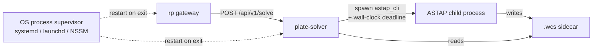

# plate-solver — Service Design

## Overview

`plate-solver` is an **rp-managed service** that wraps an
operator-supplied ASTAP CLI install and exposes a narrow HTTP solve
API to `rp`. It exists so plate solving — a hang-prone, crash-prone
external binary — runs in its own supervised process where its
failure modes cannot threaten `rp`'s liveness.

The service is **stateless across requests**: every solve spawns a
fresh `astap_cli` subprocess, waits for it under a wall-clock
deadline, parses the resulting `.wcs` sidecar, and returns. There is
no solve cache, no warm process pool, and no shared mutable state
between requests. Restart is always cheap and never costs more than
one in-flight request — which is what makes the supervision posture
described below safe.

Operators install ASTAP themselves (bring-your-own). `plate-solver`
ships no ASTAP binary, no index database, and no install script;
operators point it at their install via two required config fields.
Because the project ships none of ASTAP and runs it only as a
subprocess, it never conveys or links the LGPL-3.0 program;
[ADR-005 § License Review](../decisions/005-plate-solver.md#license-review)
holds the license analysis.

**Cross-platform support:** Linux x64, Linux aarch64 (Pi 5), macOS
Apple Silicon, Windows x64.

## Architecture



Three independent processes, three independent failure domains.
Sentinel's health supervision (or the operator's OS process
supervisor) restarts the wrapper and rp; the wrapper supervises the
ASTAP child via per-request deadlines. See
[Supervision and recovery](#supervision-and-recovery) below.

### Inputs and Outputs

- **Input:** an absolute filesystem path to a FITS file (rp and the
  service share a filesystem per `docs/services/rp.md` §"File
  Accessibility"), plus optional pointing and FOV hints, or a request
  for a whole-sky (blind) search.
- **Output:** a WCS solution (RA/Dec at image center, pixel scale,
  rotation, and — when the sidecar carries a complete CRPIX + CD
  set — the full WCS linear mapping) parsed from the `.wcs` sidecar
  ASTAP writes alongside the FITS, or a structured error.

No pixel bytes traverse HTTP. `rp` and the service trust each other
to read from a shared filesystem; this is the same trust assumption
`rp` already makes about its plugins (see `rp.md` §"File
Accessibility").

## Alignment with rp's Tenets

- **Tenet 1 — Robustness above all else.** The service exists *only*
  to honor this tenet. Wrapping ASTAP in its own process means an
  ASTAP SIGSEGV, hang, or deadlock cannot threaten `rp`'s session
  state. It is also why plate solving is an rp-managed service, which
  Sentinel restarts on hang or crash, and not a plugin
  ([rp.md § Component Categories](rp.md#component-categories)).
- **Tenet 4 — Remote interfaces only.** HTTP between rp and the
  service. The service-to-ASTAP boundary is a CLI subprocess, not an
  in-process FFI link.
- **Tenet 5 — Minimal footprint.** No long-running ASTAP processes,
  no warm caches, no embedded star database. The service holds only
  the request currently in flight.

## Behavioral Contracts

### HTTP API

The service exposes exactly two endpoints.

#### `POST /api/v1/solve`

**Happy path:**

1. Service deserializes the request body. `fits_path` must be an
   absolute path; `timeout` must parse as humantime; hint fields are
   optional. `blind: true` asks for a whole-sky search and excludes
   `ra_hint`, `dec_hint` and `search_radius_deg` (see
   [hint mapping](#hint-mapping)).
2. Service confirms `fits_path` exists, is a regular file (not a
   directory), and is readable.
3. Service acquires the single-flight semaphore (default
   concurrency = 1). Overlapping requests queue; they do not error.
4. Service spawns `astap_cli` with argv mapped from the request body
   (see [hint mapping](#hint-mapping) below).
5. Service waits for the child under the request's `timeout`
   (defaulting to `default_solve_timeout` from config).
6. On clean exit with zero status, the service reads the `.wcs`
   sidecar ASTAP wrote next to the FITS via `fitsrs` (the workspace's
   existing FITS library), deserializes the header into
   `wcs::params::WCSParams` (cds-astro/wcs-rs, already a transitive
   dep of `fitsrs`), and extracts the response fields: `ra_center`
   (CRVAL1), `dec_center` (CRVAL2), `pixel_scale_arcsec` (`|CDELT1|`
   × 3600, falling back to `√(CD1_1² + CD2_1²)` × 3600 when CDELT1 is
   absent and the CD matrix is present), `rotation_deg` (CROTA2,
   falling back to `atan2(CD2_1, CD1_1)` and defaulting to 0 when
   neither representation is present), plus a `solver` banner string
   read from the file's HISTORY / COMMENT cards (falls back to
   `"astap-cli"` when no banner is found). The response additionally
   carries `wcs_matrix` — a nested object with `crpix1`/`crpix2`
   (FITS 1-based pixel convention) and `cd1_1`/`cd1_2`/`cd2_1`/
   `cd2_2` (degrees per pixel), read verbatim from the sidecar.
   `wcs_matrix` is **all-or-nothing**: it is `null` unless all six
   keys are present, and is never synthesized from CDELT/CROTA2 — a
   synthesized matrix would fabricate image parity, which is exactly
   what the CD determinant's sign encodes. The scalar fields above
   are unchanged by its presence or absence. A defensive 2880-byte
   block padder in `runner/wcs.rs` accepts test fixtures whose card
   stream stops exactly at the END card without trailing FITS-block
   padding; it does **not** lower the WCS-keyword bar — the parser
   still requires a complete primary HDU header (`SIMPLE`, `BITPIX`,
   `NAXIS`, `CTYPE1`/`CTYPE2`) before the WCS solution. ASTAP writes
   that header with no data block (`NAXIS = 0`), and the parser takes
   it as it is. A sidecar without `CRVAL1`, `CRVAL2` or a pixel scale
   (`CDELT1`, or `CD1_1` and `CD2_1`) fails the solve with the missing
   keyword named; a non-numeric value on any keyword the response
   reads fails it with that keyword and its value named. The wrapper
   does not hand-roll FITS-header parsing.
7. Service releases the semaphore.

**Error paths** all return the same JSON envelope —
`{"error": "<code>", "message": "<text>", "details": {…}}` — with the
HTTP status the table gives. Each error code corresponds to one
failure scenario:

| Code | HTTP status | Trigger |
|------|-------------|---------|
| `invalid_request` | 400 | Schema-invalid body, non-absolute `fits_path`, unparseable `timeout`, `blind: true` together with `ra_hint`, `dec_hint` or `search_radius_deg`. Rejected before any subprocess work. |
| `fits_not_found` | 404 | `fits_path` does not exist, is not a regular file, or is not readable. Rejected before any subprocess work. |
| `solve_failed` | 422 | ASTAP exited non-zero, OR exited zero but did not write a `.wcs`, OR wrote a `.wcs` the wrapper cannot use — unreadable, a malformed header, or a required keyword missing or non-numeric. The error message names which sub-condition triggered. |
| `solve_timeout` | 504 | Wall-clock deadline expired. Service signaled the child (see [supervision](#subprocess-supervision)) and returned this error after the child exited (clean or forced), or 5 s after the force-kill if that had not ended it. Both escalation outcomes share this code; `message` distinguishes them — `solve timed out (terminated)` when the child answered the graceful signal within the grace period, `solve timed out (killed)` when it had to be force-killed. |
| `internal` | 500 | Unexpected wrapper failure: ASTAP could not be started or watched, or its stderr or exit status could not be read. Should be rare; surfacing as a distinct code keeps it visible in monitoring. |

`rp` always sees one of these five codes on failure. On a
`solve_failed` from a non-zero exit, `details` carries ASTAP's
`exit_code` and its `stderr_tail`, so the operator can diagnose
without console access to the wrapper; every other error leaves
`details` out.

#### `GET /health`

Returns `200 OK` with `{"status": "ok"}` when **all** of:

- Startup config validation passed.
- The configured `astap_binary_path` is still a regular file and
  still executable by the wrapper process at probe time.
- The configured `astap_db_directory` still exists and is still a
  directory at probe time.

Returns `503 Service Unavailable` if any of those checks fail — the
body names the failed check (`{"status": "binary_unavailable"}` or
`{"status": "db_unavailable"}`) and carries a human-readable
`message` with the offending path. Both runtime checks must pass: a
binary present without its database cannot solve, and a database
without an executable binary cannot either. The probe set matches
the startup-validation set so "healthy at probe time" means "still
capable of solving."

The probe is intentionally cheap: two filesystem stats, no
subprocess spawn. Sentinel (or any operational tooling) may probe
at high frequency without costing wrapper performance.

Sentinel consumes this endpoint through its
[service health supervision](sentinel.md#service-health-supervision):
every discovered running service is probed automatically (the URL is
derived from this service's own config), and the derived restart
command runs after consecutive failures. A `503` does **not** count
as a failure: a missing binary or database is a condition a service
restart cannot cure, so sentinel reports the service *degraded*
(amber, with the `message` displayed verbatim) instead of
restart-looping it. Anything else that speaks HTTP
(Prometheus blackbox exporter, Nagios) can probe it too.

### Subprocess Supervision

Every solve request is bounded by a wall-clock deadline. The mechanism
is [`rusty-photon-process`](../crates/rusty-photon-process.md)'s; this
section is the service's contract. The escalation sequence on deadline
expiry is:

1. **t = deadline (graceful stage):**
   - Unix: `SIGTERM` to the child's process group — the child is
     started as the leader of a session, and so of a group, of its own.
   - Windows: `CTRL_BREAK_EVENT` delivered via
     `GenerateConsoleCtrlEvent` to the child's console process group.
     The child is spawned with `CREATE_NEW_PROCESS_GROUP` so the event
     reaches it without affecting the wrapper. A wrapper with no
     console to send it through (one running as a Windows service)
     cannot deliver it, and goes straight to the force-kill stage. A
     child still starting up handles the event only once its start-up
     ends, so one that takes longer to start than deadline plus grace is
     force-killed
     ([crate doc](../crates/rusty-photon-process.md#stopping-escalates-and-stops-the-whole-tree));
     at real solve deadlines ASTAP is long past start-up.

   ASTAP normally responds cleanly within ~100 ms.
2. **t = deadline + 2 s (force-kill stage):** whatever is left of the
   child's tree is killed — the child, if it has not exited, and
   anything it started either way:
   - Unix: `SIGKILL` to the process group.
   - Windows: `TerminateJobObject` on the job object the child is placed
     in at spawn (`TerminateProcess` on the child alone if no job could
     be set up).

   The 2 s grace is a fixed constant, not configurable — chosen to
   dominate any signal-handling latency ASTAP might exhibit while
   staying short enough that a wedged child doesn't tie up the
   single-flight semaphore.
3. The service reaps the child before returning the `solve_timeout`
   error, so the semaphore is released only after exit and a
   `solve_timeout` response is followed by a free slot for the next
   request. The reap waits at most 5 s after the force-kill: a child the
   kill has not ended by then — one stuck in uninterruptible I/O on a
   wedged device — is left to a background reaper (on Windows, not waited
   for at all), and the response goes out, and the slot is freed, while
   that ASTAP is still alive.

Which stage the escalation reached is reported in the response
`message` — `(terminated)` for stage 1, `(killed)` for stage 2 — so a
caller (and the BDD suite) can tell the two apart without timing the
request. The distinction is not inferable from wall-clock duration in
practice: the stages are only 2 s apart, which is inside the spread a
loaded host puts on a request.

The service does not leak child processes. The reap before the
response is the **correctness contract** — on the normal deadline path
no ASTAP outlives its response, short of one the force-kill cannot end
within the reap's 5 s (step 3). A solve that is abandoned instead — the client
went away and the handler's future was dropped, or anything else drops
the run before it ends — stops ASTAP's tree at once (force-kill, no
grace) and reaps it, on the thread that was waiting for it rather than
on the dropped request. What no in-process path can cover is the
wrapper itself being killed outright: the job object is not
kill-on-close, so ASTAP then finishes on its own (on Linux, systemd's
stop of the unit's cgroup takes it down with the wrapper).

### Single-Flight Concurrency

ASTAP is CPU-bound on a single core during a solve. The service
serializes overlapping requests behind a `tokio::sync::Semaphore`
with capacity equal to `max_concurrency` (default 1).

Overlapping requests **queue, not error**. The HTTP request stays
open while waiting on the semaphore. Each request's `timeout`
applies to its solve only — time spent waiting in the queue is not
counted against the deadline. Operators who need to bound queue
depth do so at rp's HTTP-client layer (`plate_solver.timeout` in rp
config, which bounds queue wait and solve together), not here.

### Hint Mapping

Optional pointing and FOV hints map directly to ASTAP CLI flags:

| Request field | ASTAP flag | Notes |
|---------------|-----------|-------|
| `ra_hint` | `-ra <decimal hours>` | Wire format is decimal degrees (0–360) for consistency with `ra_center`; wrapper converts to hours (`degrees / 15`) before passing to ASTAP. |
| `dec_hint` | `-spd <degrees>` | Wire format is decimal degrees (−90–90); wrapper converts to south-pole-distance (`90 + dec`) before passing to ASTAP. |
| `fov_hint_deg` | `-fov <degrees>` | Pass-through (image height, per ASTAP CLI documentation). |
| `search_radius_deg` | `-r <degrees>` | Pass-through. Defaults to ASTAP's own default when omitted. |
| `blind` | `-r 180` | `true` asks for a whole-sky search. Refused with `invalid_request` alongside `ra_hint`, `dec_hint` or `search_radius_deg`: a radius bounds a search around a position, and a blind solve has none. `fov_hint_deg` may accompany it. `false`, the default, adds no flag. |

Omitted fields produce no flag, and ASTAP fills them in itself. Its
manual says of `-ra`, `-spd` and `-fov`: "If not specified it will be
extracted from the FITS header or last successful solve will be used
(learn mode)", and "Command-line parameters have priority above fits
header values." So a solve without hints is not necessarily blind:
ASTAP starts from the header's position (`RA`/`DEC` or
`OBJCTRA`/`OBJCTDEC`, see the timings below) or from its previous
solve, and searches `-r`, or its own default radius, around it. A
header that names the wrong place steers that search wrong, and no
flag tells ASTAP to ignore the header. `blind` is the way out: `-r`
is "the radius of the square search pattern around the start
position", and at 180° that pattern covers the whole sky. A start
taken from the header or the last solve still decides where the search
begins, and so how long it takes, but can no longer make it miss. A
whole-sky search is slow (see the timings below), so a caller budgets
the request's `timeout` for it.

The wrapper does not synthesize hints; it never invents data the
caller did not provide. `rp` never leaves a frame's position to the
header: it sends one, or `blind`
([Hint sources](#hint-sources-and-search-radius-defaults)).

### Hint sources and search-radius defaults

The wrapper itself receives hints in the HTTP request body — it
neither queries the mount nor maintains a default. Hint sources are
the caller's concern; for `rp` (the canonical caller), the hint
chain is:

1. **`ra_hint` / `dec_hint`, or `blind`**, come from the caller.
   `rp`'s `plate_solve` MCP tool resolves them per call, in this
   order:
   - An explicit `pointing_hint: { ra_deg, dec_deg }` object on the
     MCP call. Both values are decimal degrees on the wire (the
     `_deg` suffix in the field names is intentional — it preempts
     the Alpaca-hours / wrapper-degrees confusion at the call site).
     The nested-object shape makes the both-or-neither contract
     structural.
   - Else the frame's own sidecar `pointing`: what the mount reported
     as the exposure started, recorded at capture time. Its
     `ra_hours` is Alpaca's decimal hours, which rp multiplies by 15
     and folds into `[0, 360)` for the wrapper's degrees-on-the-wire
     contract; `dec_degrees` passes through unchanged. It is never
     the live mount, which may have moved since the frame was taken
     (`docs/services/rp.md` §"Ground rules").
   - Else, or whenever the call passes `blind: true`, no position:
     rp sends `blind: true` and no `search_radius_deg`. A frame with
     no sidecar, such as one another program wrote, has no recorded
     pointing and is solved blind too.

   (MCP directionality: clients call rp; rp calls the wrapper.) See
   `docs/services/rp.md` §"`plate_solve` Contract" for the full input
   shape and validation rules.
2. **`fov_hint_deg`** comes from the caller as an MCP parameter, else
   from the frame's own sidecar: `optics.fov_height_deg`, recorded at
   capture time. It is never the live camera or train config looked
   up by the frame's camera, which may have changed since the frame
   was taken (`docs/services/rp.md` §"Ground rules"). With neither,
   rp sends none, and ASTAP takes the scale from the header or its
   last solve ([Hint Mapping](#hint-mapping)).
3. **`search_radius_deg`** is the harder field. **The ASCOM Alpaca
   Telescope spec does not standardize a "pointing uncertainty"
   property.** Mount drivers may expose vendor-specific accuracy
   estimates, but there is no portable way to ask "how confident
   are you in your pointing?" Operators provide this number via
   their rp config (`plate_solver.default_search_radius_deg`) for
   fresh captures on the configured rig; per-call MCP
   `search_radius_deg` overrides for loaded-from-disk images where
   the configured default may not match the originating rig. A blind
   solve takes neither.

Recommended `search_radius_deg` defaults — operators tune per their
rig:

| Mount state | Recommended radius |
|-------------|--------------------|
| Synced to a recent solve, GoTo mount with pointing model | 1°–2° |
| Synced, no model | 2°–5° |
| Unsynced cold start | 5°–10° |
| No reliable mount input (manual pointing) | `blind: true`: no position, no radius ([Hint Mapping](#hint-mapping)) |

Smaller radius means faster solve. ASTAP's documented sweet spot is
~3° for typical amateur GoTo setups.

#### Operator perf comparison (manual)

To verify the hint speed advantage on a real rig, run the wrapper
with a real ASTAP install + a known-solvable FITS, then time two
requests via `curl`:

```sh
# With hints (M 101 example — matches the committed
# tests/fixtures/m101_known.fits)
time curl -s -X POST http://localhost:11131/api/v1/solve \
  -H 'content-type: application/json' \
  -d '{
    "fits_path": "/path/to/m101_known.fits",
    "ra_hint": 210.8099,
    "dec_hint": 54.3469,
    "fov_hint_deg": 0.42,
    "search_radius_deg": 3.0,
    "timeout": "30s"
  }'

# Same FITS, no hints (blind solve)
time curl -s -X POST http://localhost:11131/api/v1/solve \
  -H 'content-type: application/json' \
  -d '{"fits_path": "/path/to/m101_known.fits", "timeout": "120s"}'
```

Reference measurements on the committed `m101_known.fits` fixture
(Linux x64 reference box, ASTAP CLI 2026.05.18, D05 database):

- Hinted: **~63 ms**
- Blind: **~48 s** (~770× slower)

The committed fixture has its FITS pointing breadcrumbs (`RA`,
`DEC`, `OBJCTRA`, `OBJCTDEC`, `OBJECT`) stripped
([Real-ASTAP Coverage Cadence](#real-astap-coverage-cadence)),
so the "blind" measurement above truly walks ASTAP's search
spiral. Operator-captured FITS that retain those header keys will
behave very differently without hints: ASTAP reads the cards as a
free hint and finishes in milliseconds, masking any hint-pipeline
regression. To reproduce the spread above on your own captures,
either supply the wrong start position via `ra_hint`/`dec_hint`
or strip the pointing keys from a fixture copy.

If the spread disappears entirely (hinted is not materially faster
than blind on a header-less fixture), the wrapper isn't being
invoked correctly or ASTAP's index database is mismatched to the
FOV. The nightly `plate-solver-smoke` workflow records both numbers
per OS and guards them
([Real-ASTAP Coverage Cadence](#real-astap-coverage-cadence)).

### Configuration Validation at Startup

The service validates its config before binding the HTTP listener.
On any validation failure, it logs a structured error naming the
field and exits non-zero. Sentinel's restart loop then surfaces the
misconfiguration to the operator rather than masking it with a
silent retry.

Validation rules:

- `astap_binary_path` must exist, be a regular file, and be executable
  by the current user.
- `astap_db_directory` must exist and be a directory.
- `server.bind_address` must parse as an IP address (typed `IpAddr`
  in the shared server config, so a malformed address fails at config
  load rather than at bind time).
- `default_solve_timeout` must be ≤ `max_solve_timeout` (otherwise
  the request-supplied timeout could exceed `max_solve_timeout`,
  defeating the bound).
- `max_concurrency` must be ≥ 1 (a zero-capacity semaphore would
  permanently stall every request).

The `astap_binary_path` validation runs again on every `/health`
probe, so a binary removed after startup is detected.

## Configuration

The service reads a single JSON config file. `--config` names it
explicitly; when omitted, the path resolves to the platform default
(`~/.config/rusty-photon/plate-solver.json` on Linux,
`%PROGRAMDATA%\rusty-photon\plate-solver.json` on Windows) via
`rusty-photon-config`. There is no built-in default config — the file
must exist (`astap_binary_path` / `astap_db_directory` are mandatory),
so the packaged systemd unit gates on it with `ConditionPathExists`
instead of crash-looping on a fresh install. Run by the Windows SCM
without the file, the service stops at once with exit code 0, which the
failure actions leave alone (`ServiceRunner::condition_path_exists`;
[ADR-025](../decisions/025-config-gated-services-gate-themselves-on-windows.md)).

`plate-solver doctor [--config <file>] [--json]` diagnoses this service's
own config read-only without starting it — see
[doctor.md §Per-service doctors](doctor.md). Top-level flags cannot be
combined with the subcommand (the mixed form would silently ignore them).

```json
{
  "server": {
    "port": 11131,
    "bind_address": "0.0.0.0",
    "tls": null,
    "auth": null
  },
  "astap_binary_path": "/opt/astap/astap_cli",
  "astap_db_directory": "/opt/astap/d05",
  "max_concurrency": 1,
  "default_solve_timeout": "30s",
  "max_solve_timeout": "120s",
  "astap_extra_env": {}
}
```

The `server` block is the shared `ServerConfig` from
`crates/rusty-photon-server-config`: `port`,
`bind_address` (default `0.0.0.0`), and optional `tls`/`auth`. Absent
`tls`/`auth` (shown as `null` above) means plain, unauthenticated
HTTP.

| Field | Required | Default | Notes |
|-------|----------|---------|-------|
| `server.bind_address` | no | `0.0.0.0` | Interface to bind; all interfaces by default. |
| `server.port` | no | `11131` | Matches the placeholder rp config in `rp.md` §"Configuration". |
| `astap_binary_path` | **yes** | — | No default. Wrapper must be told where ASTAP is. |
| `astap_db_directory` | **yes** | — | No default. ASTAP needs an index database to solve; the operator picks D05 / D80 / etc. for their FOV. |
| `max_concurrency` | no | `1` | Capacity of the single-flight semaphore. A value above 1 is the operator's choice and unsupported: no test runs the service above 1. |
| `default_solve_timeout` | no | `30s` | Applies when the request body omits `timeout`. |
| `max_solve_timeout` | no | `120s` | Caps any caller-supplied `timeout`. |
| `astap_extra_env` | no | `{}` | Map of environment variables set on every spawned `astap_cli` child. Use for operator-controlled tunables (locale, library paths) and for BDD tests that drive `mock_astap`'s `MOCK_ASTAP_MODE` per scenario without process-wide `env::set_var` races. |

Required fields exit the process on absence (no implicit defaults
for "where is ASTAP" — see [Configuration Validation](#configuration-validation-at-startup)).

## Subprocess Test Doubles

The service ships an in-tree `mock_astap` `[[bin]]` that mimics the
ASTAP CLI surface and is used in BDD and runner integration tests.

Behavior is selected via the `MOCK_ASTAP_MODE` environment variable
the test sets before spawning the wrapper:

| Mode | Behavior | Drives |
|------|----------|--------|
| `normal` | Read `-f <path>`, write a canned `.wcs` next to it, exit 0 | Happy path |
| `exit_failure` | Write to stderr, exit 1 (no `.wcs`) | `solve_failed` (non-zero exit branch) |
| `hang` | Sleep indefinitely; respond cleanly to the platform's graceful signal (Unix `SIGTERM`; Windows `CTRL_BREAK_EVENT`) | `solve_timeout` (terminated) |
| `ignore_sigterm` | Trap and ignore the graceful signal; sleep anyway. Mode name kept for stability — semantics are platform-neutral. | `solve_timeout` (killed via the platform's force-kill) |
| `hold` | Hold the solve open until the test releases it, then behave as `normal`; a solve started after the release behaves as `hang` | Single-flight queueing |
| `malformed_wcs` | Write a `.wcs` missing `CRVAL2`, exit 0 | `solve_failed` (parser-detected branch) |
| `no_wcs` | Exit 0 without writing any `.wcs` | `solve_failed` (sidecar-missing branch) |

Setting `MOCK_ASTAP_ARGV_OUT=<file>` (any mode) writes the received
argv to the named file, used for end-to-end argv-flow assertions.
`hold` mode takes its directory from `MOCK_ASTAP_HOLD_DIR=<dir>`. An
invocation that starts before the test has created `<dir>/release`
records its start as its own empty file, `started-<pid>`, in `<dir>`,
waits for `release` to appear, then writes the canned `.wcs` and exits 0;
one that starts after the release hangs. A hold that ends without a
release (the directory is deleted, or 120 s pass) exits 2, so a failed
scenario leaves no held child behind.

The single-flight BDD scenario uses `hold` to fix the order of two solves
rather than race them, and reads the wrapper's own account of what it did.
The solve handler logs at `debug` — `solve request queued behind a running
solve` when the semaphore refuses a request, `starting the solve` with the
timeout it hands the runner, and `solve finished` before the permit drops —
and the BDD world runs the wrapper with
`RUST_LOG=info,plate_solver=debug,rusty_photon_process=debug`, the second
part so that a failed supervision scenario's log says how each deadline
stop went.
The scenario releases the first solve only after its child has recorded
its start and the wrapper has logged the second request queueing, then
holds it 500 ms more, longer than the second request's 100 ms timeout.
It then asserts the wrapper's events in order: the second solve starts
only after the first finished, with its whole 100 ms. Every wait is on
something the wrapper or the mock produced, so no assertion can fail
because a runner is slow.

This binary is **not feature-gated** — it builds with every
`cargo build --all-targets`. BDD and runner integration tests
discover it in this order: explicit `MOCK_ASTAP_BINARY` env var
(set by Bazel test targets) → `option_env!("CARGO_BIN_EXE_mock_astap")`
(set by Cargo for `[[test]]` crates). Both fallbacks let the suite
run under Cargo and Bazel without divergent code paths. Pure
`env!()` is intentionally avoided because `CARGO_BIN_EXE_*` is
unset under Bazel and unset for `#[cfg(test)] mod tests` inside
`src/`.

### Real-ASTAP Coverage Cadence

A small set of `@requires-astap`-tagged BDD scenarios runs against
the real ASTAP binary, gated by a runtime check on the
`ASTAP_BINARY` environment variable: the scenario filter in
`tests/bdd.rs` leaves them out when the env var is unset (the
PR-required path). They fire when the env var is set, which is the
job of the nightly cross-platform smoke workflow,
`plate-solver-smoke.yml`. To fire them on a developer's machine,
`bazel run //.github/actions:install -- astap` installs the CLI and
the D20 database the smoke pins into `~/.local/opt/astap` and prints
the `ASTAP_BINARY` and `ASTAP_DB_DIR` to set; then run
`cargo test -p plate-solver --all-features --test bdd`, as the smoke
does.

The mock-backed scenarios cover the wrapper's own contract on every
pull request. The real-ASTAP ones catch what `mock_astap` cannot: a
real ASTAP whose `.wcs` shape, CLI surface or banner differs from
what the mock claims, on Linux, macOS and Windows. They run
nightly, on a push that touches the service, the workflow or the
actions it uses, and on demand — not on every pull request, because
each OS leg downloads ASTAP and the ~400 MB D20 database. Each leg
installs both with the `install-astap` action, which takes its OS's
archive from a table of SHA-256-pinned archives
(`.github/actions/install-astap/assets.json`); on macOS the workflow
then clears the quarantine flag on `astap_cli`. The install alone —
the pinned archives and the binary's banner — is the
`install-astap.yml` workflow's to check, on every supported platform.

`tests/features/real_astap_smoke.feature` holds three scenarios: the
committed M 101 fixture solved without hints (`m101_blind`) and with
them (`m101_hinted`), each recording its duration, and a star-less
FITS (`degenerate_no_stars.fits`) that must fail with `solve_failed`.
The fixture, `tests/fixtures/m101_known.fits`, is a 1024×1024 crop of
a real capture with its pointing keywords — `RA`, `DEC`, `OBJCTRA`,
`OBJCTDEC`, `OBJECT` — stripped. Left in, ASTAP would start from the
header's position ([Hint Mapping](#hint-mapping)) and the request
without hints would finish in milliseconds too; stripped, that
request walks ASTAP's search spiral, so the gap between the two
scenarios measures what the hints buy. The duration step appends a
`label,elapsed_ms` row to the CSV that `PLATE_SOLVER_PERF_CSV` names,
and does nothing when that is unset; the workflow uploads each leg's
CSV as the `plate-solver-perf-<os>` artifact.

The workflow's "Log and check solve times" step (the
`plate-solver-times` action) puts the times in the log however the
BDD run ended, and guards them after a run that passed. Per OS it
requires the blind solve to stay at least 10× slower than the hinted
solve — a dropped hint flag in `runner/astap.rs` collapses that
ratio — and enforces coarse absolute ceilings (hinted ≤ 5 s,
blind ≤ 180 s) to catch a uniform slowdown. A breach fails the smoke
run, which on a scheduled run opens or updates the
`plate-solver-nightly` tracking issue. The thresholds are coarse by
design: the ratio normalises itself and so tolerates a slow or
contended runner, and the ceilings sit well above the slowest times
hosted runners show (`.github/actions/plate-solver-times/times.mjs`
holds those times), the blind one under the scenario's 300 s request
timeout.

### Refreshing the ASTAP pins

`install-astap`'s table, `.github/actions/install-astap/assets.json`,
pins a SHA-256 for each runner's ASTAP CLI archive and one for the D20
star database. ASTAP's SourceForge URLs carry no version, so upstream
replaces the bytes behind an unchanged URL; the pin turns each
replacement into a reviewed change rather than a silent one. A download
that does not match its pin fails the action before anything is
unpacked, so a rotation shows as a failed smoke: `install-astap`'s for
a CLI archive, and for either `plate-solver-smoke`'s, the only one that
downloads the database.

**The CLI archives refresh themselves.** When an `install-astap` run
on main fails, or on a manual dispatch, `refresh-astap-shas.yml`
downloads each runner's archive and compares it with its pin. It runs every rotated binary that has a hosted runner
of its own against the committed M 101 fixture, to the BDD scenario's
0.01° tolerance; Windows-ARM64 has no hosted runner, so its pin moves
unverified. When every check passes, it commits the new pins to
`chore/auto-refresh-astap-shas` and opens, or updates, the
`chore(install-astap): auto-refresh SHA-256 pins` pull request from
that branch. When one fails, upstream has shipped a binary that does
not solve, and the workflow opens, or comments on, an
`astap-refresh-blocked` issue instead. A dispatch with `dry-run` prints
what it would write and writes nothing. Two settings of the repository
are its preconditions:

- Opening the pull request needs "Allow GitHub Actions to create and
  approve pull requests" at both the organization and the repository
  level (Settings → Actions → General → Workflow permissions). Without
  it, the run fails after moving the branch, and a maintainer opens the
  pull request from `chore/auto-refresh-astap-shas` by hand.
- The `astap-refresh-blocked` label must exist. GitHub opens an issue
  without a label it lacks, and every later failure, not finding that
  issue by its label, would open another; the action fails the run
  when the label is missing.

GitHub starts no `pull_request` workflow for a pull request that a
workflow's own token opened, so the M 101 check is the only ASTAP check
the proposal gets before merge. Closing and reopening it starts the
pull-request workflows.

**The manual steps** refresh the D20 database, whose rotation the
refresh only warns about, and the CLI archives whenever the refresh
itself cannot run. For the CLI archives:

1. Download each runner's archive from SourceForge, from the folder
   the table names.
2. Take its SHA-256 (`sha256sum`, or `shasum -a 256` on macOS).
3. Write it as that runner's `sha256` in `assets.json`, keeping the
   file's layout: `install_astap_test` checks that the file is in the
   layout the refresh writes.
4. Open a pull request. The `install-astap` smoke runs on it and checks
   the new pins on `ubuntu-latest`, `ubuntu-24.04-arm`, `macos-latest`
   and `windows-latest`. Nothing runs the Windows-ARM64 archive.
5. Name in the pull request the ASTAP CLI version the new binaries
   print in their banner.

For the D20 database:

1. Download `d20_star_database.zip` from SourceForge.
2. Take its SHA-256.
3. Write it as `database.sha256` in `assets.json`. The action's cache
   key carries the pin, so the cache moves with it.
4. Push the change to a branch. `install-astap` does not download the
   database; `plate-solver-smoke` does, and runs on a push that touches
   `.github/actions/install-astap/`, on `ubuntu-latest`, `macos-latest`
   and `windows-latest`.

The table points Windows-ARM64 at `windows_installer/older versions`,
where upstream files its current archive; the usual `windows_installer`
folder answers 404 for it. When upstream moves the archive back, the
table's folder follows. Should the archive move or go first, the
refresh still runs: the Windows-ARM64 leg only compares, so an archive
it cannot download keeps its pin, the proposal says why, and the other
runners still refresh.

## Supervision and recovery

The wrapper sits inside a layered supervision design with three
distinct failure domains. **The preferred supervisor for this
service is Sentinel's
[service health supervision](sentinel.md#service-health-supervision)**:
it polls `GET /health` every 30 s and, after three consecutive
failures, runs the restart command it derives for the installed unit,
which covers both crashes *and* hangs (a wedged wrapper whose process
is still alive). The service manager that runs the unit carries out
that restart command, and relaunches a wrapper that exits on a
failure (systemd's `Restart=on-failure`, the Windows service's
failure actions). An OS-level process supervisor set up by hand
(systemd / launchd / NSSM; see the
[README's per-OS recipes](../../services/plate-solver/README.md#process-supervisor-recipes))
relaunches the wrapper on exit too, but the recipes name it
`plate-solver` (`com.rusty-photon.plate-solver` under launchd), which
Sentinel's discovery of `rusty-photon-*` units does not find, so it
covers crashes and not hangs.

### Failure Domains

| Domain | Supervisor | Detection | Action |
|--------|------------|-----------|--------|
| `rp` (gateway) | Sentinel health supervision and/or the operator's process supervisor (systemd / launchd / NSSM) | Sentinel `GET /health` probes; process exit (panic, OOM, etc.) | Sentinel runs the derived restart command after consecutive failed probes (with backoff); the OS supervisor restarts on exit per its policy (`Restart=on-failure`, `KeepAlive`, etc.) |
| `plate-solver` (this service) | Sentinel health supervision and/or the operator's process supervisor | Sentinel `GET /health` probes (crash **and** hang coverage); process exit | Same as above. The wrapper exits non-zero on config-validation failure and on internal panic; a hung-but-alive wrapper fails its probes and gets restarted by Sentinel. |
| `astap_cli` (child) | This service | Per-request wall-clock deadline | Graceful signal → 2 s grace → force-kill of the child's tree. Unix: `SIGTERM` → `SIGKILL` to its process group. Windows: `CTRL_BREAK_EVENT` (with `CREATE_NEW_PROCESS_GROUP` at spawn) → `TerminateJobObject`. |

### Belt-and-Suspenders Outer Timeout

`rp`'s HTTP client to this service has its own outer timeout
(`plate_solver.timeout` in rp config). Even if the wrapper's
internal timeout regresses, `rp` does not hang on a `plate_solve`
call. The wrapper's deadline is the primary control; rp's is the
backstop, and it never cuts a request short of that deadline: a
request carrying its own `timeout` gets
`max(plate_solver.timeout, timeout + 10 s)`, the 10 s covering the
2 s kill grace and the reap of up to 5 s after the deadline
([Subprocess Supervision](#subprocess-supervision)).

### What restart recovers from

Stateless-across-requests is the property that makes restart safe.
Restarting the wrapper costs the in-flight request (which gets a
transient error and may be retried by the orchestrator) and nothing
else — no session state, no warm caches, no in-memory artifacts the
operator cares about.

### Sentinel-driven supervision

Sentinel's [service health supervision](sentinel.md#service-health-supervision)
is the first-party answer, and it needs no wiring: sentinel discovers
the installed `rusty-photon-plate-solver` unit, derives the
`GET /health` probe from this service's own config, polls it every
30 s, and after three consecutive failures runs the derived restart
command — backing off between attempts and notifying on every
autonomous restart. The wrapper's graceful-shutdown semantics
(SIGTERM handler) compose cleanly with `systemctl restart`.
`/health` remains available to any other operational tooling
(Prometheus blackbox exporter, Nagios, etc.).

## MVP Scope

### In scope for v1

- One solve endpoint, one health endpoint, one config file.
- Single ASTAP runner. Architecturally swappable for `solve-field`,
  but only ASTAP is implemented.
- Single-flight by default (`max_concurrency` 1); overlapping
  requests queue.
- BYO ASTAP. No bundled binary, no install scripts.

### Out of scope for v1

- `solve-field` runner. The `AstapRunner` trait is the swap point; no
  `solve-field` implementation exists.
- Background solving by subscribing to rp's `exposure_complete`
  events. The wrapper is request/response only.
- Solve cache or warm process pool. Explicitly excluded by
  stateless-across-requests.
- An MCP server surface. The wrapper speaks HTTP only; rp owns the
  `plate_solve` MCP tool name.
- Pixel transport over HTTP. File path only.

## References

- ADR-005 — `docs/decisions/005-plate-solver.md`
- Implementation plan — `docs/plans/archive/plate-solver.md`
- rp design doc, §"Plate Solver" — `docs/services/rp.md`
- rp design doc, §"Sentinel Watchdog Integration" — `docs/services/rp.md`
- rp design doc, §"File Accessibility" — `docs/services/rp.md`
