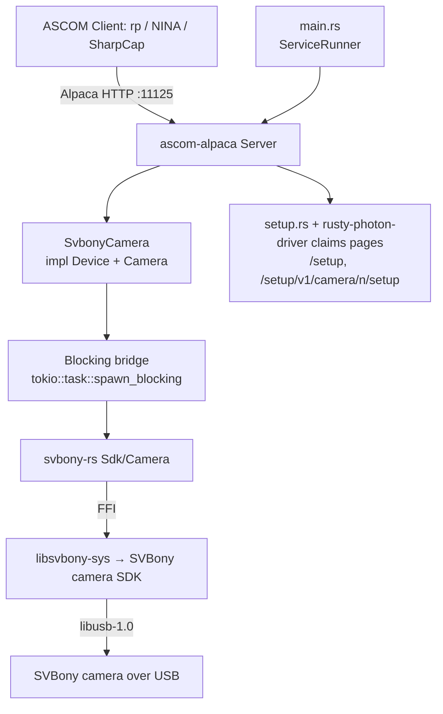

# Svbony-Camera Service Design

`svbony-camera` is validated against a physical SV605CC on Linux x86_64,
on the aarch64 field rig and on Windows 11, ConformU clean on both suites
([§ Real-hardware validation](#real-hardware-validation)).

## Overview

The `svbony-camera` service is an ASCOM Alpaca **Camera** driver for SVBony
cooled cameras (first hardware target: the SV605CC, a Sony IMX533-based OSC
camera). It exposes exposures, ROI/binning, gain/offset, cooling, and
readout over ASCOM Alpaca on a fixed port so `rp` and any Alpaca client
(NINA, SharpCap) can drive it like the existing `qhy-camera` / `zwo-camera`
services. SVBony ships no Alpaca driver of its own (Windows ASCOM binary
only); this driver is written against the native SVBony camera SDK
(`libSVBCameraSDK`) via the vendored [`svbony-rs`](../../crates/svbony-rs/)
crate.

It is the SVBony analogue of [`zwo-camera`](zwo-camera.md) — the API is
closely modeled on ZWO's ASI SDK, so `zwo-camera`'s device-trait shape ports
with mostly renames — **except for the exposure path**, SVBony's one
genuinely new design problem (see "Behavioral contracts → Exposure").

**Provenance.** Behaviour is derived from `indi_svbony_ccd` (indi-3rdparty)
as a *behavioural reference only* — GPL/LGPL-family — **no code is copied**,
the same clean-room discipline `qhy-camera` and `zwo-camera` take toward
their own INDI references.

**Not cross-platform.** Like `qhy-camera`/`zwo-camera`, this service links a
**native vendor SDK** at compile time and is gated out of the default
workspace build by SDK availability. See *Native dependency & build gating*.

**How it differs from `zwo-camera` (the two axes that matter).**

| Concern | ZWO (the mechanical precedent) | SVBony (this service) |
|---|---|---|
| **SDK license** | MIT → redistribute in-package | **No license text at all** → treat like QHY: never redistribute, download-on-target ([ADR-018](../decisions/018-svbony-sdk-no-license-payload-policy.md)) |
| **Identity** | `ASIGetSerialNumber` requires an *open* camera → enumeration opens-then-closes each camera | `SVB_CAMERA_INFO.CameraSN` arrives **pre-open**, at enumeration (`SVBGetCameraInfo`) → identity is minted directly from enumeration, no open/close dance |
| **Exposure model** | Snap API (`ASIStartExposure`) | **Video-only**: no snap API; every exposure rides `SVBStartVideoCapture` + soft trigger + `SVBGetVideoData` |
| **Rust FFI layer** | `zwo-rs`, `bindgen`-generated | `svbony-rs`, **hand-transcribed** (SVBony's header carries no license, so it is not vendored/bindgen'd — see `crates/svbony-rs`) |

Net: mechanically SVBony is ZWO-shaped (we own the FFI crate; a cleaner C
API ports closely), legally it is QHY-shaped (no redistribution grant).

---

## Native dependency & build gating (the crux)

- The imaging path is `svbony-camera → svbony-rs → libsvbony-sys → ` the
  **SVBony camera SDK** (`libSVBCameraSDK`, a source-less native binary,
  SDK version 1.13.4) **+ libusb-1.0**.
- `libsvbony-sys`'s `build.rs` emits `cargo:rustc-link-lib` for the one SDK
  library — SVBony has only one device (camera) and one SDK, so unlike
  `zwo-rs`/`libzwo-sys` there is no per-device link-feature union (a
  single-device-type SDK has nothing to split).
- **Consequence:** every machine that compiles this package needs the
  SVBony camera SDK installed and discoverable, plus `libusb-1.0` dev
  headers — not just machines with a camera attached.
- The `svbony-rs` **`simulation` feature** (forwarded here as this
  service's own `simulation` feature) makes the build **camera-free, NOT
  SDK-free**: it fabricates a fake `SV605CC-Simulated` camera at runtime,
  including the soft-trigger video-capture flow and a poll-based cooling
  ramp. The native SDK is still required at link time — *unless*
  `SVBONY_SKIP_NATIVE_LINK=1` is set (see below).
- **`libusb-1.0` needs a keep-alive reference, not just a link-lib
  directive.** The vendored `libSVBCameraSDK.so`/`.dylib` blob
  references `libusb_*` symbols internally without declaring libusb in its
  own `DT_NEEDED` (byte-verified via `readelf -d`), and `svbony-rs`'s own
  code never calls a `libusb_*` symbol directly — so a plain
  `cargo:rustc-link-lib=dylib=usb-1.0` gets dropped by the linker's default
  `--as-needed` behavior, producing a runtime `symbol lookup error:
  undefined symbol: libusb_init` on first camera-SDK call.
  `libsvbony-sys/lib.rs`'s `svbony_keep_libusb`-gated `libusb_keepalive`
  module (mirroring `libzwo-sys`'s `zwo_keep_udev`) fixes this with a
  `#[used]` function-pointer static that gives the linker a real
  regular-object reference to `libusb_init`, forcing `libusb-1.0` into
  `DT_NEEDED`. A `-Wl,--no-as-needed`/`-Wl,--as-needed` bracket around the
  link-lib line does **not** work: Cargo only applies a build script's
  `cargo:rustc-link-arg` to the *build script's own package's*
  bin/cdylib/test/example targets, not transitively to downstream binaries
  like `svbony-camera` — verified empirically (the flag never appears on the
  final linker command line).

### Bazel links the simulation only

The Cargo workflows provision the real SDK with
[`.github/actions/install-svbony-sdk`](../../.github/actions/install-svbony-sdk/action.yml),
which mirrors `install-zwo-sdk`: `native.yml` (the nightly real-link build
and the `svbony-rs` FFI smoke tests), `conformu.yml`, `scheduled.yml`'s
full-workspace legs and `pi-nightly.yml`'s sudo-free full-workspace leg
(the action's `sudo: "false"` mode). The `--all-features` workflows that
provision no SDK — `test.yml`, `safety.yml` and `ui-browser-nightly.yml` —
set `SVBONY_SKIP_NATIVE_LINK=1`, and so does `conformu.yml`'s macOS leg,
which runs on Apple Silicon, for which no SDK blob exists (see
"Packaging"). That action is a GitHub-Actions composite (shell steps
against `apt`/`brew`/`curl`+`ldconfig`), not something Bazel's hermetic
build graph consumes. Bazel would need its own repository rule (e.g. an
`http_file` fetch plus a non-skipping `cargo_build_script` variant) to
provision the same SDK, and the workspace has none, so
`crates/svbony-rs/libsvbony-sys/BUILD.bazel` bakes
`SVBONY_SKIP_NATIVE_LINK=1` into its `cargo_build_script`
*unconditionally*. The *library* targets (no final link) build with **zero
SVBony SDK provisioning**. The **real** (non-`simulation`)
`//services/svbony-camera:svbony-camera` binary cannot link under this
setup — `bazel build //services/svbony-camera:svbony-camera` fails with
undefined `SVBOpenCamera`/`SVBCloseCamera`/etc. symbols — so it is tagged
`tags = ["manual"]` in `BUILD.bazel`, unlike `zwo-camera`'s and
`qhy-camera`'s real binaries, which link cleanly under Bazel because their
BUILD.bazel files provision the real SDK unconditionally (this workspace's
Bazel CI/dev hosts have QHYCCD/ZWO pre-provisioned by other means). Only the
library and the `svbony-rs_sim`-backed binary/BDD/unit-test/`conformu_integration`
targets are first-class (non-`manual`) `//...` targets. The Bazel
`conformu_integration` target (`tags = ["conformu"]`, excluded from the
default gate like `zwo-camera`'s — run with
`bazel test --config=conformu //services/svbony-camera:conformu_integration`)
links the SIM SDK variant like every other Bazel target here, so it proves
ASCOM protocol conformance, not the real link — that real-link proof is
Cargo-only (`conformu.yml`'s `install-svbony-sdk` step). The packages are
built with Cargo (`cargo ci build-packages`, see "Packaging"), so the
`manual` tag leaves them untouched.

Cargo builds outside Bazel follow the same env-var gate (unset the variable,
with the SDK installed and `ldconfig`'d, to exercise the real link locally)
— this is exactly what `native.yml`'s `install-svbony-sdk` step does per-run,
and `bazel run //.github/actions:install -- svbony-sdk` installs the SDK on a
developer's Linux box or Intel Mac the same way, by the action's own module
([`crates/svbony-rs/README.md`](../../crates/svbony-rs/README.md) has the
details; it offers no Windows SDK, which only the private mirror holds).
The split — Cargo CI links the real SDK, Bazel only the simulation — is
deliberate and closes with a Bazel-side SDK-fetch rule (see "Future Work"),
which drops the `manual` tag.

### Gating plan with a Bazel-side SDK fetch

With a Bazel-side SDK-fetch rule the gating mirrors `zwo-camera`'s table
exactly: local dev needs the SDK installed to link; CI provisions it before
building/testing, which `install-svbony-sdk` does for Cargo; the
simulation-only legs build SDK-free via `SVBONY_SKIP_NATIVE_LINK=1`; Bazel
provisions the SDK for its `//...` targets the same way
`install-zwo-sdk`/`qhyccd-sdk-install` do.

### Windows

`libsvbony-sys/build.rs` has real Windows link directives; CI links them
against a private mirror's copy of the SDK, and no package ships it.

- **The SDK.** SVBony publishes a Windows `SVBCameraSDK` build directly
  (svbony.com/downloads/software-driver,
  `windows-SVBCameraSDK-v1.13.4.zip` — the same SDK version as the Linux
  pin), separately from indi-3rdparty, whose `libsvbony` packaging is
  Linux/macOS-only and says nothing about whether a Windows SDK exists.
  Byte-verified against the real package: the header's exported function
  set is identical to what `lib.rs` binds; the `.lib`/`.dll` (x86 + x64)
  export tables show plain, undecorated `cdecl` names (no `__stdcall`/`@N`
  decoration); no `libusb` dependency anywhere (the DLL's internal
  `CWinUsbCamera` symbol shows it uses Windows' in-box WinUSB driver
  instead); no license/EULA text anywhere in the package, so the Windows
  SDK carries no license grant either. `cargo check -p svbony-rs
  --target x86_64-pc-windows-msvc` (with `SVBONY_SDK_LIB_DIR` pointed at a
  manually-provisioned copy) passes.
- **CI: a private mirror, because the vendor URL can't be scripted.**
  Unlike the Linux/macOS blobs (indi-3rdparty's plain
  GitHub-raw mirror) or ZWO's Windows SDK (`install-zwo-sdk`'s plain CDN
  URL), SVBony's Windows download is gated behind
  `data-fileRestricted="true"` + a `recaptcha-v3.js`/`unified-captcha.js`
  consent flow — not a fetchable URL, and solving the CAPTCHA is out of
  scope on principle, not just effort. CI instead provisions the payload
  from the project's private, token-gated mirror
  (`https://private.rustyphoton.space`, code + runbook:
  `tools/private-mirror-worker/`; decision + risk analysis in
  [ADR-018 §7](../decisions/018-svbony-sdk-no-license-payload-policy.md)):
  `install-svbony-sdk`'s Windows step downloads the operator-uploaded
  vendor zip, verifies its pinned sha256, exports `SVBONY_SDK_LIB_DIR` for
  the link, and puts the DLL dir on `PATH` for runtime. `native.yml`
  builds the real link and runs the `svbony-rs` FFI smoke (DLL load +
  zero-camera enumeration) on Windows; `conformu.yml`'s Windows leg links
  the real SDK like its Linux/macOS legs. Workflows without the
  `PRIVATE_MIRROR_TOKEN` secret (fork PRs, dependabot) fall back to
  `SVBONY_SKIP_NATIVE_LINK=1`. `bazel/windows-latest` exercises only
  `SVBONY_SKIP_NATIVE_LINK=1`, as every Bazel target does (see "Bazel links
  the simulation only").
- **No package.** The mirror's copy is CI's to link and nobody's to ship,
  so the suite MSI has no `svbony-camera` feature (`packaging::NO_WINDOWS_SDK`
  in the tools crate). Operators download the SDK and the driver from
  SVBony and build from source:
  [docs/svbony-camera-windows-install.md](../svbony-camera-windows-install.md).
- **Validated against real hardware.** A build linked against a
  hand-provisioned SDK passes ConformU (`alpacaprotocol` + `conformance`,
  zero errors/issues) against a physical SV605CC on Windows 11
  (2026-07-26,
  [validation record](../validation/2026-07-26-svbony-camera-sv605cc-windows/README.md)),
  and its ~18 MB full frame transfers with no analogue of the Linux
  `usbfs_memory_mb` bump. Two Windows-only provisioning facts: the camera
  advertises no Microsoft OS descriptors, so SVBony's driver package (also
  captcha-gated) must be installed before WinUSB enumeration works — until
  it is, the SDK reports zero cameras — and the SDK's runtime DLL must sit
  next to the binary.

### udev / USB

SVBony devices need a udev rule (VID `f266`). Rules are **group-scoped**
(`GROUP="rusty-photon", MODE="0660"`), never a world-writable
`MODE="0666"` rule — `pkg/90-rusty-photon-svbony.rules`. Without a rule
the SDK enumerates **zero** cameras: libusb needs write access to the
device's `/dev/bus/usb/...` node and fails with `errno=13`, which the SDK
reports as "no devices" rather than as a permission error. The packaged
rule also raises `usbfs_memory_mb` to 200: a full `Raw16` frame from the
SV605CC's 3008×3008 sensor is ~18 MB, above the 16 MB usbfs default, and
does not download without it.

**Unpackaged hosts** (a developer box running `cargo run` or the binary
from a checkout, a hardware smoke test, an operator poking the camera
before installing the package) have no package and therefore no rule.
`rusty-photon-svbony-sdk-install` installs one: run from the checkout
(`sudo services/svbony-camera/pkg/rusty-photon-svbony-sdk-install`) it
installs the SDK *and*, when no packaged rule is present,
`/etc/udev/rules.d/90-rusty-photon-svbony-dev.rules`, then reloads and
re-triggers udev so an already-plugged camera picks it up without a
replug. The rule it writes:

- `TAG+="uaccess"` — logind ACLs the node to whoever holds the local
  seat, which covers a desktop dev machine with no group juggling;
- `GROUP="<group>", MODE="0660"` — the invoking `sudo` user's primary
  group by default, or `--udev-group NAME`, which covers headless/ssh
  use where there is no seat and hence no `uaccess` ACL. The group is
  emitted only if `getent` resolves it: udev drops the **entire rule
  line** on an unresolvable `GROUP=`, not just the assignment. (Note
  `udevadm verify` warns that device-node ownership by a non-system
  group is deprecated; point `--udev-group` at a system group where the
  host has a suitable one.)
- the same `usbfs_memory_mb` bump the packaged rule carries — a full
  frame from a 3008×3008 sensor exceeds the 16 MB usbfs default.

The dev file is deliberately **not** named like the packaged rule: udev
takes only the highest-priority file of a given basename, so an `/etc`
copy named `90-rusty-photon-svbony.rules` would mask the package's rule
and silently keep dev-user ownership after a later `apt install`. Under
its own name it sorts *before* the packaged rule (`-` < `.`), so where
both exist the service group's ownership is applied last and wins.
`--no-udev` skips the whole step.

### Working directory (SDK-persisted camera config)

With the SDK's parameter auto-save **on** (its default; `SVBSetAutoSaveParam`
toggles it) the SDK persists the whole camera parameter block — gain,
exposure, black level, auto-exposure state, … — to a per-model blob
(`<model>_Cfg_SAVE.bin`, e.g. `U3SM900C-AST_Cfg_SAVE.bin` for the SV605CC)
when the camera closes, and reloads it at the next `SVBOpenCamera`. The
Linux SDK builds that filename as a **bare relative path** and `fopen`s it,
so it lands in the process's current working directory; there is no
environment variable or API to redirect it (the Windows SDK build writes to
`%APPDATA%\CKConfig\` instead, per the
[Windows validation record](../validation/2026-07-26-svbony-camera-sv605cc-windows/README.md)).
`SVBRestoreDefaultParam` additionally writes `<model>_Cfg_A.bin` (and a
byte-identical `_Cfg_SAVE.bin` alongside it — both observed on the rig,
same instant, same hash) the same way, unconditionally, and reports
`SVB_ERROR_GENERAL_ERROR` when that write fails even though the restore
itself took effect. The repository's `.gitignore` keeps both files out of
a checkout the service is run from.

**This driver disables auto-save at connect (C1a)**, so the shipped service
neither writes nor reloads session state through the working directory: a
camera starts every session from the SDK's device defaults plus the
handshake's manual `SVB_EXPOSURE` write — the gain and offset those defaults
leave are what the connect reads as the first exposure's values (GO1) — and
`Gain` is settable immediately regardless of where the process was launched
from: a set reaches the SDK only when an exposure arms it, after that
exposure's own exposure write (GO5). The one remaining
write is `SVBRestoreDefaultParam`'s cfg-file pair, written once at connect
and never rewritten at close (verified on the rig: mtimes and hashes
unchanged across a disconnect), whose failure on a read-only working
directory is logged at `warn!` and otherwise harmless.

Why the working directory can look load-bearing: without C1a's handshake
and with a setter that writes the SDK, a writable cwd lets the SDK carry the
previous session's "auto-exposure off" forward in `_Cfg_SAVE.bin`, masking
the gain gate GO5 describes; an unwritable one (a hand-run binary in a
directory the running user cannot write, `systemd-run` without
`--working-directory`, `/`) leaves the device defaults in force, so every
`PUT Gain` between connect and that connection's first exposure fails with
*"failed to set gain: … general error (e.g. value out of valid range)"* —
the SDK's catch-all code, which makes it look like a gain-specific driver
bug. Measured on the rig 2026-08-05 by toggling only the working directory
on an otherwise identical unit (see the
[validation record](../validation/2026-08-05-svbony-camera-sv605cc-rig-readout/README.md));
the mechanism behind the A/B comes from the SDK binary and is confirmed by
`indi_svbony_ccd`'s `Connect()`, whose manual `SVB_EXPOSURE` write carries
the comment *"fix for SDK gain error issue"*.
The packaged unit keeps `WorkingDirectory=/var/lib/rusty-photon` as
ordinary hygiene, not as a correctness dependency. Diagnostic: the SDK
emits its own trace (`CameraSetAeState`, `CameraSetAnalogGain`,
`CreateCfgFile err`, …) to syslog — the journal on a systemd host, under
the process name — when the environment variable `SDK_LOG=yes` is set: the
fastest way to see what the SDK did on a given connect. **Use it for a
one-off probe only, never on the running service:** with the trace on,
`SVBCloseCamera` segfaults the process (exit status 139) whenever the
session took no exposure — SDK 1.13.4 `armv8`, reproduced on the rig with
binaries with and without C1a's handshake and from pristine and populated
working directories alike
([validation record](../validation/2026-08-16-svbony-camera-sv605cc-rig-connect-handshake/README.md));
a session that took an exposure closes cleanly, and with the variable unset
every close is clean.

---

## Architecture



**Key components**

- **`main.rs`** — plain `fn main`, parses clap args, inits `tracing`, runs
  under `ServiceRunner::new("svbony-camera").with_reload().run_with_reload(...)`
  per [`service-lifecycle.md`](../skills/service-lifecycle.md). Config
  bootstrap via `rusty_photon_config::resolve_and_init` with an **empty
  identity-pointer list** (identities are hardware-derived). Its serve loop
  is `rusty-photon-driver`'s `claims::serve_and_rebuild`, shared with
  zwo-camera (see "Service lifecycle" below).
- **`lib.rs`** — `ServerBuilder` that, on `build()`, enumerates connected
  SVBony cameras and registers each as an ASCOM device with its
  serial-derived UniqueID. Because `CameraSN` arrives at enumeration time
  (`SVBGetCameraInfo`, no open required — see "Device identity"),
  enumeration never opens a camera just to mint identity, unlike
  `zwo-camera`. With a `usb_devices` list it registers the list instead —
  each entry's camera or placeholder at its number (U4) — and, when the USB
  scan failed, starts the background re-scan (U6). Returns a `BoundServer`.
- **`claims.rs`** — this driver's half of the device claims: its normalizer
  (the SDK models it knows and the product id each enumerates under on the
  bus, U2), the simulated scan (U7), what `doctor --devices` can say about
  each camera without opening it (U8), and the placeholder it registers (U4).
  The vendor-neutral half — the join itself, the list validation, port order,
  the scan source, the listing and its block, the placeholder's fixed error
  code, `UniqueID` form and reason text — is `rusty-photon-doctor-checks`'
  `claims` module, and the placeholder device (`PlaceholderCamera`, the
  `Device` + `Camera` that holds a listed number whose camera cannot be
  served) and the failed scan's re-scan (U6) are `rusty-photon-driver`'s
  `claims` module, so `zwo-camera` and `qhy-camera` take the same rules from
  the same code. `rusty-photon-camera-core` is by its own rule no home for a
  `Camera` implementation.
- **`camera.rs`** — `SvbonyCamera` (one instance per discovered camera)
  implementing both `Device` and `Camera` against the `backend::CameraHandle`
  seam — the full exposure state machine, ROI/binning, gain/offset,
  cooling, sensor geometry/type, and pulse-guide, per the Behavioral
  contracts below. A member whose SDK call fails carries the SDK's own
  error text in its message (unless the failure found the camera gone, C6),
  and a failed connect-handshake step logs it at `warn!` with the step's
  name, so a one-off SDK failure is attributable.
- **`backend.rs`** — the SDK seam (mirrors `zwo-camera`'s `backend.rs`):
  a `CameraHandle` trait plus a production `SvbonyCameraHandle` wrapping
  `svbony_rs::Sdk`/`Camera` behind a `parking_lot::Mutex` (the RAII `Camera`
  handle is `Send + !Sync`), and an in-crate `MockCameraHandle` for unit
  tests. Covers the full blocking SDK surface `Camera` needs: property/
  property-ex fetch, control get/set, camera-mode select + video-capture
  start/stop, the soft-trigger `capture` composite (ROI + output format +
  exposure control + the armed gain and offset + trigger + the
  `SVBGetVideoData` read deadline of step 2d), and pulse-guide. `is_open`
  and `is_lost` — the mark a failed call leaves when the rescan it asks for
  no longer finds the camera (C6), read before `is_open` by a caller asking
  both — are backed by their
  own atomics,
  independent of the mutex `capture` holds, so connection-state reads stay
  responsive during an in-flight exposure — the mutex is released between
  `capture`'s ROI/control setup and its trigger + `SVBGetVideoData` call,
  mirroring `zwo-camera`'s release-during-integration pattern.
- **`config.rs`** — typed `Config` with parse-don't-validate newtypes.
- **`setup.rs`** — `ConfigurableDriver` impl behind the setup pages, and
  what the running server registered, which the camera pages and the
  Cameras section read (*Setup pages*).
- **`doctor.rs`** — the `doctor` subcommand: config
  parse + `svbony_rs::Sdk::cameras()` enumeration, gated the same way as
  `zwo-camera`'s doctor; `--devices` prints the port listing (U8).

**Concurrency.** The SVBony SDK's thread-safety is undocumented — treated
as unsafe for concurrent calls on one handle, the same posture
`qhyccd-rs`/`zwo-rs` take. Every SDK call funnels through `spawn_blocking`
with a single logical owner per device, with a generation-counter guard so
an aborted/disconnected exposure can't publish a late frame, mirroring
`zwo-camera`'s `run_exposure`/`result_lock` pattern. `svbony-rs`'s `Sdk`
additionally serializes on a process-wide lock around every call into the
SDK's *global* (non-per-handle) entry points (`SVBGetNumOfConnectedCameras`/
`SVBGetCameraInfo`/`SVBGetSDKVersion`/`SVBOpenCamera`) — `Sdk` is a cheap,
freely-instantiated value (one per discovered camera), so without this lock
two `Sdk` instances opening different cameras concurrently would race
against the SDK's process-global camera/handle table with no synchronization
at all; see `svbony-rs::SDK_CALL_LOCK`'s doc comment.

Unlike `zwo-camera`, `AbortExposure` has no SDK-level interrupt to lean on
(there is no data-preserving or interruptible stop — hardware-verified, see
the Exposure contract below): it bumps the generation counter **and sets
the in-flight capture's cancel flag**, which the capture task checks
between its short `SVBGetVideoData` poll slices — so an aborted capture
drains within ~one slice (`VIDEO_DATA_POLL_MS`, 250 ms), stops video
capture to discard the in-flight frame (which the SDK cannot preserve
anyway, and which would otherwise surface as a stale frame on the next
exposure), and re-arms capture for a trigger camera. `CameraState`/
`PercentCompleted` report idle/`0` immediately via the `aborted` flag
(cleared on the next `StartExposure`/reconnect) without waiting even for
that short drain, and a new `StartExposure` is accepted as soon as the
drain releases the in-flight claim — ~0.3 s measured on hardware, where a
drain that ran out the aborted exposure's read deadline would hold the
device for 8.3 s after aborting a 10 s exposure, reporting `Idle` while it
refuses new exposures.

**The claim is the cell.** "A capture owns this device" and "here is the cell
that cancels it" are one piece of state — `DeviceState::in_flight_capture`,
where `Some` *is* the claim — not a flag beside an `Option`. Held apart, the
two disagree for the few statements between `StartExposure` taking the claim
and installing the cell, and an abort arriving in that window finds a device
reporting itself `Exposing` with nothing to cancel: the abort is swallowed,
and the capture it was aimed at runs out its whole read deadline with the
device still claimed — precisely the stall the per-capture cell exists to
prevent, reappearing through the gap between the two halves.
Claimed and installed inside one critical section, that window cannot exist:
an abort issued at any instant the device reports `Exposing` reaches a
capture. `zwo-camera` holds the same invariant.

**Handing the device back is part of publishing the result.** A capture
records its outcome and releases its claim in one critical section under
`result_lock` — the same lock `AbortExposure` holds across "read the claim,
then bump the generation". Split apart, the two facts the abort works from
drift between its own two statements: it reads a claim, the capture that owns
it commits and hands the device back, a successor takes it, and only then does
the abort bump. The cancel goes to a capture that has already finished, so the
successor is never aborted; the bump discards the successor's frame; and
nothing records an error, so a client polls `ImageReady` for an image that will
never arrive. The same reasoning puts the release *last* in
`reset_exposure_state`: `StartExposure` does not take `result_lock`, so
anything a reset clears after handing the device back lands on the exposure
that took it — leaving a running exposure reporting no start time at all.
`zwo-camera` and `qhy-camera` hold the same invariant. Unit-tested by
`camera::tests::a_capture_hands_the_device_back_with_its_result` and
`camera::tests::an_abort_leaves_an_already_published_frame_alone`, which watch
the raw commit flag rather than `ImageReady` — the latter is deliberately
`image_ready && !exposure_in_flight`, so it cannot observe this window at all.

**One cancel cell per capture, one camera instance per capture.** A
disconnect + reconnect mid-exposure is the case where two captures exist at
once: the disconnect deliberately leaves the in-flight claim with the
still-draining capture, and the reconnect's `reset_exposure_state` then
releases it, so the next `StartExposure` runs beside the capture it
superseded. Three properties keep them from colliding:

- The cancel flag lives on the `CaptureRequest`, not on the handle, so a
  capture can only ever signal its own — a new exposure cannot erase an
  abort aimed at a capture that is still draining.
- The handle stamps an `open_epoch`, bumped under the camera lock by every
  open that actually opens a camera. Each capture reads it under the lock
  acquisition that configures its frame, and every SDK call it makes
  afterwards — the soft trigger (or the non-trigger restart), the
  `SVBGetVideoData` polls, and the abort drain's stop/re-arm — is re-checked
  against it under that same lock. A capture whose camera was reopened
  underneath it reports `camera not open` rather than triggering, consuming,
  or discarding the *new* exposure's frame.
- `DeviceState::in_flight_capture` holds exactly the cell of the capture
  that currently owns the device — and holding that cell *is* what owning it
  means — so the drain can tell "I finished" from "I was superseded" and
  releases the device only in the first case; otherwise it would report a
  genuinely running exposure as `Idle` and admit a third capture beside it.

Together these are contract E10 below. `zwo-camera` carries the same three
properties, under the same contract number. On the real camera the window
they close is narrow: a capture holds the camera lock across each
`SVBGetVideoData` slice, and `set_connected(false)` sets the cancel flag
before it takes that lock to close, so a superseded capture has to be
preempted between releasing the lock and reading its flag, and stay
preempted for the whole reconnect. The rig could not open it through the
Alpaca API
([validation record](../validation/2026-08-23-svbony-camera-sv605cc-rig-reconnect/README.md)),
so the unit tests force the interleaving instead.

A consequence worth flagging explicitly: property/control reads that need
the open `Camera` handle (temperature, cooler state and power, …) can still
block behind the same mutex `capture` holds for its `SVBGetVideoData` wait — this
is a hardware-forced consequence of SVBony having no separate "start" and
"poll status" pair the way ASI does, not an oversight — but `capture` bounds
that stall to at most one poll slice (`backend::VIDEO_DATA_POLL_MS`, 250ms):
it polls `SVBGetVideoData` in short slices instead of one blocking call for
the whole deadline, releasing the mutex between polls (a `SvbError::Timeout`
from a short slice just means "no frame yet," not a real failure). `is_open`/
`Connected` do not share even that bounded stall — they are backed by
independent atomics (the open flag and C6's lost mark) specifically so basic
connection-state polling stays responsive during an in-flight exposure. `Gain` and `Offset` do not share it
either: both members answer from the cache and both setters only store
(GO1/GO2), so none of the four waits on a capture.

---

## MVP scope

**In scope (v0)**

- ASCOM Camera (`ICameraV4`) for every enumerated SVBony camera, 8/16-bit RAW
  and mono/OSC (Bayer) sensors, derived at runtime from
  `SVB_CAMERA_PROPERTY` — never hardcoded to the SV605CC's own pattern.
- Startup enumeration registers every camera the USB scan places, in port
  order (U10) — or, with a `usb_devices` list, exactly the list (U1-U9); per-device
  connect/disconnect; on connect, select
  `SVB_MODE_TRIG_SOFT` when `IsTriggerCam` and start video capture once.
- Sensor geometry from cached `SVB_CAMERA_PROPERTY` (`MaxWidth`/`MaxHeight`,
  `SVBGetSensorPixelSize`); `PixelSizeX == PixelSizeY` (a single SDK
  pixel-size call). `CameraXSize`/`CameraYSize` report the sensor extent
  **aligned down** so the full frame divided by *every* supported bin
  satisfies the width%8/height%2 ROI rule
  ([`rusty-photon-camera-core`](../../crates/rusty-photon-camera-core/)'s
  `aligned_sensor`, fed the *same* alignment rule R3 validates against, one
  implementation shared with `zwo-camera`'s R4; SV605CC: raw 3008×3008 →
  reported 2976×3000). The raw extent would fail ConformU, which takes a
  full frame at every bin via `NumX = CameraXSize / bin`: 3008/3 = 1002 is
  not a multiple of 8.
- **Binning** — symmetric only (`CanAsymmetricBin = false`); `MaxBinX/Y`
  from `SupportedBins`.
- **ROI** — `SVBSetROIFormat` constraints: `width % 8 == 0`,
  `height % 2 == 0`, byte-for-byte the same rule `zwo-camera` enforces for
  ASI.
- **Exposure** — the soft-trigger video-capture state machine (see
  "Behavioral contracts → Exposure" below); `CanStopExposure = false`,
  `CanAbortExposure = true` (state-machine step 4).
- **Gain / Offset** — `SVB_GAIN` / `SVB_BLACK_LEVEL` (SVBony's ASCOM
  *Offset*-equivalent control); `Min`/`Max` from `SVBGetControlCaps`; the
  value is cached at the setter, seeded at connect by reading the camera,
  and armed by every `StartExposure` (GO1-GO5); `NOT_IMPLEMENTED` if the
  control is absent.
- **Readout modes = the negotiated download formats** — the camera's
  `SupportedVideoFormat` intersected with the formats this driver can
  deliver (`Raw16` first, then `Raw8`), published as `ReadoutModes` and
  defaulting to index 0. The selection drives `SVBSetOutputImageType`,
  the download buffer, the `ImageArray` unpack, and `MaxADU` (RM1-RM4).
- **Cooling** — `CoolerOn`, `SetCCDTemperature`, `CoolerPower`,
  `CanSetCCDTemperature`, `CanGetCoolerPower` gated on
  `SVB_CAMERA_PROPERTY_EX.bSupportControlTemp`. Cooler set-point / current
  temperature are 0.1 °C SDK units (÷10 for ASCOM's °C). **Tenet 3 (no
  actuation on connect) explicitly covers the cooler**: connect, reconnect,
  and a setup-page save must never touch `SVB_COOLER_ENABLE` or
  `SVB_TARGET_TEMPERATURE` — the TEC engages only on an explicit operator
  `CoolerOn` command. Verified by a unit test (`k5_connecting_never_enables_the_cooler`)
  and by construction: `open_handshake` (the connect path) contains no call
  to `set_control_value(CoolerEnable, …)`/`set_control_value(TargetTemperature, …)`
  anywhere in the file.
- **Sensor type** — `Monochrome` vs `RGGB` from `IsColorCam` / `BayerPattern`.
- **`MaxADU`** = **the selected readout format's full scale** — 65535 in
  `Raw16`, 255 in `Raw8` — NOT `(2^MaxBitDepth) - 1`: hardware-verified on
  the 14-bit SV605CC that the SDK rescales sub-16-bit ADC data to the full
  16-bit range in Raw16 output (saturated pixels read 65535, with the low
  two bits populated — a genuine rescale, not a bare left shift), so the
  delivered data's ceiling is the format's, not the ADC's. (ASI cameras
  put the ceiling in the container too, by the opposite mechanism: they
  left-shift sub-16-bit data into Raw16, low bits zero, and by default
  `zwo-camera`'s `MaxADU` is the ADC's full scale so shifted, one
  quantization step below it —
  [zwo-camera.md ST3](zwo-camera.md#sensor-type--signal).)
- **`ElectronsPerADU`** — **`NOT_IMPLEMENTED`, confirmed permanent**:
  `SVB_CAMERA_PROPERTY` carries no native electrons-per-ADU field (unlike
  ZWO's `ElecPerADU`), and real-hardware validation confirmed the SDK
  exposes no other path either — no control type and no exported function
  in the whole SDK 1.13.4 surface relates to a conversion factor.
- **Pulse guiding** — `CanPulseGuide` from `bSupportPulseGuide`;
  `PulseGuide` is a **literal blocking** `SVBPulseGuide` call (not
  `zwo-camera`'s asynchronous fire-and-forget-with-deadline wrapper) — see
  "Pulse guiding" below for the reasoning; unexercised by the simulation
  (the SV605CC has no ST4 port) beyond mock-backend unit tests.
- Setup pages (`/setup` with the Cameras section, a page per camera —
  *Setup pages*); hardware-derived `UniqueID`; in-process reload.

**Deferred (see *Future Work*)**

- **Bad-pixel correction** (`SVB_BAD_PIXEL_CORRECTION_ENABLE`) — not
  implemented: `svbony-rs` names the control, and no ASCOM `Camera` member
  exposes it.
- Per-serial connect-time tuning (gain/offset/target-temperature defaults).
- SV605MC / other SVBony cooled cameras — same driver, capability-driven.
- SVBony filter wheel (SV226) — a separate service on its own SDK, one
  service per device family, if ever in scope.

---

## Configuration

```jsonc
{
  // Optional: pin each USB port to an Alpaca device number (see below and
  // U1-U9). Absent = every camera the USB scan places, in port order (U10).
  "usb_devices": [
    { "device_number": 0,
      "usb_port": "platform-xhci-hcd.1-usbv3-0:1",
      "name": "Main Imaging",
      "description": "SV605CC @ 1000mm" }
  ],
  "server": {
    "port": 11125,
    "bind_address": "0.0.0.0",
    "tls": null,
    "auth": null
  }
}
```

The `server` block is the shared `AlpacaServerConfig` from
`crates/rusty-photon-server-config`. Absent `tls`/`auth`
means plain, unauthenticated HTTP.

- **usb_devices** — Optional. Each entry pins the camera on one USB port to
  one Alpaca device number, so a camera plugged into that socket is the same
  ASCOM device every time, and a camera on any other port is never served
  (U1-U5). That is how a camera another application owns — PHD2's guide
  camera — is kept out of this driver: it is left off the list. The `usb_port`
  is the platform's native spelling (udev's `ID_PATH_WITH_USB_REVISION` on
  Linux, the `PCIROOT(…)` location path on Windows, the location id on macOS —
  [doctor.md](doctor.md), "USB inventory"), pasted from `svbony-camera doctor
  --devices` (U8), never typed from memory.
  - **device_number** — the Alpaca device number this port's camera is served
    under. Explicit rather than positional: reordering entries renumbers
    nothing.
  - **usb_port** — the port path, compared verbatim with the USB scan.
  - **name** — optional display name for the camera, and for the
    placeholder that holds its number when it cannot be served (U4).
  - **description** — optional description for the camera. A placeholder's
    `Description` is always its reason (U4), so it does not use this one.

  Validated at load, before any USB or SDK work, and again by every
  setup-page save (U9); a list that fails either is named entry by entry and
  nothing starts from it:

  - `usb_port` is non-blank, carries no leading or trailing whitespace, and is
    unique across entries. A padded port is rejected, not trimmed: the scan
    never carries padding, so it could only ever become a placeholder for a
    port that holds a camera.
  - `device_number` is unique, and the numbers are exactly `0..N-1`. A gap is
    rejected rather than filled, so every number the driver serves is one the
    operator wrote and a typo (`0, 2`) cannot become a phantom camera 1.
    Retiring any camera but the highest-numbered one therefore means
    renumbering the entries above it — and rp's `cameras[].device_number`
    with them. A retired camera's entry is never kept just to hold its
    number: a listed port is a positive claim, so whatever SVBony camera is
    plugged into that socket later would be served there.
  - Unknown keys are rejected (`deny_unknown_fields`).
  - **A non-empty `devices` map beside a list is rejected**, naming each key:
    a listed camera's `name`/`description` live in its entry, and an override
    that would be silently ignored is the no-op config the fail-loud posture
    exists to prevent. Move its fields into the matching entry, or delete it
    if that camera is unlisted.

  **`"usb_devices": []` registers nothing** — legal in the file, logged at
  `warn!` at every start, and it needs no USB scan or SDK enumeration. It is
  how an operator hands every SVBony camera to another application for a
  night. The server page is the server's, not a device's, so it outlives the
  last camera: unchecking every row saves `[]`, and checking one again undoes
  it (*Setup pages*).

  **No list is the default, permanently.** With no `usb_devices` key the
  service registers every camera the USB scan can place, numbered in port
  order, and refuses the rest (U10). It is the scan and join a list uses, so
  every number it serves is tied to a socket. A single-camera rig never needs
  the list; one with several cameras writes it when a number must survive a
  camera being added or removed.
- **devices** — Optional per-device override map keyed by **SDK serial**
  (`SVB_CAMERA_INFO.CameraSN`, or `noserial-{usb_port}` for a camera reporting
  none — see *Device identity*). Any device without an entry uses SDK-derived defaults. It serves the
  no-list default only: beside a list it is rejected (above), and each
  camera's page edits its own entry (*Setup pages*). No per-camera
  connect-time tuning (gain/offset/target temperature) in v0 — deferred (see
  *Future Work*).

  ```jsonc
  "devices": {
    "SVB0123456789AB": { "name": "Main Imaging", "description": "SV605CC @ 1000mm" }
  }
  ```
- **server.port** — Listening port (**11125**, its row in
  `docs/workspace.md`'s Services table). `--port` pins it.
  Editable on the server page, whose save answers with the address the page
  moves to.

### Setup pages

The service configures itself on the two HTML pages the Alpaca Management
API defines, served on its own listener behind its own TLS and Basic Auth:
`/setup` for the whole server and `/setup/v1/camera/{n}/setup` for each
camera it serves. The pages are the shared
[`rusty-photon-setup`](../crates/rusty-photon-setup.md) crate's — the
render, the save, the cross-site check, the Security section, the
confirmation and the reload wait. The camera drivers' own parts — the
**Cameras** section that edits `usb_devices`, and the camera pages — are
`rusty-photon-driver`'s `claims` module, which `zwo-camera` and
`qhy-camera` share; `setup.rs` supplies the rest
(`ConfigurableDriver for SvbonyCameraDriver`): the `Config`, the
validation, the secret, the `--port` pin, and what the running server
registered. A camera's and a placeholder's `SupportedActions` is empty,
and any `Action` answers `ActionNotImplemented`.

| Page | Section | Fields |
|------|---------|--------|
| `/setup` | `server` | `port`, `bind_address`, `discovery_port`; `tls` is named as file-only (doctor writes it); `auth` is the Security section |
| | Cameras | `usb_devices`, and `devices` when the mode changes (below) |
| `/setup/v1/camera/{n}/setup` | — | by what the number serves (below) |

**The Cameras section:**

- **Two modes**, chosen by a radio: *serve every SVBony camera the USB scan
  places, numbered in port order* — no list (U10) — and *serve only the
  checked cameras* — a list (U1–U5).
- **One row per port**, in port order (U8's): each port that holds an
  `f266` record the normalizer can count as a camera now, and each listed
  port that holds none, a placeholder's. The rows come from a USB scan run
  for the page — the passive scan a start takes (U1), with no SDK call, so
  nothing is opened. A row names the port, what the bus calls the device
  (its product string, else `f266:<pid>`), and what the running service
  serves there: `camera <n>`, `placeholder <n>`, or nothing.
- **With a list**, each row has a checkbox — checked is served — and its
  entry's `name` and `description`. The numbers are kept by the page, never
  typed: the checked rows keep the order of the numbers they have now and
  take `0..N-1` in it, and a newly checked row takes the next number, in
  port order. Unchecking any camera but the highest-numbered moves the
  numbers after it down; checking one adds it at the end. A kept entry's
  other keys stay as the file has them.
- **The numbers a row has now** are the list's or, with no list, the port
  order the running service serves, so changing the mode without touching
  a row moves no number.
- **Changing to a list** carries each camera's `devices` name and
  description into its row — the rows show them, filled in — and deletes the
  `devices` map, which a list refuses (*Configuration*). **Changing to no
  list** deletes the list and carries each row's name and description into a
  `devices` entry under the camera's key (its `CameraSN`, or
  `noserial-<port>`), for every row whose camera the last start or reload
  placed on its port; a placeholder's row has no camera whose key the page
  could know.
- **Every row unchecked** with a list saves `"usb_devices": []` (above).
- **A save that moves a number is confirmed first.** It answers with the
  form as submitted, each port whose camera would be served at another
  number (from → to), each number a dropped camera held that another
  camera would take (a camera unchecked and another checked in one save,
  or a placeholder's number served once the list goes), and that rp's
  camera entries bound to those numbers
  must be renumbered to match — an entry without a `unique_id` pin would
  otherwise open the wrong camera with no error; rp's own page shows which
  entries those are, which this driver cannot. The same confirmation names
  each name and description the save would drop: an entry's no longer
  listed (every row unchecked included — a row checked again later starts
  without them), a `devices` entry no row carries into the list, and a
  placeholder's names when the list goes. Nothing is written until the
  operator saves it again from that page; a confirmation covers the
  changes it showed, so a submission whose changes differ is asked again.
- **With no list after a save**, the numbers it is checked against are the
  ones the reload it fires would give the bus as the page's scan finds it:
  in port order, each camera the last start or reload placed whose port
  still holds a record, and each port that has gained a record since that
  start's scan. The page makes no SDK call, so it takes a new record for a
  camera; the reload's own scan and join decide. So a camera plugged into
  an earlier port since the start is confirmed as the move it causes,
  whether the save leaves a list or the service already has none, and the
  confirmation says the bus has changed. A camera page's save reloads too,
  so it is checked the same way; its page scans the bus only for a save, so
  showing it costs no scan. Only a save that changes something is
  asked: one that changes nothing fires no reload, so nothing it could
  confirm would happen. A reload by `SIGHUP`, or a restart, numbers a
  changed bus afresh unasked: without a list, a camera added or removed
  moves the numbers after it (U10).
- **A failed scan** is said, with the collector's error, and the rows are
  the listed ports and what the running service serves.

**A camera's page** depends on what its number serves:

- **a listed camera**: its model, port and `UniqueID`, and a link to its
  row in the server page's Cameras section, where its name and description
  are edited;
- **a placeholder** (U4): the port it stands in for and why no camera is
  served there, and a link to the Cameras section;
- **a camera served without a list** (U10): its `devices` entry's `name`
  and `description`, with its model, port and `UniqueID`. The first save
  that names either creates the entry, under the camera's key; a save that
  clears both deletes it.

- **Secrets:** `/server/auth/password_hash`, edited through the Security
  section and never shown.
- **Validation** on every save is the load's: unknown keys are rejected at
  deserialize (`deny_unknown_fields`), and the `usb_devices` rules above run
  at load and on every save alike (U9). The Cameras section builds only
  lists those rules accept.

A save that changes anything persists atomically, answers that the
service is reloading, and fires the in-process reload after the response
has flushed: the reload re-scans, re-places and re-registers every camera
(U1), which closes and re-opens every camera the service serves. A save
that changes nothing says so and fires no reload.

### Device identity (UniqueID)

**SVBony's identity is pre-open** — the headline win over `zwo-camera`.
`SVBGetCameraInfo` returns `CameraSN` at **enumeration time**, before any
camera is opened, so unlike ZWO's `ASIGetSerialNumber` (which requires an
*open* camera), `svbony-camera`'s enumeration never opens a camera just to
mint an identity. `enumerate_cameras()` mints each device's UniqueID
directly from `Sdk::cameras()`'s output:

```
SVBONY:{friendly_name with spaces → '-'}:{serial}
```

A camera that reports an **empty** serial falls back to an identity built
from its USB port — the native spelling the scan placed it on (U2) —
mirroring `zwo-camera`'s `mint_identity`:

```
SVBONY:{friendly_name}:noserial-{usb_port}
```

logged at `warn!`. Every camera the service registers has a port, listed
(U4) or placed with no list (U10), so the fallback holds across bus
reordering and replug, where an enumeration index would let two serial-less
cameras of one model swap. It follows the socket: moved to another port, the
camera is another device, which is what the list already asks the operator
to edit. Consequences (same as `zwo-camera`/`qhy-camera`): **no
`unique_id` field in config**, an **empty identity-pointer list** passed to
`resolve_and_init` in `main.rs`, and **no Identity disclosure** on a camera's
setup page. A listed camera keeps exactly this identity — the list
pins its number, not its identity (U5). A placeholder's `UniqueID` has its
own fixed form, `placeholder:svbony-camera:{usb_port}`, which no camera's can
take (U4).

### Device registration

With no `usb_devices` list, `build()` registers what
`svbony_rs::Sdk::cameras()` reports and the USB scan places (U10):

- **With `simulation`:** `svbony-rs`'s one fabricated `SV605CC-Simulated`
  camera, placed through the real join on the simulated scan's record for
  it (U7), so BDD scenarios have "camera device 0" to address.
- **Without `simulation`** (the production real-SDK build): the
  physically connected cameras the host's scan places — verified against
  the real SV605CC (enumeration, identity from the hardware `CameraSN`,
  ConformU).

With a list, the list decides what is registered (U4): its entries, in
device-number order, each the camera placed on its port or a placeholder.

Under `cargo test` with no features, the dev-dependency's
`svbony-rs/simulation` feature unifies into the service's `svbony-rs`
dependency, so the *production* enumeration code path is exercised against
the simulated camera (`production_default_tests`). That build's scan is the
host's, where the simulated camera has no record, so the no-list default
refuses it as a camera it cannot place (U10).

`ServerBuilder::with_empty(bool)` additionally forces zero cameras
regardless of the feature (mirrors `zwo-camera`'s `--simulation-empty`
test-only path, contract C0), used by the BDD suite's empty-backend
scenario. It empties only the SDK's side of the join — the USB scan is
untouched — so the simulated camera's record is one no SDK camera is placed
on.

---

## Behavioral contracts

Named, testable behaviours. ASCOM error names per
[`docs/references/ascom-alpaca.md`](../references/ascom-alpaca.md). The BDD
feature files under `tests/features/` and the unit tests in
`src/camera.rs`/`src/backend.rs` exercise every contract below — see
"Testing" below for which layer covers which contract (E9's two branches,
the generation-counter abort race and E10 are unit-test-only, since the
simulation cannot force an SDK error — and, for E10, because forcing the
interleaving means holding a capture at a point no Alpaca client can steer
it to; on the real camera the window stays shut even with the service
pinned to one core at load average 65, see "Real-hardware validation").

### Enumeration & connection lifecycle

- **C0.** At startup `build()` enumerates connected SVBony cameras and
  registers each the USB scan places — with no list, in port order (U10);
  with one, at its entry's number (U4) — as an ASCOM device with its
  serial-derived UniqueID, no open required (see *Device identity*). Zero
  registered cameras is **not** a hard failure — the service starts with no
  Camera devices, logged at `warn!`; a later reload re-enumerates.
- **C1.** `set_connected(true)` opens the camera via the SDK. On success
  `Connected = true`. A second `set_connected(true)` on an already-open
  device is a no-op — including a *concurrent* duplicate: the handle's
  `open()` is an atomic check-and-open (one critical section, the same
  shape as qhy-camera's `SharedCameraConnection`), so exactly one racing
  connect runs the post-open handshake — the trigger-camera video-capture
  arm is not idempotent, and a second handshake would fail with the SDK's
  "video mode active". A duplicate that finds the device already open
  returns success immediately, without waiting for the winner's handshake;
  one that read it closed queues behind that handshake (C7) and then finds
  it open. Until the handshake completes, cached-property reads report
  `NOT_CONNECTED` (their existing
  unpopulated-cache fallback) — the gain and offset members excepted,
  which answer as for a control the camera does not advertise (GO4). Pinned by the
  `concurrent_connect_requests_arm_video_capture_exactly_once` unit test.
- **C1a (post-open handshake, mirrors `indi_svbony_ccd::Connect`).** The
  winning connect runs, in this order: `SVBRestoreDefaultParam` (the
  camera starts every session from the SDK's device defaults, never from
  a parameter block a previous session persisted), `SVBSetAutoSaveParam
  (false)` (the SDK stops writing `<model>_Cfg_SAVE.bin` into the
  process's working directory at close and stops reloading it at open —
  see "Working directory"), the property/capability reads, then one
  **manual** `SVB_EXPOSURE` write (1 s, clamped into the advertised
  range, `bAuto = false`) — the SDK's only path that clears its
  auto-exposure state, which gates `SVB_GAIN` (GO5) — and last a *read*
  of `SVB_GAIN` and `SVB_BLACK_LEVEL`, which seeds the values the first
  exposure arms (GO1) — published only at the very end of the handshake,
  once nothing left in it can fail (GO4). Restore and auto-save failures are logged at
  `warn!` and do **not** fail the connect: `SVBRestoreDefaultParam`
  reports `SVB_ERROR_GENERAL_ERROR` when its own follow-up write of
  `<model>_Cfg_A.bin` fails on a read-only working directory even though
  the restore itself took effect. Nothing depends on the exposure write —
  a gain set reaches the camera only when an exposure arms it,
  and every arm writes its exposure before its gain (GO5) — so it stays
  for what `indi_svbony_ccd` issues it for, keeping the SDK out of
  auto-exposure from connect on, and a camera that refuses it is logged at
  `warn!` and connects all the same: its first exposure's own exposure
  write clears the state before that exposure arms its gain. A seed read
  that fails, or reports a value the camera does not advertise, does not
  fail the connect either (GO1). Tenet 3: none of these writes actuates
  anything — a parameter restore, a software flag, and the exposure
  *register* on a camera whose video capture is either trigger-gated
  (armed but idle until an operator's soft trigger) or, for a non-trigger
  model, not yet started — and gain and offset are only read. Pinned by
  the `connect_restores_defaults_then_disables_auto_save_then_clears_auto_exposure`
  unit test, whose exact call log also shows a connect writing no gain or
  offset, by `a_connect_seeds_gain_and_offset_from_what_the_camera_holds`,
  and, for a clearing write that fails, by
  `auto_exposure_left_on_by_the_connect_is_cleared_before_gain_is_armed`.
- **C2.** `set_connected(true)` with the camera unreachable / SDK open
  failure returns the mapped driver error and `Connected` stays `false`.
- **C3.** `set_connected(false)` closes the device. An exposure in flight
  is cancelled first, and the capture draining across a reconnect is E10's
  subject — see the Exposure contract below. The gain and offset this
  session would arm are forgotten just before the handle closes, here and
  when a failed handshake closes it (C2), so the next connect's handshake
  cannot take a set against them (GO4).
- **C5 (tenet 3, verified).** No code path in this service pushes cooler
  state or any other actuation on startup, connect, or a setup-page save
  (workspace tenet [*no actuation on connect*](../workspace.md#project-tenets));
  `SVB_COOLER_ENABLE`/`SVB_TARGET_TEMPERATURE` are touched only by an
  explicit ASCOM `CoolerOn`/`SetCCDTemperature` call — `camera.rs`'s
  `open_handshake` (the sole connect-path function) contains no call to
  either control, and a unit test
  (`k5_connecting_never_enables_the_cooler`) pins the observable behaviour.
- **C6.** **A camera that has left the bus reads disconnected.** (The same
  contract as [`qhy-camera`'s C9](qhy-camera.md#behavioral-contracts) and
  [`zwo-camera`'s C6](zwo-camera.md#enumeration--connection-lifecycle).) A
  camera that loses its power or its cable while open keeps its SDK handle,
  and `Connected` is this driver's own flag, set by a connect and cleared by a
  disconnect, so nothing in it changes when the camera goes. Left
  there, the driver would answer `Connected == true`, `CameraState == Idle` and
  every cache-served member — the geometry, `BinX`, `Gain`, `Offset`,
  `ReadoutMode`, and `CanSetCCDTemperature` / `CanGetCoolerPower`, cached
  `true` at the handshake — as though the camera were present. The SDK does
  not tell either: measured on SDK 1.13.4 (below), every call on a departed
  camera's handle goes on answering — the temperature and cooler reads from
  what the SDK cached, the writes, the region, the format and the trigger
  with success — and only a frame never comes, `SVBGetVideoData` answering
  `TIMEOUT` until the read deadline fails the exposure (E9). Its
  `SVB_ERROR_CAMERA_REMOVED` status was never seen. rp's reconnect supervisor
  takes `Connected == true` as healthy ([rp.md § Device Session
  Recovery](rp.md#device-session-recovery)), so it would never re-establish
  such a camera — and on the field rig the SV605CC is the imaging camera,
  with nobody watching.

  So **a failure asks whether the camera is still there.** What does change
  when a camera leaves is the SDK's camera table, and only on a rescan
  (`SVBGetNumOfConnectedCameras`). **Only a failure asks. A blank frame
  counts as one.** Any SDK call on the camera that
  fails — a member's read or write, a step of the connect handshake, a
  capture's setup, trigger or frame read, an abort's stop or re-arm — rescans
  the bus and looks for the camera's serial — or, for a camera that reports
  none, everything else the SDK reported for it at enumeration, its SDK
  camera id included, never its position alone, since with another camera in
  the roster the one now at its old index may be a different camera — and a
  camera the rescan does not find marks the session lost, logged once at
  `warn`. A departed camera's frame read is such a failure: it times out at
  its read deadline (E9). So is a frame that reads back blank, every byte
  zero (`rusty-photon-camera-core`'s `is_blank_frame`, shared with qhy-camera
  and zwo-camera), which an SDK can hand back as a success for a readout that
  stalled (QHY's was measured doing it; SDK 1.13.4 was not seen to). A blank frame
  from a camera the rescan no longer finds is discarded and the exposure
  fails; one from a camera still there is that camera's frame, and is
  published as it is — a blank frame alone proves nothing, since the
  SV605CC's dark `Raw8` frame at unity gain is legitimately all zero, its
  dark peak around 115/65535 truncating to 0
  ([validation record](../validation/2026-08-05-svbony-camera-sv605cc-rig-readout/README.md)).

  Nothing else asks — no timer, and no read of `Connected` or of a
  cache-served member — so **the check is lazy**: a departed camera reads
  `Connected == true` until something fails on it. On SDK 1.13.4, whose calls
  on a departed camera keep answering, that is the camera's next exposure,
  which fails at its read deadline; an idle camera is noticed only then.
  qhy-camera and zwo-camera ask on the same terms. Only a rescan that succeeds
  and does not list the camera counts as gone: one that fails gives no
  verdict, since a camera wrongly taken for gone costs a reconnect, which sets
  the camera up afresh. The question is asked under the camera lock the
  failed call held, which an open and a close take too, so its verdict lands
  only on the session that failed, never on one a reconnect opened since. An
  open finds the camera the same way. The rescan takes a few tens of
  milliseconds and does not disturb a capture in flight (measured with it
  landing mid-exposure and at readout).

  From the mark on, `Connected == false` and every member that takes the
  connected check answers `NOT_CONNECTED`, the cache-served ones included. So
  does the call whose failure found the camera gone, rather than the code its
  call site would use for a camera that is there — decided from its own
  failure, not from the device's state once it returns, since a reconnect may
  by then have released the lost session and opened a fresh one. An exposure
  in flight when another call's failure finds the camera gone stops at its
  next poll slice instead of polling out its read deadline. The SDK's own
  `SVB_ERROR_CAMERA_REMOVED`, if a call ever answers it, marks the session
  lost with no rescan. Any other SDK failure that leaves the device reading
  disconnected — a disconnect that closed the camera under the call — is
  answered `NOT_CONNECTED` as well.

  **Lost is not closed.** The driver closes nothing on its own: the session
  ends when a client ends it. `Connected = false` on a lost camera releases it
  through the ordinary disconnect (C3: an exposure in flight cancelled, the
  gain and offset forgotten, the camera closed), and succeeds whatever that
  close says. `Connected = true` releases it the same way and then connects
  afresh, so a client that sees `Connected == false` and reconnects — rp's
  supervisor does exactly that — gets either a working camera or C2's
  failure, never the lost session back. Which of these a `Connected` write
  makes is `rusty-photon-driver`'s `connected_transition`, shared with
  zwo-camera and zwo-focuser. The release is
  decided, and made, under C7's lifecycle lock, so of two clients reconnecting
  a departed camera at once the second finds the first's fresh session and
  leaves it alone. `Connected` reads the lost mark before the open flag, which
  a close clears first, so a read that a release lands in the middle of never
  pairs an open flag from before the release with a mark the release cleared.
  An open is refused while the handle still holds a lost camera, and a
  handshake whose failed step finds the camera gone fails even where that
  step is advisory (C1a), since a session on a departed camera is not one to
  publish.

  **An open rescans first** and finds the camera by serial, because the SDK's
  camera table changes only on a rescan: without one, a camera that left and
  came back is never opened again (measured below). So the plain reconnect a
  supervisor makes opens a camera that has come back, with no reload. The
  rescan, the lookup and the open are one critical section on `svbony-rs`'s
  process-wide SDK lock (`Sdk::open_listed`): a rescan renumbers the camera
  table, so another device's rescan landing between them — its camera
  failing, or reconnecting — could otherwise leave the index stale, failing
  the open or opening a different camera. A camera
  absent when the service started is another matter; finding it still needs a
  reload or a restart (C0), which is why the services start with every
  camera powered ([Linux](../packaging.md#start-the-services-with-every-device-powered)
  and [Windows](../packaging-windows.md#start-the-services-with-every-device-powered)
  packaging guides).

  **A departure between two failures goes unseen.** A camera unplugged and
  plugged back with nothing failing on it meanwhile enumerates exactly as
  before — the same camera id, device id and serial — and the SDK reattaches
  the open session to it. But the camera comes back with its capture
  disarmed, so a trigger camera's exposures time out (E9), and since each
  timeout's rescan finds the camera there, it stays connected, its exposures
  timing out, until a client reconnects and the handshake re-arms it. Closing
  that is not done here.

  **Measured on hardware** on pier1's SV605CC (Raspberry Pi 5, Linux, SDK
  1.13.4 `armv8`, 2026-10-06), with the camera's USB port and its USB2
  companion disabled through sysfs while a session was open. The kernel logs
  the same `USB disconnect` a cable pull does, though the camera keeps its
  power.

  - **Idle.** `CCDTemperature`, the cooler reads, a target-temperature write,
    the region, the format, the trigger and the video-capture stop and start
    all answered success. So did `SVBGetCameraInfo`, until a rescan
    (`SVBGetNumOfConnectedCameras` answered 0) dropped the camera from the
    table.
  - **Mid-exposure.** `SVBGetVideoData` answered `TIMEOUT` through to the read
    deadline (E9 at 20.5 s on a 10 s frame), with `Connected` still `true`
    on a build that does not ask.
  - **The rescan beside a capture.** Frames arrived on time (3.19 s for a 3 s
    soft-trigger exposure, as without one) with a rescan at +1 s and at
    +2.9 s.
  - **Coming back.** An open after the camera returned was refused with
    `INVALID_INDEX` until a rescan; after one it opened, with the same camera
    id, and exposed normally.
  - **A 2.4 s blip.** The enumeration was unchanged; the open session's next
    frame timed out, and after re-arming it the same session exposed
    normally.
  - **The rescan and the reopen, on the same rig and SDK**, from a build that
    asked on a one-second timer rather than on a failure.
    The first rescan after the port went down, 0.4 s later, no longer listed
    the idle camera, and every member then answered `NOT_CONNECTED`; a
    departure 3 s into a 10 s exposure was found 0.67 s later, and the
    capture ended 10 ms after that. A reconnect while the camera was gone
    answered `NOT_CONNECTED`; after its return, a plain reconnect with no
    reload connected in 1.7 s and exposed normally.

  **This contract, end to end** on the same rig and SDK (2026-10-07), built
  from `639cf009`, with the port disabled as above:

  - **Gone while idle.** `Connected` stayed `true` through 9 s of reads, and
    `CCDTemperature`, `CanSetCCDTemperature`, `Gain` and `CameraState` all
    answered from the cache: nothing had failed, so nothing asked, and nothing
    was logged.
  - **The next exposure.** A 0.5 s exposure's read timed out at its 5 s
    deadline, the rescan that timeout asked for no longer listed the camera,
    and the session was marked lost 5.0 s after `StartExposure`, logged once:
    `why=SVBony camera SDK error: timeout, and a rescan of the bus no longer
    finds it`. `Connected` then read `false`, and `CameraState`,
    `CCDTemperature`, `CanSetCCDTemperature` and `ImageReady` answered
    `NOT_CONNECTED`.
  - **Gone mid-exposure.** A camera taken away 3.3 s into a 10 s exposure was
    found gone 20.5 s after `StartExposure`: the exposure's read deadline.
  - **Reconnecting.** A reconnect while the camera was gone answered
    `NOT_CONNECTED`. After its return, a plain reconnect with no reload
    connected in 1.7 s and exposed normally.

  **A cable pull** on the same build: the USB cable pulled by hand at the
  camera, its 12 V supply left in, so the camera lost its power as well as its
  link. It behaved exactly as the port disable did. `Connected`, the cooler
  reads, `CanSetCCDTemperature` and `CameraState` answered from the cache, and
  a `SetCCDTemperature` write succeeded. The next 0.5 s exposure marked the
  session lost 5.0 s after `StartExposure`. A reconnect while unplugged
  answered `NOT_CONNECTED`, and after the cable went back in a plain
  reconnect connected in 3.8 s and exposed normally.

  Not yet measured on Windows.
- **C7.** **Connection transitions are serialized per device.** A connect
  (the open, its handshake, and the close a failed handshake ends in), a
  disconnect, and C6's release run one at a time, under a per-device
  lifecycle lock that also covers the decision of which one a request needs.
  Without it a request could overtake a handshake still running: once an
  advisory handshake step had found the camera gone (C1a, C6), a second
  client that saw `Connected == false` could release the camera and, the
  camera back on the bus, open a fresh session, which the overtaken handshake
  would go on configuring — arming a trigger camera's video capture a second
  time — and would close if a later step failed. A plain disconnect and
  reconnect could overtake a handshake the same way. So a request decides
  only once it holds the lock, from what it finds then: a reconnect behind a
  handshake that a departure interrupted waits for that handshake to fail and
  close its own session, then connects afresh. The lock is taken on the
  blocking thread that runs the transition, so it is held for as long as the
  transition runs, even when the request that started it is dropped. A
  request whose device is already where it asks — open and not lost for
  `Connected = true`, closed for `Connected = false` — answers from two atomic
  reads without taking the lock, which is what lets C1's duplicate connect
  return without waiting. This is
  [`qhy-camera`'s C8](qhy-camera.md#behavioral-contracts) for a driver whose
  devices share no handle, so the lock is per device. C6's presence check
  takes no part in it: it runs under the camera lock the failed call holds.
  Pinned by
  `a_reconnect_waits_for_a_handshake_the_departure_interrupted` and
  `a_transition_that_finds_a_fresh_session_leaves_it_alone`.

### Device claims (`usb_devices`)

The rules for an operator's `usb_devices` list (see "Configuration"). U1-U9
are the list's rules. U10 is the no-list default's, which runs the same scan
and join, and U11 is what `svbony-camera doctor` reports about both.

The vendor-neutral rules live in shared code, which `zwo-camera`
([zwo-camera.md](zwo-camera.md) U1-U9) and `qhy-camera`
([qhy-camera.md](qhy-camera.md) U1-U10) take unchanged: the join, the list
validation, port order, the scan source, the
`--devices` listing and block, and the placeholder's error code, `UniqueID`
form and reason text in `rusty-photon-doctor-checks`' `claims` module; the
placeholder Camera device and the failed scan's re-scan in
`rusty-photon-driver`'s `claims` module, behind that crate's `claims` feature
(`rusty-photon-camera-core` is by its own rule no home for a `Camera`
implementation). What is SVBony's own — the normalizer, the simulated scan,
and what `doctor --devices` can say about a camera without opening it — is
`claims.rs`.

- **U1. The list is applied before anything could open a camera.** With a
  list, `build()` takes the host's USB scan (the passive collector of
  [doctor.md](doctor.md), "USB inventory" — sysfs, PnP properties or
  `system_profiler`, nothing opened, claimed or reset), enumerates the SDK
  (`SVBGetCameraInfo`, pre-open), places each SDK camera on a port (U2), and
  registers the list (U4). A camera on an unlisted port is never registered,
  so no client can connect it and nothing in this service opens it. An empty
  list makes neither the scan nor the enumeration, and a failed scan stops
  before the enumeration (U6).

  **Placement holds from one start or reload to the next; it is not watched.**
  A registered camera's connect finds its camera by `CameraSN` (C6), not by
  port. So a listed camera that is re-cabled onto an unlisted port while the
  service runs is still opened at its listed number until the next reload,
  which places it afresh: its number becomes a placeholder, and the camera is
  left unregistered on its new port. Re-cabling is a reload's job: watching
  placement would cost a passive scan on every connect to re-confirm the
  port, which the driver does not make. An SDK enumeration that fails after
  a scan that ran fails the start or reload, with or without a list (C0).
  Only the scan, which the list adds, is non-fatal and retried. None of these steps is an open, let alone an actuation, and a
  reload — a setup-page save's, `SIGHUP`'s, or U6's own — runs the same path
  (tenet 3, C5).
- **U2. Placing a camera on a port is a join.** No SVBony SDK call reports a
  USB location: `SVB_CAMERA_INFO` carries a name, `CameraSN`, a port *type*
  (`USB3`) and a device id, never a port. The scan knows each record's port,
  vendor and product ids, product string and, when the device publishes one,
  USB serial. The **candidates** are the scan's working records — a fault is
  never one — with SVBony's vendor id, `f266`, whose product id the
  normalizer knows as a camera model. Each SDK camera is matched on the
  strongest signal both sides carry. The shared join takes a serial when both
  sides offer one, but this driver offers none: no SVBony camera has been seen
  publishing a USB serial, so how the bus would spell one beside `CameraSN` is
  unknown, and a serial both sides carry in different spellings would refuse
  the right camera. So SVBony cameras match on **the product id** the
  normalizer gives the camera's SDK model. The product string is not compared
  either: the product id already tells SVBony's models apart.

  A match places a camera only when it is **one-to-one**: the camera matches
  exactly one candidate, and that candidate matches exactly one SDK camera.
  After the keyed matches, an SDK camera whose model the normalizer does not
  know and the one record left over are **paired by elimination** when nothing
  else could explain either: exactly one SDK camera and exactly one `f266`
  record remain unpaired, no fault could be the camera (an `f266` fault, or
  one whose vendor id could not be read, Windows' `0000` included — the
  camera's own failed record leaves the leftover unexplained), and the
  record's product id is not one the normalizer gives any model. That keeps a single camera whose
  model nobody has observed yet working. A known model is never paired this
  way: its product id is known, so a leftover record under another one is a
  different device, and its own record is missing.

  The **normalizer** knows only observed pairs:

  | SDK model | Bus record | Observed |
  |---|---|---|
  | `SVBONY SV605CC` (its `UniqueID` is `SVBONY:SVBONY-SV605CC:…` in every validation record) | `f266:9a0a`, product string `SVBONY SV605CC`, no USB serial | `pier1` (Raspberry Pi 5, Linux), 2026-10-10 |

  A simulation build also knows its fabricated `SV605CC-Simulated` under
  `9a0a` (U7). `SVB_CAMERA_INFO`'s `DeviceID` may be the bus product id,
  which would make the table unnecessary; that is unverified, so nothing
  reads it. Joining on the product id alone means **two cameras of one model
  on one host are look-alikes** (U3).
- **U3. A join that cannot be resolved is refused, never guessed.** A
  **look-alike** is an SDK camera the join cannot pair one-to-one — two
  SV605CCs with no USB serial on one host, or two SDK cameras of one model
  beside a single working record. An **unrecognised** camera is one whose
  model the normalizer does not know and that elimination could not pair.
  Neither is served, whatever the list says: a listed port holding such a
  record gets a placeholder (U4) naming the collision, or the SDK model and
  the product id the bus shows — everything a normalizer entry needs.
  Registering the wrong camera would be worse than registering none: the
  first symptom would be a frame from the wrong sensor at 2am. Look-alikes
  are resolved by cameras of different models, or one per host; an
  unrecognised model by a normalizer entry. Re-running `doctor --devices`
  with one camera unplugged tells the operator which port is which, but it
  cannot make two look-alikes servable while both are connected (U8).
- **U4. The list is what is registered, in number order; a number whose
  camera cannot be served is a placeholder.** The entries are registered in
  `device_number` order, so the server's position for each is its number —
  the position rp binds by. An entry whose port holds the camera U2 placed
  there is that camera (U5). Every other entry is a **placeholder**, so a
  powered-down hub costs its own cameras and moves no other number. Its
  reason is the first that applies, as of the last start or reload — a
  placeholder never re-scans:
  1. the scan failed (U6) — the collector's error;
  2. a fault located at the port — the fault's reason and record (a Windows
     record reported not working keeps its `PCIROOT(` path, and a Linux record
     whose port could still be spelled carries it, doctor.md "USB inventory");
  3. a look-alike or an unrecognised camera whose record is on the port
     (U3);
  4. a working record no SDK camera is placed on — another vendor's device,
     or a SVBony one the SDK does not report: *"`<port>` holds `<product>`
     (`<vid>:<pid>`), which the SVBony SDK does not report as a camera"*.
     When the record is a known model's and the SDK reports a model this
     driver does not know, the reason names both possible causes: the SDK
     does not see the device, or it names it as that model, and the
     normalizer needs the name;
  5. otherwise *"no working camera is enumerated on `<port>`"* — never "the
     port is empty", because absence proves nothing (a device whose
     enumeration failed leaves no record on Linux, and only an `ACPI(…)` chain
     on Windows). When the scan reported faults elsewhere that could be the
     camera — `f266` records, or ones with no vendor id that could be read
     (none at all, or the `0000` of a Windows enumeration failure) — the
     message adds how many and points at doctor's `hardware.usb-fault`.
     Another vendor's fault is that vendor's device, and is not offered.

  Every reason ends with the way back: once the camera is fixed, restart the
  service, which re-opens every camera it serves. The failed
  scan's is the exception: the service re-scans and rebuilds on its own
  (U6), so it says that, and sends nobody to restart anything. (A hint that
  *a camera is on this port's USB 2.0 twin* needs a port-pairing signal the
  collectors do not read, so a camera that fell back to USB 2 speed is
  reported by the generic reasons above, and shows in `doctor --devices` on
  its other spelling.)

  A placeholder is a registered Camera that cannot connect tonight:

  - `Connected` reads `false`. `Connected = true` fails with **ASCOM error
    `0x540`** — driver code `0x40` of the `0x500`–`0xFFF` driver range, the
    same value in every camera driver with device claims — and a message
    naming the port and the reason. `Connected = false` succeeds; there is
    nothing to close.
  - `Name` is the entry's `name`, else *"SVBony camera on `<port>`
    (placeholder)"*. `Description` says it is a placeholder and carries the
    reason, so a client, the Chooser or an operator reads it without
    connecting — the pinned `ascom-alpaca-rs` fork runs a Platform 7
    `Connect()` in a task of its own and logs its failure instead of
    returning it, so `Description` is where a Platform 7 client finds why.
  - `UniqueID` is `placeholder:svbony-camera:<usb_port>`, a form no camera's
    can take, so a client that remembers devices by `UniqueID` never mistakes
    the stand-in for the camera, and central doctor can recognise it in
    `configureddevices`.
  - Its setup page, `/setup/v1/camera/<n>/setup`, says which port it stands
    in for and why, and links to the server page's Cameras section, where
    the list is fixed (*Setup pages*). `SupportedActions` is empty and
    `Action` answers `ActionNotImplemented`, as for a camera.
  - `DriverInfo`, `DriverVersion` and `InterfaceVersion` answer as for a
    camera; every other member answers `NOT_CONNECTED`.
  - The service logs `warn!` at start naming the number, the port and the
    reason. A placeholder is never a startup failure.

  rp treats `0x540` from `Connected = true` as permanent for its pass: one
  attempt, logged at `debug!`, and the camera is picked up on the first pass
  after a restart or reload serves it ([rp.md](rp.md#device-session-recovery)).
  ConformU pointed at a placeholder fails its connect test — acceptable,
  since conformance runs use the simulation build with no list.
- **U5. A listed camera is the camera, with its entry's display names.** It
  is the same `SvbonyCamera` the no-list default registers — every contract
  in this document applies — with the `UniqueID` it always had (*Device
  identity*); the list pins its number, not its identity. Its `name` and
  `description` come from its entry. An SDK camera placed on a port no entry
  lists is not registered, and is logged at `debug!`.
- **U6. A failed scan serves placeholders, and is retried until it
  succeeds.** A scan that could not run — sysfs unreadable, `powershell.exe`
  or `system_profiler` erroring or outrunning its 10 s deadline, output the
  query cannot have produced — has no opinion about what is on the bus, so
  nothing is placed: every listed number is a placeholder naming the
  collector's error, the SDK is not enumerated, and the error is logged at
  `error!`. It is never a startup failure — the service starts and serves its
  placeholders — so the service manager's restart-on-failure would never retry
  it, and one slow `powershell.exe` at boot would otherwise cost the night.
  (Like the SDK enumeration, the scan runs before the listener binds, so a
  start or reload with a list is unreachable for as long as the scan takes:
  milliseconds on Linux, where it reads sysfs, and at most the collector's
  10 s deadline on macOS and Windows.) The
  service therefore re-scans in the background, after waits of 10 s, 20 s and
  40 s and then every 60 s, logging each repeat failure at `debug!`.
  When a scan succeeds, it is logged at `info!` and the server it belongs to
  stops and is rebuilt, which runs the start path again, placement and all.
  That is safe because the failed-scan outcome opened nothing, so there is no
  session to interrupt. The success ends that server only: it is not the
  service-wide reload signal, so one landing after another reload has already
  stopped the server reaches nothing, and cannot stop the next server. Nobody
  asked for this rebuild, though, so it is built from the configuration the
  stopped server was serving, not from the config file: an edit to the file
  that no reload has applied — a list removed, a port or a certificate
  changed — waits for the reload (a setup-page save, `SIGHUP`) or restart that
  applies it, rather than moving or ending the service. A rebuild whose SDK
  enumeration fails would still end it — with the first scan failed, the
  rebuild is the first enumeration since the start — so each try takes the
  scan, then checks that the SDK enumerates, and rebuilds only when both pass.
  An SDK that blocks it is logged at `warn!` each time it starts to, and at
  `debug!` while it persists, and the re-scan carries on. A try already
  running when the server stops is not interrupted: it runs out under the
  scan's own deadline and its answer goes nowhere. The re-scan stops
  when it rebuilds, and with the server it belongs to. It is not hot-plug: a
  successful scan whose listed port is merely empty serves a placeholder until
  the next reload, as at any start.
- **U7. A simulation build stages its scan.** The `svbony-rs` simulation
  fabricates a camera no host scan can see, so a `simulation` build never
  scans the host: its scan is a staged inventory (`rusty-photon-doctor-
  checks`' `mock` feature, doctor.md "USB inventory"). By default that is one
  working record per fabricated camera — `f266:9a0a`, product string `SVBONY
  SV605CC-Simulated`, on port `simulated-usbv3-0:<n>` for the camera at SDK
  index `n - 1` — so the no-list default places the simulated camera through
  the real join, and a list naming that port does too. The hidden
  `--usb-inventory <file>` flag, on the service and on `doctor` (its report
  and `--devices`) alike, replaces it with the staged document in that file,
  for the topologies a scenario needs: a listed port empty, a fault, a
  look-alike, a failed scan. A file that cannot be read, or
  describes a state no collector could produce, refuses the start, naming the
  file; every scan reads it again, U6's re-scans included, so a scenario can
  stage a failed scan and then repair it. Neither the default nor the flag
  exists in a release build.
- **U8. `svbony-camera doctor --devices` lists the cameras by port, and
  prints the list to paste.** Read-only and enumeration-only, like every
  per-service check — safe to run by hand while the service holds its
  cameras:

  ```
  $ svbony-camera doctor --devices

  SVBony cameras on the bus (vendor f266), in port order:

    Port                           Model           SDK id                        USB serial  Device
    platform-xhci-hcd.1-usbv3-0:1  SVBONY SV605CC  0123481353808C03EE2512150035  —           0

  To pin the cameras this driver serves, paste this into svbony-camera.json.
  Leave out any camera another application owns (PHD2's guide camera), and
  keep the numbers running 0..N-1:

      "usb_devices": [
        { "device_number": 0, "usb_port": "platform-xhci-hcd.1-usbv3-0:1" }
      ]
  ```

  Rows are the SDK cameras U2 placed on a port, in port order (hop by hop
  from the root, each hop compared as the number the platform writes, so
  `…-0:4.2` precedes `…-0:4.10`). The SDK id is the
  enumeration's `CameraSN`, free to read before any open; the USB serial is
  what the bus publishes, usually nothing (`—`), which says nothing about the
  camera's identity. **Device** is the number the running configuration
  serves the camera at — its entry's number, `not listed`, or, with no list,
  its port-order number (U10).

  **The block.** With no list, it holds every placed camera numbered in port
  order, each carrying the `name`/`description` its `devices` override gives
  it today, matched by `CameraSN` (or `noserial-<port>`) without opening
  anything, so pasting it and deleting the `devices` map changes no number
  and no name: it pins exactly what the no-list default serves. A `devices`
  key that matches no placed camera is named, with a note to move its fields
  by hand. With a list, the block reproduces it — every entry and number, placeholders included — and
  an unlisted camera appears in the table only: serving it is an ownership
  decision, made by copying its port into an entry.

  Below the table come what the join could not place — look-alikes,
  unrecognised models with their SDK model and the product id the bus shows,
  `f266` records no SDK camera is placed on, and `f266` faults — and, when
  more than one camera is listed, the unplug procedure: unplug one, re-run,
  and the port that disappears is the one just unplugged. Look-alikes are
  said plainly to stay unservable while both are connected.

  Exit codes follow the shared doctor contract: `0`; `1` when the config
  cannot be read, the scan failed, or the SDK could not enumerate; `2` when
  the config path cannot be resolved. A list that breaks a rule also exits
  `1`, but the cameras are listed all the same — the ports are how the list
  gets fixed — with the list's errors first and no block, since a block
  reproducing a refused list would only be pasted back. Text only:
  `--devices` does not combine with `--json`. U11's checks close the
  listing.
- **U9. The list over the setup pages.** `usb_devices` is edited in the
  server page's Cameras section (*Setup pages*). Every save runs the
  load-time validation and answers a list that breaks a rule with errors
  naming the entry (`usb_devices.1.usb_port`, `usb_devices.0.device_number`)
  or the `devices` key beside it (`devices.<serial>`), persisting nothing;
  the section itself builds only lists that pass. `"usb_devices": []` is
  saved like any other list: the server page is not a device's page, so it
  outlives the last camera and can undo it. A changed list applies through
  the ordinary in-process reload, which closes and re-opens every camera on
  the service — an operator editing the list is re-cabling or re-assigning
  cameras, not mid-exposure — and a save that moves a number is confirmed
  first. The server page is on the service's listener, so a list whose
  camera went missing is fixed there whatever the list serves; the
  placeholder's page links to it.
- **U10. Without a list, every camera the scan can place is served, in port
  order.** With no `usb_devices` key, `build()` takes U1's steps — the host's
  USB scan, the SDK enumeration, the join (U2) — and registers every SDK
  camera the join placed on a port, numbered in port order (U8's order). The
  join opens nothing, so neither does this. A camera the join cannot place is
  **refused**: never registered, and logged at `warn!` with the reason — a
  look-alike or an unrecognised model (U3), or a known model with no working
  record (its record a fault, or on no port the scan could read). A refused
  camera moves every camera after it in port order down a number; a list is
  what stops that, by holding each number with a placeholder (U4).

  **A failed scan registers no camera**, because a camera whose port cannot
  be read cannot be numbered by it: the error is logged at `error!`, the SDK
  is not enumerated, and the service re-scans in the background and rebuilds
  on the first success, exactly as U6 does for a list. Until then the server
  serves no Camera at all; its server page is still served, and the re-scan
  needs nothing from it.

  Each registered camera is the same `SvbonyCamera` a list serves, with its
  `UniqueID` (*Device identity*, `noserial-{usb_port}` for one with no
  serial) and the `name`/`description` its `devices` override gives it.
- **U11. `svbony-camera doctor` judges the claims.** The report runs the
  same scan, enumeration and join a start would, opening nothing, and adds
  the `usb-devices.*` checks of [doctor.md](doctor.md) ("The per-service
  subcommand"): with a list, `usb-devices.resolve` (each listed number a
  placeholder would serve, `warn`, with its reason) and
  `usb-devices.unlisted` (each placed camera no entry lists, `ok`); without
  one, `usb-devices.implicit` (the numbers port order gives, `ok`, when there
  is more than one camera, and each camera U10 refuses, `warn`). A failed
  scan fails whichever applies, naming the collector's error. They judge
  what a start would serve now, not what a running instance holds.
  `--devices` closes its listing with `usb-devices.resolve`'s verdicts, the
  one thing the listing does not show. Central doctor merges them
  when the unit is not active, and reads a running instance's placeholders
  from `configureddevices` (`service.devices`) when it is.

### Exposure (the soft-trigger video-capture state machine)

This is the driver's one genuinely new design problem: SVBony's SDK has no
snap-exposure API. Every exposure rides video capture
(`SVBStartVideoCapture` / `SVBSendSoftTrigger` / `SVBGetVideoData`). The
design follows `indi_svbony_ccd`'s shape (behavioural reference only, see
*References*); the steps marked hardware-verified below were checked on the
SV605CC (see "Real-hardware validation").

**State machine (as implemented):**

1. **Mode selection + video-capture start, at connect — trigger cameras
   only.** When the camera reports `IsTriggerCam`
   (`SVB_CAMERA_PROPERTY.IsTriggerCam`), the driver calls
   `SVBSetCameraMode(SVB_MODE_TRIG_SOFT)` once and then `SVBStartVideoCapture`
   once, during the connect handshake — not per-exposure. *Why at connect,
   not at first exposure:* mode selection is a one-time camera-state change,
   not per-frame; doing it once at connect keeps `StartExposure` on the hot
   path free of a first-call special case, and matches `indi_svbony_ccd`'s
   behaviour. This is tenet-3-safe **only** because trigger-gated video
   capture produces no frames until an operator's soft trigger — a read of
   camera-mode capability plus an armed-but-idle mode-select, not actuation
   of the imaging chain (no cooler, no motion, no shutter).
   **Non-trigger cameras are different and do NOT get this at connect:**
   their only mode is free-running `SVB_MODE_NORMAL`, so starting video
   capture at connect would begin the sensor continuously integrating and
   streaming frames as a side effect of connecting — genuine actuation with
   no operator action, which tenet 3 bans outright. For a non-trigger
   camera, video capture is left unarmed at connect; it is armed for the
   first time by state-machine step 5's per-exposure stop-then-start, which
   only ever runs from an operator-initiated `StartExposure`.
2. **Each ASCOM `StartExposure`:**
   a. Sets the ROI and pushes the selected readout format to
      `SVBSetOutputImageType` (RM1/RM2) — the format is negotiated once at
      connect but re-applied per exposure, so a mode change between
      exposures needs no separate SDK call and no cached-state trust.
   b. Sets `SVB_EXPOSURE` to the requested duration in **microseconds
      (µs), as ZWO's `ASI_EXPOSURE` does — hardware-confirmed**: a 3 s
      request integrates for ~3.2 s wall-clock, and
      the SDK's own value quantization reads back at µs scale (200 000 →
      199 997). Then, in the same lock acquisition, it arms the frame's
      gain and offset: the `SVB_GAIN` the exposure read from the cache
      with the rest of its description, strictly *after* the exposure
      write — that write is what clears the SDK's auto-exposure state,
      which refuses a gain (GO5) — then `SVB_BLACK_LEVEL`. Both are sent
      on every exposure, changed or not; a control the camera does not
      advertise, or that has no armable value, is skipped (GO1/GO2). A
      write the SDK refuses fails the exposure as step 7 describes.
   c. Calls `SVBSendSoftTrigger` to request one frame.
   d. Polls/awaits `SVBGetVideoData` under a **read deadline of twice the
      exposure plus 500 ms, floored at 5 s**: the SDK's own documented
      recommendation (transcribed on `SVBGetVideoData` in
      `libsvbony-sys/lib.rs`) under a floor. Exceeding the deadline is a
      failure (see E9 below).

      *Why the floor.* The recommendation is proportional to the exposure;
      a session's **first** read is not. On the SV605CC it carries ~2.6 s of
      one-off SDK setup (buffer allocation and USB), which runs alongside the
      integration rather than after it — so a session's first frame arrives
      after `max(exposure, setup) + readout`, measured as 3.32 s for a 2 s
      first exposure. Short exposures alone are therefore charged for a cost
      they do not cause: without the floor, a 0.5 s first exposure gets a
      1.5 s deadline against a ~3.3 s frame and lands in `Error` on every
      connect — which is what focus routines, plate-solving snapshots and
      framing shots ask for first. The floor is sized for the worst case it
      answers for: the 2.25 s exposure at which the recommendation takes over
      needs ~2.6 s of setup plus ~0.7 s of full-frame readout, and 5 s clears
      that with room for a loaded host. Above 2.25 s the recommendation is
      already the larger of the two and the floor never binds; a frame that
      arrives later than the recommendation alone allows is logged at
      `debug` with its elapsed time, so a setup cost that grows is visible
      before it starts failing exposures.

      The cost of the floor is bounded and one-sided: a short exposure that
      genuinely never produces a frame is reported as `Error` after 5 s
      instead of ~1.5 s. `AbortExposure` is unaffected — it drains within one
      250 ms poll slice regardless of the deadline (step 4).
3. **Stale-frame flush: not needed on the soft-trigger path
   (hardware-verified).** The `indi_svbony_ccd` reference documents a
   drain-buffered-frame workaround for its free-running capture, but with
   trigger-gated capture each `SVBGetVideoData` follows its own
   `SVBSendSoftTrigger`, and no stale frame was observed across
   ROI/exposure/bin changes on the real SV605CC (a 0.1 s exposure taken
   immediately after a 3 s one returns a fresh frame in ~0.3 s). The one
   place a buffered frame *could* linger — an aborted exposure's
   already-triggered frame — is closed by the abort path's
   stop-then-re-arm, which discards it (step 4).
4. **There is no data-preserving stop at the SDK level — hardware-
   verified.** Probed on the real SV605CC: a concurrent
   `SVBStopVideoCapture` while another thread is blocked in
   `SVBGetVideoData` is *tolerated* (returns `SVB_SUCCESS` in ~11 ms, no
   crash, and the handle survives a restart + fresh capture) but does
   **not** unblock the pending read — it runs on to its full read deadline
   and then times out, the interrupted frame never delivered. Consequently:
   - `CanStopExposure = false`, **confirmed permanent**: no SDK mechanism
     preserves a partially-integrated frame. `StopExposure` returns
     `NOT_IMPLEMENTED` unconditionally.
   - `CanAbortExposure = true`; `AbortExposure` discards the frame. The
     implementation needs no concurrent SDK call at all: `capture` polls
     `SVBGetVideoData` in short slices (backend `VIDEO_DATA_POLL_MS`,
     250 ms) and checks the request's **cancel flag** between slices, so
     an abort drains within ~one slice. The bail-out then calls
     `SVBStopVideoCapture` *from the capture task itself* (single-owner,
     no cross-thread SDK concurrency) to discard the already-triggered
     frame — otherwise it would surface as a stale frame on the next
     exposure — and, for a trigger camera, `SVBStartVideoCapture` to
     re-arm, preserving step 1's "armed once" invariant (a non-trigger
     camera is left unarmed; step 5's per-exposure restart re-arms it).
     Measured on hardware: a new exposure is accepted ~0.3 s after
     aborting a 10 s exposure, where a drain that ran out the deadline
     would take ~8.3 s, the device reporting `Idle` all the while it
     refuses `StartExposure`. `CameraState`/`PercentCompleted`
     report idle/`0` immediately, without waiting even for the short
     drain — see the Concurrency section above. An abort issued at any
     instant the device reports `Exposing` reaches the capture that is
     exposing: the claim and that capture's cancel cell are the same piece
     of state (Concurrency, "The claim is the cell"), unit-tested by
     `camera::tests::an_abort_reaches_a_capture_the_claim_has_only_just_admitted`,
     which forces the interleaving rather than racing for it. An abort that
     arrives *after* the capture has published its frame finds no claim and
     leaves the frame alone — handing the device back is part of publishing
     the result (Concurrency, above).
5. **Non-trigger cameras** (`IsTriggerCam = false`): fall back to
   `SVB_MODE_NORMAL` (free-running video capture) with a per-exposure
   capture restart (no soft trigger available) — armed for the first time
   here, not at connect (step 1). The SV605CC and its simulation are
   trigger-capable, so BDD never runs this path and no physical camera has;
   mock-backend unit tests cover it
   (`connecting_a_non_trigger_camera_never_starts_video_capture`,
   `a_non_trigger_camera_still_completes_an_exposure`,
   `aborting_a_non_trigger_cameras_exposure_leaves_capture_unarmed`).
6. **Dark frames.** No mechanical shutter exists in video mode (same
   posture as `zwo-camera`'s shutterless ASI sensors): `Light = false` is
   accepted and captures identically; `HasShutter = false`.
7. **Mid-exposure SDK error or an exceeded `SVBGetVideoData` deadline**
   transitions `CameraState = Error`, sets `last_error`, leaves
   `ImageReady = false` — covered by unit tests against the mock backend
   seam (mirrors `zwo-camera`'s E9), not BDD (the simulation cannot force
   an SDK error). A gain or offset the SDK refuses at arm time (step 2b)
   lands here too, its message `failed to set gain: ` or
   `failed to set offset: ` followed by the SDK's own text. The arm runs
   in the capture task, after `StartExposure` has already answered, so —
   unlike `qhy-camera`, whose `StartExposure` arms synchronously and
   returns a refused write as `INVALID_OPERATION` — the client learns of
   it from `CameraState` and `ImageArray`, and the next exposure arms
   again from the cache.
8. **A reconnect during an exposure (E10).** `set_connected(false)` cancels
   the in-flight capture and closes the camera but deliberately leaves the
   in-flight claim with the still-draining capture, which keeps the device;
   a `set_connected(true)` that lands before that drain completes releases
   the slot itself, and the next `StartExposure` therefore runs *alongside*
   the capture it superseded. The superseded capture must then be inert with
   respect to the new one: it issues no soft trigger, no `SVBGetVideoData`
   and no `SVBStopVideoCapture` against the camera the reconnect opened, and
   it does not release the in-flight slot the new exposure now owns. The
   mechanics — per-capture cancel cell, `open_epoch`, and the drain's
   ownership check — are in the Concurrency section above. Covered by unit
   tests at both layers (`backend::handle_tests` against the `svbony-rs`
   simulation for the camera-instance half,
   `camera::tests::a_superseded_capture_does_not_release_the_new_exposures_slot`
   against the mock's capture gate for the slot half); mirrors
   `zwo-camera`'s E10.
9. **The exposure state belongs to the running session.** `CameraState`,
   `ImageReady`, `PercentCompleted`, `LastExposureStartTime` and
   `LastExposureDuration` answer `NOT_CONNECTED` while the device is
   disconnected, as `StartExposure`, `AbortExposure`, `ImageArray` and
   `ImageArrayVariant` do. The state is cleared at the *start of a connect* (C3)
   and, on the disconnect side, only when the disconnect found a capture to
   cancel — so without the check a camera that took a frame and was then
   disconnected reports `ImageReady = true` and `PercentCompleted = 100` beside
   an `ImageArray` that refuses, and one that hit step 7's error reports
   `CameraState = Error` until someone reconnects it. Nothing stale can be
   *served* (`ImageArray` checks); what is at stake is a wrong answer to a
   readiness question, and the two members a client is told to poll together
   contradicting each other.

   `CameraState` throws rather than answering safely the way `Connected` does:
   `Connected` never throws because it is how a client asks whether the device
   is there at all, while `CameraState` reports device state, which ASCOM
   answers with `NOT_CONNECTED` when there is none. The state is still reset
   only at the start of a connect, not on disconnect — with these members
   refusing there is nothing observable in between. The capability probes beside
   them take the same check for a related reason (step 10). Shared with
   `qhy-camera`'s E10 and `zwo-camera`'s E11.
10. **A capability member answers while disconnected only if the driver never
    implements it.** `CanAsymmetricBin` (`false`, B2), `CanStopExposure`
    (`false`, confirmed permanent) with its `StopExposure`
    (`NOT_IMPLEMENTED`), and `HasShutter` (`false` — the video-mode capture
    path has no mechanical shutter to actuate on any model) are the driver's
    own knowledge: no device can change them, so they answer at any time, and
    `NOT_IMPLEMENTED` is the more useful answer than `NOT_CONNECTED` for a
    member that will never work however the client reconnects.
    `CanAbortExposure` is not in that set — `Ok(true)` while disconnected is a
    promise to abort made with no device to abort on, beside an
    `AbortExposure` that refuses — and neither is `IsPulseGuiding`, whose flag
    is session state cleared at the start of a connect (step 9's reason, PG2).
    Both answer `NOT_CONNECTED` while the device is disconnected. The
    capability members that read `SVB_CAMERA_PROPERTY_EX`
    (`CanSetCCDTemperature`, `CanGetCoolerPower`, `CanPulseGuide`,
    `SensorType`, `BayerOffsetX/Y`) take the check too: a driver holding no
    device cannot describe one. Shared with `qhy-camera`'s E11 and
    `zwo-camera`'s E12.

### ROI / binning

- **B1.** `set_bin_x`/`set_bin_y` validate against `SupportedBins`;
  unsupported → `INVALID_VALUE`.
- **B2.** `CanAsymmetricBin = false`.

  **On a colour sensor each binned pixel adds photosites of one colour, so
  the binned frame keeps the mosaic.** It starts on the same colour as the
  unbinned frame, and `BayerOffsetX/Y` read (1, 0) at every bin. This was
  measured on the SV605CC on the field rig (2026-10-18, Linux aarch64,
  nightly `g7bc4e72`), in Raw16 and Raw8, at bins 2, 3 and 4, with two 5 s
  full frames per bin and no light on the sensor, the way
  [qhy-camera.md's B1](qhy-camera.md#geometry-binning-roi) describes:
  - **Raw16 warm pixels:** at bins 2, 3 and 4, of 4,341, 3,059 and 3,734
    warm pixels whose predicted positions differ, 3,643, 1,440 and 971 are
    found only where binning by colour puts them, and 2, 0 and 0 only where
    neighbour binning would.
  - **Raw16 whole frames:** after a high-pass that keeps only pixel-scale
    structure, the camera's binned frames match the colour-binned frames
    at r = 0.978–0.979 and the neighbour-binned ones at 0.13–0.36, where two
    bin-1 frames match each other at 0.962.
  - **Raw8:** 708, 520 and 678 warm pixels against none.

  The binned pixels are sums (fit slope 0.98–0.99). `rp` still writes no
  `BAYERPAT` on a binned frame, because ASCOM does not report the layout
  and other cameras mix the colours
  ([rp.md § FITS header](rp.md#fits-header)).
- **B3.** The cached ROI is held in **unbinned** sensor pixels: the region the
  client asked for, independent of the bin it was asked at. `StartX`/`NumX` and
  their Y counterparts are ASCOM *binned* members, so a setter multiplies by the
  bin in force when it is called and a getter divides by the bin in force when it
  is read. **A bin change therefore rewrites nothing** — it only changes the
  divisor — and walking the bins and coming back returns the client's own frame
  whatever route it took. 100x100 at (200,200) is 100x100 at (200,200) again
  after 1 → 3 → 4 → 1, where scaling each step from the *previous binned value*
  would truncate twice and come back 96x96 at (196,196), four pixels short in
  both extent and origin and no way to get them back short of a reconnect.
  `set_num_x`/`set_num_y` store without validating (the members are set
  independently, so only the combination is checked, at `StartExposure`), so
  whatever the client last set is what the binned view is derived from — and the
  derivation must not change which value `StartExposure` then complains about.
  The unbinned store is wider than the `u32` a client can set, so a value read
  back at the bin it was set at is that value exactly, with no ceiling where a
  large `NumX` would fold into a smaller one the client never asked for. A
  **sub-pixel** extent is clamped to a minimum of 1, because truncating it to 0
  would make R2 reject a value the driver invented rather than the client's own `NumX`, which here is R3's
  `%8`/`%2` rule. A **client-set 0** is preserved, so it still earns R2 rather
  than being clamped into an R3 alignment complaint about a 1 nobody set.
  **One implementation**, in
  [`rusty-photon-camera-core`](../../crates/rusty-photon-camera-core/), not a
  copy per driver: copies drift unseen when each driver curates its own test
  cases, since a missing behaviour and its missing test hide each other.

  **The bin and the sub-frame move as a pair.** The ROI itself is bin-independent,
  but the *view* of it is not, and the two are still read separately: the bin
  store happens under the same lock `StartExposure` reads the pair under, because
  `StartExposure` loads the bin and *then* derives the sub-frame at it. A bin
  change landing between the two arms a view taken at a bin the client has
  already left — the right region at the wrong binned extent, while `BinX`
  reports the new bin, and comfortably inside the bounds R2 checks, so nothing
  downstream reports it. Nothing in the setter reaches the SDK (the bin is pushed at arm
  time, from the capture request), so a bin change during a capture is *pinned*
  rather than refused: it describes the next frame, which a client may
  legitimately set up while this one downloads. Identical in `zwo-camera`,
  and in `qhy-camera`, whose bin is likewise cached and pushed by
  `StartExposure` ([B1](qhy-camera.md#behavioral-contracts)). `Gain` and
  `Offset` make the same bargain here (GO2).
- **R1.** ROI setters accept any `u32`; geometry validated at
  `StartExposure`.
- **R2.** Out-of-bounds/zero sub-frame → `INVALID_VALUE`.
- **R3.** `SVBSetROIFormat`'s alignment rule — `width % 8 != 0` or
  `height % 2 != 0` — → `INVALID_VALUE`; identical to `zwo-camera`'s ASI
  rule.
- **R-order.** When a ROI breaks more than one rule at once, the client is told
  about the first of: zero extent, zero bin, alignment, bounds. The order is part of
  the contract and is pinned by tests in
  [`rusty-photon-camera-core`](../../crates/rusty-photon-camera-core/),
  because it decides which value a client is sent to fix — a zero bin is not a
  geometry that fails a rule but one with *no rule to apply*, so it is reported
  ahead of a complaint a client could otherwise chase while the real problem sat
  in `BinX`.

### Gain / offset / readout

- **GO1 (`Gain`/`Offset` report the value the next exposure arms).**
  `Gain`/`Offset` (`SVB_GAIN`/`SVB_BLACK_LEVEL`) answer from the cache,
  never from a read of the camera: the value a client last set, or before
  that the one the connect seeded. That is the bargain `BinX` and `NumX`
  already make (B3, R1) — between exposures the camera can still be at the
  last frame's value, and nothing reads it there. The connect seeds the
  cache by **reading** what the camera holds once the handshake's restore
  has put it at the device defaults (C1a): a read only, nothing is written
  at connect (tenet 3). A reading that fails, has no `i32` spelling (the
  SDK reports a `long`) or lies outside the advertised `[min, max]` is not
  armed: `Gain` then answers `INVALID_OPERATION` — *"the camera reported no
  gain in [{min}, {max}]; set Gain to choose one"*, and *"… no offset …;
  set Offset to choose one"* for `Offset` — until a client sets one, and
  no exposure sends the control. A failed seed read never fails the
  connect. A control the camera does not advertise is `NOT_IMPLEMENTED`
  from all four of its members (GO3).
- **GO2 (a set is cached, and `StartExposure` arms it).**
  `set_gain`/`set_offset` validate against the cached `[min, max]` — out
  of range → `INVALID_VALUE` (*"gain {gain} outside [{min}, {max}]"*), an
  unadvertised control → `NOT_IMPLEMENTED` — and store the value. **Nothing
  reaches the camera at the setter,** and the setter takes no device
  claim, so a set is never refused as busy: one made while an exposure is
  in flight is taken for the next frame, and the frame in flight keeps the
  values it was armed with. Each control's bounds and value are one cache
  cell, checked and stored in one critical section under the lock a
  connect publishes them under, so a value can never be checked against
  one session's bounds and stored beside another's. Every `StartExposure`
  reads the gain and offset with the rest of the frame's description — the
  bin, the sub-frame and the download format, in its `frame_setup_lock`
  section — so the frame it accepted is the frame that is armed, and its
  capture pushes them, gain first, then offset, under the claim the
  exposure holds (state-machine step 2b), **on every exposure, changed or
  not**: there is no second record of the camera's own values to drift
  from the cache, and a reset the SDK makes that nobody records is undone
  at the next frame. A control with no armable value (GO1), or none
  advertised, is skipped. Neither member nor either setter touches the
  SDK, so none of them waits behind a capture. A value the SDK refuses at
  arm time fails that exposure (step 7).

  Why cache rather than write: a setter that writes the camera reaches it
  under whatever frame is being integrated — a capture gives the SDK mutex
  up between its `SVBGetVideoData` slices, and nothing else would keep a set
  out of a live exposure's way — and what the SDK does with a gain written
  between the trigger and the frame is undocumented. Cached, the value
  lands where the frame it describes is armed, and nowhere else.

  **Measured on hardware** (SV605CC, field rig —
  [record](../validation/2026-10-01-svbony-camera-sv605cc-rig-gain-offset/README.md)).
  With a setter that writes the SDK, both a gain and an offset set 1.2 s
  into a 3 s exposure landed in that exposure's frame whole: its mean went
  from 529.5 to 1743.1 against 1743.0 for the next frame at the new offset,
  and from 5.5 to 169.7 against 169.2 for the gain. With the value cached
  the frame in flight keeps both (530.9 and 6.7) and the next frame takes
  the new ones (1740.4 and 94.3). A set made during the exposure answers in
  7–8 ms, where a setter that writes the camera waits 77–79 ms for it
  behind the capture. Arming adds nothing measurable to `StartExposure` →
  `ImageReady` (644 against 635 ms for a 0.01 s frame), and with auto-save
  off (C1a) it persists nothing: the SDK's parameter files are written at
  connect and not by any exposure after it.
- **GO3.** `GainMin/Max`, `OffsetMin/Max` reflect the cached SDK min-max,
  converted **once at the open handshake** from the SDK's `long` to ASCOM's
  `i32`. A bound with no `i32` spelling leaves the control **unadvertised**
  (`NOT_IMPLEMENTED` from all four members) rather than advertising a clamped
  bound the camera would then reject. The SV605CC advertises gain 0–600 and
  offset 0–100
  ([record](../validation/2026-10-01-svbony-camera-sv605cc-rig-gain-offset/README.md)).
- **GO4.** The cache is the sole gate on all six members, so each connect
  **overwrites** it — bounds and value, including with "unavailable". Here
  that falls out of the handshake assigning it unconditionally
  (`find(ControlType::Gain).and_then(…)`, which yields `None` when the
  control is absent), so a control missing on this connect cannot leave a
  previous session's bounds standing to be advertised, and the reconnect
  reseeds the value from the camera (GO1). Identical in `zwo-camera` and
  `qhy-camera`, which reaches it differently — see its GO4.

  `Connected` is true from the moment the handle opens, while the cells
  describe a session only once its handshake has finished. Three rules keep
  a set from being taken against cells that are not this session's:

  - **A close empties them.** A disconnect empties both cells just before
    it closes the handle, as does a connect whose handshake fails (C2, C3).
    Through the next connect's handshake all six members therefore answer
    as on a first connect, for an unadvertised control (`NOT_IMPLEMENTED`),
    and a set landing then is refused, never answered and then overwritten
    by the reseed; no read reports the last session's value or bounds. The
    cells are emptied before the close, not after it: once the handle is
    closed a racing connect can open it and publish its own cells, which a
    later clear would wipe.
  - **The handshake publishes last,** after every step that can fail it —
    the format negotiation and, on a trigger camera, the mode select and
    the video-capture arm — so no set is taken against cells a later step
    then fails and empties.
  - **A close overtakes a handshake.** The close bumps an epoch in the same
    section that empties the cells; a handshake reads the epoch before its
    first SDK call and publishes only if it has not moved, and only into a
    cell that is still empty. A disconnect landing while a handshake runs
    therefore leaves the closed camera's cells empty, whatever point the
    handshake had reached. C7 keeps a disconnect from landing there — it
    waits for the handshake — so the epoch is the cells' own guard behind
    that order rather than the only one.

  A set that passed `ensure_connected` before a disconnect and stores only
  after a whole reconnect is checked against the new session's bounds in
  the same critical section that stores it, so it is a set in the new
  session — its call spanned the reconnect. The bin and the sub-frame are
  not emptied: through a reconnect's handshake they still answer from the
  previous session until the handshake resets them. That is a gap in this
  driver's connect, not in the gain cache; a connect-readiness gate
  like `qhy-camera`'s ([C6](qhy-camera.md#behavioral-contracts)) would
  close it. Pinned by
  `a_gain_set_while_a_reconnect_handshakes_is_refused_rather_than_lost`,
  `a_reconnect_handshaking_reports_no_gain_or_offset_from_the_last_session`,
  `a_failed_handshake_leaves_no_gain_or_offset_behind`,
  `a_handshake_publishes_its_gain_and_offset_only_once_nothing_can_fail_it`,
  `a_late_handshake_keeps_a_set_made_since_the_first_one_published` and
  `a_handshake_a_close_overtook_publishes_no_gain_or_offset`.
- **GO5 (the SDK's auto-exposure gate orders the arm).** The SDK refuses
  `SVBSetControlValue(SVB_GAIN, …, bAuto = false)` while its
  **auto-exposure state** is on (surfacing as `SVB_ERROR_GENERAL_ERROR` —
  the SDK folds every internal failure into that one code, so nothing more
  specific is recoverable); that state is on after `SVBOpenCamera` and
  after `SVBRestoreDefaultParam`, and the SDK's only path that turns it off
  is a manual `SVB_EXPOSURE` write. A gain set never meets the gate — the
  setter does not reach the SDK (GO2) — so `Gain` is settable from the
  moment the connect returns, with no exposure taken first. What the
  gate constrains is the **arm**: each exposure writes its `SVB_EXPOSURE`
  before its `SVB_GAIN`, in the same lock acquisition, so its gain is never
  sent with the state on, whatever cleared it or did not — the connect's
  own clearing write (C1a) can be refused, and a restore nobody recorded
  would turn the state back on. `Offset` (`SVB_BLACK_LEVEL`) is not gated.
  The arm is one function, `backend.rs`'s `arm_controls`:
  the production handle runs it against the SDK, and the mock's `capture`
  runs the same function against the mock's model of the gate, so the
  order and the refusal messages the device tests see are production's,
  not a copy of them. Pinned against the `svbony-rs` simulation's gate,
  starting with the state on, by
  `backend::handle_tests::production_handle_capture_arms_gain_after_its_exposure_write`,
  which fails if the production handle writes its gain before its
  exposure, skips the arm, or writes an auto (`bAuto = true`) value; and
  through the device by
  `an_exposure_arms_its_gain_then_its_offset_after_its_exposure_write` (the
  exact order) and
  `auto_exposure_left_on_by_the_connect_is_cleared_before_gain_is_armed`.
  The simulation never refuses `SVB_BLACK_LEVEL`, and refuses `SVB_GAIN`
  only with the state on, which the arm has just cleared, so the refusal
  messages are pinned through the mock alone, by
  `a_gain_the_sdk_refuses_fails_the_exposure_and_the_next_one_arms_it` and
  `an_offset_the_sdk_refuses_fails_the_exposure_with_the_sdk_detail`.
- **RM1.** `ReadoutModes` is the camera's **download-format** list: at
  connect the driver intersects `SVB_CAMERA_PROPERTY.SupportedVideoFormat`
  with the formats it can deliver, in preference order `Raw16` then
  `Raw8`, and publishes the survivors (`["Raw16", "Raw8"]` on the
  SV605CC). The acquisition mode (soft trigger or free-running) is not a
  readout mode: it follows `IsTriggerCam` and no operator chooses it,
  whereas the download format is what ASCOM's `ReadoutModes` is for.
  `ReadoutMode` defaults to index 0 — the highest precision the
  camera offers — and resets to it on every connect. `set_readout_mode`
  validates the index; out of range → `INVALID_VALUE`. Changing it while
  an exposure is in flight → `INVALID_OPERATION`, so the delivered frame
  and the `MaxADU` describing it can never disagree. That last clause is
  this driver's *own* reason, and the refusal is its own choice: ASCOM and
  Alpaca document no error for a setter called mid-exposure, so nothing
  requires it. `qhy-camera` makes the same choice about its
  readout-mode change for a different reason —
  [B4](qhy-camera.md#behavioral-contracts) — so the two are parallel
  decisions, not one shared rule. The readout mode is the one frame
  setting this driver refuses mid-exposure: a bin, a sub-frame, a
  gain or an offset set then is taken for the next frame (B3, R1, GO2),
  but the mode also decides what `MaxADU` reports, and a client reads that
  about the frame being delivered.
- **RM2.** The selected mode is the driver's whole format story: it is
  what `SVBSetOutputImageType` receives before each soft trigger, what
  sizes the `SVBGetVideoData` buffer (`w × h × bytes_per_pixel`), which
  unpack `ImageArray` uses (1 or 2 bytes per pixel), and what `MaxADU`
  reports (255 for `Raw8`, 65535 for `Raw16`, per ST3).
- **RM3.** A camera advertising **neither** `Raw16` nor `Raw8` fails
  connect with `NOT_CONNECTED`, the advertised format list logged at
  `warn!`. No such SVBony model is known — `RAW8` is the SDK's universal
  baseline — but failing loudly beats silently downloading something the
  rest of the driver does not describe.
- **RM4 (deliberate exclusions).** `RGB24`/`RGB32` and `Y8`-`Y16` are
  **not** eligible readout modes, and this is a contract, not an
  oversight. The RGB formats are SDK-debayered 8-bit-per-channel output:
  selecting one would discard the raw sensor data an imaging pipeline
  exists to capture, and would change the *device* contract rather than
  just the buffer arithmetic — `SensorType` would have to become `Color`,
  `BayerOffsetX/Y` `NOT_IMPLEMENTED`, and `ImageArray` rank 3. `RGB32`'s
  4-bytes-per-pixel layout is additionally an unverified assumption (see
  `svbony_rs::ImageType::bytes_per_pixel`'s doc comment). The `Y*`
  luminance formats are safe byte-wise but redundant: on a mono camera
  `Y16` is `Raw16`, and no known SVBony model omits the raw formats, so
  admitting them would add a colour guard (`Y*` on an OSC camera would
  deliver debayered luminance while we report `RGGB`) around a branch
  nothing reaches.
- **RM5.** The `ImageArray` unpack is total in both directions, and reports the
  **format before the length**: a format the driver cannot unpack (RM4) is
  rejected as such even when the buffer is also short, because the length it
  would be measured against is derived from that same unusable format. A buffer
  shorter than `w × h × bytes_per_pixel` is rejected as "buffer too small". The
  8-bit path takes the download buffer **by value** and hands it to `Array2`
  without copying; 16-bit pays one, since its bytes must be re-read as `u16`.
  **One implementation**, in
  [`rusty-photon-camera-core`](../../crates/rusty-photon-camera-core/) — this
  driver's share is only which of its own formats maps onto which pixel
  depth, and the format name the message carries.

### Cooling

- **K1.** `CanSetCCDTemperature`/`CanGetCoolerPower` are `true` iff
  `SVB_CAMERA_PROPERTY_EX.bSupportControlTemp`; otherwise the related
  getters return `NOT_IMPLEMENTED`.
- **K2.** `CCDTemperature` reads `SVB_CURRENT_TEMPERATURE` (÷10 for °C),
  reported independently of whether cooling is on. **Deviation from
  `zwo-camera`'s decoupled-temperature decision:** ASI caches a *separate*
  `temperature_available` flag from `zwo-rs`'s `CameraInfo` (some
  uncooled ASI models still expose a bare temperature sensor), but
  `SVB_CAMERA_PROPERTY_EX` exposes only the single `bSupportControlTemp`
  flag covering both the cooler *and* the readable sensor temperature — so
  `CCDTemperature` is gated on the same flag as `CanSetCCDTemperature`
  here, not a second independently-cached one.
- **K3.** `set_set_ccd_temperature` validates `[-273.15, 80]` and encodes
  to `SVB_TARGET_TEMPERATURE` (×10, tenths of °C); `SetCCDTemperature`
  reads it back (÷10).
- **K4.** `CoolerOn`/`set_cooler_on` map to `SVB_COOLER_ENABLE`;
  `CoolerPower` is the raw `SVB_COOLER_POWER` percent (already 0–100, no
  normalization needed).
- **K5 (tenet 3).** No code path reachable from connect, reconnect, or
  a setup-page save writes `SVB_COOLER_ENABLE` or `SVB_TARGET_TEMPERATURE`:
  the only writes are in the `set_cooler_on` and `set_set_ccd_temperature`
  setters, so the cooler engages only on an explicit operator `CoolerOn`
  ASCOM call. The workspace tenet names cooler setpoints as actuation, so a
  change to a connect path is reviewed against this.

### Sensor type & signal

- **ST1.** `SensorType` is `RGGB` (colour) when `IsColorCam`, else
  `Monochrome`; `BayerOffsetX/Y` follow `BayerPattern` — read at runtime,
  never hardcoded to the SV605CC's own pattern (a future mono/other-pattern
  model must report correctly). The driver maps `SVB_BAYER_*` — which
  abbreviates the quad to its first row — onto
  [`rusty-photon-camera-core`](../../crates/rusty-photon-camera-core/)'s
  `BayerPattern`, which locates the first red photosite; the offsets themselves
  are **one implementation** across the three camera drivers.
- **ST2.** `ElectronsPerADU` is **`NOT_IMPLEMENTED`, confirmed permanent**
  — `SVB_CAMERA_PROPERTY` has no native electrons-per-ADU field (unlike
  ZWO's `ElecPerADU`), and real-hardware validation confirmed no control
  type or exported function anywhere in SDK 1.13.4 exposes a conversion
  factor either.
- **ST3.** `MaxADU` = **the selected readout format's full scale**, not
  `(2^MaxBitDepth) - 1`: 65535 in `Raw16` — hardware-verified, since the
  SDK rescales the SV605CC's 14-bit ADC data to the full 16-bit range in
  Raw16 output (saturated pixels read 65535), so `MaxBitDepth`-derived
  16383 would understate the delivered data's ceiling — and 255 in
  `Raw8`. It tracks `ReadoutMode` (RM2), because the ceiling belongs to
  the delivered format, not to the sensor.

### Pulse guiding (capability-driven)

- **PG1.** `CanPulseGuide` is `true` iff
  `SVB_CAMERA_PROPERTY_EX.bSupportPulseGuide` — capability-driven, not
  model-driven (a future ST4-capable model reports `true`). The SV605CC
  has no ST4 port, so the simulation always reports `false`.
- **PG2.** `PulseGuide` on a camera without ST4 returns `NOT_IMPLEMENTED`;
  on a camera with ST4, `SVBPulseGuide` blocks at the SDK level for the
  pulse duration. **The driver keeps it a literal blocking call**, unlike
  `zwo-camera`'s asynchronous ST4 wrapper (`PulseGuide` returns
  immediately, `IsPulseGuiding` tracks a deadline). Rationale: no
  ST4-capable SVBony model has been available to validate against (the
  SV605CC has no ST4 port, so this whole branch is exercised only by
  mock-backend unit tests, never BDD), and a literal call is simpler and
  faithful to the SDK until there is a concrete pulse-duration profile to
  design the async wrapper against. **Open:** if a future ST4-capable
  model's guide pulses are long enough to risk ConformU's ~1s response
  budget, the answer is the same fire-and-forget-with-deadline pattern
  `zwo-camera` uses — the comment in `camera.rs`'s `pulse_guide` says so
  too.

---

## ASCOM Camera surface — v0 behaviour

**Every member below that describes the camera or its session answers
`NOT_CONNECTED` while the device is disconnected** — which includes a camera
that has left the bus once a failed call has found it gone (C6) — unless its row
says otherwise: a driver holding no device cannot describe one (state-machine
steps 9 and 10). Two groups are outside that rule: what this driver never
implements, named in its rows; and the identity and health members in the
last row (`Name`, `Description`, `DriverInfo`, `DriverVersion`, `Connected`,
`UniqueID`), which describe the *driver* and are how a client asks whether a
device is there at all, so they answer throughout.

| Property / Method | v0 behaviour (backed by `svbony-rs`) | Status |
|---|---|---|
| `CameraXSize` / `CameraYSize` | `SVB_CAMERA_PROPERTY` `MaxWidth`/`MaxHeight` aligned down so every binned full frame is a valid ROI (R4; SV605CC 3008×3008 → 2976×3000) | **Real** |
| `PixelSizeX` / `PixelSizeY` | `SVBGetSensorPixelSize` (X == Y) | **Real** |
| `BinX` / `BinY` / `MaxBinX` / `MaxBinY` | Symmetric; max from `SupportedBins` | **Real** |
| `CanAsymmetricBin` | `false`; never implemented, so answered at any time (step 10) | **Real** |
| `NumX` / `NumY` / `StartX` / `StartY` | Setters relaxed; validated at `StartExposure` (incl. %8 / %2) | **Real** |
| `MaxADU` | The selected readout format's full scale — 65535 (Raw16, hardware-verified) / 255 (Raw8); NOT `2^MaxBitDepth - 1` | **Real** |
| `ElectronsPerADU` | `NOT_IMPLEMENTED` (no SDK surface, hardware-confirmed) | **Permanent stub (ST2)** |
| `ExposureMin` / `Max` / `Resolution` | From `SVBGetControlCaps(SVB_EXPOSURE)` (µs, hardware-confirmed) | **Real** |
| `Gain` / `GainMin` / `GainMax` | `SVB_GAIN`: the cached gain the next exposure arms, seeded at connect by reading the camera, pushed by every `StartExposure` after its `SVB_EXPOSURE` write (GO1/GO2/GO5); limits from `SVBGetControlCaps` | **Real** |
| `Offset` / `OffsetMin` / `OffsetMax` | `SVB_BLACK_LEVEL`: the cached offset the next exposure arms, on the same terms as `Gain` (GO1/GO2) | **Real** |
| `ReadoutMode` / `ReadoutModes` | The camera's download formats from `SupportedVideoFormat`, `Raw16` before `Raw8` (RM1); drives the download format and `MaxADU` | **Real** |
| `SensorType` / `BayerOffsetX/Y` | Mono vs RGGB from `IsColorCam` / `BayerPattern` | **Real** |
| `CoolerOn` / `CCDTemperature` / `SetCCDTemperature` / `CoolerPower` | Gated on `bSupportControlTemp` | **Real** |
| `CanSetCCDTemperature` / `CanGetCoolerPower` | `true` iff `bSupportControlTemp` | **Real** |
| `HasShutter` | `false` (no mechanical shutter in video mode); never implemented, so answered at any time (step 10) | **Real** |
| `CameraState` | `Idle` / `Exposing` / `Error`; `NOT_CONNECTED` while disconnected (state machine step 9) | **Real** |
| `PercentCompleted` | From remaining-exposure µs, clamped ≤ 100; `NOT_CONNECTED` while disconnected (step 9) | **Real** |
| `CanAbortExposure` / `CanStopExposure` | `true` (`NOT_CONNECTED` while disconnected, step 10) / **`false`** (no data-preserving stop; never implemented, so answered at any time) | **Real** |
| `CanPulseGuide` | `true` iff ST4 port present (SV605CC: `false`) | **Real** |
| `PulseGuide` / `IsPulseGuiding` | `SVBPulseGuide`, gated on ST4 capability; a literal blocking call (PG2); both `NOT_CONNECTED` while disconnected (step 10) | **Real** |
| `StartExposure` (`Light=false`) | Accepted; captured normally (no shutter) | **Real** |
| `StartExposure` / `AbortExposure` / `ImageReady` / `ImageArray` | Per the soft-trigger video-capture state machine above; all `NOT_CONNECTED` while disconnected (step 9) | **Real** |
| `StopExposure` | `NOT_IMPLEMENTED`; never implemented, so answered at any time — the truth about a member no reconnect makes work (step 10) | **Real** |
| `LastExposureStartTime` / `LastExposureDuration` | The last frame of the **running** session; `VALUE_NOT_SET` before its first exposure, `NOT_CONNECTED` while disconnected (step 9) | **Real** |
| `Name` / `Description` / `DriverInfo` / `DriverVersion` / `Connected` / `UniqueID` | `Connected` is `false` once a failed call has found the camera gone from the bus, until a client releases it (C6); reading it asks nothing of the bus | **Real** |

---

## Service lifecycle (`main.rs`)

Standard shape per [`service-lifecycle.md`](../skills/service-lifecycle.md),
identical structure to `zwo-camera`'s:

```rust
use rusty_photon_service_lifecycle::{ServiceResult, ServiceRunner};

fn main() -> ServiceResult {
    let args = Args::parse();
    let _tracing_guard = rusty_photon_service_lifecycle::init_service_tracing(
        "svbony-camera", args.log_level, args.service,
    );

    let config_path = rusty_photon_config::resolve_and_init(
        "svbony-camera",
        args.config,
        &serde_json::to_value(Config::default())?,
        &[],
    )?;

    ServiceRunner::new("svbony-camera")
        .with_reload()
        .scm_mode(args.service)
        .run_with_reload(|shutdown, reload| async move {
            loop {
                let bound = ServerBuilder::new()
                    .with_config_source(config_path.clone(), CliOverrides { port: args.port })
                    .with_reload_signal(reload.clone())
                    .build()
                    .await?;
                tokio::select! {
                    r = bound.start(shutdown.cancelled()) => return r,
                    () = reload.recv() => continue,
                }
            }
        })
}
```

`info!("Service started successfully …")` only after the bind succeeds;
everything else is `debug!` (CLAUDE.md Rule 9).

The background re-scan after a failed USB scan (U6) belongs to the bound
server: it runs while that server serves and stops when it does. Its success
ends that server, and `BoundServer::start` says so by returning
`Ended::Rescanned` instead of `Ended::Stopped`. The loop
(`rusty_photon_driver::claims::serve_and_rebuild`) rebuilds on it from the
configuration that server was serving, where a reload re-reads the config
file, and the success never travels on the service-wide `ReloadSignal`, where
a late one could stop the next server. A stop or a reload that lands while
the re-scanned server drains has no stop future left to see it, so the loop
honours it before that rebuild: the stop ends the service, and the reload
rebuilds from the file, once. A stop always wins: one that lands with a
reload ends the service without building another server first.

**Restart on request.** The service serves `POST /service/v1/restart`
and `GET /service/v1/instance` beside the Alpaca API, behind the same
auth and TLS. A restart request stops the service as a shutdown does: it
closes its devices within 10 s and exits with code 75, which its service
manager restarts it on ([rusty-photon-service-lifecycle § Restart on
request](../crates/rusty-photon-service-lifecycle.md#restart-on-request)).

---

## Testing

Layered per [`testing.md`](../skills/testing.md).

- **Unit** (`src/*.rs` `#[cfg(test)]`, some only with `simulation`) —
  config parse/newtype
  validation, identity minting (`mint_identity`'s hardware-serial and
  `noserial-{usb_port}`-fallback branches), the setup pages' driver half,
  the `exposure_timeout_ms` protocol-encoding pure function
  (`backend.rs::pure_fn_tests`), the readout-format negotiation's
  no-usable-format connect failure (RM3) and its `to_image_array`
  unsupported-format arm — neither reachable through the simulation,
  which always advertises `[Raw8, Raw16]` — and the full `Camera`/`Device`
  behaviour
  (connection lifecycle incl. connect-time property caching and C1a's
  restore-defaults / auto-save-off / manual-exposure sequence — its order,
  its clamping, and that a failing restore or auto-save call is survived —
  sensor geometry/type, gain/offset (GO1-GO5: the connect's seed read from
  the camera and the readings it leaves unarmed, the setters storing without
  reaching the camera, a set mid-exposure or after `StartExposure` has
  answered taken for the next frame, the arm's exposure → gain → offset
  order and its re-send of unchanged values, an exposure armed with the
  auto-exposure state a refused connect write left on, a gain or offset
  the SDK refuses failing that exposure with the SDK's detail, and a
  disconnect or failed handshake emptying both cells so a reconnect's
  handshake takes no set against the last session's — all against the
  mock's mirror of the SDK's auto-exposure gate, whose `capture` runs the
  production handle's own arm, `arm_controls`, through that model and logs
  each write),
  binning/ROI validation, cooling incl. K5's
  no-actuation-on-connect assertion, the exposure state machine incl. E9's
  two branches — mid-exposure SDK failure and an exceeded
  `SVBGetVideoData` deadline — and the generation-counter abort/disconnect
  race, PG1/PG2, and E10's ownership half, whose capture gate holds a
  capture before it can read its cancel flag so the disconnect → reconnect →
  second-exposure interleaving is forced rather than raced) against the
  in-crate `backend.rs` `MockCameraHandle`
  seam, which the `svbony-rs` simulation cannot exercise (it cannot force
  an SDK error, and never runs a non-trigger camera). The production
  `SvbonyCameraHandle` itself is also unit-tested against the real
  `svbony-rs` simulation backend (`backend::handle_tests`), which
  reproduces the SDK's auto-exposure gain gate — so
  `production_handle_capture_arms_gain_after_its_exposure_write`, which
  starts a capture with that state on, fails if the arm writes its gain
  before its exposure (GO5); that layer also
  covers E10's camera-instance half, closing and reopening the simulated
  camera under a running capture, and the abort that interrupts a
  `SVBGetVideoData` poll — sequenced off `svbony-rs`'s simulation-only
  `Camera::video_capture_starts`, a read-only count that tells the test the
  capture's own capture restart has run, so "the cancel landed in the poll
  loop" is a fact rather than a nap.
- **BDD** (`bdd-infra::ServiceHandle`, the feature files under
  `tests/features/`) — all green, including `enumeration_connection`'s
  disconnect-cancels-an-in-flight-exposure scenario (C3b) and every
  behavioural feature (`exposure`, `binning_and_roi`, `cooling`,
  `gain_offset_readout`, `sensor_properties`) — see each file's header
  comment for the specific contracts it encodes. E9 and the
  generation-counter abort race are deliberately **not** BDD-covered — the
  `svbony-rs` simulation cannot force an SDK error (its one, a departure, ends the session rather
  than leaving it in `Error`, C6) — and live in the unit-test layer above
  instead. The `gain_offset_readout` scenarios check GO1-GO5 only as far
  as a client can see them through the simulation — a set accepted and
  reported while an exposure carries on, an exposure at the maximum gain
  and offset completing, a reconnect reporting the camera's own values
  again — and are titled for that. The simulation's frames do not depend
  on gain or offset, and a set that wrote the camera at once would answer
  them the same way, so which frame a value lands on is pinned in the
  unit-test layer only.
- **A camera that leaves the bus (C6)** — `camera_departure.feature` starts
  the `simulation` binary with the hidden `--simulation-departure-file
  <path>` flag, which builds the simulated camera with `svbony-rs`'s
  departure file (`Sdk::with_departure_file`). While the file exists the
  camera behaves as SDK 1.13.4 was measured behaving: its calls keep
  answering, its frames never come, it drops out of the rescan, and once a
  rescan has missed it, it cannot be opened until a rescan finds it again.
  The suite creates and removes the file, so the scenarios run the shipped
  `SvbonyCameraHandle` end to end: a departed camera reading connected until
  its next exposure fails at its read deadline, and disconnected from then
  on. `backend::handle_tests` pins the handle against the same simulation,
  with `svbony-rs`'s blank-frame file (`Sdk::with_blank_frame_file`) for a
  stalled readout: a failed call marks a departed camera lost without
  closing it and says it found the camera gone, a failure on a present camera
  is only that failure, a departed camera's capture finds it gone at its read
  deadline, a blank frame fails the capture from a departed camera and is
  kept from a present one, an open is refused while the camera is gone or
  still held lost, an open after its return rescans and succeeds, and a
  capture stops once another call's failure finds its camera gone, in its
  integration wait or in its `SVBGetVideoData` poll. The device side runs
  against `MockCameraHandle::leave_bus`, which follows the same model on the
  mock's own flags: reads and `Connected` asking nothing of the bus; a failed
  call finding a departed camera gone, and a failed rescan giving no verdict;
  every member refusing once the departure is known; each member's own call
  answering `NOT_CONNECTED` when its failure found the camera gone, even past
  a reconnect
  (`MockCameraHandle::fail_next_call_as_it_leaves_past_a_reconnect`); an
  exposure finding the camera gone at its read deadline, and one stopping
  once another call's failure does; the release and the fresh reconnect; a
  handshake step failing on a departed camera, and a departure the SDK names
  during the handshake; a transition that finds a fresh session leaving it
  alone; a reconnect waiting out a handshake the departure interrupted (C7);
  and a release landing between the two state reads
  (`MockCameraHandle::close_after_next_state_read`) reading neither as
  connected.
- **Device claims (U1-U9)** — `usb_devices.feature` starts the `simulation`
  binary with a list and, where the topology needs it, the hidden
  `--usb-inventory <file>` flag (U7): a listed camera served at its number
  through the real join, an unlisted camera left unregistered, a placeholder
  for each reason U4 gives (an empty port, a fault, another device on the
  port, a look-alike, a failed scan) with its connect error code, its
  `Description`, its `UniqueID` form and its setup page, a failed scan
  re-scanned until it succeeds and the service reloads itself, the empty
  list, and the list's validation at start. `setup_pages.feature` covers
  the pages: the server page and its Cameras section in both modes — a
  row checked, a number moved and confirmed, the mode changed with its
  names carried, every row unchecked and the page still served — and each
  kind of camera page.
  `doctor --devices` is covered from the same feature against staged
  inventories. The join's own rules — the one-to-one test, elimination, the
  serial route the simulation cannot reach (its camera publishes no USB
  serial), every look-alike shape — and port order are unit-tested in
  `rusty-photon-doctor-checks`' `claims` module, the normalizer in
  `claims.rs`, and the placeholder's members and the re-scan's schedule in
  `rusty-photon-driver`'s `claims` module.
- **ConformU** — `tests/conformu_integration.rs`, mirroring
  `zwo-camera`'s: starts the `--features conformu` binary (real SDK link
  required, per "Native dependency & build gating" above — `conformu`
  enables `mock`/`simulation`, which removes the *camera*, not the SDK
  *link*) and runs ASCOM ConformU against its one simulated `SV605CC`
  camera, self-skipping when `CONFORMU_PATH` is unset (so the test passes
  locally with no ConformU installed). `[package.metadata.conformu]` in
  `Cargo.toml` drives `conformu.yml`'s dynamic per-service discovery. A
  parallel Bazel `conformu_integration` target exists too (`tags =
  ["conformu"]`) but always links the sim SDK variant (protocol conformance
  only, not the real link — see "Native dependency & build gating").

---

## Delivery phasing

Every phase of the
[archived plan](../plans/archive/svbony-camera.md#delivery-phasing), A to
G, is in place; [Future Work](#future-work) lists what is still open.

---

## Future Work

- ST4 pulse guiding on a future ST4-capable SVBony model.
- Per-serial connect-time tuning; bad-pixel-correction threshold exposure.
- SV605MC / other SVBony cooled cameras — same driver, capability-driven.
- SVBony filter wheel (SV226) — a separate service on its own SDK, if ever
  in scope (one service per device family).
- Vendor redistribution grant — an emailed one-liner from SVBony would
  collapse the packaging to `zwo-camera`'s in-package bucket.
- A Bazel-side SDK-fetch repository rule (drop the `manual` tag +
  `libsvbony-sys/BUILD.bazel`'s unconditional `SVBONY_SKIP_NATIVE_LINK=1`)
  — see "Bazel links the simulation only" for why Bazel needs one.
- The USB 2.0 twin hint for a placeholder (U4), once a collector reads the
  port-pairing signal.
- Whether `SVB_CAMERA_INFO.DeviceID` is the bus product id (U2). If it is,
  the join can read it and the normalizer table can go.
- Recovering from a departure between two failures (C6). The camera comes
  back to the same session with its capture disarmed, so a trigger camera's
  exposures time out until a reconnect. Re-arming after a capture times out,
  or ending the session on such a timeout, would close it.
- A confirmed `mac_arm64` SVBony SDK blob — `cargo ci build-tarballs` and
  `cargo ci brew-formulas` currently exclude `svbony-camera`
  outright (no macOS tarball/formula) rather than ship a
  `SVBONY_SKIP_NATIVE_LINK=1` simulation-only binary as the "real" release
  artifact; see "Packaging" below.

## Real-hardware validation

Every pass ran against the same physical SV605CC (hardware serial
`0123481353808C03EE2512150035`, USB VID `f266`). The evidence trail is
[`docs/validation/`](../validation/README.md). This service's records,
newest first:

- [2026-10-01 — `Gain` and `Offset` armed by `StartExposure`, field rig](../validation/2026-10-01-svbony-camera-sv605cc-rig-gain-offset/README.md),
  a source build: ConformU 4.5.0 clean on both suites, and the A/B behind
  GO2 — a gain or offset set during an exposure lands whole in that frame
  when the setter writes the SDK, and in the next frame when it is cached.
- [2026-08-23 — reconnect during an exposure, field rig](../validation/2026-08-23-svbony-camera-sv605cc-rig-reconnect/README.md),
  a source build: ConformU 4.5.0 clean on both suites; `AbortExposure`
  reaches `Idle` in 0.01 s and hands the device back one poll slice later;
  a disconnect cancels an in-flight exposure in 0.12 s; and the E10 race
  does not open through the Alpaca API, even with the service pinned to one
  core at load average 65, which is why its proof is the unit tests (see
  "One cancel cell per capture" under Concurrency).
- [2026-08-16 — connect handshake, field rig](../validation/2026-08-16-svbony-camera-sv605cc-rig-connect-handshake/README.md),
  the packaged nightly: started from a working directory holding no
  `U3SM900C-AST_Cfg_SAVE.bin`, it accepts `PUT Gain` straight after connect
  (C1a, GO5), ConformU 4.5.0 is clean on both suites with no information
  alerts, and the SDK writes its cfg-file pair at connect and never at
  close. The `SDK_LOG=yes` segfault under "Working directory" is this run's.
- [2026-08-08 — production TLS and Basic auth, field rig](../validation/2026-08-08-svbony-camera-sv605cc-rig/README.md),
  the packaged nightly: ConformU 4.5.0 clean on both suites against the
  service's own TLS and authenticated endpoint. The record holds the two
  ConformU settings such a run needs.
- [2026-08-05 — readout formats, field rig](../validation/2026-08-05-svbony-camera-sv605cc-rig-readout/README.md):
  `ReadoutModes` is `["Raw16", "Raw8"]`, `MaxADU` follows the mode (65535
  and 255), a full 2976 × 3000 `Raw8` frame downloads at exactly `w × h`
  bytes, a mid-exposure `ReadoutMode` change is refused, the mode resets to
  `Raw16` on reconnect (RM1–RM3), and ConformU 4.4.0 is clean on both
  suites. Its working-directory A/B is the measurement under "Working
  directory".
- [2026-07-30 — the packaged binary on the field rig](../validation/2026-07-30-svbony-camera-sv605cc-rig/README.md):
  the arm64 deb from the apt repository, the SDK installed by
  `rusty-photon-svbony-sdk-install` and the packaged udev rule. ConformU
  4.4.0 clean on both suites, full frames at bins 1–4.
- [2026-07-27 — Linux x86_64 dev machine](../validation/2026-07-27-svbony-camera-sv605cc-linux/README.md):
  the real-SDK build, ConformU 4.3.0 clean on both suites.
- [2026-07-26 — Windows 11](../validation/2026-07-26-svbony-camera-sv605cc-windows/README.md):
  the real-SDK build, ConformU 4.4.0 clean on both suites, the same
  `UniqueID` as on Linux, the next exposure accepted ~0.08 s after an
  abort, the full frame with no `usbfs_memory_mb` analogue, and the cooler
  engaging only on `CoolerOn` (see "Windows").

The first Linux pass, on 2026-07-26, predates these records and kept no
ConformU output. What it settled is stated where the design rests on it —
the exposure unit (state-machine step 2b), the missing stale frame (step
3), the missing data-preserving stop (step 4), `ElectronsPerADU` (ST2),
`MaxADU` (ST3) and the aligned-down frame (*MVP scope*) — and its account,
with that of each pass above, is in
[the record of the validation passes](../plans/archive/svbony-camera-hardware-validation-2026.md).

Not validated on hardware: a dark-frame banding check of the sensor
revision and a gain/offset sweep against the advertised e-/ADU curves,
which need a dark, temperature-controlled optical setup and on which
nothing in the driver depends; and the departure contract on Windows
(C6).

## Packaging

Packaged as `rusty-photon-svbony-camera` (`.deb`/`.rpm`) in the
no-license-grant payload bucket of
[ADR-018](../decisions/018-svbony-sdk-no-license-payload-policy.md): binary
at `/usr/bin/rusty-photon-svbony-camera`, hardened
`rusty-photon-svbony-camera.service`, and a udev rule
`90-rusty-photon-svbony.rules` assigning enumerated SVBony devices (VID
`f266`) to the `rusty-photon` service group (never world-writable) plus the
usbfs memory bump (see "udev / USB").

**The pre-bootstrap install retries; it does not gate.** This is the only
package whose binary links a library the package itself may not ship, so
between `apt install` and the operator running
`rusty-photon-svbony-sdk-install` the binary cannot be loaded at all
(`error while loading shared libraries: libSVBCameraSDK.so`, exit 127).
The unit's `Restart=on-failure`/`RestartSec=5` is exactly the right
mechanism for that — the same shape as the serial drivers retrying an
absent device — so the service picks the SDK up within seconds of the
helper finishing, with no `systemctl` step and no
`ConditionPathExists`-style gate to keep in sync. `svbony-camera` is not a
config-gated service, so the ordinary "active + config + port" contract
cannot hold before the SDK is there; `cargo ci verify-packages` therefore
walks the operator bootstrap for it, on both flavors and on every nightly:
SDK absent from the payload (an ADR-018 regression guard), then
`rusty-photon-svbony-sdk-install` run exactly as the postinst instructs,
then unit active (that wait is also the proof that the retry heals
itself — nothing issues a start), Alpaca probe on port 11125, and an `ldd`
proof that the freshly installed blob resolves through the RUNPATH.

Compared with the sibling services: `zwo-camera` bundles its MIT blob, so
nothing is deferred; `qhy-camera` links `libqhyccd.a` **statically** and
defers only camera *firmware*, so its service always starts and merely
finds no device. SVBony is the only one where the deferred piece is a
link-time `NEEDED` entry. Collapsing it into QHY's shape would mean
`dlopen`ing the SDK behind a function-pointer table instead of linking it,
so the service would start and report "SDK not installed" through the
normal no-device path (and `doctor` could name it) — a `libsvbony-sys`
rework this driver does not make.

Unlike `zwo-camera`, SVBony's SDK carries **no license grant at all** — not
even QHY's ambiguous "proprietary, unresolved" status, but a header and
blobs with no copyright notice whatsoever. Per ADR-018 this service never
bundles the SDK library; a root-only download-on-target helper,
[`rusty-photon-svbony-sdk-install`](../../services/svbony-camera/pkg/rusty-photon-svbony-sdk-install)
(analogous to `rusty-photon-qhy-firmware-install`),
downloads `libSVBCameraSDK_<arch>.bin` from the same indi-3rdparty commit
`install-svbony-sdk` (CI) pins, verifies a **real, independently
curled-and-`sha256sum`-computed** pinned sha256 per architecture (amd64,
armv8 — the two architectures rusty-photon targets; not fabricated
placeholders), and installs it as `/usr/lib/rusty-photon/libSVBCameraSDK.so`.
The vendored `.bin` carries **no embedded DT_SONAME at all**
(`readelf -d`) — like ZWO's blobs — whatever the `SOVERSION 1` CMake
*install* property in indi-3rdparty's CMakeLists suggests. CI's provisioning
([`install-svbony-sdk`](../../.github/actions/install-svbony-sdk/action.yml))
relies on glibc's `ldconfig` falling back to the on-disk *filename* as its
cache key when a shared object has no SONAME, so installing under
`libSVBCameraSDK.so.1` (+ an unversioned `.so` symlink) and running
`ldconfig` still lets a plain `-lSVBCameraSDK` resolve at both link and run
time via the standard ldconfig-scanned prefix — no RUNPATH trick needed for
CI's *build-time* purposes, but for the opposite reason the SOVERSION
property implies.

**RUNPATH.** CI's ldconfig-based trick does not carry over to the packaged
runtime install: vendor blobs a rusty-photon package installs itself live
in the private, package-owned `/usr/lib/rusty-photon/`
directory (the same directory `zwo-camera`'s bundled `libASICamera2.so`
uses) specifically so the package can cleanly own and remove the file
without conflicting with the system package manager or other packages —
and that directory is deliberately **not** on `ldconfig`'s default scan
path (unlike CI's `/usr/local/lib` provisioning target), regardless of the
SONAME finding. So `rusty-photon-svbony-sdk-install` installs the bare
`libSVBCameraSDK.so` name (no `.so.1` + symlink pair — no SOVERSION dance
is needed either way, since there is no SONAME to honor) and the packaged
`rusty-photon-svbony-camera` binary is linked with
`-Wl,-rpath,/usr/lib/rusty-photon` for the dynamic linker to find it there
at runtime with no `ldconfig` run required — **exactly** ZWO's mechanism
(the `-C link-arg=-Wl,-rpath,/usr/lib/rusty-photon` `RUSTFLAGS` of
`cargo ci build-packages`), applied to QHY's download-on-target delivery
model. The Linux package build stages the pinned indi-3rdparty blob under
a cache dir and exports `SVBONY_SDK_LIB_DIR` for the link — but, unlike
QHY/ZWO, copies nothing into `services/svbony-camera/pkg/lib/`: per ADR-018
this package never bundles the blob, so the staged copy exists purely to
satisfy the build-time link, and the RUNPATH baked into `RUSTFLAGS`
(applied uniformly to every service it builds, `zwo-camera` included) is
what lets the *operator-installed* copy resolve at runtime: the built
binary's `readelf -d` shows `NEEDED libSVBCameraSDK.so` and
`RUNPATH /usr/lib/rusty-photon`. The binary's `NEEDED` entry names a
SONAME-less library no package provides, so the package declares its
dependencies explicitly: `dpkg-shlibdeps` (`$auto`) cannot map that entry
to a package and fails, and rpm's dependency generator would emit a
requirement no package provides, making the rpm uninstallable — the same
reasoning as `zwo-camera`'s.

**macOS: excluded, not simulation-shipped.** `cargo ci build-tarballs`
targets only `aarch64-apple-darwin` (Apple Silicon), and indi-3rdparty
ships no confirmed `mac_arm64` `libSVBCameraSDK` blob (see
`install-svbony-sdk/svbony-sdk.mjs`'s header comment), so there is no real SDK
this leg could ever link against. Rather than fall back to
`SVBONY_SKIP_NATIVE_LINK=1` (a simulation-only binary — see "Native
dependency & build gating" above) and ship that as the "real" tarball,
the builder drops `svbony-camera` from its service list entirely, and
`cargo ci brew-formulas` leaves out the same service, through the one
constant both read (`packaging::NO_MACOS_SDK` in the tools crate), so no
Homebrew formula ever points at a tarball that doesn't exist. Net effect: no
`rusty-photon-svbony-camera` formula ships on macOS — the same posture as
the Windows MSI's (see "Windows"), for the same "no SDK this platform may
ship" reason. Revisit once a verified Apple Silicon blob exists (or SVBony
grants a redistribution license, collapsing this to the ZWO bucket).

**Known gap: `apt purge` does not remove the helper-installed SDK blob.**
`pkg/postrm` is `packaging/postrm.common` byte-for-byte — the packaging
guard (`tools/rusty-photon-ci/src/pkg_assets.rs`) enforces this identically across every packaged
service, with no per-service exception (unlike `pkg/postinst`, which does
allow one) — so it only ever cleans up `/var/lib/rusty-photon/$SVC`, never
`/usr/lib/rusty-photon/libSVBCameraSDK.so`. Since `rusty-photon-svbony-sdk-
install` downloads that file post-install rather than shipping it in the
`.deb`, dpkg never tracks it and purge leaves it (and the now-possibly-empty
directory) behind — contradicting this section's "so the package can
cleanly own and remove the file" rationale. This is not unique to
svbony-camera: `qhy-camera`'s analogous `rusty-photon-qhy-firmware-install`
helper has the identical gap for its firmware/fxload/udev-rule files. Fixing
it properly means teaching the *shared* `postrm.common` template about each
download-on-target service's extra paths (keyed on `$SVC`, mirroring how
the packaging guard already special-cases `postinst` per service) — a
fleet-wide packaging change, which this service does not make on its own.

## References

- Decision record: [`docs/plans/archive/svbony-camera.md`](../plans/archive/svbony-camera.md) ·
  [ADR-018](../decisions/018-svbony-sdk-no-license-payload-policy.md)
- FFI crate: [`svbony-rs`](../../crates/svbony-rs/) (this repo's author;
  siblings to `qhyccd-rs` / `zwo-rs`)
- Same-vendor-class precedent: [`zwo-camera.md`](zwo-camera.md) (mechanical
  template) · [`qhy-camera.md`](qhy-camera.md) (packaging/licensing
  template)
- [`rusty-photon-setup.md`](../crates/rusty-photon-setup.md) ·
  [`service-lifecycle.md`](../skills/service-lifecycle.md) ·
  [`development-workflow.md`](../skills/development-workflow.md) ·
  [`testing.md`](../skills/testing.md)
- Behavioural reference (read-only, clean-room): indi-3rdparty
  `indi_svbony_ccd` (GPL/LGPL-family)
- SDK ground truth: `docs/plans/archive/svbony-camera.md`'s "Verified SDK facts"
  (from `SVBCameraSDK.h` + indi-3rdparty `libsvbony` packaging, SDK 1.13.4)
- [ADR-001 Amendment A](../decisions/001-fits-file-support.md) — the
  pure-Rust / no-system-dep posture this service is a further exception to
