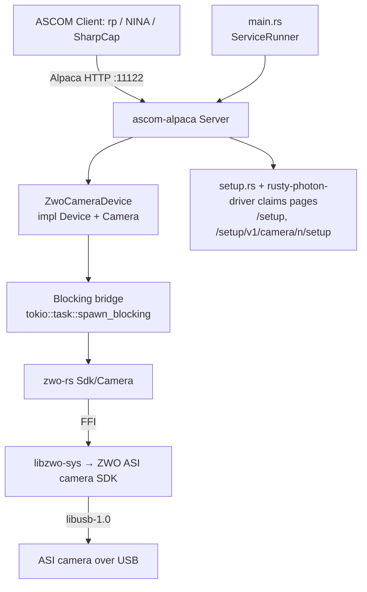

# Zwo-Camera Service Design

> **Status:** `services/zwo-camera` serves the full ASCOM `Device` + `Camera`
> surface for every connected ASI camera over the `zwo-rs` SDK seam, with
> serial-derived identity, device claims and the setup pages. Both ConformU
> suites pass against the `simulation` backend in CI and against physical
> cameras on Linux and Windows (*Testing*). Of ZWO's SDKs the binary links the
> camera's alone: the EAF focuser is [`zwo-focuser`](zwo-focuser.md), and no
> filter wheel is served here (*FilterWheel*).

## Overview

The `zwo-camera` service is an ASCOM Alpaca **Camera** driver for real ZWO ASI
hardware. It exposes a connected ASI camera — exposures, ROI/binning,
gain/offset, cooling, readout, ST4 pulse-guiding — over ASCOM Alpaca on a
fixed port so the `rp` orchestrator (and any Alpaca client: NINA, SGPro,
SharpCap) can drive it like any other device. Other ZWO device families are
separate services: the EAF focuser is
[`zwo-focuser`](zwo-focuser.md), and the EFW filter wheel is a future
`zwo-filterwheel` service.

It is the ZWO analogue of the [`qhy-camera`](qhy-camera.md) service and
reuses the same `ascom-alpaca` server framework and the
[`sky-survey-camera`](sky-survey-camera.md) (simulator) /
[`qhy-focuser`](qhy-focuser.md) (hardware driver) scaffolding.

**Provenance.** The behaviour is derived from open ZWO drivers as a *behavioural
reference only* — INDI `indi-asi`, INDIGO `ccd_asi`/`wheel_asi`, and
[`python-zwoasi`](https://github.com/stevemarple/python-zwoasi). **No code is
copied** (some references are GPL — see *References*),
the same clean-room discipline `qhy-camera` took toward `qhyccd-alpaca`.

**Not cross-platform.** Like `qhy-camera`, this service links a **native vendor
SDK** at compile time and is therefore gated out of the default workspace build.
See *Native dependency & build gating* — this is the dominant design constraint.

**How it differs from `qhy-camera` (drives every decision).** The `qhy-camera`
precedent assumed two things that are **both inverted** for ZWO, plus one that is
the same:

| Concern | QHY (the precedent) | ZWO (this service) |
|---|---|---|
| **SDK license** | Closed/proprietary, with no right to redistribute → no package ships its DLL or firmware; CI downloads it publicly from qhyccd.com | **MIT** ("Copyright 2015, ZWO Company") → redistributable with its notice, so the package ships the blob |
| **Rust FFI layer** | Published `qhyccd-rs`/`libqhyccd-sys` already exist; driver just writes the device layer | **No usable equivalent** → we also build & maintain `zwo-rs` + `libzwo-sys` |
| **Build/link gating** | Native lib links at compile time on *every* machine | **Same constraint**, per device feature (`libzwo-sys` `build.rs` links each SDK its feature enables — this service builds with `camera` only; that SDK is required at link time even with `--features simulation`, unless `ZWO_SKIP_NATIVE_LINK=1` omits the link) |

Net: ZWO is **legally much easier** but **mechanically more work up front** (we
build the FFI QHY got for free). The device-trait layer is *easier* than QHY — a
cleaner C API and more ASCOM features map natively (see *ASCOM Camera surface*).

---

## Native dependency & build gating (the crux)

This is the single most consequential fact about this service.

- The imaging path is `zwo-camera → zwo-rs → libzwo-sys → ` the **ZWO ASI
  camera SDK** (`libASICamera2`, a source-less native binary) **+ libusb-1.0**.
- `libzwo-sys`'s `build.rs` emits `cargo:rustc-link-lib` per enabled device
  feature; this service builds `zwo-rs` with `camera` only, so the
  link is `ASICamera2` + `dylib=usb-1.0` (plus `stdc++`/`c++`) — the EFW/EAF
  SDKs are linked (and shipped) by their own services.
- **Consequence:** *every machine that compiles this package* — dev laptops, CI
  runners, Bazel actions — needs the ASI camera SDK installed and discoverable,
  plus `libusb-1.0` dev headers. Not just machines with a camera attached.
  (Bazel builds the shared `zwo-rs` targets with the union of device features,
  so Bazel actions provision all the blobs.)
- The `zwo-rs` **`simulation` feature** (which this service forwards as its own
  `simulation` feature) makes the build **camera-free, NOT SDK-free**: it
  fabricates fake frames (and EFW position/moving) at runtime. The native SDK is
  still required at link time, unless `ZWO_SKIP_NATIVE_LINK=1` omits the link
  directives: a `simulation` build references no SDK symbol, so it then links
  with no SDK at all, as the CI jobs that build only that path do (*Gating
  plan*). *(The ZWO SDK ships **no** simulation backend —
  unlike `qhyccd-rs` — so the simulator is wholly fabricated inside `zwo-rs`.)*

### Why this matters for rusty-photon specifically

Outside the drivers built on a vendor SDK and their FFI crates, nothing in the
workspace needs a native library installed to build: `qhy-camera`,
`zwo-camera`, `zwo-focuser` and `svbony-camera` each link their vendor's SDK
through one. What sets ZWO's apart from QHY's is
licensing: ZWO's SDK is **MIT**, so `zwo-camera`'s `.deb`/`.rpm` ships
`libASICamera2.so` with its license ([Packaging](#packaging)), while QHYCCD's
gives no right to redistribute, so `qhy-camera`'s packages ship neither its
DLL nor its firmware.

### Gating plan

| Concern | Mechanism |
|---|---|
| local dev (SDK required) | `zwo-camera` is a normal workspace member but **fails to link without the SDK**. The SDK is a required local-dev prerequisite — install it with `bazel run //.github/actions:install -- zwo-sdk`, which installs what CI installs, by the action's own module (into `/usr/local` on Linux and macOS); `bazel build //...` then builds the package like any other. On Windows the build also needs LLVM/libclang for bindgen (`LIBCLANG_PATH`), which CI runners ship and a fresh Windows box does not, `ZWO_SDK_LIB_DIR` pointing at the SDK's `lib\x64` for the link, and `ASICamera2.dll` beside the executable to run. Documented here and in the service README. |
| CI | An explicit SDK-provisioning step (`./.github/actions/install-zwo-sdk`) **pulls the pinned ASI/EFW/EAF SDK from the INDI mirror** (Linux/macOS, pinned by `REF` in the action's `zwo-sdk.mjs`) **or ZWO's CDN** (Windows, unpinned "latest") + installs `libusb-1.0-0-dev`, before building/testing this package, as `bazel.yml` / `conformu.yml` / `native.yml` / `scheduled.yml` do before their builds. The Linux/macOS mirror fetch is cached (keyed on the arch folder, the files and `REF`) so a warm cache skips it — the mirror otherwise rate-limits CI's ephemeral IPs (429s; see the action's own doc comment); the Windows download is cached per ISO week, and the newest earlier week's stands in when ZWO's CDN fails. `test.yml` and `safety.yml` (ASan/LSan) build only the `simulation` path and set `ZWO_SKIP_NATIVE_LINK=1`, so they provision no SDK — which also lets the sanitizers cover the zwo crates rather than exclude them — and `cargo check`/clippy jobs (no linker) skip it too. The real link and FFI are built on Linux, macOS and Windows, with a Linux runtime FFI smoke (`cargo test -p zwo-rs` against the installed SDK), by `native.yml`: nightly, and on every push to `main` that touches the zwo crates, services or the SDK action. |
| Raspberry Pi nightly runner | **Sudo-free per-run** (the runner is sudo-less for public-repo safety): `pi-nightly.yml` runs `./.github/actions/install-zwo-sdk` with `sudo: "false"` — stages the `armv8` blobs under `$RUNNER_TEMP`, symlinks the system libusb/libudev *runtime* libs to satisfy `-lusb-1.0`/`-ludev` (no -dev package), and exports `ZWO_SDK_LIB_DIR` + `LD_LIBRARY_PATH` (the blobs carry no SONAME). `scripts/setup-pi-runner.sh` installs only the stable host prerequisites (clang/libclang-dev, libusb-1.0 runtime) — no device-access udev rule: this runner is CI-only and never has a physical camera attached, so the device rule below applies only to *production packaging* (`services/zwo-camera/pkg/`), not this runner. Mirrors the QHYCCD per-run model → self-healing for SDK bumps. **aarch64 (Pi 5) confirmed linking.** |
| Bazel | **First-class `//...` targets — no `manual` gating.** `zwo-rs` / `libzwo-sys` are **vendored first-party**, so the repo owns their `BUILD.bazel`: `libzwo-sys` is a first-party `cargo_build_script` (runs bindgen in-sandbox; its `data` carries the vendored MIT headers + `wrapper.h`), and `zwo-rs` ships **two variants** — `//crates/zwo-rs:zwo-rs` (real SDK) and `//crates/zwo-rs:zwo-rs_sim` (`testonly`, `simulation`). zwo-camera's production `lib`/`binary` link the **real** variant (the prod binary `NEEDs libASICamera2.so` — the real/sim parity win an external `@cr` crate could not give, since `crate_universe` resolves one feature set per crate); the `unit_test` / `bdd` / `conformu_integration` targets link `zwo-rs_sim`. Every workspace crate builds and tests under Bazel, so a `manual`-excluded crate would silently carry zero CI. The `bdd` / `conformu_integration` suites — which spawn the service binary (linked against `zwo-rs_sim`) and bind a port — run under Bazel, tagged `bdd` / `conformu` (mirroring qhy-camera). The `bazel.yml` / `bazel-coverage.yml` workflows run the `install-zwo-sdk` composite action (like they install OmniSim), so `libzwo-sys` links against the system SDK; `.bazelrc` forwards `LIBCLANG_PATH` (macOS bindgen) / `ZWO_SDK_LIB_DIR` (Windows link) per-OS under `strict_action_env`. zwo-camera keeps a `simulation` dev-dep for one reason: it keeps `simulation`'s optional deps (`rand`/`rayon`) resolved into `@cr` for the `zwo-rs_sim` target. After any change to `Cargo.lock` or any workspace `Cargo.toml` (a version bump included), run `cargo ci repin-bazel-lock` (Rule 10). |

### udev / USB

ZWO devices need a udev rule granting access to vendor `0x03c3` and raising
`usbfs_memory_mb` to 200 for USB3 throughput: the package ships
`90-rusty-photon-zwo.rules`, which gives the devices to the `rusty-photon`
service group (*Packaging*) rather than making them world-writable
(`MODE=0666`) as ZWO's own `99-asi.rules` does. The EFW is USB-HID (no kernel driver) but the SDK
still talks libusb. macOS `.dylib`s need `install_name_tool` fixing before
linking (INDI automates this). On Windows the camera needs ZWO's own USB driver
(`asicamusb3.inf`, a direct download from ZWO; v3.28 measured): it carries no
MS OS descriptors, so WinUSB never binds it on its own.

---

## Architecture



**Key components**

- **`main.rs`** — plain `fn main`, parses clap args, inits `tracing`, runs under
  `ServiceRunner::new("zwo-camera").with_reload().run_with_reload(...)` per
  [`service-lifecycle.md`](../skills/service-lifecycle.md). No hand-rolled signal
  handling; config bootstrap via `rusty_photon_config::resolve_and_init` with an
  **empty identity-pointer list** (identities are hardware-derived), which still
  materializes the default config file on first start. Its serve loop is
  `rusty-photon-driver`'s `claims::serve_and_rebuild`, shared with
  svbony-camera: after a reload it rebuilds from the config file, after a
  failed scan's re-scan from the configuration it was serving (U6), and a
  stop or reload that lands while a re-scanned server drains is honoured
  before that rebuild. A stop always wins: one that lands with a reload ends
  the service without building another server first.
- **`lib.rs`** — `ServerBuilder` that, on `build()`, opens the SDK,
  **enumerates every connected ASI camera** and places each on its USB port,
  then registers what it serves as ASCOM devices (index 0, 1, 2, …) with their
  serial-derived UniqueIDs: with no `usb_devices` list every placed camera in
  port order (U10), with one the list — the camera the USB join placed on each
  entry's port, or a placeholder that says why there is none (U1-U9). It opens
  only the cameras it serves (*Device claims*).
  Because `ASIGetSerialNumber` requires an *open* camera (see *Device
  identity*), enumeration reads each camera's serial via
  `zwo_rs::Sdk::open_uninitialised` + `UninitialisedCamera::serial`
  (`ASIOpenCamera` + `ASIGetSerialNumber`/`ASIGetID` + `ASICloseCamera` — no
  `ASIInitCamera`, so this passive path touches no camera state); the eager
  per-device connect handshake, which does call `ASIInitCamera`, happens on
  `set_connected(true)`. A camera that cannot be *opened* costs only itself
  (C0, U5). One that opens but has no serial is not a failure at all — the
  **identity fallback (`mint_identity`)**: older ASI models (e.g. the ASI1600)
  expose *neither* a hardware serial (`ASIGetSerialNumber`) nor a programmed
  flash ID (`ASIGetID`) — that read returns a general SDK error — so the camera
  takes an identity built from its USB port (`noserial-{usb_port}`, UniqueID
  `ZWO:{name}:noserial-{usb_port}`) and is still usable; every registered
  camera has a port (U4, U10), so it is stable across bus reordering and
  replug. Returns a `BoundServer`.
- **`camera.rs`** — `ZwoCameraDevice` (one instance per discovered camera)
  implementing `Device` + `Camera` against `zwo-rs`. **Every blocking SDK call
  runs inside `tokio::task::spawn_blocking`** so the async runtime is never
  stalled — *including* the CPU-heavy `to_image_array` frame transform (a
  ~26-megapixel `u16`→`i32` widen+transpose), which runs in the same
  `spawn_blocking` closure as the SDK download, never on a Tokio worker and never
  while holding `result_lock` (held only for the cheap commit).
- **`claims.rs`** — this driver's half of the device claims: which ASI models
  it knows on the bus (the normalizer, U2), its simulated USB scan (U7), and
  what `doctor --devices` can say about each camera without opening it (U8).
  The rest is shared (*Device claims*).
- **`config.rs`** — typed `Config` with parse-don't-validate newtypes.
- **`setup.rs`** — `ConfigurableDriver` impl behind the setup pages; `lib.rs`
  records what the running server registered, which the camera pages and the
  Cameras section read (*Setup pages*).
- **`backend.rs`** — the SDK seam (`CameraHandle`): the production
  `ZwoCameraHandle` over `zwo-rs`, and the unit tests' `MockCameraHandle`
  (`backend::mock`, test builds only). The `simulation` feature (alias `mock`)
  swaps the real SDK for `zwo-rs`'s fabricated camera, with which the BDD and
  ConformU suites run the production handle.

**Concurrency.** The ASI/EFW SDKs are blocking C FFI and are **not** safe to call
from arbitrary threads concurrently for a single device. Device state (the ROI,
bin and readout mode, the gain and offset the next exposure arms, the target
temperature, the exposure state machine) is cached in atomics and
`parking_lot::Mutex` cells, none held across an `await`; `StartExposure` pins
everything that describes its frame, gain and offset included, in one critical
section (B3, GO2). All SDK calls funnel through `spawn_blocking` and a single
logical owner per device.

The capture's integration wait (`backend.rs`) sleeps against a **real-clock
deadline** (`Instant::now() + duration`), not accumulated intended sleep time.
Under blocking-pool oversubscription — e.g. ConformU firing a storm of concurrent
property reads, each a `spawn_blocking` — individual `thread::sleep` calls
overshoot, and a loop that summed *intended* naps would run the full step count
regardless of real time, ballooning a 2 s exposure to ~10 s of wall-clock on a
contended runner (enough to trip ConformU's 10 s async-operation timeout on a
macOS CI runner — a scheduling artifact, not a slow CPU). The deadline bounds the
integration to the requested duration plus at most one overshooting nap. The same
real-clock-deadline discipline is applied to every wait loop in the capture path
(integration, readout-completion poll, and the test backends), so no loop counts
fixed naps or sums *intended* sleep time. Validated under genuine concurrency:
three cameras driven by simultaneous ConformU `conformance` suites all stayed
within their response-time targets
([2026-06-21, on the dev box](../plans/archive/zwo-camera-hardware-validation-2026.md#the-runs)).

**The claim is the cell.** "A capture owns this device" and "here is the cell
that stops it" are one piece of state — `DeviceState::in_flight_capture`, where
`Some` *is* the claim — not a flag beside an `Option`. Held apart, the two
disagree for the few statements between `StartExposure` taking the claim and
installing the cell, and an abort or stop arriving in that window finds a device
reporting itself `Exposing` with nothing to signal: it is swallowed, and the
capture it was aimed at integrates on to its full duration with the device still
claimed — precisely the stall the per-capture cell exists to prevent,
reappearing through the gap between the two halves. Claimed and installed inside
one critical section, that window cannot exist: a stop issued at any instant the
device reports `Exposing` reaches a capture. `svbony-camera` holds the same
invariant.

**Handing the device back is part of publishing the result.** A capture
records its outcome and releases its claim in one critical section under
`result_lock` — the same lock `AbortExposure` holds across "read the claim,
then bump the generation". Split apart, the two facts the abort works from
drift between its own two statements: it reads a claim, the capture that owns
it commits and hands the device back, a successor takes it, and only then does
the abort bump. The stop goes to a capture that has already finished, so the
successor is never aborted; the bump discards the successor's frame; and
nothing records an error, so a client polls `ImageReady` for an image that will
never arrive. The same reasoning puts the release *last* in
`reset_exposure_state`: `StartExposure` does not take `result_lock`, so
anything a reset clears after handing the device back lands on the exposure
that took it — leaving a running exposure reporting no start time at all.
`svbony-camera` and `qhy-camera` hold the same invariant. Unit-tested by
`camera::tests::a_capture_hands_the_device_back_with_its_result` and
`camera::tests::an_abort_leaves_an_already_published_frame_alone`, which watch
the raw commit flag rather than `ImageReady` — the latter is deliberately
`image_ready && !exposure_in_flight`, so it cannot observe this window at all.

**One stop signal per capture, one camera instance per capture.** Stopping an
exposure — `AbortExposure`, `StopExposure`, or a disconnect — is signalled
through a `StopSignal` cell that the `StartExposure` spawning that capture
creates and carries in its `CaptureRequest`, never through a cell owned by the
handle. A handle-wide cell is reset by whichever capture starts next, and a
disconnect + reconnect mid-exposure produces exactly that: the reconnect's
`reset_exposure_state` releases the in-flight claim while the aborted capture is
still draining, so the next `StartExposure` is accepted and — with a shared cell —
erases the abort the disconnect had just requested. The superseded capture would
integrate on, re-lock the camera (by then the *reopened* one) and poll, download,
or `ASIStopExposure` against the exposure that replaced it. Four properties close
that window by construction rather than by timing:

- the stop cell belongs to one capture, so no capture can clear another's abort;
- `reset_exposure_state` **takes and sets** the outgoing capture's cell as it
  releases the in-flight slot, so a capture left over from a previous session
  drains within one poll step instead of running out its exposure;
- the handle stamps every open with an `open_epoch`, read by a capture under the
  same lock acquisition that starts its exposure. Both SDK calls a capture makes
  afterwards — the readout poll plus download when it re-locks the camera, and
  the `ASIStopExposure` in `stop_at_sdk` — are gated on `is_current(epoch)`,
  checked while holding that same lock. So a capture whose camera was closed and
  reopened under it issues no further SDK calls at all and reports itself
  aborted, rather than reading a frame off, or stopping, the next exposure's
  camera;
- the draining capture task releases the in-flight claim only if it still
  *owns* it (its cell is still the installed one), so a superseded capture
  cannot declare a newer, genuinely running exposure finished and admit a third
  one alongside it.

`svbony-camera` carries the same per-capture cancel flag; ZWO's is tri-state
(none / abort / preserve) because ASI's `ASIStopExposure` also backs the
data-preserving stop (E8) that SVBony has no analogue for.

---

## MVP scope

The MVP boundary drives BDD scenario selection (Phase 2). Grounded in what the
ASI C API exposes and what `zwo-rs` wraps.

**In scope (v0)**

- ASCOM Camera (`ICameraV4`) for **every enumerated ASI camera** (each registered as
  a device on the one port), 16-bit (`ASI_IMG_RAW16`) monochrome **and**
  one-shot-colour (Bayer) sensors.
- Startup enumeration registers all discovered cameras;
  per-device connect/disconnect lifecycle: open → `ASIInitCamera` → RAW16
  transfer → snap mode → cache `ASI_CAMERA_INFO` (geometry, pixel size, bit
  depth, cooler/colour/ST4 flags, `ElecPerADU`) and control caps.
- Sensor geometry (`CameraXSize`/`YSize`, `PixelSizeX`/`Y`) from cached info.
  **`PixelSizeX == PixelSizeY`** trivially (ASI exposes a single `PixelSize`).
- **`ElectronsPerADU`** is a **real native value** from `ASI_CAMERA_INFO.ElecPerADU`
  (a ZWO win — QHY ships `NOT_IMPLEMENTED`).
- **Binning** — symmetric only (`CanAsymmetricBin = false`); `MaxBinX/Y` from the
  SDK's `SupportedBins`; the ROI is held in unbinned pixels, so a bin change
  only changes the divisor its binned members are read through (B3).
- **ROI** — `StartX/Y`/`NumX/Y` setters accept any `u32`; geometry validated at
  `StartExposure`, **including the ASI alignment rules**: width must be a multiple
  of 8 and height a multiple of 2. (The legacy ASI120 USB2 models additionally
  require `width·height % 1024 == 0`; `check_geometry` does **not**
  enforce that older-model rule — such a frame would simply be rejected by the
  SDK at `StartExposure`. Adding it is Future Work if an ASI120 USB2 is used.)
- **Exposure** — `ExposureMin/Max/Resolution` from `ASIGetControlCaps(ASI_EXPOSURE)`
  (µs; min ~32 µs for current ASI sensors — required for bias frames, see
  [`docs/workspace.md` Duration Units](../workspace.md#duration-units)); single
  `ASIStartExposure` (snap mode); `ImageReady`/`ImageArray`/`ImageArrayVariant`;
  `CameraState` (`Idle`/`Exposing`/`Error`); `PercentCompleted` from
  remaining-exposure µs.
- **Graceful stop AND abort** — `ASIStopExposure` is a single graceful,
  **data-preserving** stop ("image can still be read out"), so `CanStopExposure =
  true`; the same call backs `AbortExposure` (discarding data), so
  `CanAbortExposure = true` (both while connected; E12). *(A ZWO win — QHY ships
  `CanStopExposure = false`.)*
- **PulseGuide** — native `ASIPulseGuideOn/Off` (ST4), gated on the `ST4Port`
  capability → `CanPulseGuide = true` when present. *(A ZWO win — QHY defers it.)*
- **Gain / Offset** — the value the next exposure arms, seeded at connect by
  reading the camera's own and sent by every `StartExposure`, + `Min`/`Max`
  from `ASIGetControlCaps` (`ASI_GAIN`, `ASI_OFFSET`/brightness);
  `NOT_IMPLEMENTED` if the control is absent on the model (GO1/GO2).
- **Readout modes = the negotiated download formats** — the camera's
  `SupportedVideoFormat` intersected with the formats this driver can deliver
  (`Raw16` first, then `Raw8`), published as `ReadoutModes` and defaulting to
  index 0. The selection drives `ASISetROIFormat`, the download buffer, the
  `ImageArray` unpack, and `MaxADU` (RM1-RM4).
- **Cooling** — `CoolerOn`, `SetCCDTemperature`, `CoolerPower`,
  `CanSetCCDTemperature`, `CanGetCoolerPower` are gated on
  `ASI_CAMERA_INFO.IsCoolerCam` (these need an actual TEC).
  **`CCDTemperature` is decoupled from cooling**: it reports the sensor
  temperature whenever the camera advertises the `ASI_TEMPERATURE` control
  (cached at the open handshake), cooled or not — most ASI cameras, including
  uncooled ones like the ASI178, expose a readable sensor temperature, and
  throwing it away as `NOT_IMPLEMENTED` would discard a genuinely useful reading.
  A camera without the control reports `NOT_IMPLEMENTED`.
- **Sensor type** — `Monochrome` vs `RGGB` (+ `BayerOffsetX/Y`) from
  `IsColorCam` / `BayerPattern`.
- **`MaxADU`** = **a saturation threshold chosen to be reachable** in the
  selected readout format, NOT `(2^BitDepth) - 1` and not an exact upper bound:
  255 in `Raw8`, and in `Raw16` the ADC's full scale *shifted into the 16-bit
  container*, one quantization step below the top code
  (`((2^BitDepth) - 2) << (16 - BitDepth)` — **65528** for a 14-bit ADC,
  **65504** for a 12-bit one). Where that margin applies, a sensor reaching its
  top code delivers pixels one step *above* `MaxADU`; ST3 explains the trade. A
  16-bit depth reports 65535 because it fills the container and there is no
  shift to step down from; an unknown depth reports 65535 because it says
  nothing about the packing at all — in both cases the value is the container's
  own maximum, so nothing can exceed it. Hardware-measured, see ST3.
  Configurable: `max_adu_reporting` selects this accurate threshold (default) or
  the flat container maximum that ZWO's own ASCOM driver reports, for clients
  written against that value — see ST3 *the compatibility switch*.
  `SensorName` comes from the device name.
- **Dark/bias frames** — ASI sensors have **no mechanical shutter**; `Light =
  false` is **accepted** and captures normally (there is no shutter to actuate —
  the frame differs only in metadata). So `HasShutter = false` and darks/bias
  work on every model (a divergence from `qhy-camera`, which rejects darks on
  shutterless models).
- Setup pages (`/setup` with the Cameras section, a page per camera —
  *Setup pages*); hardware-derived `UniqueID` (camera SDK serial);
  in-process reload.
- ConformU integration test driven against the `zwo-rs` `simulation` backend
  (SDK installed in CI, no physical camera).

**Deferred (see *Future Work*)**

- **Video mode** (`ASIStartVideoCapture`) — the high-FPS guiding/planetary path;
  v0 is snap-mode only (snap and video are mutually exclusive).
- **EFW filter wheel** and **EAF focuser** — separate services:
  the EAF is [`zwo-focuser`](zwo-focuser.md); the EFW is a future
  `zwo-filterwheel` service (*FilterWheel*).
- **CAA rotator** (`CAA_API.h`) — only if a ZWO rotator is ever in scope.
- Per-serial connect-time tuning (gain/offset/target-temperature defaults).
- `FullWellCapacity` (no native ASI field; supply a placeholder only if ConformU
  requires it).
- **Vendoring the SDK** into `libzwo-sys` (MIT permits) to drop external
  provisioning — deferred in favour of mirroring `qhyccd-rs`'s external model.

---

## Configuration

With no `usb_devices` list the service **enumerates every connected ASI
camera** at startup and registers each as an ASCOM device (camera index 0, 1,
2, …) on the one port. Each device's UniqueID comes from its SDK serial; config
carries optional per-serial display overrides plus the port. A `usb_devices`
list pins each USB port to an Alpaca device number instead, so a camera on a
given port is the same ASCOM device every time, and a camera on an unlisted
port is never opened (U1-U9).

```jsonc
{
  // Optional per-device overrides, keyed by SDK serial. A device with no entry
  // uses SDK-derived defaults (name from model+serial). Named `devices` (not
  // `overrides`), the name every camera driver's map has.
  "devices": {
    "ASI2600MM-0A1B2C3D4E5F6071": {
      "name": "Main Imaging",
      "description": "ASI2600MM-Pro @ 1000mm"
    }
  },
  // Which MaxADU contract to present (ST3). Omit for the accurate default.
  "max_adu_reporting": "sensor_ceiling",
  "server": {
    "port": 11122,
    "bind_address": "0.0.0.0",
    "tls": null,
    "auth": null
  }
}
```

The same service with a `usb_devices` list in place of the `devices` map (a
non-empty map beside a list is refused, below):

```jsonc
{
  // Optional: pin each USB port to an Alpaca device number (see below and
  // U1-U9). Absent = every camera the USB scan places, in port order (U10).
  "usb_devices": [
    { "device_number": 0,
      "usb_port": "pci-0000:c1:00.4-usbv3-0:1.4",
      "name": "Main Imaging",
      "description": "ASI1600MM-Cool @ 1000mm" }
  ],
  "server": { "port": 11122 }
}
```

The `server` block is the shared `AlpacaServerConfig` from
`crates/rusty-photon-server-config`: `port`, `bind_address`
(default `0.0.0.0`), optional `discovery_port`, and optional `tls`/`auth`.
Absent `tls`/`auth` means plain, unauthenticated HTTP.

Sections:

- **usb_devices** — Optional. Each entry pins the camera on one USB port to
  one Alpaca device number, so a camera plugged into that socket is the same
  ASCOM device every time, and a camera on any other port is never opened
  (U1-U5). That is how a camera another application owns — PHD2's guide
  camera — is kept out of this driver: it is left off the list. The `usb_port`
  is the platform's native spelling (udev's `ID_PATH_WITH_USB_REVISION` on
  Linux, the `PCIROOT(…)` location path on Windows, the location id on macOS —
  [doctor.md](doctor.md), "USB inventory"), pasted from `zwo-camera doctor
  --devices` (U8), never typed from memory.
  - **device_number** — the Alpaca device number this port's camera is served
    under. Explicit rather than positional: reordering entries renumbers
    nothing.
  - **usb_port** — the port path, compared verbatim with the USB scan.
  - **name** — optional display name for the camera, and for the
    placeholder that holds its number when it cannot be served (U4).
  - **description** — optional description for the camera. A placeholder's
    `Description` is always its reason (U4), so it does not use this one.

  Validated at load, before any USB or SDK work, and again by every
  setup-page save (U9); a list that fails either is named entry by entry and
  nothing starts from it:

  - `usb_port` is non-blank, carries no leading or trailing whitespace, and is
    unique across entries. A padded port is rejected, not trimmed: the scan
    never carries padding, so it could only ever become a placeholder for a
    port that holds a camera.
  - `device_number` is unique, and the numbers are exactly `0..N-1`. A gap is
    rejected rather than filled, so every number the driver serves is one the
    operator wrote and a typo (`0, 2`) cannot become a phantom camera 1.
    Retiring any camera but the highest-numbered one therefore means
    renumbering the entries above it — and rp's `cameras[].device_number`
    with them. A retired camera's entry is never kept just to hold its
    number: a listed port is a positive claim, so whatever ASI camera is
    plugged into that socket later would be opened and served there.
  - Unknown keys are rejected (`deny_unknown_fields`).
  - **A non-empty `devices` map beside a list is rejected**, naming each key:
    a listed camera's `name`/`description` live in its entry, and an override
    that would be silently ignored is the no-op config the fail-loud posture
    exists to prevent. Move its fields into the matching entry, or delete it
    if that camera is unlisted.

  **`"usb_devices": []` registers nothing** — legal in the file, logged at
  `warn!` at every start, and it needs no USB scan or SDK enumeration, so it
  opens nothing. It is how an operator hands every ASI camera to another
  application for a night. The server page is the server's, not a device's,
  so it outlives the last camera: unchecking every row saves `[]`, and
  checking one again undoes it (*Setup pages*).

  **No list is the default, permanently.** With no `usb_devices` key the
  service registers every camera the USB scan can place, numbered in port
  order, opening only those, each briefly for its serial, and refuses the
  rest (U10). It is the scan and join a list uses, so every number it serves
  is tied to a socket. A single-camera rig never needs the list; one with
  several cameras writes it when a number must survive a camera being added
  or removed.
- **devices** — Optional per-device override map keyed by **SDK serial** (the
  16-hex `ASIGetSerialNumber` value, or `noserial-{usb_port}` for a camera that
  exposes none — see *Device identity*). Lets an operator give a friendly
  `name`/`description` to a specific camera. Any device without an entry uses
  SDK-derived defaults. It serves the no-list default only: beside a list it is
  refused (above), and each camera's page edits its own entry (*Setup
  pages*). v0 does **not** carry per-camera connect-time tuning
  (gain/offset/target temperature) — with heterogeneous cameras those are
  per-serial concerns and clients set them over ASCOM; per-serial defaults are
  deferred (see *Future Work*).
- **max_adu_reporting** — Which `MaxADU` contract to present, service-wide:
  `sensor_ceiling` (default, a value saturated pixels reach) or
  `zwo_driver` (a flat 65535 in `Raw16`, matching ZWO's own ASCOM driver for
  clients written against it). A dropdown on the server page
  (*Setup pages*), baked into each device at construction, so it takes effect
  on the next reload or restart rather than on the live objects. See ST3
  *the compatibility switch*: on a sub-16-bit sensor `zwo_driver` may disable
  a client's saturation detection. The values' former names
  (`saturation_threshold`, `container_full_scale`) are refused at load.
  `doctor --fix` deletes `saturation_threshold`, so the field takes its
  default, and renames `container_full_scale` to `zwo_driver`
  (`config.retired-keys`).
- **server.port** — Listening port (**11122**, next free in the 1112x family;
  11121 is `qhy-camera`). One port hosts all enumerated devices. `--port`
  pins it. Editable on the server page, whose save answers with the address
  the page moves to.

### Setup pages

The service configures itself on the two HTML pages the Alpaca Management
API defines, served on its own listener behind its own TLS and Basic Auth:
`/setup` for the whole server and `/setup/v1/camera/{n}/setup` for each
camera it serves. The pages are the shared
[`rusty-photon-setup`](../crates/rusty-photon-setup.md) crate's — the
render, the save, the cross-site check, the Security section, the
confirmation and the reload wait. The camera drivers' own parts — the
**Cameras** section that edits `usb_devices`, and the camera pages — are
`rusty-photon-driver`'s `claims` module, which `svbony-camera` and
`qhy-camera` share; `setup.rs` supplies the rest
(`ConfigurableDriver for ZwoCameraDriver`): the `Config`, the validation,
the secret, the `--port` pin, and what the running server registered. No
page edits a `UniqueID`: they are hardware-derived and not stored in config
(*Device identity*). A camera's and a placeholder's `SupportedActions` is
empty, and any `Action` answers `ActionNotImplemented`.

| Page | Section | Fields |
|------|---------|--------|
| `/setup` | `server` | `port`, `bind_address`, `discovery_port`; `tls` is named as file-only (doctor writes it); `auth` is the Security section |
| | `max_adu_reporting` | a dropdown (below) |
| | Cameras | `usb_devices`, and `devices` when the mode changes (below) |
| `/setup/v1/camera/{n}/setup` | — | by what the number serves (below) |

**`max_adu_reporting` is a dropdown** of its two values, `sensor_ceiling`
and `zwo_driver`, each labelled by what it reports (the crate's field shapes
draw a string enum so, a variant's `title` its label). The field's hint,
under the dropdown, says what `MaxADU` is, that the two differ only in the
`Raw16` readout of a sub-16-bit sensor, whose pixels stop short of 65535
(`Raw8` reports 255 under both), and that `zwo_driver` may disable a client's saturation
detection, depending on the threshold the client counts saturation at (ST3
*the compatibility switch*). Each device reads it at construction, so a changed
value applies at the reload the save fires, which re-creates every device;
a hand edit applies at the next reload (`SIGHUP`) or restart.

**The Cameras section** is the same section `svbony-camera` serves:

- **Two modes**, chosen by a radio: *serve every ZWO camera the USB scan
  places, numbered in port order* — no list (U10) — and *serve only the
  checked cameras* — a list (U1–U5).
- **One row per port**, in port order (U8's): each port that holds an
  `03c3` record the normalizer can count as a camera now (U2: an observed
  model, or a product id the ASI SDK's own table accepts, a lookup that
  opens nothing, which keeps the EAF and the EFW out), and each listed port
  that holds none, a placeholder's. The rows come from a USB scan run for
  the page — the passive scan a start takes (U1) — so nothing is opened. A
  row names the port, what the bus calls the device (its product string,
  else `03c3:<pid>`), and what the running service serves there:
  `camera <n>`, `placeholder <n>`, or nothing.
- **With a list**, each row has a checkbox — checked is served — and its
  entry's `name` and `description`. The numbers are kept by the page, never
  typed: the checked rows keep the order of the numbers they have now and
  take `0..N-1` in it, and a newly checked row takes the next number, in
  port order. Unchecking any camera but the highest-numbered moves the
  numbers after it down; checking one adds it at the end. A kept entry's
  other keys stay as the file has them.
- **The numbers a row has now** are the list's or, with no list, the port
  order the running service serves, so changing the mode without touching
  a row moves no number.
- **Changing to a list** carries each camera's `devices` name and
  description into its row — the rows show them, filled in — and deletes the
  `devices` map, which a list refuses (*Configuration*). **Changing to no
  list** deletes the list and carries each row's name and description into a
  `devices` entry under the camera's serial (or `noserial-<port>`). The page
  knows a serial only where the last start or reload read it, by opening the
  camera (*Device identity*): every camera it served, which with a list is a
  listed camera whose open succeeded. A placeholder's names have no camera
  whose serial the page could know, and neither has a listed camera whose
  open failed, which a placeholder holds; the confirmation names them as
  dropped.
- **Every row unchecked** with a list saves `"usb_devices": []` (above).
- **A save that moves a number is confirmed first.** It answers with the
  form as submitted, each port whose camera would be served at another
  number (from → to), each number a dropped camera held that another
  camera would take (a camera unchecked and another checked in one save,
  or a placeholder's number served once the list goes), and that rp's
  camera entries bound to those numbers must be renumbered to match — an
  entry without a `unique_id` pin would otherwise open the wrong camera
  with no error; rp's own page shows which entries those are, which this
  driver cannot. The same confirmation names each name and description the
  save would drop: an entry's no longer listed (every row unchecked
  included — a row checked again later starts without them), a `devices`
  entry no row carries into the list, and the names leaving a list drops
  (above). Nothing is written until the operator saves it again from that
  page; a confirmation covers the changes it showed, so a submission whose
  changes differ is asked again.
- **With no list after a save**, the numbers it is checked against are the
  ones the reload it fires would give the bus as the page's scan finds it:
  in port order, each camera the last start or reload placed whose port
  still holds a record, and each port that has gained a record since that
  start's scan. The page opens nothing, so it takes a new record for a
  camera; the reload's own scan, join and opens decide. A camera the start
  placed but did not open — unlisted, such as a guide camera another
  application holds, or one whose open failed — may open on the reload or
  not, which the page cannot tell. The reload serves each camera it opens
  in its place in port order, so the confirmation names those cameras and
  lists the moves for none of them opening and, where they differ, for
  all of them opening, and it asks even when only the second list moves.
  So a camera plugged into an earlier port since the start is confirmed as
  the move it causes, whether the save leaves a list or the service
  already has none, and the confirmation says the bus has changed. A camera page's save reloads too,
  so it is checked the same way; its page scans the bus only for a save, so
  showing it costs no scan. Only a save that changes something is asked:
  one that changes nothing fires no reload, so nothing it could confirm
  would happen. A reload by `SIGHUP`, or a restart, numbers a changed bus
  afresh unasked: without a list, a camera added or removed moves the
  numbers after it (U10).
- **A failed scan** is said, with the collector's error, and the rows are
  the listed ports and what the running service serves.

**A camera's page** depends on what its number serves:

- **a listed camera**: its model, port and `UniqueID`, and a link to its
  row in the server page's Cameras section, where its name and description
  are edited;
- **a placeholder** (U4): the port it stands in for and why no camera is
  served there, and a link to the Cameras section;
- **a camera served without a list** (U10): its `devices` entry's `name`
  and `description`, with its model, port and `UniqueID`. The first save
  that names either creates the entry, under the camera's serial; a save
  that clears both deletes it.

- **Secrets:** `/server/auth/password_hash`, edited through the Security
  section and never shown.
- **Validation** on every save is the load's: unknown keys are rejected at
  deserialize (`deny_unknown_fields`, as in zwo-focuser), so typos and
  keys this service does not read (a `filterwheel` section among them: the
  EFW is a separate service's, *FilterWheel*) fail loudly
  instead of being silently ignored, and the `usb_devices` rules above run
  at load and on every save alike (U9). `devices` keys are free-form serial
  strings and the override values free-form display strings, so there is
  nothing semantic to validate in them. The Cameras section builds only
  lists the rules accept.

A save that changes anything persists atomically, answers that the
service is reloading, and fires the in-process reload after the response
has flushed (`main.rs` runs under `with_reload().run_with_reload(...)`):
the reload re-scans, re-places and re-registers every camera (U1), which
closes and re-opens every camera the service serves. A save that changes
nothing says so and fires no reload.

### Device identity (UniqueID)

ASCOM requires a globally-unique, never-changing `UniqueID`. **This service
derives the UniqueID from the camera's hardware serial** — the same scheme as
`qhy-camera`.

A **ZWO-specific wrinkle:** `ASIGetSerialNumber` (the stable 8-byte → 16-hex id,
available only since ASI SDK driver V1.14.0227) requires the camera to be
**opened first** — unlike QHY's pre-open read. So enumeration opens each camera
briefly via `zwo_rs::Sdk::open_uninitialised` (`ASIOpenCamera` + `ASIGetSerialNumber`
— never `ASIInitCamera`, see C5) to read its serial, then closes it. The fallback
chain is:

1. `ASIGetSerialNumber` (open briefly → read → close) — the canonical identity.
2. `ASIGetID` (a writable, USB3-only flash id) — a weak fallback for older
   cameras that report no serial.
3. Otherwise (`mint_identity`) an identity built from the camera's USB port,
   `noserial-{usb_port}` — the native spelling the scan placed it on (U2).

Consequences (same as
`qhy-camera`): **no `unique_id` field in config**, an **empty identity-pointer
list** passed to `resolve_and_init` in `main.rs` (no minting; the bootstrap
still materializes the default config file on first start), and **no
identity field** on the setup pages. Two identical-model cameras
would be told apart by serial only once each is open, which is why neither a
`usb_devices` list nor the no-list default can place them before an open, and
both refuse them as look-alikes (U3, U10).

A listed camera keeps exactly this identity, read through the same
uninitialised open — the list pins its number, not its identity (U5). Every
camera the service registers has a port, listed or placed with no list
(U10), so the `noserial-{usb_port}` fallback holds across bus reordering and
replug, where an enumeration index would not: the SDK's order changes with
what else is on the bus (the ASI1600MM-Cool has enumerated at index 2 beside
two other cameras and at 0 alone), so two serial-less cameras of one model
could swap. It follows the socket: moved to another port, the camera is
another device, which is what the list already asks the operator to edit. A
placeholder's `UniqueID` has its own fixed form,
`placeholder:zwo-camera:{usb_port}`, which no camera's can take (U4).

---

## Behavioral contracts

Named, testable behaviours, each mapping to a BDD scenario in `tests/features/`
except where a contract notes a unit-tested branch (e.g. E9, and PG2's no-ST4
path). ASCOM error names per [`docs/references/ascom-alpaca.md`](../references/ascom-alpaca.md).
Values are grounded in the `zwo-rs`-backed implementation; the `simulation`
backend presents one **ASI2600MM-Pro-Simulated** camera (6248×4176, monochrome,
16-bit, cooled, ST4 present). (`zwo-rs`'s sim also fabricates an EFW and an
EAF; those belong to the other zwo services.)

> The simulator's capability set (cooler + ST4 + 16-bit) is chosen so the BDD
> suite exercises the **full** ASCOM surface from a single device. ST4 on a
> 2600-class body is a simulator convenience, not a shipping-SKU claim; the
> `simulation` backend is wholly fabricated inside `zwo-rs` (the ASI SDK has no
> simulation mode).

### Enumeration & connection lifecycle

- **C0.** At startup `build()` enumerates the connected ASI cameras, places
  each on a USB port (*Device claims*, U2), and registers the cameras it
  serves — with no list, every placed camera in port order (U10); with one,
  each entry at its number (U4) — as ASCOM devices with their serial-derived
  UniqueIDs, opening each served camera briefly via
  `Sdk::open_uninitialised` to read the serial, without initialising it (see
  C5). A camera it does not serve is never opened. Zero registered cameras is
  **not** a hard failure — the service starts with no Camera devices, logged
  at `warn!`; a later reload re-enumerates. A camera that cannot even be
  *opened* for its serial read (removed between `Sdk::cameras()` and the open,
  or wedged) costs only itself: with no list it is not registered, logged at
  `warn!`; with one, a placeholder holds its number (U5). A *post-open* read
  failure (no serial, no flash id) is not a failure at all: the camera takes
  the `noserial-{usb_port}` fallback (see *Device identity*). An SDK
  enumeration that fails fails the start or reload with a list or
  without.
- **C1.** `set_connected(true)` on a device opens *that* camera, `ASIInitCamera`,
  selects RAW16, snap mode, and caches `ASI_CAMERA_INFO`, supported binning modes,
  and exposure/gain/offset control caps, and reads the camera's current gain and
  offset as the values the first exposure arms (GO1) — reads only. On success
  `Connected = true`.
- **C2.** `set_connected(true)` with the device's camera unreachable / SDK open
  failure returns the mapped driver error and `Connected` stays `false`.
- **C3.** `set_connected(false)` closes that device and returns `NOT_CONNECTED`
  for subsequent operations; an in-flight exposure on it is aborted. A reconnect
  landing while that capture is still draining is E10. A camera that leaves the
  bus while connected is C6's.
- **C4.** Connect is per-device and independent: connecting/disconnecting one
  camera does not affect the others enumerated on the same service. On
  hardware, with three cameras on one service, each connect left the others'
  `Connected` as it was, and a 2 s exposure on one left the other two `Idle`
  with `ImageReady` false.
- **C5.** No code path in this service pushes cooler state or any other
  actuation on startup, connect, or a setup-page save (workspace tenet
  [*no actuation on connect*](../workspace.md#project-tenets)); cooler commands
  are issued only by explicit ASCOM setters, and no cooler setpoint is restored
  on connect. The C0 serial read runs only `ASIOpenCamera` +
  `ASIGetSerialNumber`/`ASIGetID` + `ASICloseCamera`
  (`zwo_rs::Sdk::open_uninitialised` + `UninitialisedCamera::serial`)
  on every camera the configuration serves — every camera the USB join placed
  with no `usb_devices` list (U10), only those placed on listed ports with one
  (U1) — at
  *service start* and on every reload (a setup-page save's, `SIGHUP`'s, or
  U6's own) —
  `ASIOpenCamera` is documented by the vendor SDK as not affecting a capturing
  camera. It deliberately never calls `ASIInitCamera` (which resets controls,
  e.g. the cooler, to SDK defaults); that call is reserved for the per-device
  `set_connected(true)` handshake (C1), so startup and reload touch no camera
  state. Gain and offset hold to the same rule: the connect handshake only
  *reads* them (GO1), and they are written only by the arm of an
  operator-started `StartExposure` (GO2). On hardware, `CoolerOn` reads
  `false` after every connect
  ([2026-08-05 record](../validation/2026-08-05-zwo-camera-asi1600mm-cool-maxadu/README.md)).
- **C6.** **A camera that has left the bus reads disconnected.** A camera that
  loses its power or its cable while connected keeps its open SDK handle, and
  `Connected` is this driver's own record of that handle: a connect sets it, a
  disconnect clears it, and nothing else changes it. Left there, a departed
  camera would answer `Connected == true` for as long as the service ran, along
  with every member served from cache (the geometry, `BinX`, `Gain`, `Offset`,
  `ReadoutMode`, and the capability flags read from `ASI_CAMERA_INFO`, E12).
  Its next exposure would fail as a generic E9 `Error`, and rp's reconnect
  supervisor, which takes `Connected == true` as healthy, would never
  re-establish it. The session would stay broken even after the camera came
  back, because its SDK handle never recovers.

  **What the SDK does when a camera leaves (measured).** On Linux with ASI SDK
  1.41, with the cameras taken off the bus by cutting their hub's power:

  - **No call ever answers `ASI_ERROR_CAMERA_REMOVED`**, whatever the header
    says that code is for.
  - **Until something rescans, the SDK hides the departure.**
    `ASIGetControlValue` (the sensor temperature included) and
    `ASIGetCameraPropertyByID` keep answering from the SDK's memory, with the
    values from before the departure. Some writes fail with `GENERAL_ERROR`
    (`ASISetControlValue`), others still succeed (`ASISetROIFormat`).
    `ASIStartExposure` succeeds, and the exposure status turns
    `ASI_EXP_FAILED` about a second later.
  - **A rescan tells.** `ASIGetNumOfConnectedCameras` re-enumerates the bus
    (about 18 ms when nothing has changed, about 320 ms when something has) and
    drops the departed camera. From then on every call on its camera ID
    answers `INVALID_ID`, even once the camera is plugged back in. After the
    camera returns and another rescan runs, that ID answers `CAMERA_CLOSED`:
    it now names the fresh, unopened entry.
  - **A rescan leaves present cameras alone.** Their IDs hold, and an exposure
    integrating through two rescans completed normally.

  **A failure asks whether the camera is still there.** When the SDK fails a
  call on the open camera, the handle asks the SDK, before it answers, whether
  that camera is still there: it rescans, then asks for the camera's
  properties by its ID. `INVALID_ID` or `CAMERA_CLOSED` means the camera has
  gone, and the session is marked lost, logged once at `warn`. Any other answer
  means it is still there, and the failure stands as what it is. Any of these
  failures asks: a member's read or write, a step of the connect handshake, a
  capture's arm, a capture whose exposure the SDK reports failed
  (`ASI_EXP_FAILED`), its readout poll or download, the `ASIStopExposure` an
  abort or a stop sends, and the pulse-guide on or off. A `CAMERA_REMOVED`
  answer, should the SDK ever give one, marks the session lost without asking.
  Rescans run one at a time across the service, since the SDK's camera list is
  one per process.

  The question is asked under the camera lock the failed call ran under, which
  is the lock an open and a close take. So the answer describes the camera that
  failed, and the mark lands on that session, never on one a reconnect has
  opened since. A failure on a camera that is still there costs one rescan
  and changes nothing else: `GENERAL_ERROR` is also the SDK's answer to a value
  out of range, so failing never counts as leaving. A false "lost" would cost
  more than a late one. It ends a live session, and the reconnect a supervisor
  answers it with runs `ASIInitCamera`, which resets the camera's controls, the
  cooler included, to the SDK defaults (C5).

  **What a lost session answers.** `Connected == false`, and every member that
  takes the connected check answers `NOT_CONNECTED`, the cache-served ones
  included. The request whose failure found the departure answers
  `NOT_CONNECTED` too, rather than the code its call site gives a failure. It
  takes that from its own failure, which the handle relabels a removal, not
  from the mark, so a reconnect that clears the mark before the request
  returns cannot turn it back into the call site's code. A connect whose
  handshake finds the camera gone fails with C2's error, even when the read
  that found it is one the handshake can do without, such as the gain or the
  offset. The connected check reads the handle and its mark together under the
  camera lock: a close clears the mark as it lets the camera go, so two
  separate reads could describe a live session that never existed.

  **Only a failure asks. A blank frame counts as one.**
  Nothing else runs the check: no timer, and no check on reads. The
  `Connected` read, `CCDTemperature` and the cache-served members keep
  answering normally on a departed camera, so a client that reads only those
  learns nothing until its next exposure, cooler write or pulse. A capture in
  flight finds out by itself when its frame is due: the integration wait holds
  no lock and makes no SDK call, and the readout poll after it is the first
  call to find the exposure failed. A readout the camera left in the middle of
  can also come back a success with every pixel zero, as a QHY readout was seen
  to on Windows, so a downloaded frame that is all zeros asks too. No ASI
  readout has been seen to, on Linux or on Windows, where power cuts were swept
  through the readout of a full frame. From a camera that has gone it is discarded and the capture fails
  as a departure; from one still there it is published as it is. The scan stops
  at the first byte that is not zero, so a real frame costs nothing. qhy-camera
  ([C9](qhy-camera.md#behavioral-contracts)) and svbony-camera follow the same
  rule.

  **Lost is not closed.** The driver closes nothing on its own. A capture may
  still be integrating against the camera, with its lock released, and the
  session ends when a client ends it. `Connected = false` releases a lost
  session through the ordinary disconnect (C3): the in-flight capture is
  cancelled, the camera is closed, and the call succeeds. `Connected = true`
  releases it the same way and then connects afresh. A client that reconnects,
  as rp's supervisor does, gets either a working camera or C2's failure, never
  the lost session back, and a fresh connect reseeds gain and offset (GO4) and
  starts the exposure state clean. A release is not idempotent the way an open
  is, so connection changes run one at a time: `set_connected` reads the
  session and acts on it under one lifecycle lock. Two `Connected = true`
  requests after a departure, a supervisor's and a client's say, therefore open
  one fresh session between them. The second finds it live, rather than
  releasing it and running `ASIInitCamera` a second time.

  **A connect finds its camera by identity.** A rescan renumbers the SDK's
  camera list, so once one has run, the enumeration index read at startup (C0)
  can name a different body, or none. Every open therefore rescans first and
  looks for this device's camera by model name and serial. It reads a
  candidate's serial the way C0 does, through an open without
  `ASIInitCamera`, and it never opens a camera another device of this service
  holds. A camera without a serial (`noserial-{usb_port}`) is matched by its name,
  preferring its startup index. The search is one step: the service's set of
  held cameras stays locked from the first look to the reservation, and the
  SDK's camera list (`zwo_rs::CameraList`) from the rescan to the open. A
  presence check's rescan therefore cannot renumber the list between the
  choice and the open, two devices opening at once cannot take one camera, and
  no camera but the chosen one is ever initialised. A close keeps its camera
  reserved until `ASICloseCamera` has run, so a sibling cannot open the ID
  afresh in between and then have its session closed by that drop. So a camera that left and came back reconnects
  with a plain `Connected = true` and no reload, as measured. A camera that is
  still gone fails the open with C2's error.

  **Measured on hardware**, on the dev box's ASI120MC-S and ASI178MM, with the
  ASI1600MM-Cool on USB3 as the control (the
  [2026-10-06 record](../validation/2026-10-06-zwo-camera-departure-linux/README.md)):

  - **Idle.** With the cameras gone and the sessions held, `Connected`,
    `CCDTemperature` and `Gain` answered as before. Each camera's next
    exposure failed in its arm, the check found it gone, and it read
    disconnected about a second later. The first camera's check found it
    through `GENERAL_ERROR`. The second found it through `INVALID_ID`, since
    the first check's rescan had already dropped it.
  - **Mid-exposure.** A camera that left 3 s into a 10 s frame read
    disconnected at 11 s, through the capture's own readout poll and with no
    client call.
  - **Back.** A plain reconnect found each camera by its identity, each device
    opening its own body (told apart by `GainMax`).
  - **Switched off and on with nothing failing in between.** The session's
    next exposure fails, the check finds its ID answering `CAMERA_CLOSED`, and
    the session ends. A reconnect then works. The cost is one failed exposure.
    A build without this rule, run the same way, failed every capture with
    `GENERAL_ERROR` until a client reconnected.
  - The control camera on USB3 kept its session and took frames throughout.

  **Windows answers the same**, on the same three cameras and SDK 1.41, in a
  KVM guest (the
  [2026-10-07 record](../validation/2026-10-07-zwo-camera-departure-windows/README.md)).
  The power cut was paired with a hypervisor detach, because QEMU passes a
  host-side unplug to the guest only once an I/O on the camera fails. All
  five probes behaved as on Linux, failure for failure. A sweep of cuts
  across a full-frame exposure, from the integration through its readout,
  always surfaced as `ASI_EXP_FAILED` before any download.

  **The blank frame is unobserved on ASI hardware**, on both platforms; the
  rule is there because a QHY readout returned one.

### Device claims (`usb_devices`)

U1-U9 are the rules for an operator's `usb_devices` list (see
"Configuration"). U10 is the no-list default's, which runs the same scan,
join and identity opens, and U11 is what `zwo-camera doctor` reports about
both.

They are [`svbony-camera`](svbony-camera.md)'s U1-U9 with ZWO's
facts in place of SVBony's, and the vendor-neutral half is the same code. In
`rusty-photon-doctor-checks`' `claims` module: the join, the list validation,
port order, the scan source, the placeholder's error code, `UniqueID` form
and reason text, and the `--devices` listing and block. In
`rusty-photon-driver`'s `claims` module (its `claims` feature): the
placeholder Camera device and the failed scan's re-scan. What is ZWO's own is
`claims.rs`: the normalizer, the simulated scan, and what `--devices` can say
about a camera without opening it. One thing has no SVBony counterpart: a
ZWO camera's serial is read through an open (*Device identity*), so placing a
camera and minting its identity are two steps here, and the second can fail
on its own (U5).

- **U1. The list is applied before anything could open a camera.** With a
  list, `build()` takes the host's USB scan (the passive collector of
  [doctor.md](doctor.md), "USB inventory" — sysfs, PnP properties or
  `system_profiler`, nothing opened, claimed or reset), enumerates the SDK
  (`ASIGetNumOfConnectedCameras` + `ASIGetCameraProperty`, pre-open), places
  each SDK camera on a port (U2), and only then opens the cameras placed on
  listed ports, each briefly and uninitialised, for its serial (U5). It
  registers the list (U4). A camera on an unlisted port is never opened and
  never registered, so no client can connect it either. An empty list makes neither the scan nor the
  enumeration, and a failed scan stops before the enumeration (U6). The
  enumeration, the placement and the identity opens are one hold of the SDK's
  camera list (`zwo_rs::CameraList`), so no rescan can renumber the list
  between the index the join chose and the camera opened.

  **Placement holds from one start or reload to the next; it is not watched.**
  A registered camera's connect finds its camera by name and serial (C6), not
  by port, reading the serial of each SDK camera of its name the service does
  not hold, through an uninitialised open. A placed camera was the only one of
  its model the SDK enumerated at the start — two would have been look-alikes
  (U3) — so that touches no unlisted camera unless one of the same model is
  plugged in after the start. Then a connect may open it, uninitialised, to
  read its serial. A camera with no serial (the ASI1600MM-Cool reports none)
  is taken by name alone, so a connect opens and initialises the newcomer in
  place of the listed camera whenever the listed one is off the bus, or a
  rescan has given the newcomer the listed camera's startup index, which a
  connect tries first. A listed camera re-cabled onto an
  unlisted port while the service runs is likewise still opened at its listed
  number. Both are a reload's to correct: it places every camera afresh.
  Placement is not watched: closing this would take a passive scan on every
  connect to re-confirm the port, a cost this design does not pay. An SDK
  enumeration that fails after a scan that ran fails the start or reload,
  with or without a list (C0). Only the scan is non-fatal and retried (U6,
  U10). None of these steps initialises a camera, let alone actuates one, and
  a reload — a
  setup-page save's, `SIGHUP`'s, or U6's own — runs the same path (tenet 3,
  C5).
- **U2. Placing a camera on a port is a join.** No ASI SDK call reports a USB
  location: `ASI_CAMERA_INFO` carries a name, a camera id and the sensor's
  facts, never a port, and the camera's serial is readable only once it is
  open (*Device identity*), which placement must not do. The scan knows each
  record's port, vendor and product ids, product string and, when the device
  publishes one, USB serial. The **candidates** are the scan's working records
  — a fault is never one — with ZWO's vendor id, `03c3`, that are cameras: a
  product id the normalizer knows, or one the ASI SDK's own table recognises
  (`ASICameraCheck(vid, pid)`, a lookup of the product ids the SDK supports
  that opens nothing and needs no camera on the bus). The SDK's table is what
  keeps ZWO's other devices out: the EAF focuser and the EFW filter wheel
  enumerate under `03c3` like every ASI camera, and they are never a
  candidate, a row of `doctor --devices`, or a record a placeholder's reason
  blames. Measured with SDK 1.41 on Linux (2026-10-11): `ASICameraCheck`
  answers true for `03c3:1603`, `178c` and `120e` (below) and for `rig2`'s
  ASI662MC, `662b`, which is not on the dev box at all, and false for every
  product id ZWO's other SDKs list for their own devices: the EFW's `1f01` and
  `1f02` (`EFWGetProductIDs`, EFW SDK 1.7) and the EAF's `1f10`
  (`EAFGetProductIDs`, EAF SDK 1.7.7). Those lists are tables too, so this
  needs no wheel or focuser on the bus.

  Each SDK camera is matched on the strongest signal both sides carry. The
  shared join takes a serial when both sides offer one, but neither side has
  one before an open: the SDK's serial needs it, and no ASI camera has been
  seen publishing a USB serial. So ASI cameras match on **the product id** the
  normalizer gives the camera's SDK model. A match places a camera only when
  it is **one-to-one**: the camera matches exactly one candidate, and that
  candidate matches exactly one SDK camera. After the keyed matches, an SDK
  camera whose model the normalizer does not know and the one record left over
  are **paired by elimination** when nothing else could explain either: exactly
  one SDK camera and exactly one candidate remain unpaired, no fault could be
  the camera (a `03c3` fault, or one whose vendor id could not be read,
  Windows' `0000` included — but not a `03c3` fault whose product id the SDK's
  table rejects, which is a focuser or a wheel), and the record's product id is
  not one the normalizer gives any model. That keeps a single camera whose
  model nobody has observed yet working — `rig2`'s ASI662MC is one.

  The **normalizer** knows only observed pairs:

  | SDK model | Bus record | Observed |
  |---|---|---|
  | `ZWO ASI1600MM-Cool` | `03c3:1603`, product string `ASI1600MM-Cool`, no USB serial | dev box (Fedora 44, x86_64, ASI SDK 1.41), 2026-10-11 |
  | `ZWO ASI178MM` | `03c3:178c`, product string `ASI178MM`, no USB serial | the same |
  | `ZWO ASI120MC-S` | `03c3:120e`, product string `ASI120MC-S`, no USB serial | the same |

  The SDK names are what `zwo-camera doctor` lists (`hardware.sdk-devices`),
  and the names every validation record's `UniqueID` carries
  (`ZWO:ZWO-ASI178MM:…`); the bus records are sysfs's. A simulation build also
  knows its fabricated `ASI2600MM-Pro-Simulated` under `2600`, a product id
  chosen for the simulation, not one observed on a real ASI2600MM Pro (U7).
  Joining on the product id alone means **two cameras of one model on one host
  are look-alikes** (U3), whatever their serials, since neither side can read
  one without an open.
- **U3. A join that cannot be resolved is refused, never guessed.** A
  **look-alike** is an SDK camera the join cannot pair one-to-one — two
  ASI178MMs on one host, or two SDK cameras of one model beside a single
  working record. An **unrecognised** camera is one whose model the normalizer
  does not know and that elimination could not pair. Neither is opened or
  served, whatever the list says: a listed port holding such a record gets a
  placeholder (U4) naming the collision, or the SDK model and the product id
  the bus shows — everything a normalizer entry needs. Registering the wrong
  camera would be worse than registering none: the first symptom would be a
  frame from the wrong sensor at 2am. Look-alikes are resolved by cameras of
  different models, or one per host; an unrecognised model by a normalizer
  entry. Re-running `doctor --devices` with one camera unplugged tells the
  operator which port is which, but it cannot make two look-alikes servable
  while both are connected (U8).
- **U4. The list is what is registered, in number order; a number whose
  camera cannot be served is a placeholder.** The entries are registered in
  `device_number` order, so the server's position for each is its number —
  the position rp binds by. An entry whose port holds the camera U2 placed
  there, and whose identity open succeeded, is that camera (U5). Every other
  entry is a **placeholder**, so a powered-down hub costs its own cameras and
  moves no other number. Its reason is the first that applies, as of the last
  start or reload — a placeholder never re-scans:
  1. the scan failed (U6) — the collector's error;
  2. a fault located at the port — the fault's reason and record (a Windows
     record reported not working keeps its `PCIROOT(` path, and a Linux record
     whose port could still be spelled carries it, doctor.md "USB inventory");
  3. a look-alike or an unrecognised camera whose record is on the port
     (U3);
  4. a working record no SDK camera is placed on — another vendor's device,
     ZWO's focuser or wheel, or an ASI camera the SDK does not report:
     *"`<port>` holds `<product>` (`<vid>:<pid>`), which the ZWO SDK does not
     report as a camera"*. When the record is a camera's and the SDK reports a
     model this driver does not know, the reason names both possible causes:
     the SDK does not see the device, or it names it as that model, and the
     normalizer needs the name;
  5. otherwise *"no working camera is enumerated on `<port>`"* — never "the
     port is empty", because absence proves nothing (a device whose
     enumeration failed leaves no record on Linux, and only an `ACPI(…)` chain
     on Windows). When the scan reported faults elsewhere that could be the
     camera, the message adds how many and points at doctor's
     `hardware.usb-fault`;
  6. the camera placed on the port could not be opened for its identity — the
     SDK's error (U5).

  Every reason ends with the way back: once the camera is fixed, restart the
  service, which re-opens every camera it serves. The failed
  scan's is the exception: the service re-scans and rebuilds on its own
  (U6), so it says that, and sends nobody to restart anything. (A hint that
  *a camera is on this port's USB 2.0 twin* would need a port-pairing signal
  the collectors do not read, so a camera that fell back to USB 2 speed is
  reported by the generic reasons above, and shows in `doctor --devices` on
  its other spelling.)

  A placeholder is a registered Camera that cannot connect tonight:

  - `Connected` reads `false`. `Connected = true` fails with **ASCOM error
    `0x540`** — driver code `0x40` of the `0x500`–`0xFFF` driver range, the
    same value in every camera driver with device claims — and a message
    naming the port and the reason. `Connected = false` succeeds; there is
    nothing to close.
  - `Name` is the entry's `name`, else *"ZWO camera on `<port>`
    (placeholder)"*. `Description` says it is a placeholder and carries the
    reason, so a client, the Chooser or an operator reads it without
    connecting — the pinned `ascom-alpaca-rs` fork runs a Platform 7
    `Connect()` in a task of its own and logs its failure instead of
    returning it, so `Description` is where a Platform 7 client finds why.
  - `UniqueID` is `placeholder:zwo-camera:<usb_port>`, a form no camera's
    can take, so a client that remembers devices by `UniqueID` never mistakes
    the stand-in for the camera, and central doctor can recognise it in
    `configureddevices`.
  - Its setup page, `/setup/v1/camera/<n>/setup`, says which port it stands
    in for and why, and links to the server page's Cameras section, where
    the list is fixed (*Setup pages*). `SupportedActions` is empty and
    `Action` answers `ActionNotImplemented`, as for a camera.
  - `DriverInfo`, `DriverVersion` and `InterfaceVersion` answer as for a
    camera; every other member answers `NOT_CONNECTED`.
  - The service logs `warn!` at start naming the number, the port and the
    reason. A placeholder is never a startup failure.

  rp treats `0x540` from `Connected = true` as permanent for its pass: one
  attempt, logged at `debug!`, and the camera is picked up on the first pass
  after a restart or reload serves it ([rp.md](rp.md#device-session-recovery)).
  ConformU pointed at a placeholder fails its connect test — acceptable,
  since conformance runs use the simulation build with no list.
- **U5. A listed camera is the camera, with its entry's display names.** The
  camera U2 placed on a listed port is opened once, uninitialised, for its
  serial — `ASIOpenCamera` + `ASIGetSerialNumber`/`ASIGetID` +
  `ASICloseCamera`, exactly C0's read, and on no other camera — and is then the
  same `ZwoCamera` the no-list default registers: every contract in this
  document applies, with the `UniqueID` it always had (*Device identity*). The
  list pins its number, not its identity. Its `name` and `description` come
  from its entry; `max_adu_reporting` is the service's. An SDK camera placed
  on a port no entry lists is neither opened nor registered, and is logged at
  `debug!`.

  **An open that fails is that camera's alone.** A placed camera whose
  `ASIOpenCamera` fails — wedged, or gone between the enumeration and the open
  — holds its number with a placeholder whose reason is the SDK's error,
  logged at `warn!`, and every other entry is served as usual (without a
  list it is not registered, U10). A camera whose serial and flash id cannot
  be read once it is open is not a failure: it takes the `noserial-{usb_port}`
  identity, as without a list.

  **Another process holding the camera does not fail the open** (measured
  with ASI SDK 1.41 on the dev box, Linux, 2026-10-11, on the ASI120MC-S): a
  second process's `ASIOpenCamera` and serial read succeeded both while a
  first held the camera open, and while it held it open *and* initialised, as
  a guider does; after the second process's `ASICloseCamera` the first's
  session still read its gain, set its region and completed an exposure. So a
  camera PHD2 holds is not refused by its open: the list, not the open, is
  what keeps another application's camera out of this service.
  Windows is unmeasured.
- **U6. A failed scan serves placeholders, and is retried until it
  succeeds.** A scan that could not run — sysfs unreadable, `powershell.exe`
  or `system_profiler` erroring or outrunning its 10 s deadline, output the
  query cannot have produced — has no opinion about what is on the bus, so
  nothing is placed and nothing is opened: every listed number is a
  placeholder naming the collector's error, the SDK is not enumerated, and the
  error is logged at `error!`. It is never a startup failure — the service
  starts and serves its placeholders — so the service manager's
  restart-on-failure would never retry it, and one slow `powershell.exe` at
  boot would otherwise cost the night. (Like the SDK enumeration, the scan
  runs before the listener binds, so a start or reload with a list is
  unreachable for as long as the scan takes: milliseconds on Linux, where it
  reads sysfs, and at most the collector's 10 s deadline on macOS and
  Windows.) The service therefore re-scans in the background, after waits of
  10 s, 20 s and 40 s and then every 60 s, logging each repeat failure at
  `debug!`. When a scan succeeds, it is logged at `info!` and the server it
  belongs to stops and is rebuilt, which runs the start path again, placement
  and identity opens and all. That is safe because the failed-scan outcome
  opened nothing, so there is no session to interrupt. The success ends that
  server only: it is not the service-wide reload signal, so one landing after
  another reload has already stopped the server reaches nothing, and cannot
  stop the next server. Nobody asked for this rebuild, though, so it is built
  from the configuration the stopped server was serving, not from the config
  file: an edit to the file that no reload has applied — a list removed, a
  port or a certificate changed — waits for the reload (a setup-page save,
  `SIGHUP`) or restart that applies it, rather than moving or ending the
  service. A rebuild whose SDK enumeration fails would still end it — with
  the first scan failed, the rebuild is the first enumeration since the start
  — so each try takes the scan, then checks that the SDK enumerates, and
  rebuilds only when both pass. An SDK that blocks it is logged at `warn!`
  each time it starts to, and at `debug!` while it persists, and the re-scan
  carries on. A try already running when the server stops is not
  interrupted: it runs out under the scan's own deadline and its answer goes
  nowhere. An identity open that fails in the rebuild costs that camera a
  placeholder (U5), never the service. The re-scan stops when it rebuilds,
  and with the server it belongs to. It is not hot-plug: a successful scan
  whose listed port is merely empty serves a placeholder until the next
  reload, as at any start.
- **U7. A simulation build stages its scan.** The `zwo-rs` simulation
  fabricates a camera no host scan can see, so a `simulation` build never
  scans the host: its scan is a staged inventory (`rusty-photon-doctor-
  checks`' `mock` feature, doctor.md "USB inventory"). By default that is one
  working record per fabricated camera — `03c3:2600`, product string
  `ASI2600MM-Pro-Simulated`, on port `simulated-usbv3-0:<n>` for the camera at
  SDK index `n - 1` — so the no-list default places the simulated camera
  through the real join, a list naming that port does too, and the simulated
  `ASICameraCheck` recognises `2600` alone. The hidden `--usb-inventory
  <file>` flag, on the service and on `doctor` (its report and `--devices`)
  alike, replaces it with the staged document in that file,
  for the topologies a scenario needs: a listed port empty, a fault, a
  look-alike, a ZWO focuser, a failed scan. A file that cannot be read, or
  describes a state no collector could produce, refuses the start, naming the
  file; every scan reads it again, U6's re-scans included, so a scenario can
  stage a failed scan and then repair it. The hidden `--simulation-unopenable`
  flag makes every open of the simulated camera fail with the SDK's
  `GENERAL_ERROR` (`zwo-rs`'s `Sdk::with_unopenable`), the camera U5's and
  U10's open failure is about. None of these flags exists in a release build.
- **U8. `zwo-camera doctor --devices` lists the cameras by port, and prints
  the list to paste.** Read-only and enumeration-only, like every
  per-service check — it opens no camera, so it is safe to run by hand while
  the service holds its cameras:

  ```
  $ zwo-camera doctor --devices

  ZWO cameras on the bus (vendor 03c3), in port order:

    Port                            Model               SDK id  USB serial  Device
    pci-0000:c1:00.4-usbv2-0:1.2.1  ZWO ASI178MM        —       —           0
    pci-0000:c1:00.4-usbv2-0:1.2.2  ZWO ASI120MC-S      —       —           1
    pci-0000:c1:00.4-usbv3-0:1.4    ZWO ASI1600MM-Cool  —       —           2

  Cannot tell which row is which camera? Unplug one and run this again: the port that disappears is the one you unplugged.

  To pin the cameras this driver serves, paste this into zwo-camera.json.
  Leave out any camera another application owns (PHD2's guide camera), and
  keep the numbers running 0..N-1:

      "usb_devices": [
        { "device_number": 0, "usb_port": "pci-0000:c1:00.4-usbv2-0:1.2.1" },
        { "device_number": 1, "usb_port": "pci-0000:c1:00.4-usbv2-0:1.2.2" },
        { "device_number": 2, "usb_port": "pci-0000:c1:00.4-usbv3-0:1.4" }
      ]
  ```

  That is the dev box's three cameras, read with no list (the real join, the
  production build). The SDK enumerated them at indices `2, 1, 0` in port
  order; the **Device** column is the port order the no-list default serves
  them in (U10). Rows are the SDK cameras U2 placed on a port, in port order
  (hop by hop from the root, each hop compared as the number the platform writes, so `…-0:4.2` precedes `…-0:4.10`). **The SDK id is never
  shown:** ZWO's serial needs an open (*Device identity*), which `--devices`
  never makes — least of all on a camera another application may be
  streaming. The USB serial is what the bus publishes, usually nothing (`—`),
  which says nothing about the camera's identity. **Device** is the number the
  running configuration serves the camera at — its entry's number, `not
  listed`, or, with no list, its port-order number (U10). That number
  assumes every placed camera opens for its serial: `--devices` opens none,
  so it cannot see one that would not, which the service then leaves out,
  moving each camera after it down a number (the service's `warn!` names
  it).

  **The block.** With no list, it holds every placed camera numbered in port
  order, so pasting it changes no number: it pins exactly what the no-list
  default serves. It carries no `devices` override's names: a ZWO camera's
  `devices` key is its serial, or `noserial-<port>` when the camera has none,
  and telling which needs an open too, so every `devices` key is named below
  the block with a note to move its fields by hand. With a list, the block
  reproduces it — every
  entry and number, placeholders included — and an unlisted camera appears in
  the table only: serving it is an ownership decision, made by copying its
  port into an entry.

  Below the table come what the join could not place — look-alikes,
  unrecognised models with their SDK model and the product id the bus shows,
  ASI camera records no SDK camera is placed on, and the faults that could be
  a camera — and, when more than one camera is listed, the unplug procedure:
  unplug one, re-run, and the port that disappears is the one just unplugged.
  Look-alikes are said plainly to stay unservable while both are connected.

  Exit codes follow the shared doctor contract: `0`; `1` when the config
  cannot be read, the scan failed, or the SDK could not enumerate; `2` when
  the config path cannot be resolved. A list that breaks a rule also exits
  `1`, but the cameras are listed all the same — the ports are how the list
  gets fixed — with the list's errors first and no block, since a block
  reproducing a refused list would only be pasted back. Text only:
  `--devices` does not combine with `--json`. U11's checks close the
  listing.
- **U9. The list over the setup pages.** `usb_devices` is edited in the
  server page's Cameras section (*Setup pages*). Every save runs the
  load-time validation and answers a list that breaks a rule with errors
  naming the entry (`usb_devices.1.usb_port`, `usb_devices.0.device_number`)
  or the `devices` key beside it (`devices.<serial>`), persisting nothing;
  the section itself builds only lists that pass. `"usb_devices": []` is
  saved like any other list: the server page is not a device's page, so it
  outlives the last camera and can undo it. A changed list applies through
  the ordinary in-process reload, which closes and re-opens every camera on
  the service — an operator editing the list is re-cabling or re-assigning
  cameras, not mid-exposure — and a save that moves a number is confirmed
  first. The server page is on the service's listener, so a list whose
  camera went missing is fixed there whatever the list serves; the
  placeholder's page links to it.
- **U10. Without a list, every camera the scan can place is served, in port
  order.** With no `usb_devices` key, `build()` takes U1's steps — the host's
  USB scan, the SDK enumeration, the join (U2) — and opens, uninitialised and
  briefly, only the cameras the join placed, for their serials (U5), under
  the same hold of the SDK's camera list. It registers them numbered in port
  order (U8's order). A camera the join cannot place is **refused**: never
  opened, never registered, and logged at `warn!` with the reason — a
  look-alike or an unrecognised model (U3), or a known model with no working
  record (its record a fault, or on no port the scan could read). So is a
  placed camera whose identity open fails: logged at `warn!` with the SDK's
  error, every other camera served as usual. A refused camera moves every
  camera after it in port order down a number; a list is what stops that, by
  holding each number with a placeholder (U4).

  **A failed scan registers no camera and opens none**, because a camera
  whose port cannot be read cannot be numbered by it: the error is logged at
  `error!`, the SDK is not enumerated, and the service re-scans in the
  background and rebuilds on the first success, exactly as U6 does for a
  list. Until then the server serves no Camera at all; its setup page is
  still served, and the re-scan needs nothing from it.

  Each registered camera is the same `ZwoCamera` a list serves, with its
  `UniqueID` (*Device identity*, `noserial-{usb_port}` for one with no serial
  or flash id) and the `name`/`description` its `devices` override gives it.
- **U11. `zwo-camera doctor` judges the claims.** The report runs the same
  scan, enumeration and join a start would — and no identity open, so it
  cannot see a camera whose open would fail — and adds the `usb-devices.*`
  checks of [doctor.md](doctor.md) ("The per-service subcommand"): with a
  list, `usb-devices.resolve` (each listed number a placeholder would serve,
  `warn`, with its reason) and `usb-devices.unlisted` (each placed camera no
  entry lists, `ok`); without one, `usb-devices.implicit` (the numbers port
  order gives, `ok`, when there is more than one camera, and each camera U10
  refuses, `warn`). A failed scan fails whichever applies, naming the
  collector's error. They judge what a start would serve now, not what a
  running instance holds. `--devices` closes its listing with
  `usb-devices.resolve`'s verdicts, the one thing the listing does not show.
  Central doctor merges them when the unit is not active, and reads a running
  instance's placeholders from `configureddevices` (`service.devices`) when
  it is.

**On hardware** (the dev box, Fedora 44, x86_64, ASI SDK 1.41, 2026-10-11;
the production build started with `cargo run`). A list of the
ASI1600MM-Cool's port at 0 (named `Main Imaging`), the ASI178MM's at 1, and
an empty port at 2, with the ASI120MC-S left unlisted, registered exactly
three Cameras: the ASI1600MM-Cool as `Main Imaging` and
`ZWO:ZWO-ASI178MM:1915d5081b090900`, each with the identity it has without a
list, and `placeholder:zwo-camera:pci-0000:c1:00.4-usbv3-0:9`. Only the two
listed cameras were opened for their identity, and the log named the
ASI120MC-S's port as neither opened nor served. `Connected = true` on the
placeholder answered error 1344 (`0x540`) with the reason, which its
`Description` carried too, and device 1 connected the ASI178MM (its
`SensorName` and its aligned 3072-pixel width).

**Without a list, on hardware** (the same box and SDK, 2026-10-12, the
production build and a configuration with no `usb_devices` key). The SDK
enumerated the ASI1600MM-Cool, the ASI120MC-S and the ASI178MM in that order,
and the service registered them in port order:
Camera 0 `ZWO:ZWO-ASI178MM:1915d5081b090900` on `…-usbv2-0:1.2.1`, Camera 1
`ZWO:ZWO-ASI120MC-S:1f19470620070900` on `…-usbv2-0:1.2.2`, and Camera 2
`ZWO:ZWO-ASI1600MM-Cool:noserial-pci-0000:c1:00.4-usbv3-0:1.4`, whose identity
open logged the port-built fallback (U10). Camera 2 connected, read its
4608-pixel width and disconnected. `doctor --devices` showed the same numbers
in its **Device** column with no renumbering note, and closed with
`usb-devices.implicit` naming them; `doctor --json` carried the same `ok`.

### Geometry, binning, ROI

- **G1.** `CameraXSize`/`CameraYSize`/`PixelSizeX`/`PixelSizeY` reflect the cached
  `ASI_CAMERA_INFO`; `PixelSizeX == PixelSizeY` (single SDK `PixelSize`).
- **R4.** `CameraXSize`/`CameraYSize` are reported *aligned down* so the full
  frame at every supported bin — `NumX = CameraXSize / bin`, the ROI conformance
  tools and clients expose at each bin — is a valid ASI ROI (binned width a
  multiple of 8, binned height a multiple of 2). The reported extent is the
  largest multiple of `lcm(unit · bin)` (unit = 8 for X, 2 for Y) not exceeding
  the raw sensor; for the ASI2600 (6248×4176, bins 1–4) that is **6240×4176**
  (the raw 6248/2 = 3124 is not a multiple of 8, so the raw width would make the
  bin-2/3/4 full frames unachievable). The cost is a few edge columns at full
  resolution, and the reason is reachability alone — B3 round-trips from the
  unbinned source whatever the reported extent is. Bounds checks (R2) use the
  *reported* extent. Both extents are computed by
  [`rusty-photon-camera-core`](../../crates/rusty-photon-camera-core/)'s
  `aligned_sensor` from the *same* alignment rule R3 validates against, so the
  reported size and the ROI check cannot be aligned to different multiples.
  `qhy-camera` and `svbony-camera` report their extents through the same
  function. On hardware the ASI1600MM-Cool's 4656×3520 is reported as
  **4608×3504** (multiples of 96 and 24, for bins 1–4) and the ASI178MM's
  3096×2080 as **3072×2064**.
- **B1.** `set_bin_x`/`set_bin_y` validate against the SDK's `SupportedBins` and
  set symmetric binning; an unsupported bin returns `INVALID_VALUE`.
- **B2.** `CanAsymmetricBin = false`; `MaxBinX`/`MaxBinY` come from
  `SupportedBins` (typically 1–4, up to 8).

  **On a colour sensor each binned pixel adds photosites of one colour, so
  the binned frame keeps the mosaic.** It starts on the same colour as the
  unbinned frame, and `BayerOffsetX/Y` read (1, 0) at every bin. This was
  measured on the ASI120MC-S, whose largest bin is 2 (2026-10-18, Linux
  x86_64, this driver at `da81df85`, two 5 s full frames per bin with light
  on the sensor), the way
  [qhy-camera.md's B1](qhy-camera.md#geometry-binning-roi) describes:
  - **Raw16:** of 3,836 warm pixels whose predicted positions differ, 1,082
    are found only where binning by colour puts them and 1 only where
    neighbour binning would. The bin-1 frame's contrast between its four
    colour sites survives at 0.98 of its size.
  - **Raw8:** 1,057 against 3, and the contrast survives at 0.97.

  The two modes combine the four photosites differently: Raw16 averages them
  (the bin-2 median is 1.03 times bin 1's), while Raw8 sums them (4.12
  times), so a Raw8 bin-2 frame reaches 255 four times sooner. `rp` still
  writes no `BAYERPAT` on a binned frame, because ASCOM does not report the
  layout and other cameras mix the colours
  ([rp.md § FITS header](rp.md#fits-header)).
- **B3.** The cached ROI is held in **unbinned** sensor pixels: the region the
  client asked for, independent of the bin it was asked at. `StartX`/`NumX` and
  their Y counterparts are ASCOM *binned* members, so a setter multiplies by the
  bin in force when it is called and a getter divides by the bin in force when it
  is read. **A bin change therefore rewrites nothing** — it only changes the
  divisor — and walking the bins and coming back returns the client's own frame
  whatever route it took. 100x100 at (200,200) is 100x100 at (200,200) again
  after 1 → 3 → 4 → 1, where scaling each step from the *previous binned value*
  would truncate twice and come back 96x96 at (196,196), four pixels short in
  both extent and origin, with no way to get them back short of a reconnect.
  `set_num_x`/`set_num_y` store without validating (the members are set
  independently, so only the combination is checked, at `StartExposure`), so
  whatever the client last set is what the binned view is derived from — and the
  derivation must not change which value `StartExposure` then complains about.
  The unbinned store is wider than the `u32` a client can set, so a value read
  back at the bin it was set at is that value exactly, with no ceiling where a
  large `NumX` would fold into a smaller one the client never asked for. A
  **sub-pixel** extent is clamped to a minimum of 1, because truncating it to 0
  would make R2 reject a value the driver invented rather than the client's own `NumX`, which here is R3's
  `%8`/`%2` rule. A **client-set 0** is preserved, so it still earns R2 rather
  than being clamped into an R3 alignment complaint about a 1 nobody set.
  **One implementation**, in
  [`rusty-photon-camera-core`](../../crates/rusty-photon-camera-core/): as
  three copies, one could drift unseen, because each driver curates its own
  test cases, so a missing behaviour and its missing test hide each other.

  **The bin and the sub-frame move as a pair.** The ROI itself is bin-independent,
  but the *view* of it is not, and the two are still read separately: the bin
  store happens under the same lock `StartExposure` reads the pair under, because
  `StartExposure` loads the bin and *then* derives the sub-frame at it. A bin
  change landing between the two arms a view taken at a bin the client has
  already left — the right region at the wrong binned extent, while `BinX`
  reports the new bin, and comfortably inside the bounds R2 checks, so nothing
  downstream reports it. Nothing in the setter reaches the SDK (the bin is pushed at arm
  time, from the capture request), so a bin change during a capture is *pinned*
  rather than refused: it describes the next frame, which a client may
  legitimately set up while this one downloads. `qhy-camera` does the same:
  its bin is cached and pushed by `StartExposure`
  ([B1](qhy-camera.md#behavioral-contracts)). Gain and offset take the same
  path here: pinned with the bin, pushed at arm time (GO2).
- **R1.** `StartX/Y`/`NumX/Y` setters accept any `u32`; geometry is validated at
  `StartExposure` (R2/R3), not at the setter.
- **R2.** `StartExposure` with `StartX + NumX > CameraXSize / BinX` (or the Y
  analogue), or `NumX/NumY = 0`, returns `INVALID_VALUE`.
- **R3.** `StartExposure` with a sub-frame that violates the ASI alignment rules —
  `NumX % 8 != 0` or `NumY % 2 != 0` — returns `INVALID_VALUE`; otherwise the ROI
  is applied to the SDK before exposing.
- **R-order.** When a ROI breaks more than one rule at once, the client is told
  about the first of: zero extent, zero bin, alignment, bounds. The order is part of
  the contract and is pinned by tests in
  [`rusty-photon-camera-core`](../../crates/rusty-photon-camera-core/),
  because it decides which value a client is sent to fix — a zero bin is not a
  geometry that fails a rule but one with *no rule to apply*, so it is reported
  ahead of a complaint a client could otherwise chase while the real problem sat
  in `BinX`. The messages are camera-core's `GeometryError` texts — *"NumX
  must be a multiple of 8 and NumY a multiple of 2"*, *"StartX + NumX exceeds
  CameraXSize / BinX"* — each `INVALID_VALUE` through one conversion, and
  reach the client unchanged.

### Exposure

- **E1.** `StartExposure` while disconnected returns `NOT_CONNECTED`.
- **E2.** `StartExposure` while exposing returns `INVALID_OPERATION`.
- **E3.** `StartExposure` `Duration` outside `[ExposureMin, ExposureMax]` returns
  `INVALID_VALUE`.
- **E4.** `StartExposure` with `Light = false` (dark/bias) is **accepted** on
  every model: ASI cameras have no mechanical shutter, so the frame is captured
  identically and differs only in client-applied metadata. `HasShutter = false`.
- **E5.** A successful `StartExposure` pins the frame — bin, sub-frame, download
  format, gain and offset — and claims the device in one critical section, then
  runs the ASI single-frame capture on the blocking bridge. The capture arms the
  camera in one acquisition of the camera lock, in this order:
  `ASISetROIFormat`, `ASISetStartPos`, `ASI_GAIN`, `ASI_OFFSET` (GO2),
  `ASI_EXPOSURE`, `ASIStartExposure`. On completion it produces an `ImageArray`
  of the binned sub-frame, `ImageReady = true`,
  `LastExposureStartTime`/`LastExposureDuration` set, `CameraState = Idle`.
- **E6.** `CameraState` is `Exposing` during capture; `PercentCompleted` is
  derived from remaining-exposure µs (clamped to ≤ 100), `100` once ready.
- **E7.** `AbortExposure` during capture calls `ASIStopExposure` and discards the
  frame, leaving `ImageReady = false`; `CanAbortExposure = true`. Issued at any
  instant `CameraState` reports `Exposing` it reaches a capture, never a device
  that counts as claimed with nothing to signal — the claim and that capture's
  stop cell are the same piece of state (*Concurrency*, "The claim is the
  cell"), unit-tested by
  `camera::tests::an_abort_reaches_a_capture_the_claim_has_only_just_admitted`,
  which forces the interleaving rather than racing for it. An abort that arrives
  *after* the capture has published its frame finds no claim and leaves the
  frame alone — handing the device back is part of publishing the result
  (*Concurrency*, above).
- **E8.** `StopExposure` during capture calls `ASIStopExposure` and **preserves**
  the partially-integrated frame ("can still be read out"); `CanStopExposure =
  true`. *(The ZWO inversion of `qhy-camera` E8.)* Reaches the in-flight capture
  on E7's terms, through the same cell.
- **E9.** A mid-exposure SDK error transitions `CameraState = Error`, sets
  `last_error`, leaves `ImageReady = false`, logged at `warn!`; `ImageArray`
  then answers `0x500` carrying the message. The arm (E5) runs inside the
  capture, after `StartExposure` has answered `Ok`, so a write the camera
  refuses there — a gain or offset included (GO2) — surfaces this way rather
  than as a `StartExposure` error. The next `StartExposure` clears it. Every
  such failure first asks whether the camera has left the bus (C6). One that
  has is C6's instead: the camera then reads disconnected, and `CameraState`
  answers `NOT_CONNECTED`.
- **E10.** A disconnect and reconnect *during* an exposure aborts that capture
  and leaves the reconnected device `Idle`; the next `StartExposure` is accepted
  and returns its own frame. The superseded capture — which may still be draining
  its un-interruptible SDK chain — can neither cancel, consume, nor stop the new
  exposure, and does not release its in-flight slot: its stop signal is its own,
  and every SDK call it makes is gated on the camera instance it started
  (*Concurrency*, "One stop signal per capture"). Its own result is discarded by
  the generation guard. On hardware, twelve disconnect points per camera —
  through the integration and past it into the readout of a full frame — each
  followed by a reconnect and a differently sized exposure, completed 12 of 12
  with the second exposure's own geometry on all three cameras
  ([2026-08-23 record](../validation/2026-08-23-zwo-camera-three-cameras-reconnect/README.md)).
  The race these rules close does not fire through the Alpaca API on a
  healthy box: a build without them, driven by the same harness, stayed clean
  over 12 sweeps and 80 soak iterations, half of them pinned to one core
  crowded by 64 spinners. The
  reconnect and the next `StartExposure`, about 300 ms of USB and SDK work,
  would have to land before the superseded capture's next 20 ms poll, which
  takes that one capture thread delayed past them — the blocking-pool
  overshoot of *Concurrency*. So the proof is the unit tests', which force the
  interleaving (*Testing*).
- **E11.** The exposure state is a **session's** state, so the members that
  report it — `CameraState`, `ImageReady`, `PercentCompleted`,
  `LastExposureStartTime`, `LastExposureDuration` — answer `NOT_CONNECTED`
  while the device is disconnected, as `StartExposure` (E1), `AbortExposure`,
  `StopExposure`, `ImageArray` and `ImageArrayVariant` do. That state is cleared
  at the *start of a connect* (C3) and, on the disconnect side, only when the
  disconnect found a capture to cancel — so without the check a camera that took
  a frame and was then disconnected reports `ImageReady = true` and
  `PercentCompleted = 100` beside an `ImageArray` that refuses, and one that hit
  E9 reports `CameraState = Error` until someone reconnects it. Nothing stale can
  be *served* — `ImageArray` checks — so what is at stake is a wrong answer to a
  readiness question, and the two members a client is told to poll together
  contradicting each other.

  `CameraState` **throws** rather than answering safely the way `Connected`
  does: `Connected` never throws because it is how a client asks whether the
  device is there at all, while `CameraState` reports device state, which ASCOM
  answers with `NOT_CONNECTED` when there is none. The state is still reset only
  at the start of a connect, not on disconnect: with these members refusing,
  there is nothing observable in between, and a disconnect that leaves the device
  logically connected must not blank a live session. The capability probes beside
  them take the same check for a related reason (E12). Shared with
  `qhy-camera` (its E10) and `svbony-camera` (its state-machine step 9).
- **E12.** A capability member answers while disconnected **only if the driver
  never implements it**. `CanAsymmetricBin` (`false`) is the one such member
  here: no device can change it, so it answers at any time. Every other
  capability member — `HasShutter`, `CanSetCCDTemperature`, `CanGetCoolerPower`,
  `CanPulseGuide`, `CanAbortExposure` and `CanStopExposure` — answers
  `NOT_CONNECTED` while the device is disconnected. A driver holding no device
  cannot describe one. The first four read `ASI_CAMERA_INFO` cached at
  enumeration, which not only survives a disconnect but survives the camera
  being unplugged and a different model plugged into the same port, so the
  answer can describe hardware that is no longer there — indistinguishable, to
  the client, from a live one. `CanAbortExposure`/`CanStopExposure` are the
  opposite failure: a hard-coded promise to abort or stop, made with no device
  to abort on, beside an `AbortExposure`/`StopExposure` that refuse — E11's
  `ImageReady`/`ImageArray` contradiction in a second pair. `IsPulseGuiding`
  takes the check as session state, for E11's own reason (PG2). Shared with
  `qhy-camera`'s E11 and `svbony-camera`'s state-machine step 10.

### Gain / offset / readout

- **GO1 (`Gain`/`Offset` report the value the next exposure arms).** Each
  control is cached as one cell holding its range and its value, and both
  getters answer from the cell, never from the camera: the value is the one the
  next `StartExposure` sends (GO2) — the bargain `BinX` and `NumX` already make
  (B3, R1), and between exposures the camera can still hold the last frame's
  values. A connect seeds the value by **reading** the camera's own
  (`ASIGetControlValue`); nothing is written at connect (C5). A reading that
  fails, has no `i32` spelling (the SDK reports a `long`), or lies outside the
  advertised `[min, max]` is not armed: the getter then answers
  `INVALID_OPERATION` — *"the camera reported no gain in [{min}, {max}]; set
  Gain to choose one"*, and the same for the offset — until a client sets one,
  and no exposure sends that control meanwhile. A failed seed read never fails
  the connect. A control the model does not advertise answers `NOT_IMPLEMENTED`
  from all four of its members (GO3); `GainMin/Max` and
  `OffsetMin/Max` are unchanged by any of this.
- **GO2 (a gain or offset is cached, and `StartExposure` arms it).**
  `set_gain`/`set_offset` validate against the cached `[min, max]` — out of
  range is `INVALID_VALUE` (*"gain {gain} outside [{min}, {max}]"*), an
  unadvertised control `NOT_IMPLEMENTED` — and store the value. **Nothing
  reaches the camera at the setter**, and the setter takes no device claim, so a
  set is never refused as busy. The check and the store are one critical
  section on the cell the connect publishes the range under (GO4), so a value
  can never be checked against one session's range and stored beside
  another's.

  Every `StartExposure` reads the cached gain and offset in the critical section
  that pins the frame's bin, sub-frame and format and claims the device (B3,
  RM1), so the frame it accepted is the frame that is armed. The capture then
  sends the gain, then the offset, under the claim the exposure holds — after
  the ROI and start position, ahead of the exposure time and `ASIStartExposure`
  (E5). It sends both on **every** exposure, not only when a client changed one:
  the camera is at the values its frame was accepted with, there is no second
  record of the camera's state to fall out of step with the first, and a change
  to the registers that nobody recorded is undone by the next frame. A control
  that is unadvertised, or has no value to arm (GO1), is not sent. A set made
  while an exposure is in flight is taken for the **next** frame — the frame in
  flight keeps the values it was armed with, so nothing reaches a camera that is
  integrating or reading out. `Gain` read after such a set therefore describes
  the next frame, not the one being delivered, as `BinX` and `NumX` do after
  theirs (B3); a client recording the gain a frame was taken at reads it before
  setting a new one. A value the camera refuses at arm time fails that
  exposure as E9, with the message `failed to set gain: ` or `failed to set
  offset: ` followed by the SDK's own text. That refusal is lazy: the arm runs
  in the detached capture, after `StartExposure` has answered `Ok`, where
  `qhy-camera`'s arm runs before `StartExposure` returns and refuses the
  `StartExposure` itself.

  Neither getters nor setters touch the SDK, so neither waits out an
  integration or is refused as busy. They are not free of the capture
  entirely: like every member they pass the connected check, whose
  `session()` read takes the camera lock a capture holds through its arm and
  through its readout and download, so a call landing then waits for that to
  end, as any member's would.

  The reason for arming rather than writing at the setter: the capture
  releases the camera lock for the integration (see `backend.rs`), so a write
  made at the setter would reach a camera that is integrating, and no ASI
  document says whether the camera takes a gain or offset at exposure start
  or at readout — QHY's vendor manual says its own are applied at readout.

  **Measured on hardware** (ASI1600MM-Cool, Linux —
  [record](../validation/2026-10-01-zwo-camera-asi1600mm-cool-gain-offset-linux/README.md)).
  The two differ. With the setter writing the SDK (a build without this
  rule), an **offset** set 1.2 s into a 3 s exposure landed in that
  exposure's frame whole — its median went from 224 to 592, the same as the next frame at the
  new offset — so the offset is taken at readout. A **gain** set the same way
  did not: the frame stayed at 1664 and only the next one moved (4256), so
  the gain is taken when the exposure starts. With the value cached the frame
  in flight keeps both (offset 160 → 160, next frame 528; gain 1600 → 1600,
  next frame 2208). The arm's two extra `ASISetControlValue` writes do not
  show in the time from `StartExposure` to `ImageReady` (705 against 708 ms
  for a 0.01 s frame).
- **GO3.** `GainMin/Max`, `OffsetMin/Max` reflect the cached SDK min-max,
  converted **once at the open handshake** from the SDK's `long` to ASCOM's
  `i32`. A bound with no `i32` spelling leaves the control **unadvertised**
  (`NOT_IMPLEMENTED` from all four members) rather than advertising a clamped
  bound the camera would then reject. The ranges come from `ASIGetControlCaps`
  once per connect and do not depend on the readout mode, which here selects
  only a download format (RM1), so no mode change can leave a cached value
  outside its range — unlike `qhy-camera`, whose ranges are per mode.
- **GO4.** The cell is the sole gate on all six members, so each connect
  **republishes** it — range and value, including with "unavailable" — into
  the cells the last close emptied (below). `seeded_setting` yields `None`
  when the control is absent, so a control missing on this connect cannot
  leave a previous session's bounds standing to be advertised. The value is
  re-read from the camera too, so a value a client set and no exposure armed
  does not survive a reconnect: the camera never received it, and the new
  session starts from what the camera holds. Identical in `svbony-camera`
  and `qhy-camera`, which reaches it differently — see its GO4.

  `Connected`, and the connected check every member makes, turn true when the
  camera opens, while the cells describe a session only once its handshake
  has published them. Three rules keep a set from being taken against cells
  that are not this session's:

  - **A close empties them.** A disconnect empties both cells just before it
    closes the camera, as does a connect whose handshake fails (C2, C3).
    Through the next connect's handshake all six members therefore answer as
    on a first connect, for an unadvertised control (`NOT_IMPLEMENTED`), and
    a set landing then is refused, never answered and then overwritten by
    the reseed; no read reports the last session's value or bounds. The
    cells are emptied before the close, not after it: once the camera is
    closed a racing connect can open it and publish its own cells, which a
    later clear would wipe.
  - **A close overtakes a handshake.** The close bumps an epoch in the same
    section that empties the cells; a handshake reads the epoch before its
    first SDK call and publishes only if it has not moved. A disconnect
    landing while a handshake runs therefore leaves the closed camera's
    cells empty, whatever point the handshake had reached.
  - **The first handshake to publish wins.** A handshake publishes only into
    a cell that is still empty, so a later one cannot replace an earlier
    one's seed, or a set a client has made since, with its own older
    reading. Client requests do not run two handshakes at once, since
    `set_connected` runs connection changes one at a time (C6), but the
    connect path keeps this guard rather than depending on that.

  The bin and ROI, which the handshake also resets, are not emptied: through
  a reconnect's handshake they still answer from the previous session. That
  is a gap in this driver's connect, not in the gain cache; a
  connecting gate like `qhy-camera`'s
  ([C7/C8](qhy-camera.md#behavioral-contracts)) would close it for all of
  them. Pinned by
  `a_gain_set_while_a_reconnect_handshakes_is_refused_rather_than_lost`,
  `a_reconnect_handshaking_reports_no_gain_or_offset_from_the_last_session`,
  `a_late_handshake_keeps_a_set_made_since_the_first_one_published` and
  `a_handshake_a_close_overtook_publishes_no_gain_or_offset`.
- **RM1.** `ReadoutModes` is the camera's **download-format** list: at
  enumeration the driver intersects `ASI_CAMERA_INFO.SupportedVideoFormat` with
  the formats it can deliver, in preference order `Raw16` then `Raw8`, and
  publishes the survivors (`["Raw16", "Raw8"]` on every model measured).
  `ReadoutMode` defaults to index 0 — the highest precision the camera offers —
  and resets to it on every connect. `set_readout_mode` validates the index;
  out of range → `INVALID_VALUE`. Changing it while an exposure is in flight →
  `INVALID_OPERATION`, so the delivered frame and the `MaxADU` describing it
  can never disagree. That last clause is this driver's *own* reason, and the
  refusal is its own choice: ASCOM and Alpaca document no error for a setter
  called mid-exposure, so nothing requires it. `qhy-camera` makes the same choice
  about its readout-mode change for a different reason —
  [B4](qhy-camera.md#behavioral-contracts) — so the two are parallel decisions,
  not one shared rule.
- **RM2.** The selected mode is the driver's whole format story: it is what
  `ASISetROIFormat` receives, what sizes the download buffer
  (`w × h × bytes_per_pixel`), which unpack `ImageArray` uses (1 or 2 bytes per
  pixel), and what `MaxADU` reports (ST3). On the ASI120MC-S, switching
  `ReadoutMode` over Alpaca changes the delivered frame and `MaxADU` together
  — the same 64×48 sub-frame ranges 16-17872 in `Raw16` and 0-48 in `Raw8`,
  whose `MaxADU` is 255 — so the 8-bit download path is proven on hardware,
  not only in the simulator.
- **RM3.** A camera advertising **neither** `Raw16` nor `Raw8` fails connect
  with `NOT_CONNECTED`, the advertised list logged at `warn!`. No such ASI model
  is known — `RAW8` is the SDK's universal baseline — but failing loudly beats
  silently downloading something the rest of the driver does not describe.
- **RM4 (deliberate exclusions, and why INDI's model guard is not ported).**
  `RGB24` and `Y8` are not eligible: `RGB24` is SDK-debayered
  8-bit-per-channel output that would change the *device* contract
  (`SensorType::Color`, no `BayerOffset`, a rank-3 `ImageArray`) rather than
  just the buffer arithmetic, and `Y8` is a luminance format — redundant with
  `Raw8` on a mono sensor and wrong on a Bayer one while we report `RGGB`.
  **`indi-asi` additionally refuses `RAW16` on any device whose name contains
  `ASI120`/`ASI130`, and that guard is deliberately not ported**: measured on a
  physical **ASI120MC-S** (`is_usb3 = true`, the USB3 refresh of the USB2
  original), which advertises `[Raw8, Rgb24, Y8, Raw16]` *and* delivers
  `Raw16` correctly at 320×240, full-frame 1280×960 and bin 2 — read with
  `crates/zwo-rs/examples/probe_formats.rs`, the probe to re-run against a new
  model rather than assume this one generalises. A name match would force
  that working camera to 8 bits. If a USB2 ASI120/ASI130 is ever shown to
  misbehave, the guard can be added then — scoped by `is_usb3`, and with
  evidence.
- **RM5.** The `ImageArray` unpack is total in both directions, and reports the
  **format before the length**: a format the driver cannot unpack (RM4) is
  rejected as such even when the buffer is also short, because the length it
  would be measured against is derived from that same unusable format. A buffer
  shorter than `w × h × bytes_per_pixel` is rejected as "buffer too small". The
  8-bit path takes the download buffer **by value** and hands it to `Array2`
  without copying; 16-bit pays one, since its bytes must be re-read as `u16`.
  **One implementation**, in
  [`rusty-photon-camera-core`](../../crates/rusty-photon-camera-core/) — this
  driver's share is only which of its own formats maps onto which pixel
  depth, and the format name the message carries.

### Cooling

- **K1.** `CanSetCCDTemperature` / `CanGetCoolerPower` are `true` iff
  `ASI_CAMERA_INFO.IsCoolerCam`; otherwise the related getters return
  `NOT_IMPLEMENTED`.
- **K2.** `CCDTemperature` returns the current sensor temperature
  (`ASI_TEMPERATURE`, 0.1 °C units) whenever the camera advertises that
  control, cooled or not, and `NOT_IMPLEMENTED` on one that does not (*MVP
  scope*). On the uncooled ASI178MM it reads the live sensor while the cooler
  members answer `NOT_IMPLEMENTED` (K1). The first read straight after a
  connect can return a stale `0.0 °C` and the next the sensor's value: the
  driver reads the register live, so that is the SDK's `ASI_TEMPERATURE`
  before its first internal measurement, about a second after the open.
- **K3.** `set_set_ccd_temperature` validates `[-273.15, 80]` and sets the target;
  `SetCCDTemperature` reads it back.
- **K4.** `CoolerOn`/`set_cooler_on` map to `ASI_COOLER_ON`; `CoolerPower` is the
  normalized `ASI_COOLER_POWER_PERC` percent. On the ASI1600MM-Cool with its
  TEC powered, `CoolerPower` ramps 0 → 24 % while the sensor falls 17.7 °C →
  6.2 °C in 120 s, and returns to 0 % when the cooler is switched off
  ([record](../validation/2026-08-05-zwo-camera-asi1600mm-cool-maxadu/README.md)).

### Sensor type & signal

- **ST1.** `SensorType` is `RGGB` (colour) when `IsColorCam`, else `Monochrome`;
  `BayerOffsetX/Y` follow `ASI_CAMERA_INFO.BayerPattern`. The driver maps
  `ASI_BAYER_*` — which abbreviates the quad to its first row — onto
  [`rusty-photon-camera-core`](../../crates/rusty-photon-camera-core/)'s
  `BayerPattern`, which locates the first red photosite; the offsets themselves
  are **one implementation** across the three camera drivers. The ASI120MC-S
  reports `ASI_BAYER_GR` and `BayerOffsetX/Y` = (1, 0), GRBG — `Gr` and `Gb`
  are the pair whose offsets transpose each other, so it is the case a
  mis-mapping would show
  ([record](../validation/2026-08-07-zwo-camera-three-cameras-linux/README.md)).
- **ST2.** `ElectronsPerADU` returns the native `ASI_CAMERA_INFO.ElecPerADU`
  (a finite positive value), **not** `NOT_IMPLEMENTED` — read **live on every
  call**, never from the `CameraInfo` cached at enumeration and never computed.
  The SDK scales this field by the gain register, by a law that **differs per
  model** (see *`ElecPerADU` is gain-scaled* below), so the property describes
  **the gain the camera holds**: the gain the last exposure armed (GO2), or,
  before any exposure this session, the gain read at connect (GO1). After a
  `Gain` set it catches up when the next `StartExposure` arms the new gain; a
  client that needs the figure for a new gain takes one exposure first (an
  `ExposureMin` frame will do). A value cached at enumeration would be worse
  than that interval: it would freeze the property at whatever gain the camera
  held when the service started, and never move at all.

  It does not follow the cached `Gain` at once because nothing can answer for a
  gain the camera does not hold. No SDK call reports `ElecPerADU` for any gain
  but the register's, so the figure for a pending gain could come only from
  writing the register outside an exposure — exactly what GO2 exists to stop —
  or from a formula, which the ASI120MC-S rules out by fitting none. Nothing
  depends on the figure being immediate: ASCOM treats `ElectronsPerADU` as
  static for a session, ConformU reads it once, and no client in this
  repository reads it. On the ASI1600MM-Cool
  ([record](../validation/2026-10-01-zwo-camera-asi1600mm-cool-gain-offset-linux/README.md))
  it read 4.96 at gain 0, still 4.96 straight after `Gain` was set to 200, and
  0.496 once an exposure had armed it — 4.96 / 10^(200/200).
- **ST3.** `MaxADU` = **a saturation threshold chosen to be reachable** by the
  delivered data in the selected readout mode (RM2) — not `(2^BitDepth) - 1`,
  and deliberately *not* an exact upper bound on the pixel values (see *the
  margin*, which explains why a client may see values slightly above it, and
  why "reachable" is a design intent rather than a guarantee):
  - `Raw8` → **255**, whatever the ADC depth is.
  - `Raw16` → `((2^BitDepth) - 2) << (16 - BitDepth)`: **65528** for a 14-bit
    ADC, **65504** for a 12-bit one — one quantization step below the shifted
    full scale, see *the margin* below.
  - `Raw16` from a 16-bit ADC → the container's own **65535**: it fills the
    container, so there is no shift to step down from.
  - `Raw16` from an unknown (0) or degenerate (1) depth → **65535** as well,
    but for a different reason: the depth says nothing about the packing, so
    there is no step size to step down by.

  ASI packs sub-16-bit ADC data into the Raw16 container by *left-shifting* it,
  so the ceiling belongs to the container, not the ADC. Hardware-measured on a
  12-bit ASI120MC-S: every pixel's low 4 bits are zero and a saturated full
  frame tops out at exactly `4095 << 4 = 65520` — sixteen times the 4095 that
  `(2^BitDepth) - 1` gives, so a client normalising by that would mis-scale
  everything above 1/16 of range. The shift — rather than a rescale — is
  **confirmed independently on a 14-bit ASI178MM**, whose pixels carry two
  always-zero low bits at bin 1, so `16 - BitDepth` is a real packing rule and
  not an extrapolation from one camera. (`svbony-camera` reached the same
  *conclusion* on its SV605CC by the opposite mechanism — there a genuine
  rescale, low bits populated.) An unknown (0) depth falls back to the
  container's own 65535.

  **The margin: why the shifted branch reports one step below full scale.**
  A sensor need not reach its top ADC code. The physical ASI178MM clips at
  `16382 << 2` = **65528**, one count short of the `16383 << 2 = 65532` the
  shift alone predicts — measured at every gain from 0 to 510, at bins 1-3,
  and at exposures from 1 s to 15 s, with ~98 000 pixels piled on 65528 and
  nothing above it. ASCOM defines this property as *"the maximum ADU value the
  camera can produce"*, and a client that tests saturation as
  `pixel >= MaxADU` finds no saturated pixel under an unreachable
  ceiling: it does not merely round badly, it can make saturation
  **undetectable**. (`rp` also reads the frame's own clip and takes the lower
  of the two — [rp.md](rp.md), `measure_basic` contract, the saturation level —
  but a client that trusts `MaxADU` alone does not.) Measured through the
  driver with `MaxADU` at the shifted full scale (65532), a comprehensively
  blown-out frame gave `pixels >= MaxADU` = 0 while 13 655 pixels sat at the
  sensor's real ceiling; with the margin, the same frame reports 6 709
  saturated pixels
  ([record](../validation/2026-08-05-zwo-camera-asi178mm-maxadu/README.md)).

  **The shortfall is genuinely per-model — all three cameras were blown out
  and they do not agree:**

  | camera | ADC | shift predicts | **delivered ceiling** | margin |
  |---|---|---|---|---|
  | ASI178MM | 14-bit | 65532 | **65528** = `16382 << 2` | exact |
  | ASI1600MM-Cool | 12-bit | 65520 | **65504** = `4094 << 4` | exact |
  | ASI120MC-S | 12-bit | 65520 | **65520** = `4095 << 4` | costs one code |

  Two of the three clip one ADC count short, and on those the margin *is* the
  measured ceiling rather than a conservative approximation. The ASI120MC-S
  really does reach full scale — confirmed at every gain across its 0-100
  range — so identical 12-bit sensors disagree, and no formula derived from
  `BitDepth` can be exact on all of them. Driven to complete saturation (gain
  600, 15 s), every pixel of an ASI1600MM-Cool frame sits at 65504 at every
  bin, and the same ceiling shows as a clip at gain 100, so it is fixed rather
  than an artifact of an over-driven gain. The ASI178MM's and the
  ASI1600MM-Cool's runs, with their ConformU passes at the margin's values,
  are recorded:
  [ASI178MM](../validation/2026-08-05-zwo-camera-asi178mm-maxadu/README.md),
  [ASI1600MM-Cool](../validation/2026-08-05-zwo-camera-asi1600mm-cool-maxadu/README.md).

  **All three ceilings are confirmed through a second, independent driver
  stack.** Driving the same three cameras through **ZWO's own ASCOM driver**
  (6.5.36, ASCOM Platform 7.1.3, Windows) to saturation delivers 65528, 65504
  and 65520 — identical to the values above, measured by different code, in a
  different language, on a different operating system, against a different build
  of the SDK. The per-model shortfall is therefore a property of the sensors,
  not an artefact of this driver's unpacking.

  **One step is what the measurements support, not a proof.** Every sensor seen
  so far clips by at most one ADC count, so one step of margin is enough to
  make `pixel >= MaxADU` satisfiable on all of them. A model that clipped
  *two* or more counts short would defeat it again, and nothing in the SDK
  would reveal that in advance — so on an unmeasured camera, reachability is
  the design intent rather than a guarantee. Widening the margin further is not
  free: each extra step raises the false-positive band on every sensor that
  does reach its top code, which is why it is one and not two. Any new model
  worth trusting for saturation detection should be run through
  `crates/zwo-rs/examples/probe_ceiling.rs`, which overexposes deliberately and
  prints the histogram tail — what separates a real clip from the brightest
  thing in the room — or `probe_gain_sweep` for the whole register.

  **The cost of being wrong in the safe direction is measured, and it is
  tiny.** On the ASI120MC-S, a blown-out full frame through the driver:

  ```
  delivered max : 65520  (6095 px)      advertised MaxADU : 65504
  pixels >= MaxADU : 6098   of which at the ceiling: 6095   false positives: 3
  ```

  Three pixels out of 1 228 800 — 0.0002% — are called saturated one ADC LSB
  early, while all 6 095 genuinely saturated pixels are flagged. Against that,
  without the margin the other two cameras report **zero** saturated pixels on
  a comprehensively saturated frame. The error is *below the sensor's own
  resolution* either way, since a shifted container cannot represent anything
  finer; the asymmetry is that understating costs a fraction of one code while
  overstating costs the entire capability.

  **The margin's other consequence: on a sensor that reaches full scale,
  delivered pixels exceed the advertised `MaxADU`.** The ASI120MC-S delivers
  65520 while reporting 65504, so a client normalising `pixel / MaxADU` sees
  **1.00024** at the top codes rather than 1.0. Measured across that camera's
  whole gain register, this happens at **101 of 101 gains** — it is the normal
  case on such a sensor, not an edge case. Clients that clamp are unaffected;
  one that asserts `≤ 1.0` would trip. That is the price of choosing a
  reachable saturation threshold over an exact upper bound, and ASCOM's single
  `MaxADU` cannot express both.

  **The compatibility switch: `max_adu_reporting`.** ZWO ships its own ASCOM
  driver for these cameras, and it reports a flat **65535** — measured on all
  three, driver 6.5.36 under ASCOM Platform 7.1.3, constant across every readout
  mode, five gains spanning each camera's full range, and every supported bin.
  Clients written against ZWO's driver may therefore carry logic that assumes
  65535, and for them this driver's accurate value is a behaviour change: pixels
  never reach `MaxADU` on such a client's arithmetic *by design*, whereas here
  they do, and on a sensor that reaches full scale they exceed it. A top-level
  config key chooses which contract to present:

  | `max_adu_reporting` | `Raw16`, sub-16-bit ADC | meaning |
  |---|---|---|
  | `sensor_ceiling` *(default)* | `((2^BitDepth) - 2) << (16 - BitDepth)` | reachable — saturated pixels reach it, so `pixel >= MaxADU` finds them |
  | `zwo_driver` | 65535 | matches ZWO's own ASCOM driver; nothing can exceed it |

  The setting is **service-wide** and changes only the shifted branch: `Raw8` is
  255 either way, and a 16-bit or unknown depth is 65535 either way, because in
  those branches the container maximum *is* the answer. The default is the
  accurate value — saturation detection is the capability the property exists
  for, and it should work without configuration; `zwo_driver` is the
  deliberate opt-out for an installation whose client needs ZWO's number.

  Choosing `zwo_driver` **may disable saturation detection** on any
  sub-16-bit sensor. No pixel of such a sensor reaches 65535, so a client
  that counts a pixel saturated only at or above `MaxADU` finds none: the
  state ZWO's driver is in, where a fully blown-out frame reports zero pixels
  at or above `MaxADU` on all three cameras. rp is such a client: its star
  detection counts a pixel at or above the camera's `MaxADU` as saturated. A
  client that counts saturation from a lower threshold is unaffected. ASCOM
  sets no client's threshold, so the page says *may*. It is a compatibility
  mode, not a second correct answer.

  **Verified exhaustively, at every gain each camera advertises** — 601, 511
  and 101 values respectively, 1 213 frames, exposure scaled by `10^(gain/200)`
  so low gains are not left dark (an unsaturated frame cannot falsify a
  ceiling):

  | camera | gains | ceiling delivered | exceeded it | reached it | packing |
  |---|---|---|---|---|---|
  | ASI1600MM-Cool | 601 | 65504 | never | 586/601 | shift 4 at every gain |
  | ASI178MM | 511 | 65528 | never | 511/511 | shift 2 at every gain |
  | ASI120MC-S | 101 | 65520 | never | 101/101 | shift 4 at every gain |

  No frame at any gain on any camera exceeded its ceiling, and the shift
  signature never moved. The 15 ASI1600MM-Cool gains that did not *reach* the
  ceiling are exactly gains 0-14, where the brightest pixel climbs 55696 →
  65008 and then pins from gain 15 up — an under-exposed scene at the bottom of
  the register, not a second ceiling. `crates/zwo-rs/examples/probe_gain_sweep.rs`
  is the probe; it runs for about an hour across three cameras.

  The margin is spent only where the shift creates it (see the ST3 bullets
  above): a 16-bit ADC fills the container and has no shift to step down from,
  while an unknown depth says nothing about the packing at all. `Raw8` was
  measured reaching exactly 255 on every camera tried, so it takes no margin
  either.

  One further measured caveat, which the formula does not express:

  - **The shift signature is a bin-1 property.** At bin ≥ 2 the SDK combines
    neighbouring ADC counts, which populates the low bits — an ASI178MM frame
    at bin 2 looks "rescaled" by the low-bit test, and the ASI1600MM-Cool
    walks the shift down — 4 zero bits at bin 1, 2 at bin 2, none at bins 3-4,
    consistent with the SDK averaging the binned pixels. The *ceiling* is
    unchanged, so the single published `MaxADU` still describes every bin.

### Pulse guiding

- **PG1.** `CanPulseGuide` is `true` iff the camera reports an ST4 port; the
  simulated camera reports ST4 present.
- **PG2.** `PulseGuide(direction, duration)` is **asynchronous**: it starts the
  ST4 pulse (`ASIPulseGuideOn`) and returns immediately, with `IsPulseGuiding`
  reporting `true` until the pulse's deadline (`now + duration`); a detached task
  ends it (`ASIPulseGuideOff`) when the deadline passes. Blocking for the whole
  pulse would exceed ConformU's 1 s response target and stall an autoguider's
  cadence. Each direction keeps its own pulse, so a short pulse on one axis
  does not end `IsPulseGuiding` for a longer one on the other. An autoguider,
  and ConformU, start the next pulse as soon as `IsPulseGuiding` reads false,
  which can be while the last pulse's stop is still at the camera, and in the
  same direction. So a pulse's start (`ASIPulseGuideOn`, and recording the
  pulse) and a pulse's stop (checking that its pulse still owns the
  direction, and `ASIPulseGuideOff`) take one lock in turn, and a stop whose
  direction a newer pulse has taken sends no `ASIPulseGuideOff`: the newer
  pulse's stop ends the line, which a late stop would otherwise cut short.
  While disconnected `PulseGuide` returns `NOT_CONNECTED`; a model without ST4
  returns `NOT_IMPLEMENTED`. `IsPulseGuiding` refuses while disconnected for the
  same reason the exposure state does (E11, E12): a disconnect leaves the
  pulses it reads in place, which a pulse's own stop and the start of a connect
  clear, so a pulse issued shortly before a disconnect would otherwise report
  `IsPulseGuiding = true` on a camera nobody is connected to, until its
  deadline. *(The disconnected branch is a BDD scenario; the no-ST4
  `NOT_IMPLEMENTED` branch, the async `IsPulseGuiding` timing and the pulse
  order are covered by unit tests, since the `simulation` backend always
  reports ST4 present.)*

### FilterWheel

This service serves no filter wheel. ZWO's EFW is an independently usable
device on its own SDK, so it is a separate `zwo-filterwheel` service's, not
yet built ([`docs/plans/zwo-driver.md`](../plans/zwo-driver.md), Phase F).
That service's contracts are ASCOM's FilterWheel: `Names` and `Position`,
with `Position` reading `-1` while the wheel moves, a `Position` set validated
against the slot range, and zero `FocusOffsets`; per-serial `filter_names`
overrides; and serialized enumeration, since `EFWGetNum` is reportedly not
thread-safe on macOS.

---

## ASCOM Camera surface — v0 behaviour

**Every member below that describes the camera or its session answers
`NOT_CONNECTED` while the device is disconnected** unless its row says
otherwise: a driver holding no device cannot describe one (E11, E12). Outside
that rule: `CanAsymmetricBin`, which this driver never implements, and the
ASCOM identity and health members (`Name`, `Description`, `DriverInfo`,
`DriverVersion`, `Connected`, `UniqueID`), which describe the driver and are
how a client asks whether a device is there at all. A session whose camera
the SDK has reported removed counts as disconnected: `Connected` reads
`false` and the members below answer `NOT_CONNECTED` (C6).

| Property / Method | v0 behaviour (backed by `zwo-rs`) |
|---|---|
| `CameraXSize` / `CameraYSize` | Cached `ASI_CAMERA_INFO` MaxWidth/MaxHeight, aligned down so the full frame at every bin is a valid ASI ROI (R4; e.g. 6248→6240) |
| `PixelSizeX` / `PixelSizeY` | Cached `ASI_CAMERA_INFO.PixelSize` (X == Y) |
| `BinX` / `BinY` / `MaxBinX` / `MaxBinY` | Symmetric; max from `SupportedBins` |
| `CanAsymmetricBin` | `false`; never implemented, so answered at any time (E12) |
| `NumX` / `NumY` / `StartX` / `StartY` | Setters relaxed; validated at `StartExposure` (incl. %8 / %2) |
| `MaxADU` | A saturation threshold chosen to be reachable, not an exact upper bound (ST3): 255 in Raw8; in Raw16 the ADC scale shifted into the container, one quantization step below full scale — 65528 for 14-bit, 65504 for 12-bit, 65535 for 16-bit/unknown. Where the margin applies, a sensor reaching its top code delivers one step above this; the 65535 cases are the container maximum and cannot be exceeded |
| `ElectronsPerADU` | **Native** `ASI_CAMERA_INFO.ElecPerADU`, read live per call — the SDK scales it by the gain register, so it describes the gain the camera holds: the last exposure's, or the one read at connect, catching up with a `Gain` set when the next `StartExposure` arms it (ST2) |
| `FullWellCapacity` | `NOT_IMPLEMENTED` (no native field; placeholder only if ConformU demands) |
| `ExposureMin` / `Max` / `Resolution` | From `ASIGetControlCaps(ASI_EXPOSURE)` (µs) |
| `Gain` / `GainMin` / `GainMax` | `ASI_GAIN` control. `Gain` is the cached value the next exposure arms: seeded by a read at connect, set without reaching the camera, sent by every `StartExposure` (GO1/GO2); `INVALID_OPERATION` until a client sets one if the connect read none in range; `NOT_IMPLEMENTED` if absent |
| `Offset` / `OffsetMin` / `OffsetMax` | `ASI_OFFSET`/brightness control, on `Gain`'s terms (GO1/GO2); `NOT_IMPLEMENTED` if absent |
| `ReadoutMode` / `ReadoutModes` | The camera's download formats from `SupportedVideoFormat`, `Raw16` before `Raw8` (RM1); drives the download format and `MaxADU` |
| `SensorType` / `BayerOffsetX/Y` | Mono vs RGGB from `IsColorCam` / `BayerPattern` |
| `CoolerOn` / `SetCCDTemperature` / `CoolerPower` | Gated on `IsCoolerCam` (K1) |
| `CCDTemperature` | The sensor temperature whenever the camera advertises `ASI_TEMPERATURE`, cooled or not (K2) |
| `CanSetCCDTemperature` / `CanGetCoolerPower` | `true` iff `IsCoolerCam`; `NOT_CONNECTED` while disconnected (E12) |
| `HasShutter` | `false` (ASI sensors are shutterless), read from the cached `ASI_CAMERA_INFO`; `NOT_CONNECTED` while disconnected (E12) |
| `CameraState` | `Idle` / `Exposing` / `Error`; `NOT_CONNECTED` while disconnected (E11) |
| `PercentCompleted` | From remaining-exposure µs, clamped ≤ 100; `NOT_CONNECTED` while disconnected (E11) |
| `CanAbortExposure` / `CanStopExposure` | `true` / `true` (both via `ASIStopExposure`); `NOT_CONNECTED` while disconnected (E12) |
| `CanPulseGuide` | `true` iff ST4 port present; `NOT_CONNECTED` while disconnected (E12) |
| `PulseGuide` / `IsPulseGuiding` | Asynchronous `ASIPulseGuideOn/Off` (ST4): returns immediately, `IsPulseGuiding` true until `now + duration` (PG2); both `NOT_CONNECTED` while disconnected (E12) |
| `StartExposure` (`Light=false`) | Accepted; captured normally (no shutter) |
| `StartExposure` / `AbortExposure` / `StopExposure` / `ImageReady` / `ImageArray` / `ImageArrayVariant` | Per *Exposure* contracts; `ImageArray` axes `[X, Y]`; all `NOT_CONNECTED` while disconnected (E1, E11) |
| `LastExposureStartTime` / `LastExposureDuration` | The last frame of the **running** session; `VALUE_NOT_SET` before its first exposure, `NOT_CONNECTED` while disconnected (E11) |

---

## Service lifecycle (`main.rs`)

Standard shape per [`service-lifecycle.md`](../skills/service-lifecycle.md):

```rust
use rusty_photon_service_lifecycle::{ServiceResult, ServiceRunner};
use zwo_camera::{load_effective_config, serve_and_rebuild, CliOverrides, ServerBuilder};

fn main() -> ServiceResult {
    let args = Args::parse();
    // `zwo-camera doctor [--json | --devices]` runs here and exits.

    let _tracing_guard = rusty_photon_service_lifecycle::init_service_tracing(
        "zwo-camera",
        args.log_level,
        args.service,
    );

    // The default config materializes at the default path on first start. The
    // empty identity-pointer list is deliberate: ASCOM UniqueIDs are derived
    // from the camera SDK serials at enumeration (see "Device identity"), not
    // minted into config.
    let config_path = rusty_photon_config::resolve_and_init::<zwo_camera::Config>(
        "zwo-camera",
        args.config,
        &serde_json::to_value(zwo_camera::Config::default())?,
        &[],
    )?;
    let overrides = CliOverrides { port: args.port };

    ServiceRunner::new("zwo-camera")
        .with_reload()
        .scm_mode(args.service)
        .run_with_reload(move |shutdown, reload| async move {
            let restart = shutdown.restart();
            // rusty-photon-driver's claims::serve_and_rebuild: a reload rebuilds
            // from the config file, a failed scan's re-scan from the
            // configuration being served (U6).
            serve_and_rebuild(
                shutdown.token(),
                reload.clone(),
                || load_effective_config(&config_path, &overrides),
                |config, stop| {
                    let builder = ServerBuilder::new()
                        .with_config(config)
                        .with_config_source(config_path.clone(), overrides.clone())
                        .with_reload_signal(reload.clone())
                        .with_restart(restart.clone());
                    // USB scan, SDK enumeration, join, identity opens, register
                    async move { builder.build().await?.start(stop).await }
                },
            )
            .await?;
            Ok(())
        })
}
```

`info!("Service started successfully …")` only after the bind succeeds; everything
else is `debug!` (CLAUDE.md Rule 9).

**Restart on request.** The service serves `POST /service/v1/restart`
and `GET /service/v1/instance` beside the Alpaca API, behind the same
auth and TLS. A restart request stops the service as a shutdown does: it
closes its devices within 10 s and exits with code 75, which its service
manager restarts it on ([rusty-photon-service-lifecycle § Restart on
request](../crates/rusty-photon-service-lifecycle.md#restart-on-request)).

---

## Testing

Layered per [`testing.md`](../skills/testing.md). The `simulation` feature,
which `--all-features` turns on, gates three groups of unit tests: `lib.rs`'s
`simulation_tests`, the `backend::handle_tests` that drive the production
handle against the `zwo-rs` simulation, and three of `claims.rs`'s.

- **Unit** (`src/*.rs` `#[cfg(test)]`) — config parse/newtype validation, ROI/
  binning geometry math (including the %8 / %2 alignment rules), the `Camera`
  state machine (Idle/Exposing/Error, `ImageReady`, percent-completed), gain/
  offset range checks, cooling gating, Bayer-offset mapping, the format-aware
  `MaxADU` (ST3, incl. the shift, the one-step margin, and the no-shift
  depths that take none), the readout-format
  negotiation and its `to_image_array` unpacks, the gain scaling of
  `ElectronsPerADU` (ST2) — following the gain an exposure armed, not a set
  alone — and the paths the `zwo-rs` simulation can't force
  (mid-exposure SDK error E9; a model without an ST4 port PG2; an uncooled
  model K1; a camera advertising no raw format at all, RM3) — against the
  in-crate `backend.rs` mock seam over the SDK. The reconnect-during-an-exposure
  contract (E10) is unit-tested from both sides: the mock seam gates a capture
  *before* it can read its stop signal, so the disconnect → reconnect → second
  `StartExposure` interleaving is forced rather than raced, and the production
  `ZwoCameraHandle` is driven against the `zwo-rs` simulation with its camera
  closed and reopened mid-capture.
- **Gain and offset (GO1/GO2)** are unit-tested against the mock seam's log of
  the control writes the camera took: the connect seeds by reading and writes
  nothing; the getters answer with the camera refusing reads; a set sends
  nothing; a set refused as out of range leaves the cached value, and so the
  next exposure's, where it was; an exposure sends the gain, then the offset,
  on every exposure, with the values pinned when `StartExposure` accepted the
  frame (a set made after it returns, before the capture arms, is not armed
  into it); a set mid-exposure is taken for the next frame; a refused write
  fails the exposure as E9 with its `failed to set …` message; a reading that
  is unreadable, beyond `i32` or out of range does not fail the connect and is
  not armed until set; an unadvertised control is never sent; a reconnect
  re-seeds. The mock arms through the production handle's own arm sequence,
  and the production half is pinned against the `zwo-rs` simulation in
  `backend::handle_tests`: a capture's gain and offset are on the camera while
  its frame integrates — read once the exposure is running, which the test can
  see only after the lock section that armed and started it has ended — and a
  control with no value is not written. What no test reaches is the order
  *inside* that section: that the writes precede `ASIStartExposure` rather
  than follow it under the same lock. Neither double can observe it, so it
  rests on the code's order (E5).
- **BDD** (`bdd-infra::ServiceHandle`, the six camera feature files) —
  connection lifecycle (C0–C4), ROI/bin validation (R1–R3, B1–B3), exposure
  happy-path + error paths (E1–E8, incl. the graceful-stop / abort split; E9's
  mid-exposure Error transition is unit-tested), gain/offset/readout (GO1–RM1,
  including a gain set mid-exposure that leaves `ElectronsPerADU` at the
  in-flight frame's gain until the next exposure arms it, the only Alpaca-side
  view of which gain a frame armed), cooling (K1–K4), sensor type & signal
  (ST1–ST3), pulse-guiding (PG1–PG2), the
  capability surface a disconnected driver may not describe (E12), and
  the setup pages, driven against the `zwo-rs` `simulation` backend.
- **A camera that leaves the bus (C6)** — `camera_departure.feature` starts the
  `simulation` binary with the hidden `--simulation-departure-file <path>`
  flag, which gives each camera's SDK `zwo-rs`'s `Sdk::with_departure_file`.
  The suite creates and removes the file, and the simulated camera behaves as
  ASI SDK 1.41 was measured to. Until a rescan, reads answer from memory,
  control writes and guide pulses fail with `GENERAL_ERROR`, an exposure ends
  failed, and a download answers a blank frame. No ASI hardware has answered
  one; the simulator does so that the blank-frame rule is exercised. A
  rescan while the file exists drops the camera, process-wide: every call on
  its handle then answers `INVALID_ID`, even once the file is gone, and an open
  finds it again only after a rescan has listed it. While the
  file exists the camera cannot be opened (`INVALID_INDEX`). So the scenarios
  run the shipped `ZwoCameraHandle` end to end: a read that still answers, a
  failing write that finds the departure, a capture that loses its camera
  mid-frame, and a reconnect once it is back. The `zwo-rs` tests pin the model
  itself, and `Sdk::still_connected`.

  The `backend::handle_tests` pin the handle's half against the same
  simulator:
  - a failure that finds the camera gone marks the session lost and leaves
    the camera held;
  - a read that succeeds asks nothing;
  - a failure on a present camera stands;
  - a close releases a lost session, an open is refused while the camera is
    gone, and an open after it returns finds it by identity and starts
    unmarked;
  - an open never takes a camera a sibling device holds, and two devices
    opening at once never both take one camera;
  - a capture whose camera leaves mid-frame fails as a departure;
  - a stop that reaches the readout poll on a dropped camera fails the
    readout as a departure;
  - a blank frame from a departed camera is discarded.

  `backend::error_tests` pin that `CAMERA_REMOVED` alone crosses the seam as a
  departure, that the presence check's relabelling keeps the message, that a
  departure keeps its kind when the arm names the control that failed (GO2).
  What counts as a blank frame is `rusty-photon-camera-core`'s
  `is_blank_frame`, shared with qhy-camera and svbony-camera. What a
  `Connected` write does from each session is `rusty-photon-driver`'s
  `connected_transition`, shared with svbony-camera and zwo-focuser. Both are
  tested where they live.

  The unit tests drive the device side through `MockCameraHandle::leave_bus`,
  which reproduces the handle's outcome on the mock's own flags:
  - every member that reaches the SDK answers `NOT_CONNECTED`, whatever code
    its call site gives other failures, and still so when the departure leaves
    no mark (`answer_removals_unmarked`, the window in which a reconnect has
    cleared it);
  - a failure from a camera still on the bus leaves the session alone;
  - a camera that leaves partway through the connect handshake
    (`leave_bus_after`) fails the connect;
  - the release and the reconnect;
  - two concurrent reconnects open one fresh session between them (the mock's
    `opens` count), with the test holding the lifecycle lock while both
    requests read the lost session.

  The simulator models the dev-box measurements, not every ASI model. Windows
  was measured to answer the same as Linux.

  Mutation-checked:
  - a presence check that never finds the camera gone fails five handle tests;
  - an open that ignores the cameras siblings hold fails the sibling test;
  - an open that reserves its camera only after the open (a snapshot of the
    held set) fails the concurrent-open test, every run;
  - dropping the blank-frame check fails the blank-frame test;
  - a readout stop that does not ask fails the readout-stop test.

  On the device side, each of these fails the device tests:
  - a connected check that ignores the mark;
  - a `set_connected` that does not release a lost session;
  - a member that takes its verdict from the mark rather than its own failure;
  - a connect that ignores a departure its handshake met;
  - a `set_connected` that acts on the session it read before its blocking
    task.

  One variant is not reliably caught: a read made inside the blocking task but
  before the lock is taken. It races the first request's transition, so
  whether the test sees it depends on thread scheduling.
- **Device claims (U1-U9)** — `usb_devices.feature` runs the `simulation`
  binary with a list, the staged inventory of U7 and, where a scenario needs
  one, `--usb-inventory` or `--simulation-unopenable`: a listed camera served
  at its number with its entry's name; a placeholder for an empty port, a
  ZWO focuser's port, a fault, a look-alike, a camera that cannot be opened
  and a failed scan, with its `0x540` connect error, `Description`, `UniqueID`
  form, `NOT_CONNECTED` members and empty action list; the failed scan's
  re-scan that rebuilds the server, from the configuration it serves rather
  than a hand edit to the file; the empty list; the list's validation at
  start; a camera that cannot be opened at a start without a list, left
  unregistered while the service starts (C0); and `doctor --devices`'
  listing and block. `setup_pages.feature` covers
  the pages: the server page and its Cameras section in both modes — a row
  checked, a number moved and confirmed, the mode changed with its names
  carried, every row unchecked and the page still served — and each camera
  page by what its number serves, the names a listed camera whose open
  failed drops when the list goes, a changed bus confirmed, the config
  actions gone, the cross-site refusal, the port move and the pages behind
  TLS and auth. The join, the
  reasons, port order and the listing are unit-tested once, in
  `rusty-photon-doctor-checks`' `claims` module; the placeholder device and
  the re-scan's schedule in `rusty-photon-driver`'s; the normalizer over the
  observed pairs in `claims.rs`; and `register_list`'s outcomes, the open
  failure among them, in `lib.rs`' `simulation_tests`.
- **ConformU** (`tests/conformu_integration.rs`, gated by the `conformu` feature)
  — launches the production binary with `--features simulation` and runs
  `bdd_infra::run_conformu("camera", …)`. Skipped when
  `CONFORMU_PATH` is unset. **Passes both suites** (`alpacaprotocol` +
  `conformance`) against the simulation backend: *"no errors, warnings or issues
  found"*, all members within their response-time targets. `conformu.yml`
  provisions the ZWO SDK and runs it on ubuntu, macOS and Windows.

**Real-hardware validation.** The evidence trail is
[`docs/validation/`](../validation/README.md). Both ConformU suites pass
against the production, non-`simulation` build — the real FFI path,
`zwo-camera → zwo-rs → libzwo-sys → libASICamera2` — on three physical
cameras: an ASI1600MM-Cool (cooled, mono, 12-bit, no serial), an ASI178MM
(uncooled, mono, 14-bit) and an ASI120MC-S (uncooled, colour, 12-bit). This
service's records, newest first:

- [2026-10-07 — a camera that leaves the bus, Windows](../validation/2026-10-07-zwo-camera-departure-windows/README.md):
  C6's five probes repeated in a Windows 11 KVM guest, and a sweep of power
  cuts across a full-frame exposure; ConformU clean on all three cameras.
- [2026-10-06 — a camera that leaves the bus, Linux](../validation/2026-10-06-zwo-camera-departure-linux/README.md):
  what the ASI SDK does when a camera leaves, and C6 on hardware; ConformU
  clean on all three.
- [2026-10-01 — gain and offset armed by `StartExposure`, ASI1600MM-Cool](../validation/2026-10-01-zwo-camera-asi1600mm-cool-gain-offset-linux/README.md):
  GO1/GO2 and ST2, with the A/B of a set made during an exposure.
- [2026-08-23 — reconnect during an exposure, three cameras](../validation/2026-08-23-zwo-camera-three-cameras-reconnect/README.md):
  E7, E8, C3 and E10 on the real SDK.
- [2026-08-07 — three cameras on one service](../validation/2026-08-07-zwo-camera-three-cameras-linux/README.md):
  `rusty-photon-camera-core`'s ROI rules, Bayer offsets and unpack on
  physical sensors.
- [2026-08-05 — the ASI1600MM-Cool's delivered ceiling](../validation/2026-08-05-zwo-camera-asi1600mm-cool-maxadu/README.md):
  65504 (ST3), and cooling with the TEC powered (K1-K4).
- [2026-08-05 — the ASI178MM's delivered ceiling](../validation/2026-08-05-zwo-camera-asi178mm-maxadu/README.md):
  65528 (ST3), the measurement behind ST3's one-step margin.
- [2026-07-27 — ASI1600MM-Cool, Windows](../validation/2026-07-27-zwo-camera-asi1600mm-cool-windows/README.md):
  the Windows link path on a physical camera, in a Windows 11 KVM guest with
  the camera on USB passthrough.
- [2026-07-27 — ASI1600MM-Cool, Linux](../validation/2026-07-27-zwo-camera-asi1600mm-cool-linux/README.md).

Runs with no record there — the first ConformU passes on real hardware, the
readout-format and colour measurements on the ASI120MC-S, three cameras on
one service, three ConformU runs fired at one service at once — settled what
is stated where the design rests on it (*Concurrency*, C4, R4, RM1-RM4, ST1,
ST3, K2), and their dated account is in
[the record of the hardware runs](../plans/archive/zwo-camera-hardware-validation-2026.md).

### `ElecPerADU` is gain-scaled — reading it live (ST2)

`ASI_CAMERA_INFO.ElecPerADU` is **not** a static per-model constant. The SDK
stores the model's gain-0 figure in a per-model table and divides it by the
camera's current gain before handing it over, so the field tracks the gain
register. Measured across three bodies:

| Camera | Gain range | `ElecPerADU` at gain 0 → max | Scaling law |
|---|---|---|---|
| ASI1600MM-Cool | 0–600 | 4.96 → 0.00496 | `10^(gain/200)` (0.1 dB units) — 60.000000 dB |
| ASI178MM | 0–510 | 0.916 → 0.0025816 | `10^(gain/200)` — 51.000000 dB |
| ASI120MC-S | 0–100 | 3.52 → 0.055 | **neither** — ÷3.125, ÷9, ÷64 at gain 25/50/100 |

The modern bodies follow ASI's 0.1 dB gain convention exactly. The legacy
ASI120MC-S does not: its gain scale is 0–100 and the mapping is something else
entirely (the 0.1 dB law would predict ÷1.33, ÷1.78, ÷3.16 at those gains).

**Checked at every gain each camera advertises** (601 / 511 / 101 values, read
over Alpaca through a build whose `Gain` set reached the camera at the setter;
this driver arms a gain only with an exposure, so the sweep through it takes
one exposure between each set and its read — ST2):

| Camera | vs `10^(gain/200)` | monotonic | distinct values |
|---|---|---|---|
| ASI1600MM-Cool | worst error **0.000 %** across 601 gains | yes | — |
| ASI178MM | worst error **0.000 %** across 511 gains | yes | — |
| ASI120MC-S | worst error **95.06 %** (at gain 100) | yes | 101 of 101 |

The two modern bodies match the 0.1 dB law to the float's precision at *every*
gain, not merely at sampled points. The ASI120MC-S misses it by 95 % at the top
of its range — exactly the ÷64-versus-÷3.16 gap above — and its divisor ladder
walks 1, 1.3125, 1.625, 1.9375, 2.5, 3.125 … 32, 40, 48, 56, 64 in segments
that fit no single expression. It returns a **distinct value at all 101 gains**,
so the property really does track every step of the register.

**That is the case for reading the value rather than computing it.** Any
driver-side formula would have to be right for every model ZWO has ever shipped,
and the ASI120MC-S alone proves there is no single formula. Reading live is
law-agnostic — the driver never needs to know the mapping.

The gain-0 values are visible in the blob as float32 constants (`4.96f` for the
ASI1600, `0.916f` for the ASI178), and each reconciles with its sensor's physics
— 0.916 e⁻/ADU against the IMX178's ≈15 ke⁻ over a 14-bit ADC ≈ 0.92, and
3.52 e⁻/ADU against the ASI120's ≈14 ke⁻ over 12 bits.

**Why it is not served from enumeration.** Served from the `CameraInfo`
snapshot taken at enumeration, `ElectronsPerADU` would report the figure for
whatever gain the camera held at service startup and never move when a client
changed `Gain`, so a client that sets gain and then reads `ElectronsPerADU` —
the normal sequence for SNR or exposure math — would get a stale number. ST2
reads it live, through `Camera::electrons_per_adu` (`ASIGetCameraPropertyByID`,
an open-camera call, rather than the enumeration-index `ASIGetCameraProperty`).
Since a gain set reaches the camera only when an exposure arms it (GO2), the
live value follows `Gain` from the next exposure on, not from the set: that
client takes one exposure between setting the gain and reading the figure.

**Linux and Windows agree.** Read on Linux at **maximum gain**, the
ASI1600MM-Cool (600) gives 0.00496 and the ASI178MM (510) 0.00258 — 1000× and
√1000× below readings taken on Windows at gain 0 (ASI1600) and gain 210
(ASI178), which looks like a platform split and is not. Driven back to gain 0
on Linux, the ASI1600 reports `4.960000038146973`, **bit-identical** to the
Windows figure, and the two ratios are exactly 60.000000 dB and 30.000000 dB:
gain deltas to eight significant figures rather than decimal scaling.

There is consequently **no plausibility check on this value, and there must not
be one**: at high gain a genuinely tiny `ElectronsPerADU` is correct, and
`MaxADU × ElectronsPerADU` is *supposed* to shrink — that is what gain means.

Reproducer (needs the SDK + a camera; reads properties and writes the gain
control directly, as the driver's arm does, so it needs no exposure):

```c
ASI_CAMERA_INFO info;
ASIGetCameraProperty(&info, 0);
ASIOpenCamera(info.CameraID); ASIInitCamera(info.CameraID);
for (long g = 0; g <= 510; g += 255) {
    ASISetControlValue(info.CameraID, ASI_GAIN, g, ASI_FALSE);
    ASIGetCameraPropertyByID(info.CameraID, &info);
    printf("gain %3ld -> ElecPerADU=%.17g\n", g, (double)info.ElecPerADU);
}
```

---

## Delivery phasing

The phases this service and its FFI crates are delivered in, and what remains
of them, are in [`docs/plans/zwo-driver.md`](../plans/zwo-driver.md).

---

## Future Work

- **Video mode** (`ASIStartVideoCapture`) as a high-FPS guiding/planetary path.
- **CAA rotator** (`CAA_API.h`) if a ZWO rotator is ever in scope.
- **Vendoring the SDK** into `libzwo-sys` (MIT permits) to drop external
  provisioning entirely.
- Per-serial connect-time tuning; `FullWellCapacity`.

## Packaging

Packaged as `rusty-photon-zwo-camera` (`.deb`/`.rpm`,
[packaging.md](../packaging.md)): binary at
`/usr/bin/rusty-photon-zwo-camera`, hardened
`rusty-photon-zwo-camera.service` (camera class: `AF_NETLINK`, no
`PrivateDevices`/`MemoryDenyWriteExecute`, no supplementary groups), and
a udev rule `90-rusty-photon-zwo.rules` assigning enumerated ZWO devices
(VID `03c3`) to the `rusty-photon` service group plus the usbfs memory
bump.

Unlike qhy-camera, the native SDK ships **inside the package**: ZWO's
blobs are MIT-licensed, so `libASICamera2.so` — **exactly the one SDK this
binary links** (zwo-rs `camera` feature) — is downloaded at
package-build time by `cargo ci build-packages` from the same pinned
indi-3rdparty commit `.github/actions/install-zwo-sdk` uses, and installed
at `/usr/lib/rusty-photon/`, with the SDK license at
`/usr/share/doc/rusty-photon-zwo-camera/ZWO-SDK-LICENSE.txt`. Because each
zwo package owns only its own blob, this package co-installs cleanly with
`rusty-photon-zwo-focuser` (which ships `libEAFFocuser.so`). The blob
carries no SONAME, so the packaged binary locates it via a RUNPATH
(`-Wl,-rpath,/usr/lib/rusty-photon`) injected by the build script — no
`ldconfig`, no `/usr/local` spill, no external SDK install step for the
operator. ZWO cameras keep their firmware in onboard flash, so there is
no firmware-install helper and no cold-plug upload path.

## References

- FFI crates: [`zwo-rs`](../../crates/zwo-rs/) + `libzwo-sys` (siblings to
  `qhyccd-rs` / `libqhyccd-sys`), first-party and pre-1.0. They are
  dual-homed: this repository is where they are developed, and their
  manifests keep what publishing them to crates.io from `crates/zwo-rs/`
  needs.
- Same-vendor-class precedent: [`qhy-camera.md`](qhy-camera.md) ·
  [`qhy-focuser.md`](qhy-focuser.md)
- Camera scaffolding template: [`sky-survey-camera.md`](sky-survey-camera.md)
- [`rusty-photon-setup.md`](../crates/rusty-photon-setup.md) ·
  [`service-lifecycle.md`](../skills/service-lifecycle.md) ·
  [`development-workflow.md`](../skills/development-workflow.md) ·
  [`testing.md`](../skills/testing.md)
- Behavioural references (read-only, clean-room): INDI `indi-asi` (LGPL-2.1+ /
  GPL-2.0+ per file), [`python-zwoasi`](https://github.com/stevemarple/python-zwoasi),
  INDIGO `indigo_drivers/{ccd,wheel,focuser}_asi`
- ASI/EFW SDK (headers + per-arch binaries, MIT): INDI `indi-3rdparty/libasi`
